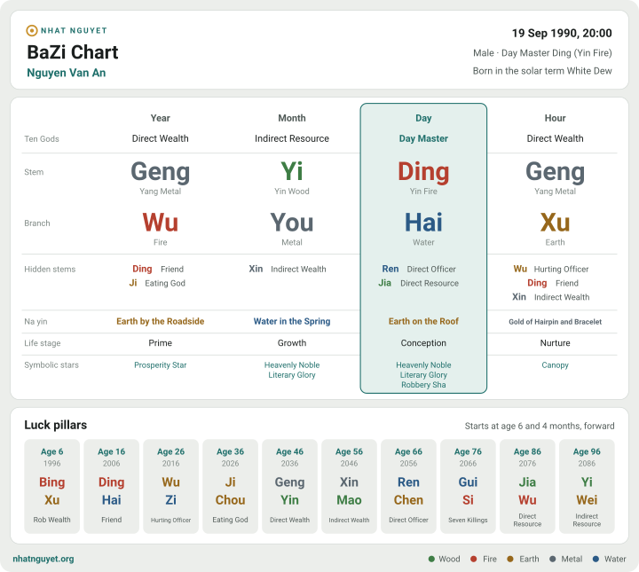
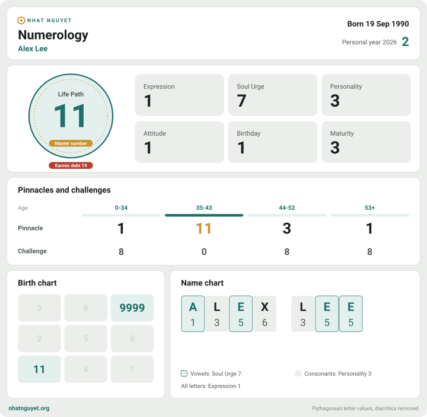
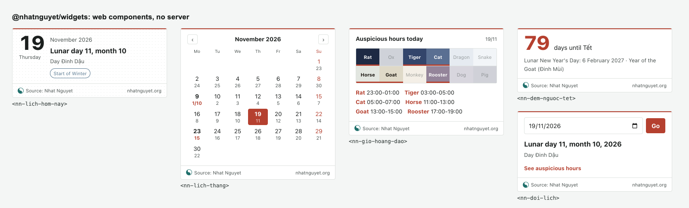

<h1 align="center">Nhat Nguyet</h1>

<p align="center">
  <b>Le calendrier lunaire vietnamien n'est pas le calendrier chinois : les bibliothèques courantes donnent une date lunaire vietnamienne fausse pour 2 724 jours entre 1900 et 2100.</b><br>
  Zi Wei Dou Shu, BaZi, numérologie, fêtes et heures fastes sur le bon calendrier, en JavaScript, en Python et via MCP · 3,6 millions de thèmes ouverts dont les lectures citent les classiques, livre et chapitre · résultats en English, Tiếng Việt, 中文 · 17 291 vecteurs de test partagés
</p>

<p align="center">
  <a href="./README.md">English</a> · <a href="./README.vi.md">Tiếng Việt</a> · <a href="./README.zh.md">中文</a> · <a href="./README.ja.md">日本語</a> · <a href="./README.ko.md">한국어</a> · <b>Français</b> · <a href="./README.th.md">ไทย</a>
  <br>
  <a href="https://nhatnguyet.org/en/ma-nguon-mo/thu">Bac à sable</a> ·
  <a href="https://nhatnguyet.org/en/ma-nguon-mo/tai-lieu">Documentation</a> ·
  <a href="./docs/paper/paper.pdf">Article</a> ·
  <a href="https://huggingface.co/nhatnguyet">Hugging Face</a> ·
  <a href="https://nhatnguyet.org/en/ma-nguon-mo">Page du projet</a>
</p>

<p align="center">
  <picture>
    <source media="(prefers-color-scheme: dark)" srcset="./assets/la-so-tu-vi-toi.svg">
    
  </picture>
</p>

<p align="center">
  <a href="https://www.npmjs.com/package/@nhatnguyet/ziwei"></a>
  <a href="https://pypi.org/project/nhatnguyet/"></a>
  <a href="./ca-kiem"></a>
  <a href="https://github.com/Nhat-Nguyet/nhatnguyet-lunar-ziwei-bazi-numerology/actions/workflows/kiem.yml"></a>
  <a href="./LICENSE"></a>
  <a href="./DATA-LICENSE"></a>
  <a href="https://doi.org/10.5281/zenodo.24358013"></a>
</p>

## Démarrage rapide

**JavaScript, TypeScript** (Node 18+, navigateurs)

```bash
npm i @nhatnguyet/ziwei @nhatnguyet/lunar
```

```js
import { writeFileSync } from "node:fs";
import { castZiWei } from "@nhatnguyet/ziwei";
import { toLunar } from "@nhatnguyet/lunar";

const chart = castZiWei({ name: "Nguyen Van An", date: "1990-09-19", time: "20:00", gender: "male" });
const life = chart.palaces[chart.lifePalace];
console.log(chart.bureau.name, "|", life.name, life.branch, "|", life.stars[0].name, life.stars[0].brightness);
writeFileSync("chart.svg", chart.toSvg());   // the chart image above

// Same day, two calendars: Tết in Vietnam, still the 12th month in China
const vn = toLunar("1985-01-21");
const cn = toLunar("1985-01-21", { country: "CN" });
console.log(vn.day, vn.month, vn.year, vn.yearName, "|", cn.day, cn.month, cn.year, cn.yearName);
```

```text
Earth Five | Life Palace Hai | Moon Exalted
1 1 1985 Yi Chou | 1 12 1984 Jia Zi
```

**Python** (3.9+, bibliothèque standard uniquement) : mêmes résultats, même SVG à l'octet près.

```bash
pip install nhatnguyet
```

<!-- run: same-output -->
```python
from nhatnguyet import cast_zi_wei, to_lunar, zi_wei_svg

chart = cast_zi_wei(name="Nguyen Van An", date="1990-09-19", time="20:00", gender="male")
life = chart["palaces"][chart["lifePalace"]]
print(chart["bureau"]["name"], "|", life["name"], life["branch"], "|", life["stars"][0]["name"], life["stars"][0]["brightness"])
open("chart.svg", "w", encoding="utf-8").write(zi_wei_svg(chart))

vn = to_lunar("1985-01-21")
cn = to_lunar("1985-01-21", country="CN")
print(vn["day"], vn["month"], vn["year"], vn["yearName"], "|", cn["day"], cn["month"], cn["year"], cn["yearName"])
```

**Ligne de commande** : sans installation avec `npx`, ou `nhatnguyet ...` après `pip install nhatnguyet`.

<p align="center"></p>

```bash
npx @nhatnguyet/cli ziwei 1990-09-19 20:00 male --year 2026
```

<details>
<summary>Sortie (les 12 palais sous forme de grille, puis l'année, les périodes décennales, les configurations)</summary>

```text
┌────────────────────┬────────────────────┬────────────────────┬────────────────────┐
│ Travel             │ Health             │ Wealth · Body      │ Children           │
│ Xin Si             │ Ren Wu Jie Kong    │ Gui Wei Jie Kong   │ Jia Shen           │
│ Celestial Mechanism│ Purple Star Ex     │ Spinning Top,      │ Army Breaker We    │
│   Pr               │ Celestial Leader,  │ Celestial Void     │ Prosperity,        │
│ Celestial Talent,  │ Celestial Fortune, │ Nurture            │ Celestial Horse,   │
│ Bell Star,         │ Celestial Messen…  │                    │ Celestial Charm,   │
│ Shattering Star    │ Conception         │                    │ Celestial Physic…, │
│ Extinction         │                    │                    │ Solitary Star,     │
│                    │                    │                    │ Flowing Haze       │
│                    │                    │                    │ Growth             │
├────────────────────┼────────────────────┴────────────────────┼────────────────────┤
│ Friends/Subordinat…│                                         │ Spouse             │
│ Geng Chen          │                                         │ Yi You             │
│ Seven Killings We  │                                         │ Sword Ram,         │
│ Phoenix Pavilion,  │                                         │ Earthly Robber,    │
│ Celestial Punish…, │                                         │ Dipper Lord,       │
│ State Seal,        │                                         │ Red Phoenix        │
│ Releasing Spirit,  │                                         │ Bathing            │
│ Terrace Aide,      │                                         │                    │
│ Celestial Injury,  │                                         │                    │
│ Celestial Net,     │          ZI WEI DOU SHU CHART           │                    │
│ Widow Star         │       Born 1990-09-19 20:00 (Xu)        │                    │
│ Tomb               │       Lunar 1990-08-01 · Geng Wu        │                    │
├────────────────────┤                Yang Male                ├────────────────────┤
│ Career             │           Bureau: Earth Five            │ Siblings           │
│ Ji Mao             │      Na yin: Earth by the Roadside      │ Bing Xu Xun Kong   │
│ Sun Pr Lu          │          Life: Hai · Body: Wei          │ Purity Ex          │
│ Celestial Beam Pr  │                                         │ Celestial Treasury │
│ Right Assistant,   │                                         │   Pr               │
│ Peach Blossom,     │                                         │ Dragon Pool,       │
│ Eight Seats,       │                                         │ Earthly Snare,     │
│ Celestial Nobili…, │                                         │ Canopy             │
│ Celestial Virtue,  │                                         │ Youth              │
│ Celestial Joy,     │                                         │                    │
│ Celestial Release  │                                         │                    │
│ Death              │                                         │                    │
├────────────────────┼────────────────────┬────────────────────┼────────────────────┤
│ Property           │ Fortune/Virtue     │ Parents            │ Life Palace        │
│ Wu Yin             │ Ji Chou            │ Wu Zi              │ Ding Hai Xun Kong  │
│ Military Song      │ Celestial Blessing │ Greedy Wolf We     │ Moon Ex Ji         │
│   Pr Quan          │   We Ke            │ Literary Glory,    │ Left Assistant,    │
│ Celestial Minister │ Giant Gate We      │ Celestial Weeping, │ Three Terraces,    │
│   Ex               │ Earthly Void,      │ Celestial Emptin…, │ Grace Light,       │
│ Celestial Halberd, │ Celestial Longev…, │ Patent of Honour   │ Celestial Offici…, │
│ Literary Melody,   │ Court Tally        │ Peak               │ Fire Star,         │
│ Earthly Release,   │ Decline            │                    │ Monthly Virtue,    │
│ Celestial Kitchen  │                    │                    │ Robbery Sha,       │
│ Illness            │                    │                    │ Annual Literary …  │
│                    │                    │                    │ Prime              │
└────────────────────┴────────────────────┴────────────────────┴────────────────────┘
Brightness: Ex exalted, Pr prosperous, Fa favorable, Ne neutral, We weak. Ages are East
Asian ages (1 at birth).

Year 2026 (Bing Wu)
  age 37 · Year palace: Health · Minor limit: Friends/Subordinates ·
  Decade: Property (35-44) · Hua Lu: Celestial Blessing → Fortune/Virtue ·
  Hua Quan: Celestial Mechanism → Travel · Hua Ke: Literary Glory → Parents ·
  Hua Ji: Purity → Siblings

Ten-year periods
    5-14  1994-2003  Life Palace (Hai)  Moon
   15-24  2004-2013  Parents (Zi)  Greedy Wolf
   25-34  2014-2023  Fortune/Virtue (Chou)  Celestial Blessing, Giant Gate
   35-44  2024-2033  Property (Yin)  Military Song, Celestial Minister
   45-54  2034-2043  Career (Mao)  Sun, Celestial Beam
   55-64  2044-2053  Friends/Subordinates (Chen)  Seven Killings
   65-74  2054-2063  Travel (Si)  Celestial Mechanism
   75-84  2064-2073  Health (Wu)  Purple Star
   85-94  2074-2083  Wealth (Wei)  -
   95-104 2084-2093  Children (Shen)  Army Breaker
  105-114 2094-2103  Spouse (You)  -
  115-124 2104-2113  Siblings (Xu)  Purity, Celestial Treasury

Patterns
  Mechanism, Moon, Blessing and Beam 機月同梁 · Life Palace
  Left and Right Assistants Meeting 左右同會 · Life Palace
  Sun Rising from Fusang 日出扶桑 · Career
  Moon Setting in the Hai Palace 月落亥宮 · Life Palace

Birth time 20:00 falls in the Xu double hour (19:00-20:59). The lunar date follows the
Vietnamese calendar (UTC+7).
```

</details>

Autres commandes : `bazi`, `lunar`, `solar`, `terms`, `numerology`, `festivals` (`--ics` pour un fichier de calendrier), `hours` ; `--lang vi|zh`, `--json`, `--svg chart.svg`, et les options d'école décrites plus bas. API complète en anglais, avec toutes les options : [docs/api-en.md](./docs/api-en.md).

## Sommaire

1. [Pourquoi lui faire confiance](#pourquoi-lui-faire-confiance)
2. [Installation](#installation)
3. [Fonctionnalités](#fonctionnalités)
4. [Jeux de données](#jeux-de-données)
5. [Pour les IA](#pour-les-ia)
6. [Widgets](#widgets)
7. [Exemples et documentation](#exemples-et-documentation)
8. [Migrer depuis iztro](#migrer-depuis-iztro)
9. [FAQ](#faq)
10. [Contribuer](#contribuer)
11. [Citation et licence](#citation-et-licence)

## Pourquoi lui faire confiance

**La science est dans la méthode, pas dans les prédictions.** Le calendrier
relève de l'astronomie, et il est vérifié par rapport à la NASA et à l'IMCCE de
1900 à 2100 :

| Vérification | Résultat |
|---|---|
| Nouvelles lunes par rapport à la NASA (2 474) | 0,9 min de retard en moyenne, 3,9 min au maximum |
| Mois lunaires reconstruits à partir des nouvelles lunes de la NASA et des termes solaires de l'IMCCE | 2 459 sur 2 461 concordent (pour les deux autres, la nouvelle lune tombe à moins d'une minute de minuit) |
| Termes solaires par rapport à l'IMCCE (4 824) | 0,27 min d'écart en moyenne, 0,9 min au maximum (arrondi à la minute), chaque terme tombe le bon jour |
| Vietnam (UTC+7) et Chine (UTC+8), mêmes règles | 2 814 jours et 10 dates du Tết diffèrent |

- **Article technique** : [Computing the Vietnamese lunisolar calendar](./docs/paper/paper.pdf)
  (PDF) présente la méthode, le budget d'erreur, la vérification par rapport à
  la NASA, à l'IMCCE et à JPL DE440, et une explication pour chaque jour où les
  calendriers vietnamien et chinois diffèrent. Chacun de ses chiffres est
  recalculé par `docs/paper/reproduce.sh`.
- **Vecteurs de test partagés** : [`ca-kiem/`](./ca-kiem) contient **17 291 cas de base**
  (entrée `vao`, sortie attendue `ra`) générés par le moteur de référence qui
  fait tourner [nhatnguyet.org](https://nhatnguyet.org) : 14 936 cas de
  calendrier, 777 thèmes Zi Wei, 777 thèmes BaZi, 600 profils numérologiques et
  201 années de fêtes, plus 432 cas pour les options d'école et 1 096 jours
  d'heures fastes (18 819 au total). TypeScript et Python les passent tous à
  chaque push.
- **Histoire du Tết** : [`history/`](./history/README.md) donne le Tết de chaque
  année de 1900 à 2100 en UTC+7 et en UTC+8, avec le calendrier réellement
  utilisé au Vietnam et une source pour chaque année documentée.
- **Périmètre honnête** : le Zi Wei Dou Shu, le BaZi et la numérologie sont les
  règles d'écoles traditionnelles, pas une science validée ; ne les utilisez pas
  pour des décisions de santé, d'argent ou d'ordre juridique. Là où les écoles
  divergent, la bibliothèque indique la règle qu'elle suit et vous laisse en
  changer ([options d'école](#options-décole)).

### Comparaison avec les autres bibliothèques

[iztro](https://github.com/SylarLong/iztro) et
[lunar-javascript](https://github.com/6tail/lunar-javascript) sont des
bibliothèques soignées et largement utilisées, et toutes deux sont exactes pour
ce qu'elles implémentent : le calendrier chinois à l'heure de Pékin (UTC+8). Le
Vietnam applique les mêmes règles à l'heure de Hanoï (UTC+7). Comparaison sur
chaque jour de 1900 à 2100 ([doi-chieu/](./doi-chieu/README.md), reproductible
avec `node chay.mjs`) :

| | Résultat |
|---|---:|
| Jours dont la date lunaire diffère de lunar-javascript | 2 724 sur 73 414 |
| Années dont le Tết diffère de lunar-javascript | 9 sur 201 |
| Années dont le mois intercalaire diffère de lunar-javascript | 6 sur 201 |
| Jours qui diffèrent encore de lunar-javascript avec `country: "CN"` | 150 (5 mois) |
| Thèmes Zi Wei (chaque jour × 12 heures) dont le Cục, le palais de la Vie ou une étoile majeure diffère d'iztro | 38 752 sur 880 968 (4,40 %) |
| dont dus au fuseau horaire (iztro utilise l'heure de Pékin même avec `vi-VN`) | 26 602 (3,02 %) |
| dont dus à la règle du mois intercalaire (`fixLeap` d'iztro, une option) | 11 818 (1,34 %) |
| dont ni l'un ni l'autre | 332 (0,04 %) |
| Termes solaires par rapport à l'IMCCE, plus grand écart : Nhat Nguyet / lunar-javascript | 0,9 min / 0,28 min |

**Deux chiffres, deux questions.** Les 2 724 jours et 9 années de Tết
comparent Nhat Nguyet (Vietnam, UTC+7) à lunar-javascript. Les 2 814 jours et
10 années de Tết du tableau ci-dessus comparent le moteur Nhat Nguyet à
lui-même, en UTC+7 et en UTC+8. Ils diffèrent parce que `country: "CN"` n'est
pas identique à lunar-javascript : 150 jours diffèrent encore, un mois en 1914,
1916, 1920, 2057 et 2097. En 1914, 1916 et 1920, lunar-javascript corrige
volontairement les dates antérieures à 1960 pour reproduire les almanachs
chinois de l'époque ; en 2057 et 2097, la nouvelle lune tombe exactement à
minuit à Pékin (16 h 00 UT), trop près pour trancher.

**Les 332 thèmes qui ne relèvent ni du fuseau ni de la règle du mois
intercalaire** tombent tous dans un seul mois, les 30 jours qui commencent le
28 septembre 2057. Sa nouvelle lune est à 16 h 00 UT : Nhat Nguyet la place
juste avant minuit à Pékin et fait commencer le mois le 28 dans les deux
fuseaux ; lunar-javascript (et donc iztro) la place juste après, le 29. C'est le
même cas limite de minuit que ci-dessus, et ni le fuseau ni la règle du mois
intercalaire n'y changent rien.

Exemple : une naissance le 21 janvier 1985, à l'heure Tỵ. iztro donne le 1er
jour du 12e mois de l'année Giáp Tý, Kim Tứ Cục, palais de la Vie en Thân. Nhat
Nguyet donne le Tết, 1er jour de l'année Ất Sửu, Thủy Nhị Cục, palais de la Vie
en Dậu. Passez `country: "CN"` et Nhat Nguyet donne aussi le calendrier
chinois.

## Installation

Version 0.3.0. Les paquets JavaScript sont en ESM, avec types TypeScript et sans
dépendances ; le paquet Python n'utilise que la bibliothèque standard.

```bash
npm i @nhatnguyet/lunar @nhatnguyet/ziwei @nhatnguyet/bazi @nhatnguyet/numerology @nhatnguyet/festivals
pip install nhatnguyet
```

| Paquet | Aussi publié sous | Rôle |
|---|---|---|
| [`@nhatnguyet/lunar`](./js/packages/am-lich) | `@nhatnguyet/am-lich` | Conversion entre calendrier lunaire et calendrier grégorien pour le Vietnam, la Chine, la Corée, le Japon et 7 autres régions ; troncs et branches ; 24 termes solaires à la minute près ; 28 demeures lunaires ; na yin ; heures fastes |
| [`@nhatnguyet/ziwei`](./js/packages/tu-vi) | `@nhatnguyet/tu-vi` | Zi Wei Dou Shu : 12 palais, éclat des étoiles, Quatre Transformations, Tuần et Triệt, périodes décennales et annuelles, étoiles de transit, configurations accompagnées de la ligne classique d'origine, options d'école ; SVG ; texte pour les LLM ; couche compatible avec iztro |
| [`@nhatnguyet/bazi`](./js/packages/bat-tu) | `@nhatnguyet/bat-tu` | BaZi : quatre piliers selon les termes solaires, troncs cachés, Dix Dieux, étoiles symboliques, piliers de chance, petites périodes ; SVG |
| [`@nhatnguyet/numerology`](./js/packages/than-so-hoc) | `@nhatnguyet/than-so-hoc` | Numérologie pythagoricienne (chemin de vie, expression, élan de l'âme, sommets, défis, année personnelle), noms vietnamiens avec diacritiques ; SVG |
| [`@nhatnguyet/festivals`](./js/packages/le-hoi) | `@nhatnguyet/le-hoi` | 206 fêtes vietnamiennes avec leur date pour n'importe quelle année, provinces, groupes ethniques, lieux ; export iCalendar |
| [`@nhatnguyet/cli`](./js/packages/cli) | | Thèmes sous forme de grilles dans le terminal, en JSON, en SVG ou en iCalendar ; les mêmes commandes que `nhatnguyet` en Python |
| [`@nhatnguyet/mcp`](./js/packages/mcp) | | Serveur MCP pour les assistants IA |
| [`@nhatnguyet/widgets`](./js/packages/widgets) | | 5 composants web |
| [`nhatnguyet`](./python) (PyPI) | | Tout ce qui précède dans un seul paquet Python, mêmes résultats champ par champ |

Les paquets aux noms vietnamiens sont le même code sous leurs noms d'origine ;
les imports existants continuent de fonctionner.

## Fonctionnalités

Chaque bibliothèque reproduit, champ par champ, le moteur qui fait tourner
[nhatnguyet.org](https://nhatnguyet.org) et l'application Nhat Nguyet. Aucun
appel réseau. Les résultats sont en anglais (`lang: "en"`, par défaut), en
vietnamien (`"vi"`) ou en chinois (`"zh"`) ; en anglais, les troncs et branches
sont en pinyin par défaut (`terms: "han"` ou `"vi"` pour les caractères chinois
ou le sino-vietnamien).

<table>
  <tr>
    <td align="center" width="33%"><a href="./assets/la-so-tu-vi.svg"><picture><source media="(prefers-color-scheme: dark)" srcset="./assets/la-so-tu-vi-toi.svg"></picture></a><br><sub>Zi Wei Dou Shu · <code>castZiWei().toSvg()</code></sub></td>
    <td align="center" width="33%"><a href="./assets/la-so-bat-tu.svg"><picture><source media="(prefers-color-scheme: dark)" srcset="./assets/la-so-bat-tu-toi.svg"></picture></a><br><sub>BaZi · <code>castBaZi().toSvg()</code></sub></td>
    <td align="center" width="33%"><a href="./assets/than-so-hoc.svg"><picture><source media="(prefers-color-scheme: dark)" srcset="./assets/than-so-hoc-toi.svg"></picture></a><br><sub>Numérologie · <code>numerology().toSvg()</code></sub></td>
  </tr>
</table>

<p align="center"><sub>Chaque image est un SVG dessiné par la bibliothèque ; cliquez pour l'ouvrir en taille réelle.</sub></p>

### Calendrier lunaire et heures fastes

`toLunar`, `toSolar`, `solarTerms` et `auspiciousHours` dans
`@nhatnguyet/lunar` (`to_lunar`, `to_solar`, `solar_terms`,
`auspicious_hours` en Python). Le calendrier est celui du Vietnam (UTC+7),
sauf si vous passez `country` : Chine, Taïwan, Hong Kong, Macao, Singapour,
Malaisie, Indonésie, Philippines (UTC+8) ; Corée, Japon (UTC+9).

`auspiciousHours` donne les douze heures doubles d'une journée, avec
l'indication faste (hoàng đạo) ou néfaste (hắc đạo) et l'esprit qui y préside,
telles que les impriment les almanachs vietnamiens (ligne de commande
`nhatnguyet hours`, outil MCP `auspicious_hours`) :

```js
import { auspiciousHours } from "@nhatnguyet/lunar";

const day = auspiciousHours("2027-02-06");   // Tết 2027
console.log(day.day, "|", day.hours.filter((h) => h.auspicious).map((h) => `${h.branch} ${h.range} ${h.spirit}`).join(", "));
```

```text
Bing Chen | Yin 03:00-04:59 Si Ming, Chen 07:00-08:59 Qing Long, Si 09:00-10:59 Ming Tang, Shen 15:00-16:59 Jin Kui, You 17:00-18:59 Bao Guang, Hai 21:00-22:59 Yu Tang
```

<!-- run: same-output -->
```python
from nhatnguyet import auspicious_hours

day = auspicious_hours("2027-02-06")   # Tết 2027
print(day["day"], "|", ", ".join(f"{h['branch']} {h['range']} {h['spirit']}" for h in day["hours"] if h["auspicious"]))
```

### Zi Wei Dou Shu

`castZiWei` construit le thème complet : palais de la Vie et du Corps, bureau,
les 14 étoiles majeures et 55 étoiles mineures avec leur éclat, les Quatre
Transformations, Tuần et Triệt, les périodes décennales, une année
d'observation avec ses étoiles de transit, et les configurations du Zi Wei Dou
Shu Quan Shu avec la ligne classique d'origine. `chart.toSvg()` le dessine ;
`chartToText` le transforme en Markdown compact pour un modèle de langage. La
couche compatible avec iztro fournit les recherches et l'horoscope :
`palace()`, `star()`, `surroundedPalaces()`, `horoscope()`, `fliesTo()`
([Migrer depuis iztro](#migrer-depuis-iztro)).

### Options d'école

Là où les livres divergent, la bibliothèque choisit une règle par défaut, nomme
le livre qu'elle suit et vous laisse passer à la règle que donne une autre
source nommée ([docs/schools.md](./docs/schools.md)). Les valeurs par défaut ne
changent jamais, et chaque option a ses propres vecteurs de test.

| Option | Valeurs (par défaut en premier) | Ce qui change |
|---|---|---|
| `fireBell` | `vietnamese`, `quanshu`, `swap-for-female`, `swap-for-yin-male-yang-female` | Fire Star et Bell Star |
| `leapMonth` | `whole`, `split-at-15`, `next-month` | le mois retenu pour une naissance dans un mois intercalaire |
| `transformations` | `vietnamese`, `quanshu`, `zhongzhou` | les Quatre Transformations du tronc Geng |
| `heavenlyKitchen` | `vietnamese`, `chinese` | Celestial Kitchen dans une année Gui |
| `injuryMessenger` | `standard`, `zhongzhou` | Celestial Injury et Messenger |
| `ziHour` (BaZi) | `next-day-from-23`, `split-at-midnight` | le pilier du jour d'une naissance entre 23 h 00 et 24 h 00 |

```js
import { castZiWei } from "@nhatnguyet/ziwei";

const opts = { date: "1990-09-19", time: "20:00", gender: "male" };
const where = (chart, star) => chart.palaces.find((p) => p.stars.some((s) => s.name === star)).branch;
const viet = castZiWei(opts);
const quanshu = castZiWei({ ...opts, schools: { fireBell: "quanshu" } });
console.log("Bell Star:", where(viet, "Bell Star"), "|", where(quanshu, "Bell Star"));
console.log(quanshu.notes.at(-1));
```

```text
Bell Star: Si | Chou
School options (not the default): Fire and Bell stars: both forward (Quan Shu).
```

<!-- run: same-output -->
```python
from nhatnguyet import cast_zi_wei

opts = dict(date="1990-09-19", time="20:00", gender="male")
where = lambda chart, star: next(p["branch"] for p in chart["palaces"] if any(s["name"] == star for s in p["stars"]))
viet = cast_zi_wei(**opts)
quanshu = cast_zi_wei(**opts, schools={"fire_bell": "quanshu"})
print("Bell Star:", where(viet, "Bell Star"), "|", where(quanshu, "Bell Star"))
print(quanshu["notes"][-1])
```

En ligne de commande : `--fire-bell quanshu`, `--leap-month split-at-15`,
`--zi-hour split-at-midnight`... Comparé à iztro 2.6.5 sur 610 thèmes,
`{ fireBell: "quanshu", transformations: "quanshu", heavenlyKitchen: "chinese" }`
ramène à 0 les écarts sur les positions de Fire et Bell (484 différences), les
transformations des années Geng (126) et la Celestial Kitchen des années Gui
(59).

### BaZi et numérologie

`castBaZi` prend l'année à Lập Xuân (début du printemps) et le mois à chaque
terme sectionnel, à la minute près ; il donne les troncs cachés, les Dix Dieux,
les douze stades, les étoiles symboliques, les piliers de chance et les petites
périodes. `numerology` suit la méthode pythagoricienne et supprime les
diacritiques vietnamiens (« Đ » compte comme « D »), en conservant les nombres
maîtres 11, 22 et 33.

### Fêtes

`festivals(year)` dans `@nhatnguyet/festivals` donne les 164 fêtes à date
lunaire ou grégorienne fixe pour n'importe quelle année de 1900 à 2100, sur les
206 du jeu de données (les 42 autres sont datées chaque année par leurs
organisateurs). Chacune a sa province sur la carte de 2025 à 34 provinces, le
groupe ethnique dont c'est la fête lorsque la description le précise, et ses
lieux, avec des coordonnées seulement lorsqu'une source les donne. `group`,
`scope` et `level` sont des codes anglais dans toutes les langues.
`festivalsIcs(year)` écrit un fichier iCalendar (RFC 5545) avec un événement
sur la journée entière par fête.

```js
import { writeFileSync } from "node:fs";
import { festivals, festivalsIcs } from "@nhatnguyet/festivals";

const f = festivals(2027).find((x) => x.id === "khai-hoi-chua-bai-dinh");
const venue = f.venues[0];
console.log(f.date, f.name, "|", f.provinces[0].name, "|", venue.name, venue.coordinates.lat, venue.coordinates.lon);
writeFileSync("vietnam-festivals-2027.ics", festivalsIcs(2027));
```

```text
2027-02-11 Bái Đính Pagoda Festival Opening | Ninh Bình | Bái Đính Pagoda 20.276944 105.862778
```

<!-- run: same-output -->
```python
from nhatnguyet import festivals
from nhatnguyet.en import festivals_ics

f = next(x for x in festivals(2027) if x["id"] == "khai-hoi-chua-bai-dinh")
venue = f["venues"][0]
print(f["date"], f["name"], "|", f["provinces"][0]["name"], "|", venue["name"], venue["coordinates"]["lat"], venue["coordinates"]["lon"])
open("vietnam-festivals-2027.ics", "w", encoding="utf-8", newline="").write(festivals_ics(2027))
```

Le même fichier en ligne de commande : `nhatnguyet festivals 2027 --ics > vn.ics`.

## Jeux de données

Sous CC BY 4.0, utilisables dans des produits commerciaux et pour
l'entraînement d'IA, avec attribution.

| Jeu de données | Contenu | Taille |
|---|---|---:|
| [`nhatnguyet/ziwei-readings`](https://huggingface.co/datasets/nhatnguyet/ziwei-readings) | 1 761 936 thèmes Zi Wei avec interprétations : chaque jour de 1900 à 2100 × 12 heures × 2 sexes | 10,37 Go |
| [`nhatnguyet/bazi-readings`](https://huggingface.co/datasets/nhatnguyet/bazi-readings) | 1 761 936 thèmes BaZi avec interprétations, même période | 1,56 Go |
| [`nhatnguyet/numerology-readings`](https://huggingface.co/datasets/nhatnguyet/numerology-readings) | 73 414 profils numérologiques, un par date de naissance | 0,08 Go |
| [`nhatnguyet/ziwei-knowledge`](https://huggingface.co/datasets/nhatnguyet/ziwei-knowledge) | 2 787 unités de connaissance (une étoile dans un palais, une configuration...) avec le texte du site en trois langues et 885 passages classiques | |
| [`nhatnguyet/bazi-knowledge`](https://huggingface.co/datasets/nhatnguyet/bazi-knowledge) | 973 unités (maître du jour selon le mois, pilier du jour et heure, Dix Dieux...), 1 589 passages classiques | |
| [`nhatnguyet/numerology-knowledge`](https://huggingface.co/datasets/nhatnguyet/numerology-knowledge) | 143 unités (nombres principaux, nombres de cycle, thèmes de vie), 195 passages | |
| [`nhatnguyet/sach-co`](https://huggingface.co/datasets/nhatnguyet/sach-co) | 373 textes classiques du domaine public (environ 350 œuvres), 72,7 millions de caractères, texte intégral | 147 Mo de texte, 70 Mo en Parquet |
| [`nhatnguyet/classical-parallel`](https://huggingface.co/datasets/nhatnguyet/classical-parallel) | 1 328 segments alignés du Yi King : chinois classique avec des traductions anglaises (952) et françaises (376) du domaine public | |
| [Terminologie](./du-lieu/terminology/README.md) | 428 termes en vietnamien, en chinois traditionnel et simplifié, en pinyin et en anglais, tous les noms que produisent les bibliothèques | |
| [Jeu d'évaluation IA](./ai-eval/README.md) | 1 520 questions calculées en anglais, vietnamien et chinois (dates lunaires, Tết, piliers, thèmes), dont 626 (41 %) sont des cas difficiles | |
| [Le Tết de 1900 à 2100](./history/README.md) | Le Tết en UTC+7 et en UTC+8 sur 201 années, avec le calendrier réellement utilisé et les sources | |
| [33 jeux de données sur le calendrier et la culture](https://nhatnguyet.org/en/du-lieu) | calendrier luni-solaire de 1900 à 2100, termes solaires, 64 hexagrammes, 78 cartes de tarot, 206 fêtes, 456 prières rituelles... en CSV, JSON et Parquet, avec un [DOI](https://doi.org/10.5281/zenodo.23009396) | |

Les trois jeux de données d'interprétations totalisent **3 597 286 thèmes,
12,02 Go compressés**, en trois parties : les thèmes structurés avec les
identifiants d'interprétation (`charts/`, 1,55 Go), le texte intégral
préassemblé par langue (`assembled/<system>/<en|vi|zh>/`, 10,42 Go) et le magasin de
textes, où chaque interprétation, citation classique et article n'est conservé
qu'une seule fois (`store/`, 0,04 Go). Les interprétations citent les
classiques avec le livre et le chapitre. Il y a un fichier par année de
naissance. **Décompressés, ils sont très volumineux** (le texte se répète d'un
thème à l'autre : une année de texte Zi Wei préassemblé pèse environ 2,7 Go par
langue), lisez-les donc en flux ou téléchargez-les une année à la fois.

Les jeux de données de connaissances en sont la version compacte : une ligne
par unité, avec les mêmes identifiants de texte que les interprétations, les
passages du domaine public que le moteur d'interprétation consulte pour cette
unité, et les identifiants de règles. Les textes classiques : 306 en chinois
classique, 36 en anglais, 20 en français, 11 en vietnamien ; par thème, 192 sur
le Yi King et la divination, 24 croyances et rites, 22 histoire et culture
vietnamiennes, 21 numérologie, 20 les Trois Arts, 19 calendrier et choix des
jours, 17 BaZi et destinée, 16 feng shui, 14 bouddhisme, 13 physiognomonie, 7
astrologie et tarot, 6 Zi Wei, 2 divers. 38 sont des textes issus d'OCR et
portent l'indicateur `ocr`. Chaque texte a un champ `pd_basis` qui indique
pourquoi il est dans le domaine public. Par choix du propriétaire, `sach-co`
désigne chaque texte par un code neutre (`sc-0416`) plutôt que par son titre
et son auteur ; les jeux de connaissances et le stock de lectures donnent le
titre et l'auteur de chaque passage qu'ils citent.

```python
from datasets import load_dataset

units = load_dataset("nhatnguyet/ziwei-knowledge", "major-star-in-palace", split="train")
row = units[0]
print(len(units), row["unit_id"])
print(row["classical"][0]["book_title_original"], "|", row["classical"][0]["classical_text"][:20])

books = load_dataset("nhatnguyet/sach-co", split="train")
print(len(books), sum(books["characters"]))
```

```text
2016 major-star-in-palace/zi-wei.life.zi
紫微斗数全书 | 子宫喜丁己庚生人贵格，壬癸生人不耐久。
373 72650969
```

## Pour les IA

Les modèles de langage ne devraient pas calculer de tête les dates lunaires ni
la position des étoiles. Quatre façons de leur fournir les chiffres :

- **Serveur MCP**, exécuté en local, avec les outils `lunar_convert`,
  `solar_terms`, `auspicious_hours`, `cast_ziwei`, `cast_bazi`, `numerology`,
  `festivals`, `render_chart_svg` (options d'école comprises) :
  `claude mcp add nhatnguyet -- npx -y @nhatnguyet/mcp`. Configuration pour
  Claude Desktop, Cursor et VS Code : [js/packages/mcp](./js/packages/mcp/README.md).
- **Agent Skill** qui demande à un assistant d'appeler les outils au lieu de
  deviner : [skills/](./skills/README.md).
- **`chartToText`** (`chart_to_text` en Python) transforme un thème en Markdown
  compact à insérer dans un prompt :

  ```js
  import { castZiWei, chartToText } from "@nhatnguyet/ziwei";

  const chart = castZiWei({ date: "1990-09-19", time: "20:00", gender: "male" });
  console.log(chartToText(chart, { detail: "summary" }));
  ```

  ```text
  # Zi Wei Dou Shu chart

  Computed data only, no interpretation.

  - Gender: male
  - Birth date (Gregorian): 1990-09-19 20:00
  - Birth hour: Xu (19:00-20:59)
  - Birth date (lunar): 1990-08-01
  - Year pillar: Geng Wu
  - Yin-yang: Yang Male
  - Bureau: Earth Five (5)
  ...
  ```

- **Données** : le [jeu d'évaluation IA](./ai-eval/README.md) mesure à quelle
  fréquence un modèle donne ces faits correctement avec et sans les outils
  (`ai-eval/score.py`) ; la [terminologie](./du-lieu/terminology/README.md)
  fait correspondre chaque terme entre vietnamien, chinois et anglais ; les
  [jeux de données](#jeux-de-données) servent à l'entraînement et à la
  recherche documentaire.

## Widgets

<p align="center"></p>

[`@nhatnguyet/widgets`](./js/packages/widgets) regroupe 5 composants web
(date du jour, calendrier mensuel, heures fastes, compte à rebours du Tết,
convertisseur de dates) qui tournent dans le navigateur du lecteur : code
ouvert dans ce dépôt, sans serveur ni appel réseau, thèmes clair et sombre, en
anglais, vietnamien et chinois.

```html
<script type="module" src="https://cdn.jsdelivr.net/npm/@nhatnguyet/widgets/dist/nn-widgets.js"></script>
<nn-lich-thang lang="en" theme="auto" country="VN"></nn-lich-thang>
```

`country` (`VN` par défaut, `CN`, `KR`, `JP`...) passe au calendrier lunaire
d'un autre pays. Attributs et aperçus : [widgets/](./widgets/README.md).

nhatnguyet.org propose aussi 14 widgets intégrés par iframe (glossaire, jours
favorables, résultats de loterie...) ; c'est un service du site, pas du code
ouvert de ce dépôt : [nhatnguyet.org/widget](https://nhatnguyet.org/en/widget).

## Exemples et documentation

- **Bac à sable** : [nhatnguyet.org/en/ma-nguon-mo/thu](https://nhatnguyet.org/en/ma-nguon-mo/thu), exécute les paquets dans votre navigateur.
- **Documentation de l'API** : [nhatnguyet.org/en/ma-nguon-mo/tai-lieu](https://nhatnguyet.org/en/ma-nguon-mo/tai-lieu) et [docs/api-en.md](./docs/api-en.md).
- **Guides** : [établir un thème Tử Vi en JavaScript](https://nhatnguyet.org/en/blog/lap-la-so-tu-vi-bang-javascript) · [calendrier lunaire et fêtes pour votre application](https://nhatnguyet.org/en/blog/lich-am-le-hoi-cho-ung-dung) · [un assistant IA qui cite les classiques](https://nhatnguyet.org/en/blog/tro-ly-ai-trich-dan-sach-co) · [analyser des données de thèmes avec Python](https://nhatnguyet.org/en/blog/phan-tich-du-lieu-la-so-bang-python).
- **Contexte** : [calendrier lunaire et termes solaires](https://nhatnguyet.org/en/blog/co-so-khoa-hoc-am-lich-tiet-khi) ·
  [thème Zi Wei](https://nhatnguyet.org/en/blog/co-so-khoa-hoc-la-so-tu-vi) ·
  [BaZi](https://nhatnguyet.org/en/blog/co-so-khoa-hoc-bat-tu) ·
  [numérologie](https://nhatnguyet.org/en/blog/co-so-khoa-hoc-than-so-hoc) ·
  [textes classiques et interprétations](https://nhatnguyet.org/en/blog/co-so-khoa-hoc-sach-co-loi-luan) ·
  [comment Nhat Nguyet vérifie son travail](https://nhatnguyet.org/en/blog/co-so-khoa-hoc-kiem-chung).

[`examples/`](./examples/README.md) propose des essais rapides (une page HTML
sans étape de build, Node, Python) et quatre modèles à copier :

| Modèle | Ce que c'est |
|---|---|
| [`nextjs-lunar-calendar`](./examples/nextjs-lunar-calendar) | Page Next.js (export statique) : grille mensuelle avec dates lunaires et termes solaires, compte à rebours du Tết, thème Zi Wei à partir d'un formulaire |
| [`telegram-bot`](./examples/telegram-bot) | Bot grammY : `/today`, `/tet`, `/ziwei`, réponses en anglais, vietnamien ou chinois |
| [`google-sheets`](./examples/google-sheets) | `=LUNARDATE()`, `=SEXAGENARY()`, `=SOLARTERM()`, `=SOLARDATE()` dans un seul fichier `Code.gs` |
| [`jupyter`](./examples/jupyter) | Notebook : Tết, mois lunaires et mois intercalaires au Vietnam et en Chine, de 1900 à 2100, avec graphiques |

## Migrer depuis iztro

`@nhatnguyet/ziwei/iztro` est **compatible** avec iztro : `astro.bySolar` et
`astro.byLunar` prennent les mêmes paramètres et renvoient un JSON de même
forme que le `FunctionalAstrolabe` d'iztro, avec ses six langues d'affichage et
ses méthodes (`palace()`, `star()`, `surroundedPalaces()`, `horoscope()`,
`fliesTo()`, `use()`...), mais calculé sur le calendrier vietnamien
(`{ country: "CN" }` pour l'heure de Pékin).

```diff
- import { astro } from "iztro";
+ import { astro } from "@nhatnguyet/ziwei/iztro";
```

Mesurés par rapport à iztro sur 2 006 horoscopes, les palais de la décennie, de
l'âge et de l'année ainsi que les positions annuelles des étoiles concordent ;
chaque différence restante (les transformations des années Geng, la règle du
mois intercalaire, deux mois dont la nouvelle lune tombe à minuit à Pékin) est
comptée et expliquée. Quelques placements suivent volontairement ces livres :
éclat des étoiles majeures sur cinq niveaux (sept chez iztro), Tiangui, ainsi
que Kui et Yue des années Geng. Non placés : cinq étoiles adjectives qu'on ne
trouve que dans des textes chinois, le cycle Jiang Xing, et les étoiles mobiles
de la décennie et du mois. Passez les options d'école ci-dessus pour suivre
iztro sur Fire et Bell, les transformations Geng et la Celestial Kitchen. Liste
complète : [docs/chuyen-tu-iztro.md](./docs/chuyen-tu-iztro.md).

## FAQ

<details>
<summary><b>Pourquoi le calendrier lunaire vietnamien diffère-t-il du calendrier chinois ?</b></summary>

Mêmes règles, horloge différente. Un mois commence le jour de la nouvelle lune,
et ce jour se décide en heure locale. Quand une nouvelle lune tombe entre
16 h 00 et 17 h 00 UT, il est encore avant minuit à Hanoï mais déjà après
minuit à Pékin : le mois commence donc un jour plus tôt au Vietnam. Le Tết 1985
tombe à un mois entier d'écart (le 21 janvier au Vietnam, le 20 février en
Chine), parce que le mois intercalaire tombe une année différente.
</details>

<details>
<summary><b>Quelle est l'heure Tý, et quelle date retient-on pour une naissance à 23 h 30 ?</b></summary>

L'heure Tý va de 23 h 00 à 0 h 59. Le Zi Wei garde la date saisie (certains
livres la reportent au lendemain ; saisissez la date du lendemain pour les
suivre). Le BaZi change de pilier du jour à 23 h 00, ou à minuit avec
`schools: { ziHour: "split-at-midnight" }`. Les deux règles sont indiquées dans
les `notes` du thème.
</details>

<details>
<summary><b>Le pilier du mois du BaZi suit-il le mois lunaire ou les termes solaires ?</b></summary>

Les termes solaires : l'année change à Lập Xuân (début du printemps), le mois à
chaque terme sectionnel. Prendre le mois lunaire à la place donne un pilier du
mois différent pour environ un quart des jours (24,3 % de 1900 à 2100).
</details>

<details>
<summary><b>Puis-je utiliser les données pour entraîner un modèle d'IA ?</b></summary>

Oui, y compris à des fins commerciales, sous CC BY 4.0. Créditez « Data: Nhat
Nguyet (nhatnguyet.org) ».
</details>

<details>
<summary><b>Comment les noms vietnamiens sont-ils traités en numérologie ?</b></summary>

Les diacritiques sont supprimés (« Đ » compte comme « D »), puis la table
pythagoricienne des lettres est appliquée. Les nombres maîtres 11, 22 et 33
sont conservés.
</details>

## Contribuer

Les signalements de bugs accompagnés d'une source (un livre et un chapitre, ou
des données astronomiques) sont les plus utiles ; voir
[CONTRIBUTING.md](./CONTRIBUTING.md).

**Défi de portage** : écrivez le moteur dans un autre langage (Go, Rust, Dart,
Swift, C#...) et passez les 17 291 vecteurs de test de [`ca-kiem/`](./ca-kiem).
Lisez `vao`, comparez avec `ra` ; les règles se trouvent dans
[CONTRIBUTING.md](./CONTRIBUTING.md#port-challenge).

## Citation et licence

| Partie | Licence |
|---|---|
| Code | [MIT](./LICENSE) |
| Données, interprétations, vecteurs de test | [CC BY 4.0](./DATA-LICENSE) : usage commercial et entraînement d'IA autorisés, attribution obligatoire |
| Textes classiques | Originaux dans le domaine public ; la numérisation et le nettoyage sont sous CC BY 4.0 |

Ligne d'attribution : `Data: Nhat Nguyet (nhatnguyet.org)`, avec un lien
lorsque c'est possible. Le nom et le logo Nhat Nguyet ne sont pas couverts par
ces licences. Pour citer le logiciel (la méthode de calcul du calendrier est
décrite dans l'[article technique](./docs/paper/paper.pdf)) :

```bibtex
@software{nhatnguyet_2026,
  author = {{Nhat Nguyet}},
  title  = {Nhat Nguyet: open source code and data for Zi Wei Dou Shu, BaZi and numerology},
  year   = {2026},
  url    = {https://nhatnguyet.org/en/ma-nguon-mo},
  doi    = {10.5281/zenodo.24358013}
}
```

Site web : [nhatnguyet.org](https://nhatnguyet.org) · E-mail : lienhe@nhatnguyet.org

<p align="center"><sub>Données : Nhat Nguyet (nhatnguyet.org) · Code MIT · Données CC BY 4.0</sub></p>
