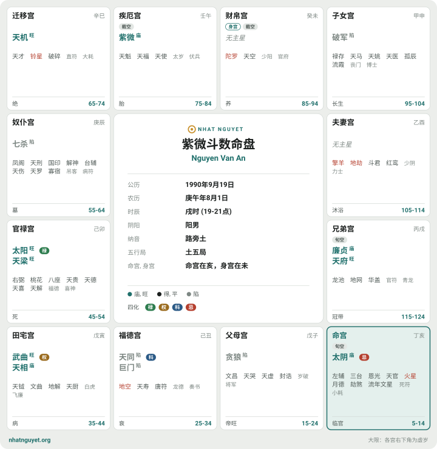
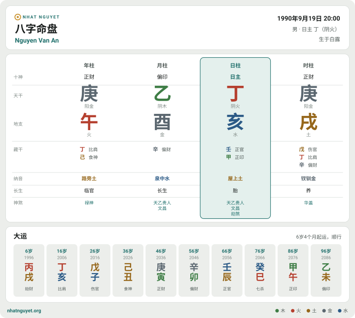
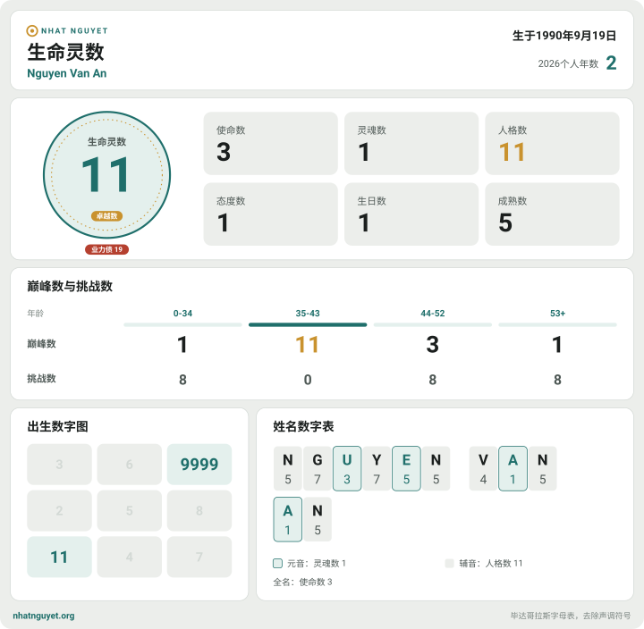

<h1 align="center">Nhat Nguyet</h1>

<p align="center">
  <b>ベトナムの旧暦は中国の旧暦ではありません。広く使われているライブラリは、1900年から2100年のうち 2,724日でベトナム旧暦の日付を誤ります。</b><br>
  正しい暦で計算する紫微斗数、四柱推命、数秘術、祭礼、吉時を JavaScript、Python、MCP で · 古典を書名と章つきで引用する解釈つきの公開命盤 360万件 · 出力は English、Tiếng Việt、中文 · 共通テストベクター 17,291件
</p>

<p align="center">
  <a href="./README.md">English</a> · <a href="./README.vi.md">Tiếng Việt</a> · <a href="./README.zh.md">中文</a> · <b>日本語</b> · <a href="./README.ko.md">한국어</a> · <a href="./README.fr.md">Français</a> · <a href="./README.th.md">ไทย</a>
  <br>
  <a href="https://nhatnguyet.org/en/ma-nguon-mo/thu">プレイグラウンド</a> ·
  <a href="https://nhatnguyet.org/en/ma-nguon-mo/tai-lieu">ドキュメント</a> ·
  <a href="./docs/paper/paper.pdf">論文</a> ·
  <a href="https://huggingface.co/nhatnguyet">Hugging Face</a> ·
  <a href="https://nhatnguyet.org/en/ma-nguon-mo">プロジェクトページ</a>
</p>

<p align="center">
  <picture>
    <source media="(prefers-color-scheme: dark)" srcset="./assets/la-so-tu-vi-zh-toi.svg">
    
  </picture>
</p>

<p align="center">
  <a href="https://www.npmjs.com/package/@nhatnguyet/ziwei"></a>
  <a href="https://pypi.org/project/nhatnguyet/"></a>
  <a href="./ca-kiem"></a>
  <a href="https://github.com/Nhat-Nguyet/nhatnguyet-lunar-ziwei-bazi-numerology/actions/workflows/kiem.yml"></a>
  <a href="./LICENSE"></a>
  <a href="./DATA-LICENSE"></a>
  <a href="https://doi.org/10.5281/zenodo.24358013"></a>
</p>

## クイックスタート

**JavaScript、TypeScript**（Node 18 以上、ブラウザ）

```bash
npm i @nhatnguyet/ziwei @nhatnguyet/lunar
```

```js
import { writeFileSync } from "node:fs";
import { castZiWei } from "@nhatnguyet/ziwei";
import { toLunar } from "@nhatnguyet/lunar";

const chart = castZiWei({ name: "Nguyen Van An", date: "1990-09-19", time: "20:00", gender: "male" });
const life = chart.palaces[chart.lifePalace];
console.log(chart.bureau.name, "|", life.name, life.branch, "|", life.stars[0].name, life.stars[0].brightness);
writeFileSync("chart.svg", chart.toSvg());   // the chart image above

// Same day, two calendars: Tết in Vietnam, still the 12th month in China
const vn = toLunar("1985-01-21");
const cn = toLunar("1985-01-21", { country: "CN" });
console.log(vn.day, vn.month, vn.year, vn.yearName, "|", cn.day, cn.month, cn.year, cn.yearName);
```

```text
Earth Five | Life Palace Hai | Moon Exalted
1 1 1985 Yi Chou | 1 12 1984 Jia Zi
```

**Python**（3.9 以上、標準ライブラリのみ）：結果は同じで、SVG もバイト単位で一致します。

```bash
pip install nhatnguyet
```

<!-- run: same-output -->
```python
from nhatnguyet import cast_zi_wei, to_lunar, zi_wei_svg

chart = cast_zi_wei(name="Nguyen Van An", date="1990-09-19", time="20:00", gender="male")
life = chart["palaces"][chart["lifePalace"]]
print(chart["bureau"]["name"], "|", life["name"], life["branch"], "|", life["stars"][0]["name"], life["stars"][0]["brightness"])
open("chart.svg", "w", encoding="utf-8").write(zi_wei_svg(chart))

vn = to_lunar("1985-01-21")
cn = to_lunar("1985-01-21", country="CN")
print(vn["day"], vn["month"], vn["year"], vn["yearName"], "|", cn["day"], cn["month"], cn["year"], cn["yearName"])
```

**コマンドライン**：`npx` を使えばインストール不要です。`pip install nhatnguyet` の後なら `nhatnguyet ...` で実行できます。

<p align="center"></p>

```bash
npx @nhatnguyet/cli ziwei 1990-09-19 20:00 male --year 2026
```

<details>
<summary>出力（十二宮をグリッドで表示し、続いて流年、大限、格局）</summary>

```text
┌────────────────────┬────────────────────┬────────────────────┬────────────────────┐
│ Travel             │ Health             │ Wealth · Body      │ Children           │
│ Xin Si             │ Ren Wu Jie Kong    │ Gui Wei Jie Kong   │ Jia Shen           │
│ Celestial Mechanism│ Purple Star Ex     │ Spinning Top,      │ Army Breaker We    │
│   Pr               │ Celestial Leader,  │ Celestial Void     │ Prosperity,        │
│ Celestial Talent,  │ Celestial Fortune, │ Nurture            │ Celestial Horse,   │
│ Bell Star,         │ Celestial Messen…  │                    │ Celestial Charm,   │
│ Shattering Star    │ Conception         │                    │ Celestial Physic…, │
│ Extinction         │                    │                    │ Solitary Star,     │
│                    │                    │                    │ Flowing Haze       │
│                    │                    │                    │ Growth             │
├────────────────────┼────────────────────┴────────────────────┼────────────────────┤
│ Friends/Subordinat…│                                         │ Spouse             │
│ Geng Chen          │                                         │ Yi You             │
│ Seven Killings We  │                                         │ Sword Ram,         │
│ Phoenix Pavilion,  │                                         │ Earthly Robber,    │
│ Celestial Punish…, │                                         │ Dipper Lord,       │
│ State Seal,        │                                         │ Red Phoenix        │
│ Releasing Spirit,  │                                         │ Bathing            │
│ Terrace Aide,      │                                         │                    │
│ Celestial Injury,  │                                         │                    │
│ Celestial Net,     │          ZI WEI DOU SHU CHART           │                    │
│ Widow Star         │       Born 1990-09-19 20:00 (Xu)        │                    │
│ Tomb               │       Lunar 1990-08-01 · Geng Wu        │                    │
├────────────────────┤                Yang Male                ├────────────────────┤
│ Career             │           Bureau: Earth Five            │ Siblings           │
│ Ji Mao             │      Na yin: Earth by the Roadside      │ Bing Xu Xun Kong   │
│ Sun Pr Lu          │          Life: Hai · Body: Wei          │ Purity Ex          │
│ Celestial Beam Pr  │                                         │ Celestial Treasury │
│ Right Assistant,   │                                         │   Pr               │
│ Peach Blossom,     │                                         │ Dragon Pool,       │
│ Eight Seats,       │                                         │ Earthly Snare,     │
│ Celestial Nobili…, │                                         │ Canopy             │
│ Celestial Virtue,  │                                         │ Youth              │
│ Celestial Joy,     │                                         │                    │
│ Celestial Release  │                                         │                    │
│ Death              │                                         │                    │
├────────────────────┼────────────────────┬────────────────────┼────────────────────┤
│ Property           │ Fortune/Virtue     │ Parents            │ Life Palace        │
│ Wu Yin             │ Ji Chou            │ Wu Zi              │ Ding Hai Xun Kong  │
│ Military Song      │ Celestial Blessing │ Greedy Wolf We     │ Moon Ex Ji         │
│   Pr Quan          │   We Ke            │ Literary Glory,    │ Left Assistant,    │
│ Celestial Minister │ Giant Gate We      │ Celestial Weeping, │ Three Terraces,    │
│   Ex               │ Earthly Void,      │ Celestial Emptin…, │ Grace Light,       │
│ Celestial Halberd, │ Celestial Longev…, │ Patent of Honour   │ Celestial Offici…, │
│ Literary Melody,   │ Court Tally        │ Peak               │ Fire Star,         │
│ Earthly Release,   │ Decline            │                    │ Monthly Virtue,    │
│ Celestial Kitchen  │                    │                    │ Robbery Sha,       │
│ Illness            │                    │                    │ Annual Literary …  │
│                    │                    │                    │ Prime              │
└────────────────────┴────────────────────┴────────────────────┴────────────────────┘
Brightness: Ex exalted, Pr prosperous, Fa favorable, Ne neutral, We weak. Ages are East
Asian ages (1 at birth).

Year 2026 (Bing Wu)
  age 37 · Year palace: Health · Minor limit: Friends/Subordinates ·
  Decade: Property (35-44) · Hua Lu: Celestial Blessing → Fortune/Virtue ·
  Hua Quan: Celestial Mechanism → Travel · Hua Ke: Literary Glory → Parents ·
  Hua Ji: Purity → Siblings

Ten-year periods
    5-14  1994-2003  Life Palace (Hai)  Moon
   15-24  2004-2013  Parents (Zi)  Greedy Wolf
   25-34  2014-2023  Fortune/Virtue (Chou)  Celestial Blessing, Giant Gate
   35-44  2024-2033  Property (Yin)  Military Song, Celestial Minister
   45-54  2034-2043  Career (Mao)  Sun, Celestial Beam
   55-64  2044-2053  Friends/Subordinates (Chen)  Seven Killings
   65-74  2054-2063  Travel (Si)  Celestial Mechanism
   75-84  2064-2073  Health (Wu)  Purple Star
   85-94  2074-2083  Wealth (Wei)  -
   95-104 2084-2093  Children (Shen)  Army Breaker
  105-114 2094-2103  Spouse (You)  -
  115-124 2104-2113  Siblings (Xu)  Purity, Celestial Treasury

Patterns
  Mechanism, Moon, Blessing and Beam 機月同梁 · Life Palace
  Left and Right Assistants Meeting 左右同會 · Life Palace
  Sun Rising from Fusang 日出扶桑 · Career
  Moon Setting in the Hai Palace 月落亥宮 · Life Palace

Birth time 20:00 falls in the Xu double hour (19:00-20:59). The lunar date follows the
Vietnamese calendar (UTC+7).
```

</details>

ほかのコマンド：`bazi`、`lunar`、`solar`、`terms`、`numerology`、`festivals`（`--ics` でカレンダーファイルを出力）、`hours`。オプションは `--lang vi|zh`、`--json`、`--svg chart.svg`、それに下記の流派オプションです。すべてのオプションを載せた英語版 API リファレンス：[docs/api-en.md](./docs/api-en.md)。

## 目次

1. [信頼できる理由](#信頼できる理由)
2. [インストール](#インストール)
3. [機能](#機能)
4. [データセット](#データセット)
5. [AI での利用](#ai-での利用)
6. [ウィジェット](#ウィジェット)
7. [サンプルとドキュメント](#サンプルとドキュメント)
8. [iztro からの移行](#iztro-からの移行)
9. [よくある質問](#よくある質問)
10. [貢献](#貢献)
11. [引用とライセンス](#引用とライセンス)

## 信頼できる理由

**科学性は方法にあり、予測にはありません。** 暦は天文学であり、1900年から2100年にわたって NASA と IMCCE に照合しています。

| 検証項目 | 結果 |
|---|---|
| NASA と比べた朔（2,474回） | 平均 0.9分遅れ、最大 3.9分 |
| NASA の朔と IMCCE の節気から再構築した旧暦の月 | 2,461か月中 2,459か月が一致（残る2か月は朔が真夜中から1分以内） |
| IMCCE と比べた節気（4,824回） | 平均 0.27分のずれ、最大 0.9分（分単位に丸め）、すべての節気が正しい日付 |
| ベトナム（UTC+7）と中国（UTC+8）、同じ規則 | 2,814日とテトの日付 10回が異なる |

- **技術論文**：[Computing the Vietnamese lunisolar calendar](./docs/paper/paper.pdf)（PDF）では、計算方法、誤差の内訳、NASA、IMCCE、JPL DE440 との照合、そしてベトナムと中国の暦が異なる日ごとの説明を示しています。論文中の数値はすべて `docs/paper/reproduce.sh` で再計算されます。
- **共通テストベクター**：[`ca-kiem/`](./ca-kiem) には、[nhatnguyet.org](https://nhatnguyet.org) を動かす参照エンジンが生成した **中核の 17,291件のケース**（入力 `vao`、期待される出力 `ra`）が入っています。内訳は暦 14,936件、紫微斗数の命盤 777件、四柱推命の命盤 777件、数秘術のプロフィール 600件、祭礼の年 201件で、さらに流派オプション用の 432件と吉時の 1,096日分があります（合計 18,819件）。TypeScript 版と Python 版は、プッシュのたびにそのすべてに合格しています。
- **テトの歴史**：[`history/`](./history/README.md) には、1900年から2100年の毎年のテトを UTC+7 と UTC+8 で載せ、ベトナムが実際に使った暦と、記録のある年にはそれぞれの出典を添えています。
- **正直な範囲**：紫微斗数、四柱推命、数秘術は伝統的な流派の規則であり、科学的に検証されたものではありません。健康、金銭、法律に関する判断には使わないでください。流派によって説が分かれる箇所では、どの規則に従っているかを明示し、切り替えられるようにしています（[流派オプション](#流派オプション)）。

### 他のライブラリとの比較

[iztro](https://github.com/SylarLong/iztro) と [lunar-javascript](https://github.com/6tail/lunar-javascript) は丁寧に作られ、広く使われているライブラリです。どちらも実装している範囲、つまり北京時間（UTC+8）による中国の暦としては正確です。ベトナムは同じ規則をハノイ時間（UTC+7）で使います。1900年から2100年の毎日を比較した結果は次のとおりです（[doi-chieu/](./doi-chieu/README.md)、`node chay.mjs` で再現できます）。

| | 結果 |
|---|---:|
| lunar-javascript と旧暦の日付が異なる日 | 73,414日中 2,724日 |
| lunar-javascript とテトの日付が異なる年 | 201年中 9年 |
| lunar-javascript と閏月が異なる年 | 201年中 6年 |
| `country: "CN"` にしても lunar-javascript と異なる日 | 150日（5か月） |
| iztro と五行局（Cục）、命宮、主星のいずれかが異なる紫微斗数の命盤（毎日 × 12時辰） | 880,968件中 38,752件（4.40%） |
| うちタイムゾーンによるもの（iztro は `vi-VN` でも北京時間を使う） | 26,602件（3.02%） |
| うち閏月の規則によるもの（iztro の `fixLeap`、オプション） | 11,818件（1.34%） |
| うちどちらでもないもの | 332件（0.04%） |
| IMCCE と比べた節気の最大差：Nhat Nguyet / lunar-javascript | 0.9分 / 0.28分 |

**2つの数字は別のものを測っています。** 2,724日とテト 9年は、Nhat Nguyet（ベトナム、UTC+7）と lunar-javascript の比較です。上の表の 2,814日とテト 10年は、Nhat Nguyet の計算エンジン自身を UTC+7 と UTC+8 で比べた数字です。両者が一致しないのは、`country: "CN"` が lunar-javascript と完全には同じでないためで、1914年、1916年、1920年、2057年、2097年にそれぞれ1か月、計 150日が異なります。1914年、1916年、1920年は、lunar-javascript が中国の古い暦書に合わせるため 1960年より前の日付を意図的に補正している部分です。2057年と2097年は朔がちょうど北京の真夜中（16:00 UT）に当たり、どちらとも決めきれないほど際どいケースです。

**タイムゾーンでも閏月の規則でもない 332件の命盤**は、すべて 2057年9月28日からの 30日間、つまり1か月に収まります。この月の朔は 16:00 UT です。Nhat Nguyet は北京の真夜中の直前と計算するため、どちらのタイムゾーンでも28日に月が始まり、lunar-javascript（したがって iztro）は直後と計算して29日に始まります。上で述べた真夜中の際どいケースと同じもので、タイムゾーンや閏月の規則を変えても変わりません。

例：1985年1月21日、巳の刻（Tỵ）生まれ。iztro では甲子（Giáp Tý）年の12月1日、金四局（Kim Tứ Cục）、命宮は申（Thân）になります。Nhat Nguyet ではテト（Tết）、つまり乙丑（Ất Sửu）年の元日で、水二局（Thủy Nhị Cục）、命宮は酉（Dậu）です。`country: "CN"` を渡せば、Nhat Nguyet でも中国の暦で計算できます。

## インストール

バージョン 0.3.0。JavaScript パッケージは TypeScript の型定義付きの ESM で、外部の依存関係はありません（MCP サーバーだけは SDK と zod を使います）。Python パッケージは標準ライブラリのみを使います。

```bash
npm i @nhatnguyet/lunar @nhatnguyet/ziwei @nhatnguyet/bazi @nhatnguyet/numerology @nhatnguyet/festivals
pip install nhatnguyet
```

| パッケージ | 別名での公開 | 機能 |
|---|---|---|
| [`@nhatnguyet/lunar`](./js/packages/am-lich) | `@nhatnguyet/am-lich` | ベトナム、中国、韓国、日本ほか7地域の旧暦と新暦の変換、干支、分単位の二十四節気、二十八宿、納音、吉時 |
| [`@nhatnguyet/ziwei`](./js/packages/tu-vi) | `@nhatnguyet/tu-vi` | 紫微斗数：十二宮、星の廟旺利陥、四化、旬空と截空（Tuần、Triệt）、大限と流年、流曜、古典の原文を添えた格局、流派オプション、SVG、LLM 向けテキスト、iztro 互換のレイヤー |
| [`@nhatnguyet/bazi`](./js/packages/bat-tu) | `@nhatnguyet/bat-tu` | 四柱推命：節気による四柱、蔵干、通変星（十神）、神殺、大運、小運、SVG |
| [`@nhatnguyet/numerology`](./js/packages/than-so-hoc) | `@nhatnguyet/than-so-hoc` | ピタゴラス式数秘術（ライフパス数、ディスティニー数、ソウル数、ピナクル、チャレンジ、パーソナルイヤー）、声調記号付きのベトナム語氏名に対応、SVG |
| [`@nhatnguyet/festivals`](./js/packages/le-hoi) | `@nhatnguyet/le-hoi` | ベトナムの祭礼 206件と任意の年の日付、省、民族、開催地、iCalendar 出力 |
| [`@nhatnguyet/cli`](./js/packages/cli) | | 命盤をターミナルのグリッド、JSON、SVG、iCalendar で出力。Python の `nhatnguyet` と同じコマンド |
| [`@nhatnguyet/mcp`](./js/packages/mcp) | | AI アシスタント向けの MCP サーバー |
| [`@nhatnguyet/widgets`](./js/packages/widgets) | | ウェブコンポーネント 5個 |
| [`nhatnguyet`](./python)（PyPI） | | 上記すべてを1つの Python パッケージに収録、結果はフィールド単位で同じ |

ベトナム語名のパッケージは、元の名前で公開している同じコードです。既存の import はそのまま動きます。

## 機能

どのライブラリも、[nhatnguyet.org](https://nhatnguyet.org) と Nhat Nguyet アプリを動かすエンジンをフィールド単位で再現します。ネットワーク通信は行いません。結果は英語（`lang: "en"`、既定）、ベトナム語（`"vi"`）、中国語（`"zh"`）で出力されます。英語では干支は既定でピンイン表記で、漢字にするには `terms: "han"`、漢越音にするには `"vi"` を指定します。

<table>
  <tr>
    <td align="center" width="33%"><a href="./assets/la-so-tu-vi-zh.svg"><picture><source media="(prefers-color-scheme: dark)" srcset="./assets/la-so-tu-vi-zh-toi.svg"></picture></a><br><sub>紫微斗数 · <code>castZiWei().toSvg()</code></sub></td>
    <td align="center" width="33%"><a href="./assets/la-so-bat-tu-zh.svg"><picture><source media="(prefers-color-scheme: dark)" srcset="./assets/la-so-bat-tu-zh-toi.svg"></picture></a><br><sub>四柱推命 · <code>castBaZi().toSvg()</code></sub></td>
    <td align="center" width="33%"><a href="./assets/than-so-hoc-zh.svg"><picture><source media="(prefers-color-scheme: dark)" srcset="./assets/than-so-hoc-zh-toi.svg"></picture></a><br><sub>数秘術 · <code>numerology().toSvg()</code></sub></td>
  </tr>
</table>

<p align="center"><sub>どの図もライブラリが描いた SVG です。クリックすると原寸で開きます。</sub></p>

### 旧暦と吉時

`@nhatnguyet/lunar` の `toLunar`、`toSolar`、`solarTerms`、`auspiciousHours`（Python では `to_lunar`、`to_solar`、`solar_terms`、`auspicious_hours`）。`country` を渡さない限り、暦はベトナムのもの（UTC+7）です。渡せるのは、中国、台湾、香港、マカオ、シンガポール、マレーシア、インドネシア、フィリピン（UTC+8）、韓国、日本（UTC+9）です。

`auspiciousHours` は1日の十二時辰を、ベトナムの暦書の表記どおり、吉の黄道（hoàng đạo）か凶の黒道（hắc đạo）かのフラグと、その時を司る神とともに返します（コマンドラインでは `nhatnguyet hours`、MCP ツールでは `auspicious_hours`）。

```js
import { auspiciousHours } from "@nhatnguyet/lunar";

const day = auspiciousHours("2027-02-06");   // Tết 2027
console.log(day.day, "|", day.hours.filter((h) => h.auspicious).map((h) => `${h.branch} ${h.range} ${h.spirit}`).join(", "));
```

```text
Bing Chen | Yin 03:00-04:59 Si Ming, Chen 07:00-08:59 Qing Long, Si 09:00-10:59 Ming Tang, Shen 15:00-16:59 Jin Kui, You 17:00-18:59 Bao Guang, Hai 21:00-22:59 Yu Tang
```

<!-- run: same-output -->
```python
from nhatnguyet import auspicious_hours

day = auspicious_hours("2027-02-06")   # Tết 2027
print(day["day"], "|", ", ".join(f"{h['branch']} {h['range']} {h['spirit']}" for h in day["hours"] if h["auspicious"]))
```

### 紫微斗数

`castZiWei` は命盤をすべて組み立てます。命宮と身宮、五行局、廟旺利陥付きの主星 14個と補助星 55個、四化、旬空と截空（Tuần、Triệt）、大限、流年とその流曜、そして古典の原文を添えた『紫微斗数全書』の格局です。`chart.toSvg()` で描画し、`chartToText` で言語モデル向けの簡潔な Markdown に変換します。iztro 互換のレイヤーには、検索とホロスコープの機能があります：`palace()`、`star()`、`surroundedPalaces()`、`horoscope()`、`fliesTo()`（[iztro からの移行](#iztro-からの移行)）。

### 流派オプション

書物によって説が分かれる箇所では、ライブラリが既定を選んで従っている書名を示し、別の出典が示す規則に切り替えられるようにしています（[docs/schools.md](./docs/schools.md)）。既定が変わることはなく、オプションごとに専用のテストベクターがあります。

| オプション | 値（先頭が既定） | 変わるもの |
|---|---|---|
| `fireBell` | `vietnamese`、`quanshu`、`swap-for-female`、`swap-for-yin-male-yang-female` | 火星と鈴星 |
| `leapMonth` | `whole`、`split-at-15`、`next-month` | 閏月生まれに使う月 |
| `transformations` | `vietnamese`、`quanshu`、`zhongzhou` | 庚干の四化 |
| `heavenlyKitchen` | `vietnamese`、`chinese` | 癸年の天厨 |
| `injuryMessenger` | `standard`、`zhongzhou` | 天傷と天使 |
| `ziHour`（四柱推命） | `next-day-from-23`、`split-at-midnight` | 23:00 から 24:00 までに生まれた場合の日柱 |

```js
import { castZiWei } from "@nhatnguyet/ziwei";

const opts = { date: "1990-09-19", time: "20:00", gender: "male" };
const where = (chart, star) => chart.palaces.find((p) => p.stars.some((s) => s.name === star)).branch;
const viet = castZiWei(opts);
const quanshu = castZiWei({ ...opts, schools: { fireBell: "quanshu" } });
console.log("Bell Star:", where(viet, "Bell Star"), "|", where(quanshu, "Bell Star"));
console.log(quanshu.notes.at(-1));
```

```text
Bell Star: Si | Chou
School options (not the default): Fire and Bell stars: both forward (Quan Shu).
```

<!-- run: same-output -->
```python
from nhatnguyet import cast_zi_wei

opts = dict(date="1990-09-19", time="20:00", gender="male")
where = lambda chart, star: next(p["branch"] for p in chart["palaces"] if any(s["name"] == star for s in p["stars"]))
viet = cast_zi_wei(**opts)
quanshu = cast_zi_wei(**opts, schools={"fire_bell": "quanshu"})
print("Bell Star:", where(viet, "Bell Star"), "|", where(quanshu, "Bell Star"))
print(quanshu["notes"][-1])
```

コマンドラインでは `--fire-bell quanshu`、`--leap-month split-at-15`、`--zi-hour split-at-midnight` などです。iztro 2.6.5 と 610件の命盤で比較すると、`{ fireBell: "quanshu", transformations: "quanshu", heavenlyKitchen: "chinese" }` で、火星と鈴星の位置（差 484件）、庚年の四化（126件）、癸年の天厨（59件）の差がすべて 0 になります。

### 四柱推命と数秘術

`castBaZi` は年を立春（Lập Xuân）で、月を各節入りで、分単位で切り替えます。蔵干、通変星、十二運、神殺、大運、小運を出します。`numerology` はピタゴラス式に従い、ベトナム語の声調記号などを取り除いて数え（「Đ」は「D」として数えます）、マスターナンバー 11、22、33 を残します。

### 祭礼

`@nhatnguyet/festivals` の `festivals(year)` は、データセットにある 206件のうち旧暦または新暦の日付が固定された 164件の祭礼を、1900年から2100年の任意の年について返します（残る 42件は主催者が毎年日付を決めます）。各祭礼には、2025年の34省の地図による省、説明に記載がある場合はその祭礼を担う民族、そして開催地が付きます。座標は出典がある場合にのみ付きます。`group`、`scope`、`level` はどの言語でも英語のコードです。`festivalsIcs(year)` は、祭礼ごとに終日の予定を1件ずつ入れた iCalendar（RFC 5545）ファイルを書き出します。

```js
import { writeFileSync } from "node:fs";
import { festivals, festivalsIcs } from "@nhatnguyet/festivals";

const f = festivals(2027).find((x) => x.id === "khai-hoi-chua-bai-dinh");
const venue = f.venues[0];
console.log(f.date, f.name, "|", f.provinces[0].name, "|", venue.name, venue.coordinates.lat, venue.coordinates.lon);
writeFileSync("vietnam-festivals-2027.ics", festivalsIcs(2027));
```

```text
2027-02-11 Bái Đính Pagoda Festival Opening | Ninh Bình | Bái Đính Pagoda 20.276944 105.862778
```

<!-- run: same-output -->
```python
from nhatnguyet import festivals
from nhatnguyet.en import festivals_ics

f = next(x for x in festivals(2027) if x["id"] == "khai-hoi-chua-bai-dinh")
venue = f["venues"][0]
print(f["date"], f["name"], "|", f["provinces"][0]["name"], "|", venue["name"], venue["coordinates"]["lat"], venue["coordinates"]["lon"])
open("vietnam-festivals-2027.ics", "w", encoding="utf-8", newline="").write(festivals_ics(2027))
```

同じファイルはコマンドラインでも作れます：`nhatnguyet festivals 2027 --ics > vn.ics`。

## データセット

CC BY 4.0 です。クレジットを表記すれば、商用製品にも AI の学習にも使えます。

| データセット | 内容 | サイズ |
|---|---|---:|
| [`nhatnguyet/ziwei-readings`](https://huggingface.co/datasets/nhatnguyet/ziwei-readings) | 解釈付きの紫微斗数の命盤 1,761,936件：1900年から2100年の毎日 × 12時辰 × 2つの性別 | 10.37 GB |
| [`nhatnguyet/bazi-readings`](https://huggingface.co/datasets/nhatnguyet/bazi-readings) | 解釈付きの四柱推命の命盤 1,761,936件、範囲は同じ | 1.56 GB |
| [`nhatnguyet/numerology-readings`](https://huggingface.co/datasets/nhatnguyet/numerology-readings) | 数秘術のプロフィール 73,414件、生年月日ごとに1件 | 0.08 GB |
| [`nhatnguyet/ziwei-knowledge`](https://huggingface.co/datasets/nhatnguyet/ziwei-knowledge) | 知識単位 2,787件（宮に入る星、格局など）、サイトの3言語のテキストと古典の一節 885件 | |
| [`nhatnguyet/bazi-knowledge`](https://huggingface.co/datasets/nhatnguyet/bazi-knowledge) | 知識単位 973件（月ごとの日主、日柱と時、通変星など）、古典の一節 1,589件 | |
| [`nhatnguyet/numerology-knowledge`](https://huggingface.co/datasets/nhatnguyet/numerology-knowledge) | 知識単位 143件（核となる数、周期の数、人生のテーマ）、一節 195件 | |
| [`nhatnguyet/sach-co`](https://huggingface.co/datasets/nhatnguyet/sach-co) | パブリックドメインの古典 373点（約350作品）、7,265万字、全文 | テキスト 147 MB、Parquet 70 MB |
| [`nhatnguyet/classical-parallel`](https://huggingface.co/datasets/nhatnguyet/classical-parallel) | 易経の対訳セグメント 1,328件：漢文と、パブリックドメインの英訳（952件）および仏訳（376件） | |
| [用語集](./du-lieu/terminology/README.md) | ベトナム語、繁体字と簡体字の中国語、ピンイン、英語による用語 428件。ライブラリが出力するすべての名称を収録 | |
| [AI 評価セット](./ai-eval/README.md) | 英語、ベトナム語、中国語の計算問題 1,520問（旧暦の日付、テト、四柱、命盤）、うち 626問（41%）は難しいケース | |
| [テト 1900年から2100年](./history/README.md) | 201年分の UTC+7 と UTC+8 のテト、実際に使われた暦と出典付き | |
| [暦と文化のデータセット 33件](https://nhatnguyet.org/en/du-lieu) | 1900年から2100年の太陰太陽暦、節気、六十四卦、タロット78枚、祭礼206件、祭祀祈祷文456篇など。CSV、JSON、Parquet、[DOI](https://doi.org/10.5281/zenodo.23009396) 付き | |

3つの解釈データセットは合計 **3,597,286件の命盤、圧縮後 12.02 GB** で、3つの部分からなります。解釈 ID 付きの構造化命盤（`charts/`、1.55 GB）、言語ごとに組み立て済みの全文（`assembled/<system>/<en|vi|zh>/`、10.42 GB）、そして各解釈、古典の引用、記事を1回だけ格納するテキストストア（`store/`、0.04 GB）です。解釈は書名と章を明記して古典を引用します。ファイルは生まれ年ごとに1つです。**展開するとかなり大きくなります**（テキストが命盤をまたいで繰り返されるためで、紫微斗数の組み立て済みテキストは 1年分で1言語あたり約 2.7 GB）。ストリーミングで読むか、1年ずつダウンロードしてください。

知識データセットはコンパクト版です。1単位1行で、解釈と同じテキスト ID、解釈エンジンがその単位について参照するパブリックドメインの一節、規則 ID を持ちます。古典の内訳は、漢文 306点、英語 36点、フランス語 20点、ベトナム語 11点です。分野別では易経と占術 192点、信仰と儀礼 24点、ベトナムの歴史と文化 22点、数秘術 21点、三式 20点、暦と日選び 19点、四柱推命と命理 17点、風水 16点、仏教 14点、人相 13点、占星術とタロット 7点、紫微斗数 6点、その他 2点。うち 38点は OCR テキストで、`ocr` フラグが付いています。各テキストにはパブリックドメインである根拠を示す `pd_basis` フィールドがあります。所有者の方針により、`sach-co` は各テキストを書名と著者ではなく中立的なコード（`sc-0416`）で示します。知識データセットと解釈のテキストストアは、引用するすべての一節に書名と著者を付けています。

```python
from datasets import load_dataset

units = load_dataset("nhatnguyet/ziwei-knowledge", "major-star-in-palace", split="train")
row = units[0]
print(len(units), row["unit_id"])
print(row["classical"][0]["book_title_original"], "|", row["classical"][0]["classical_text"][:20])

books = load_dataset("nhatnguyet/sach-co", split="train")
print(len(books), sum(books["characters"]))
```

```text
2016 major-star-in-palace/zi-wei.life.zi
紫微斗数全书 | 子宫喜丁己庚生人贵格，壬癸生人不耐久。
373 72650969
```

## AI での利用

言語モデルに旧暦の日付や星の位置を頭の中で割り出させるべきではありません。数値を渡す方法は4つあります。

- **MCP サーバー**：ローカルで動作し、ツールは `lunar_convert`、`solar_terms`、`auspicious_hours`、`cast_ziwei`、`cast_bazi`、`numerology`、`festivals`、`render_chart_svg`（流派オプションに対応）。`claude mcp add nhatnguyet -- npx -y @nhatnguyet/mcp`。Claude Desktop、Cursor、VS Code での設定方法：[js/packages/mcp](./js/packages/mcp/README.md)。
- **Agent Skill**：推測せずにツールを呼び出すようアシスタントに指示します：[skills/](./skills/README.md)。
- **`chartToText`**（Python では `chart_to_text`）：命盤をプロンプト用の簡潔な Markdown に変換します。

  ```js
  import { castZiWei, chartToText } from "@nhatnguyet/ziwei";

  const chart = castZiWei({ date: "1990-09-19", time: "20:00", gender: "male" });
  console.log(chartToText(chart, { detail: "summary" }));
  ```

  ```text
  # Zi Wei Dou Shu chart

  Computed data only, no interpretation.

  - Gender: male
  - Birth date (Gregorian): 1990-09-19 20:00
  - Birth hour: Xu (19:00-20:59)
  - Birth date (lunar): 1990-08-01
  - Year pillar: Geng Wu
  - Yin-yang: Yang Male
  - Bureau: Earth Five (5)
  ...
  ```

- **データ**：[AI 評価セット](./ai-eval/README.md) は、ツールの有無でモデルがこれらの事実をどれだけ正しく答えられるかを測ります（`ai-eval/score.py`）。[用語集](./du-lieu/terminology/README.md) はすべての用語をベトナム語、中国語、英語の間で対応付けます。[データセット](#データセット)は学習と検索拡張に使えます。

## ウィジェット

<p align="center"></p>

[`@nhatnguyet/widgets`](./js/packages/widgets) は、読者のブラウザの中で動く 5つのウェブコンポーネント（今日の暦、月間カレンダー、吉時、テトまでのカウントダウン、日付変換）です。コードはこのリポジトリで公開しており、サーバー不要、ネットワーク通信なしで、ライトとダークのテーマ、英語、ベトナム語、中国語に対応します。

```html
<script type="module" src="https://cdn.jsdelivr.net/npm/@nhatnguyet/widgets/dist/nn-widgets.js"></script>
<nn-lich-thang lang="en" theme="auto" country="VN"></nn-lich-thang>
```

`country`（既定は `VN`、ほかに `CN`、`KR`、`JP` など）で他国の旧暦に切り替えます。属性と各ウィジェットの画像：[widgets/](./widgets/README.md)。

nhatnguyet.org では iframe で埋め込む 14種のウィジェット（用語、吉日、宝くじの結果など）も提供していますが、これはウェブサイトのサービスで、このリポジトリのオープンなコードではありません：[nhatnguyet.org/widget](https://nhatnguyet.org/en/widget)。

## サンプルとドキュメント

- **プレイグラウンド**：[nhatnguyet.org/en/ma-nguon-mo/thu](https://nhatnguyet.org/en/ma-nguon-mo/thu)。ブラウザ上でパッケージを動かせます。
- **API ドキュメント**：[nhatnguyet.org/en/ma-nguon-mo/tai-lieu](https://nhatnguyet.org/en/ma-nguon-mo/tai-lieu) と [docs/api-en.md](./docs/api-en.md)。
- **ガイド**：[JavaScript で Tử Vi の命盤を作る](https://nhatnguyet.org/en/blog/lap-la-so-tu-vi-bang-javascript) · [アプリのための旧暦と祭礼](https://nhatnguyet.org/en/blog/lich-am-le-hoi-cho-ung-dung) · [古典を引用する AI アシスタント](https://nhatnguyet.org/en/blog/tro-ly-ai-trich-dan-sach-co) · [Python で命盤データを分析する](https://nhatnguyet.org/en/blog/phan-tich-du-lieu-la-so-bang-python)。
- **背景**：[旧暦と二十四節気](https://nhatnguyet.org/en/blog/co-so-khoa-hoc-am-lich-tiet-khi) ·
  [紫微斗数の命盤](https://nhatnguyet.org/en/blog/co-so-khoa-hoc-la-so-tu-vi) ·
  [四柱推命](https://nhatnguyet.org/en/blog/co-so-khoa-hoc-bat-tu) ·
  [数秘術](https://nhatnguyet.org/en/blog/co-so-khoa-hoc-than-so-hoc) ·
  [古典と解釈](https://nhatnguyet.org/en/blog/co-so-khoa-hoc-sach-co-loi-luan) ·
  [Nhat Nguyet の検証方法](https://nhatnguyet.org/en/blog/co-so-khoa-hoc-kiem-chung)。

[`examples/`](./examples/README.md) には、手軽に試せるもの（ビルド不要の HTML ページ、Node、Python）と、コピーして使えるテンプレート4つがあります。

| テンプレート | 内容 |
|---|---|
| [`nextjs-lunar-calendar`](./examples/nextjs-lunar-calendar) | Next.js のページ（静的エクスポート）：旧暦の日付と節気を表示する月間カレンダー、テトのカウントダウン、フォームから作る紫微斗数の命盤 |
| [`telegram-bot`](./examples/telegram-bot) | grammY のボット：`/today`、`/tet`、`/ziwei`、英語、ベトナム語、中国語で返信 |
| [`google-sheets`](./examples/google-sheets) | `=LUNARDATE()`、`=SEXAGENARY()`、`=SOLARTERM()`、`=SOLARDATE()` を1つの `Code.gs` ファイルで |
| [`jupyter`](./examples/jupyter) | ノートブック：1900年から2100年のベトナムと中国のテト、旧暦の月、閏月をグラフ付きで |

## iztro からの移行

`@nhatnguyet/ziwei/iztro` は iztro と**互換**です。`astro.bySolar` と `astro.byLunar` は同じ引数を受け取り、iztro の `FunctionalAstrolabe` と同じ形の JSON を返します。6つの表示言語とメソッド（`palace()`、`star()`、`surroundedPalaces()`、`horoscope()`、`fliesTo()`、`use()` など）も同じですが、計算はベトナム暦で行います（`{ country: "CN" }` で北京時間）。

```diff
- import { astro } from "iztro";
+ import { astro } from "@nhatnguyet/ziwei/iztro";
```

iztro と 2,006件のホロスコープで比較すると、大限、年齢、流年の宮と、流年の星の位置は一致します。残る差（庚年の四化、閏月の規則、朔が北京の真夜中に当たる2か月）は、すべて数えて説明しています。いくつかの配置は意図的に書物の記述に従っています：主星の明るさは5段階（iztro は7段階）、天貴、庚年の魁鉞。配置していないもの：中国の文献にしか見られない雑曜5つ、将星の系列、大限と流月の流曜。上記の流派オプションを渡せば、火星と鈴星、庚年の四化、天厨で iztro に合わせられます。全一覧：[docs/chuyen-tu-iztro.md](./docs/chuyen-tu-iztro.md)。

## よくある質問

<details>
<summary><b>ベトナムの旧暦はなぜ中国の旧暦と違うのですか？</b></summary>

規則は同じで、時計が違います。月は朔の日に始まり、その日付は現地時間で決まります。朔が世界時（UT）の16時から17時の間に起きると、ハノイでは真夜中前、北京では真夜中過ぎになるため、ベトナムでは月が1日早く始まります。1985年のテトは丸1か月ずれています（ベトナムは1月21日、中国は2月20日）。閏月の入る年が異なるためです。
</details>

<details>
<summary><b>子の刻（Tý）とは何時で、23時30分生まれはどの日付を使いますか？</b></summary>

子の刻は 23:00 から 00:59 までです。紫微斗数では入力した日付をそのまま使います（翌日に移す書物もあり、それに従う場合は翌日の日付を入力してください）。四柱推命では日柱が 23:00 で切り替わります。`schools: { ziHour: "split-at-midnight" }` を指定すると真夜中で切り替わります。どちらも命盤の `notes` に記載されます。
</details>

<details>
<summary><b>四柱推命の月柱は旧暦の月と節気のどちらに従いますか？</b></summary>

節気に従います。年は立春（Lập Xuân）で、月は各節気の節入りで切り替わります。代わりに旧暦の月を使うと、全日数のおよそ4分の1（1900年から2100年で 24.3%）で月柱が変わります。
</details>

<details>
<summary><b>このデータを AI モデルの学習に使えますか？</b></summary>

はい、商用を含めて CC BY 4.0 のもとで使えます。「Data: Nhat Nguyet (nhatnguyet.org)」とクレジットを表記してください。
</details>

<details>
<summary><b>数秘術ではベトナム語の氏名をどう扱いますか？</b></summary>

声調記号などを取り除き（「Đ」は「D」として数えます）、そのうえでピタゴラス式の文字表を当てはめます。マスターナンバー 11、22、33 はそのまま残します。
</details>

## 貢献

出典（書名と章、または天文データ）を添えた不具合報告が最も役立ちます。[CONTRIBUTING.md](./CONTRIBUTING.md) を参照してください。

**移植チャレンジ**：エンジンを別の言語（Go、Rust、Dart、Swift、C# など）で書き、[`ca-kiem/`](./ca-kiem) のテストベクター 17,291件すべてに合格させてください。`vao` を読み込み、`ra` と比較します。ルールは [CONTRIBUTING.md](./CONTRIBUTING.md#port-challenge) にあります。

## 引用とライセンス

| 対象 | ライセンス |
|---|---|
| コード | [MIT](./LICENSE) |
| データ、解釈、テストベクター | [CC BY 4.0](./DATA-LICENSE)：商用利用と AI 学習が可能、クレジット表記が必須 |
| 古典 | 原文はパブリックドメイン。デジタル化と校訂は CC BY 4.0 |

クレジット表記：`Data: Nhat Nguyet (nhatnguyet.org)`。可能であればリンクを添えてください。Nhat Nguyet の名称とロゴは、これらのライセンスの対象外です。ソフトウェアを引用する場合は次のとおりです（暦の計算方法は[技術論文](./docs/paper/paper.pdf)にあります）。

```bibtex
@software{nhatnguyet_2026,
  author = {{Nhat Nguyet}},
  title  = {Nhat Nguyet: open source code and data for Zi Wei Dou Shu, BaZi and numerology},
  year   = {2026},
  url    = {https://nhatnguyet.org/en/ma-nguon-mo},
  doi    = {10.5281/zenodo.24358013}
}
```

ウェブサイト：[nhatnguyet.org](https://nhatnguyet.org) · メール：lienhe@nhatnguyet.org

<p align="center"><sub>データ：Nhat Nguyet (nhatnguyet.org) · コード MIT · データ CC BY 4.0</sub></p>
