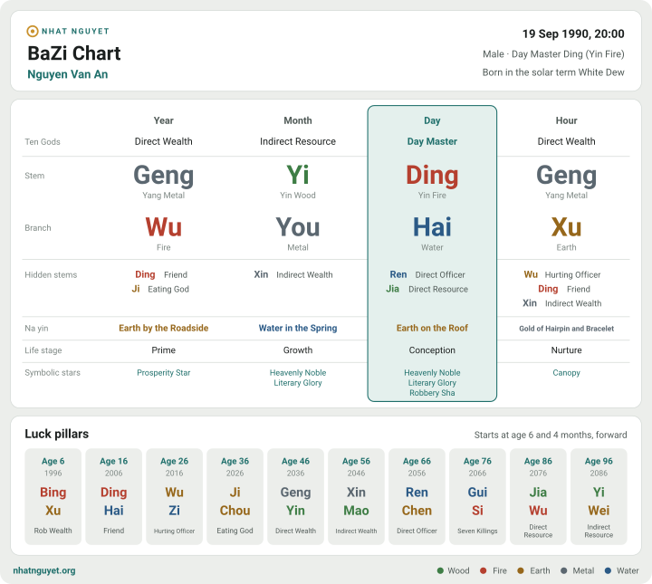
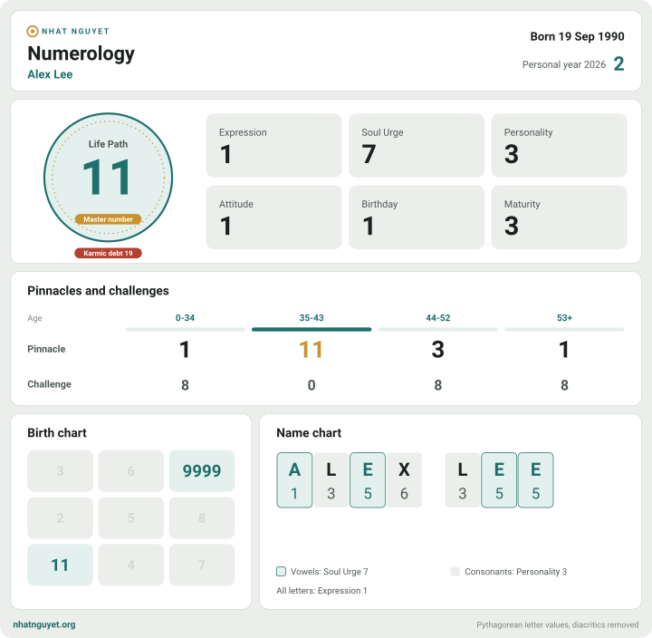

<h1 align="center">Nhat Nguyet</h1>

<p align="center">
  <b>NASA와 IMCCE로 검증한 베트남 음력 위에서 계산하는 자미두수, 사주팔자, 수비학. 고전을 인용하는 명반 해석 360만 건과, 어떤 포팅 구현이든 통과 여부를 확인할 수 있는 공용 테스트 벡터 17,291개를 담았습니다.</b><br>
  JavaScript · Python · CLI · MCP 서버 · 웹 위젯 · English, Tiếng Việt, 中文
</p>

<p align="center">
  <picture>
    <source media="(prefers-color-scheme: dark)" srcset="./assets/la-so-tu-vi-toi.svg">
    
  </picture>
  <picture>
    <source media="(prefers-color-scheme: dark)" srcset="./assets/la-so-bat-tu-toi.svg">
    
  </picture>
  <picture>
    <source media="(prefers-color-scheme: dark)" srcset="./assets/than-so-hoc-toi.svg">
    
  </picture>
</p>

<p align="center">
  <a href="./README.md">English</a> · <a href="./README.vi.md">Tiếng Việt</a> · <a href="./README.zh.md">中文</a> · <a href="./README.ja.md">日本語</a> · <b>한국어</b> · <a href="./README.fr.md">Français</a> · <a href="./README.th.md">ไทย</a>
  <br>
  <a href="https://nhatnguyet.org/en/ma-nguon-mo/thu">플레이그라운드</a> ·
  <a href="https://nhatnguyet.org/en/ma-nguon-mo/tai-lieu">문서</a> ·
  <a href="https://huggingface.co/nhatnguyet">Hugging Face</a> ·
  <a href="https://nhatnguyet.org/en/ma-nguon-mo">프로젝트 페이지</a>
</p>

<p align="center">
  <a href="https://www.npmjs.com/package/@nhatnguyet/tu-vi"></a>
  <a href="https://pypi.org/project/nhatnguyet/"></a>
  <a href="./ca-kiem"></a>
  <a href="https://github.com/Nhat-Nguyet/nhatnguyet/actions/workflows/kiem.yml"></a>
  <a href="./LICENSE"></a>
  <a href="./DATA-LICENSE"></a>
  <a href="https://doi.org/10.5281/zenodo.24358014"></a>
</p>

## 빠른 시작

**JavaScript, TypeScript** (Node 18 이상, 브라우저)

```bash
npm i @nhatnguyet/tu-vi @nhatnguyet/am-lich
```

```js
import { writeFileSync } from "node:fs";
import { castZiWei } from "@nhatnguyet/tu-vi";
import { toLunar } from "@nhatnguyet/am-lich";

const chart = castZiWei({ name: "Nguyen Van An", date: "1990-09-19", time: "20:00", gender: "male" });
const life = chart.palaces[chart.lifePalace];
console.log(chart.bureau.name, "|", life.name, life.branch, "|", life.stars[0].name, life.stars[0].brightness);
writeFileSync("chart.svg", chart.toSvg());   // the chart image above

// Same day, two calendars: Tết in Vietnam, still the 12th month in China
const vn = toLunar("1985-01-21");
const cn = toLunar("1985-01-21", { country: "CN" });
console.log(vn.day, vn.month, vn.year, vn.yearName, "|", cn.day, cn.month, cn.year, cn.yearName);
```

```text
Earth Five | Life Palace Hợi | Moon Exalted
1 1 1985 Ất Sửu | 1 12 1984 Giáp Tý
```

**Python** (3.9 이상, 표준 라이브러리만 사용): 결과가 같고, SVG도 바이트 단위까지 똑같습니다.

```bash
pip install nhatnguyet
```

```python
from nhatnguyet import cast_zi_wei, to_lunar, zi_wei_svg

chart = cast_zi_wei(name="Nguyen Van An", date="1990-09-19", time="20:00", gender="male")
life = chart["palaces"][chart["lifePalace"]]
print(chart["bureau"]["name"], "|", life["name"], life["branch"], "|", life["stars"][0]["name"], life["stars"][0]["brightness"])
open("chart.svg", "w", encoding="utf-8").write(zi_wei_svg(chart))

vn = to_lunar("1985-01-21")
cn = to_lunar("1985-01-21", country="CN")
print(vn["day"], vn["month"], vn["year"], vn["yearName"], "|", cn["day"], cn["month"], cn["year"], cn["yearName"])
```

**명령줄**: `npx`를 쓰면 설치가 필요 없고, `pip install nhatnguyet` 후에는 `nhatnguyet ...`로 실행합니다.

```bash
npx @nhatnguyet/cli ziwei 1990-09-19 20:00 male --year 2026
```

<details>
<summary>출력 (12궁을 격자로 보여 준 뒤 유년, 대한, 격국)</summary>

```text
┌────────────────────┬────────────────────┬────────────────────┬────────────────────┐
│ Travel             │ Health             │ Wealth · Body      │ Children           │
│ Tân Tỵ             │ Nhâm Ngọ Triệt     │ Quý Mùi Triệt      │ Giáp Thân          │
│ Celestial Mechanism│ Purple Star Ex     │ Spinning Camel     │ Army Breaker We    │
│   Pr               │ Celestial Leader,  │ Nurture            │ Prosperity,        │
│ Celestial Talent   │ Celestial Fortune  │                    │ Celestial Horse    │
│ Extinction         │ Conception         │                    │ Growth             │
├────────────────────┼────────────────────┴────────────────────┼────────────────────┤
│ Friends/Subordinat…│                                         │ Spouse             │
│ Canh Thìn          │                                         │ Ất Dậu             │
│ Seven Killings We  │                                         │ Sword Ram,         │
│ Tomb               │                                         │ Earthly Robber,    │
│                    │          ZI WEI DOU SHU CHART           │ Dipper Lord        │
│                    │      Born 1990-09-19 20:00 (Tuất)       │ Bathing            │
├────────────────────┤       Lunar 1990-08-01 · Canh Ngọ       ├────────────────────┤
│ Career             │                Yang Male                │ Siblings           │
│ Kỷ Mão             │           Bureau: Earth Five            │ Bính Tuất Tuần     │
│ Sun Pr Lộc         │      Na yin: Earth by the Roadside      │ Purity Ex          │
│ Celestial Beam Pr  │          Life: Hợi · Body: Mùi          │ Celestial Treasury │
│ Right Assistant,   │                                         │   Pr               │
│ Peach Blossom,     │                                         │ Youth              │
│ Eight Seats,       │                                         │                    │
│ Celestial Nobili…  │                                         │                    │
│ Death              │                                         │                    │
├────────────────────┼────────────────────┬────────────────────┼────────────────────┤
│ Property           │ Fortune/Virtue     │ Parents            │ Life Palace        │
│ Mậu Dần            │ Kỷ Sửu             │ Mậu Tý             │ Đinh Hợi Tuần      │
│ Military Song      │ Celestial Blessing │ Greedy Wolf We     │ Moon Ex Kỵ         │
│   Pr Quyền         │   We Khoa          │ Literary Glory,    │ Left Assistant,    │
│ Celestial General  │ Giant Gate We      │ Celestial Weeping, │ Three Terraces,    │
│   Ex               │ Earthly Void,      │ Celestial Emptin…  │ Grace Light,       │
│ Celestial Excell…, │ Celestial Longev…  │ Peak               │ Celestial Offici…  │
│ Literary Melody    │ Decline            │                    │ Prime              │
│ Illness            │                    │                    │                    │
└────────────────────┴────────────────────┴────────────────────┴────────────────────┘
Brightness: Ex exalted, Pr prosperous, Fa favorable, Ne neutral, We weak. Ages are East
Asian ages (1 at birth).

Year 2026 (Bính Ngọ)
  age 37 · Year palace: Health · Minor limit: Friends/Subordinates ·
  Decade: Property (35-44) · Hóa Lộc: Celestial Blessing → Fortune/Virtue ·
  Hóa Quyền: Celestial Mechanism → Travel · Hóa Khoa: Literary Glory → Parents ·
  Hóa Kỵ: Purity → Siblings

Ten-year periods
    5-14  1994-2003  Life Palace (Hợi)  Moon
   15-24  2004-2013  Parents (Tý)  Greedy Wolf
   25-34  2014-2023  Fortune/Virtue (Sửu)  Celestial Blessing, Giant Gate
   35-44  2024-2033  Property (Dần)  Military Song, Celestial General
   45-54  2034-2043  Career (Mão)  Sun, Celestial Beam
   55-64  2044-2053  Friends/Subordinates (Thìn)  Seven Killings
   65-74  2054-2063  Travel (Tỵ)  Celestial Mechanism
   75-84  2064-2073  Health (Ngọ)  Purple Star
   85-94  2074-2083  Wealth (Mùi)  -
   95-104 2084-2093  Children (Thân)  Army Breaker
  105-114 2094-2103  Spouse (Dậu)  -
  115-124 2104-2113  Siblings (Tuất)  Purity, Celestial Treasury

Patterns
  Cơ Nguyệt Đồng Lương 機月同梁 · Life Palace
  Tả Hữu đồng hội 左右 · Life Palace
  Nhật xuất Phù Tang 日出扶桑 · Career
  Nguyệt lạc Hợi cung 月落亥宮 · Life Palace

Birth time 20:00 falls in the Tuất double hour (19:00-20:59). The lunar date follows the
Vietnamese calendar (UTC+7).
```

</details>

다른 명령: `bazi`, `lunar`, `solar`, `terms`, `numerology`, `festivals`. 옵션은 `--lang vi|zh`, `--json`, `--svg chart.svg`. 모든 옵션을 담은 영문 API 문서: [docs/api-en.md](./docs/api-en.md).

## 목차

1. [패키지 구성](#패키지-구성)
2. [데이터셋](#데이터셋)
3. [다른 라이브러리와 비교](#다른-라이브러리와-비교)
4. [AI 활용](#ai-활용)
5. [위젯](#위젯)
6. [과학적 근거](#과학적-근거)
7. [플레이그라운드와 문서](#플레이그라운드와-문서)
8. [iztro에서 옮겨 오기](#iztro에서-옮겨-오기)
9. [라이선스와 출처 표기](#라이선스와-출처-표기)
10. [자주 묻는 질문](#자주-묻는-질문)
11. [기여하기](#기여하기)

## 패키지 구성

모든 라이브러리는 [nhatnguyet.org](https://nhatnguyet.org)와 Nhat Nguyet 앱을 구동하는
엔진을 필드 단위까지 그대로 재현합니다. 네트워크 호출이 없고, 서드파티 의존성도
없습니다.

| 패키지 | Python | 기능 |
|---|---|---|
| [`@nhatnguyet/am-lich`](./js/packages/am-lich) | `nhatnguyet` | 베트남, 중국, 한국, 일본 외 7개 지역의 음력과 양력 변환, 간지, 분 단위 24절기, 28수, 납음 |
| [`@nhatnguyet/tu-vi`](./js/packages/tu-vi) | `nhatnguyet` | 자미두수: 12궁, 별의 밝기, 사화, Tuần과 Triệt(순공과 절공), 대한과 유년, 유성, 고전 원문을 곁들인 격국, SVG, LLM용 텍스트, iztro 호환 계층 |
| [`@nhatnguyet/bat-tu`](./js/packages/bat-tu) | `nhatnguyet` | 사주팔자: 절기 기준 사주, 지장간, 십신, 신살, 대운, 소운, SVG |
| [`@nhatnguyet/than-so-hoc`](./js/packages/than-so-hoc) | `nhatnguyet` | 피타고라스 수비학(생명수, 표현수, 영혼수, 정점수, 도전수, 개인년수), 성조 부호가 있는 베트남어 이름 지원, SVG |
| [`@nhatnguyet/le-hoi`](./js/packages/le-hoi) | `nhatnguyet` | 베트남 축제 200개와 어느 해든 그 해의 양력 날짜 |
| [`@nhatnguyet/cli`](./js/packages/cli) | `nhatnguyet` 명령 | 명반을 터미널 격자, JSON, SVG로 출력 |
| [`@nhatnguyet/mcp`](./js/packages/mcp) | | AI 어시스턴트용 도구 7개를 갖춘 MCP 서버 |
| [`@nhatnguyet/widgets`](./js/packages/widgets) | | 웹 컴포넌트 5개(달력, 월 달력, 길한 시간, 설날 카운트다운, 날짜 변환기) |

[`ca-kiem/`](./ca-kiem)에는 기준 엔진이 생성한 **테스트 벡터 17,291개**(입력 `vao`,
기대 출력 `ra`)가 들어 있습니다. 역법 케이스 14,936개, 자미두수 명반 777개, 사주팔자
명반 777개, 수비학 프로필 600개, 축제 연도 201개입니다. TypeScript와 Python 구현은
푸시할 때마다 이 모두를 통과합니다.

## 데이터셋

모두 [Hugging Face](https://huggingface.co/nhatnguyet)에 CC BY 4.0으로 공개되어 있으며,
출처를 표기하면 상업용 제품과 AI 학습에 쓸 수 있습니다.

| 데이터셋 | 내용 | 압축 크기 |
|---|---|---:|
| [`nhatnguyet/loi-luan-tu-vi`](https://huggingface.co/datasets/nhatnguyet/loi-luan-tu-vi) | 해석이 담긴 자미두수 명반 1,761,936건: 1900~2100년의 모든 날 × 12시진 × 2개 성별 | 9.20 GB |
| [`nhatnguyet/loi-luan-bat-tu`](https://huggingface.co/datasets/nhatnguyet/loi-luan-bat-tu) | 해석이 담긴 사주팔자 명반 1,761,936건, 같은 범위 | 1.57 GB |
| [`nhatnguyet/loi-luan-than-so-hoc`](https://huggingface.co/datasets/nhatnguyet/loi-luan-than-so-hoc) | 수비학 프로필 73,414건, 생년월일마다 1건 | 0.08 GB |
| [`nhatnguyet/sach-co`](https://huggingface.co/datasets/nhatnguyet/sach-co) | 퍼블릭 도메인 고전 412종(약 390개 작품), 7,010만 자, 전문 | 텍스트 151 MB, Parquet 69 MB |
| [역법과 문화 데이터셋 33종](https://nhatnguyet.org/en/du-lieu) | 1900~2100년 음양력, 절기, 64괘, 타로 78장, 축제 200개, 제례 기도문 456편... CSV, JSON, Parquet, [DOI](https://doi.org/10.5281/zenodo.23009396) 부여 | |

세 해석 데이터셋은 모두 합쳐 **명반 3,597,286건, 압축 시 10.85 GB**이며 세 부분으로
나뉩니다. 해석 ID가 붙은 구조화된 명반(`la-so/`, 1.50 GB), 언어별로 미리 결합한
전문(`ghep-san/<vi|en|zh>/`, 9.31 GB), 그리고 각 해석, 고전 인용, 아티클을 한 번씩만
저장하는 텍스트 저장소(`kho/`, 0.04 GB)입니다. 해석은 서명과 편명을 밝혀 고전을
인용합니다. 파일은 출생 연도마다 하나입니다. **압축을 풀면 매우 큽니다**(텍스트가
명반마다 반복되기 때문으로, 자미두수 결합본 텍스트는 1년치가 언어당 약 2.6 GB). 스트리밍으로
읽거나 한 해씩 내려받으세요.

고전 문헌의 구성은 한문 337종, 영어 44종, 베트남어 30종, 독일어 1종입니다. 주제별로는
주역과 점술 201종, 수비학 28종, 베트남 역사와 문화 26종, 삼식 26종, 풍수 22종, 사주와
명리 20종, 불교 20종, 신앙과 의례 20종, 역법과 택일 19종, 관상 14종, 자미두수 8종,
점성술과 타로 6종, 기타 2종입니다. 이 가운데 28종은 OCR 텍스트이며 `ocr` 플래그가
붙어 있습니다.

```python
from datasets import load_dataset

# one birth year of Zi Wei readings in English, streamed
ds = load_dataset("nhatnguyet/loi-luan-tu-vi", data_files="ghep-san/tu-vi/en/1990.jsonl.zst", split="train", streaming=True)
row = next(iter(ds))
print(row["k"])
print(row["van"].splitlines()[0])

books = load_dataset("nhatnguyet/sach-co", split="train")
print(len(books), sum(books["characters"]))
```

```text
1990-01-01-0-nam
# Tử Vi chart | Male | Born 01/01/1990, hour Tý
412 70092009
```

## 다른 라이브러리와 비교

[iztro](https://github.com/SylarLong/iztro)와
[lunar-javascript](https://github.com/6tail/lunar-javascript)는 꼼꼼하게 만들어져 널리
쓰이는 라이브러리이며, 둘 다 구현한 범위, 즉 베이징 시간(UTC+8) 기준 중국 역법으로는
정확합니다. 베트남은 같은 규칙을 하노이 시간(UTC+7)으로 적용합니다. 1900~2100년의
모든 날을 비교한 결과입니다([doi-chieu/](./doi-chieu/README.md), `node chay.mjs`로
재현 가능).

| | 결과 |
|---|---:|
| lunar-javascript와 음력 날짜가 다른 날 | 73,414일 중 2,724일 |
| 설날이 다른 해 | 201년 중 9년 |
| 윤달이 다른 해 | 201년 중 6년 |
| iztro와 Cục, 명궁, 주성 중 하나라도 다른 자미두수 명반(모든 날 × 12시진) | 880,968건 중 38,752건(4.40%) |
| 그중 시간대 때문인 것(iztro는 `vi-VN`에서도 베이징 시간 사용) | 3.02% |
| 그중 윤달 규칙 때문인 것(iztro `fixLeap`, 옵션) | 1.34% |
| IMCCE 대비 절기 최대 오차: Nhat Nguyet / lunar-javascript | 0.9분 / 0.28분 |

예: 1985년 1월 21일 Tỵ시(사시) 출생. iztro는 Giáp Tý년 음력 12월 1일, Kim Tứ Cục,
명궁 Thân으로 계산합니다. Nhat Nguyet은 설날(Tết), 곧 Ất Sửu년 첫날, Thủy Nhị Cục,
명궁 Dậu로 계산합니다. `country: "CN"`을 넘기면 Nhat Nguyet도 중국 역법으로
계산합니다.

## AI 활용

언어 모델이 음력 날짜나 별의 위치를 머릿속으로 셈하게 해서는 안 됩니다. 정확한 수치를
건네는 방법은 네 가지입니다.

- **MCP 서버**: 도구 7개(`lunar_convert`, `solar_terms`, `cast_zi_wei`,
  `cast_bazi`, `numerology`, `festivals`, `render_chart_svg`)를 갖추고 로컬에서 실행됩니다.
  `claude mcp add nhatnguyet -- npx -y @nhatnguyet/mcp`. Claude Desktop, Cursor,
  VS Code 설정 방법: [js/packages/mcp](./js/packages/mcp/README.md).
- **Agent Skill**: 어시스턴트가 추측하지 말고 도구를 호출하도록 안내합니다:
  [skills/](./skills/README.md).
- **`chartToText`**(Python은 `chart_to_text`): 명반을 프롬프트에 넣기 좋은 간결한
  Markdown으로 바꿉니다.

  ```js
  import { castZiWei, chartToText } from "@nhatnguyet/tu-vi";

  const chart = castZiWei({ date: "1990-09-19", time: "20:00", gender: "male" });
  console.log(chartToText(chart, { detail: "summary" }));
  ```

  ```text
  # Zi Wei Dou Shu chart

  Computed data only, no interpretation.

  - Gender: male
  - Birth date (Gregorian): 1990-09-19 20:00
  - Birth hour: Tuất (19:00-20:59)
  - Birth date (lunar): 1990-08-01
  - Year pillar: Canh Ngọ
  - Yin-yang: Yang Male
  - Bureau: Earth Five (5)
  ...
  ```

- **데이터셋**: 학습과 검색용. [위](#데이터셋)를 참고하세요.

## 위젯

<p align="center"></p>

nhatnguyet.org에서 호스팅합니다(위젯 14종, 옵션은
[nhatnguyet.org/widget](https://nhatnguyet.org/widget?lang=en)에서 고를 수 있습니다).

```html
<div data-widget="lich-hom-nay" data-lang="en" data-theme="auto"></div>
<script async src="https://nhatnguyet.org/embed/w.js"></script>
```

`data-country`(기본값 `VN`, 그 밖에 `CN`, `KR`, `JP`...)로 달력 위젯을 다른 나라의
음력으로 바꿀 수 있습니다. 또는 그중 5종을 서버 없이 페이지 안에서 직접 실행할 수도
있습니다.

```html
<script type="module" src="https://cdn.jsdelivr.net/npm/@nhatnguyet/widgets/dist/nn-widgets.js"></script>
<nn-lich-thang lang="en" theme="auto" country="VN"></nn-lich-thang>
```

모든 위젯과 속성: [widgets/](./widgets/README.md).

## 과학적 근거

**과학은 예측이 아니라 방법에 있습니다.** 역법은 천문학이며, 1900~2100년에 걸쳐
NASA와 IMCCE로 검증했습니다.

| 검증 항목 | 결과 |
|---|---|
| NASA 대비 합삭(2,474회) | 평균 0.9분 늦음, 최대 3.9분 |
| NASA 합삭과 IMCCE 절기로 재구성한 음력 월 | 2,461개월 중 2,459개월 일치(나머지 둘은 합삭이 자정에서 1분 이내) |
| IMCCE 대비 절기(4,824회) | 평균 0.27분 차이, 최대 0.9분(분 단위 반올림), 모든 절기가 올바른 날짜 |
| 베트남(UTC+7)과 중국(UTC+8), 같은 규칙 | 2,814일과 설날 10번이 다름 |

국가별 역법: 베트남 UTC+7(기본값). 중국, 대만, 홍콩, 마카오, 싱가포르, 말레이시아,
인도네시아, 필리핀은 UTC+8. 한국과 일본은 UTC+9. 모든 결과는 결정론적이며 테스트
벡터로 다시 확인할 수 있습니다. 자미두수, 사주팔자, 수비학은 전통 학파의 규칙이며
과학적으로 검증되지 않았습니다. 건강, 재정, 법률 결정에 사용하지 마십시오. 학파마다
견해가 갈리는 부분(윤달, 23시부터 시작하는 Tý시)은 어떤 규칙을 쓰는지 문서에 밝혀
두었습니다.

더 읽을거리: [음력과 절기](https://nhatnguyet.org/en/blog/co-so-khoa-hoc-am-lich-tiet-khi) ·
[자미두수 명반](https://nhatnguyet.org/en/blog/co-so-khoa-hoc-la-so-tu-vi) ·
[사주팔자](https://nhatnguyet.org/en/blog/co-so-khoa-hoc-bat-tu) ·
[수비학](https://nhatnguyet.org/en/blog/co-so-khoa-hoc-than-so-hoc) ·
[고전 문헌과 해석](https://nhatnguyet.org/en/blog/co-so-khoa-hoc-sach-co-loi-luan) ·
[Nhat Nguyet의 검증 방식](https://nhatnguyet.org/en/blog/co-so-khoa-hoc-kiem-chung).

## 플레이그라운드와 문서

- **플레이그라운드**: [nhatnguyet.org/en/ma-nguon-mo/thu](https://nhatnguyet.org/en/ma-nguon-mo/thu), 브라우저에서 패키지를 직접 실행합니다.
- **API 문서**: [nhatnguyet.org/en/ma-nguon-mo/tai-lieu](https://nhatnguyet.org/en/ma-nguon-mo/tai-lieu)와 [docs/api-en.md](./docs/api-en.md).
- **예제**: [examples/](./examples/README.md)(빌드 과정이 필요 없는 HTML 페이지, Node, Python).
- **가이드**: [JavaScript로 Tử Vi 명반 만들기](https://nhatnguyet.org/en/blog/lap-la-so-tu-vi-bang-javascript) · [앱을 위한 음력과 축제](https://nhatnguyet.org/en/blog/lich-am-le-hoi-cho-ung-dung) · [고전을 인용하는 AI 어시스턴트](https://nhatnguyet.org/en/blog/tro-ly-ai-trich-dan-sach-co) · [Python으로 명반 데이터 분석하기](https://nhatnguyet.org/en/blog/phan-tich-du-lieu-la-so-bang-python).

## iztro에서 옮겨 오기

import 한 줄만 바꾸면 됩니다. 결과는 iztro의 `FunctionalAstrolabe` 구조와 여섯 가지
표시 언어를 그대로 유지하면서 베트남 역법으로 계산됩니다.

```diff
- import { astro } from "iztro";
+ import { astro } from "@nhatnguyet/tu-vi/iztro";
```

`astrolabe.palace()` 같은 메서드는 제공하지 않습니다(이 계층은 데이터만 다룹니다).
자세한 내용: [docs/chuyen-tu-iztro.md](./docs/chuyen-tu-iztro.md).

## 라이선스와 출처 표기

| 구분 | 라이선스 |
|---|---|
| 코드 | [MIT](./LICENSE) |
| 데이터, 해석, 테스트 벡터 | [CC BY 4.0](./DATA-LICENSE): 상업적 이용과 AI 학습 가능, 출처 표기 필수 |
| 고전 문헌 | 원문은 퍼블릭 도메인, 디지털화와 교감 작업은 CC BY 4.0 |

출처 표기 문구: `Data: Nhat Nguyet (nhatnguyet.org)`, 가능하면 링크를 함께 답니다.
Nhat Nguyet 이름과 로고는 이 라이선스들의 대상이 아닙니다.

```bibtex
@software{nhatnguyet_2026,
  author = {{Nhat Nguyet}},
  title  = {Nhat Nguyet: open source code and data for Zi Wei Dou Shu, BaZi and numerology},
  year   = {2026},
  url    = {https://nhatnguyet.org/en/ma-nguon-mo},
  doi    = {10.5281/zenodo.24358014}
}
```

## 자주 묻는 질문

<details>
<summary><b>베트남 음력은 왜 중국 음력과 다른가요?</b></summary>

규칙은 같고 시계가 다릅니다. 한 달은 합삭이 있는 날에 시작하며, 그 날짜는 현지
시간으로 정합니다. 합삭이 세계시(UT) 16시에서 17시 사이에 일어나면 하노이에서는 자정
전, 베이징에서는 자정 후가 되므로 베트남에서는 달이 하루 일찍 시작합니다. 1985년
설날은 꼬박 한 달 차이가 납니다(베트남 1월 21일, 중국 2월 20일). 윤달이 드는 해가
다르기 때문입니다.
</details>

<details>
<summary><b>Tý시는 몇 시이며, 23시 30분에 태어나면 어느 날짜를 쓰나요?</b></summary>

Tý시는 23:00부터 00:59까지입니다. 자미두수는 입력한 날짜를 그대로 씁니다(다음 날로
넘기는 책도 있으니, 그 방식을 따르려면 다음 날 날짜를 입력하세요). 사주팔자는 23:00에
일주가 바뀝니다. 두 경우 모두 명반의 `notes`에 적혀 있습니다.
</details>

<details>
<summary><b>사주팔자의 월주는 음력 월을 따르나요, 절기를 따르나요?</b></summary>

절기를 따릅니다. 해는 Lập Xuân(입춘)에, 달은 각 절(節)이 드는 때에 바뀝니다. 음력
월을 대신 쓰면 전체 날짜의 약 4분의 1(1900~2100년 기준 24.3%)에서 월주가
달라집니다.
</details>

<details>
<summary><b>이 데이터로 AI 모델을 학습시켜도 되나요?</b></summary>

네, 상업적 용도를 포함해 CC BY 4.0에 따라 가능합니다. "Data: Nhat Nguyet
(nhatnguyet.org)"으로 출처를 표기해 주세요.
</details>

<details>
<summary><b>수비학은 베트남어 이름을 어떻게 처리하나요?</b></summary>

성조 부호를 없앤 뒤("Đ"는 "D"로 셉니다) 피타고라스 문자표를 적용합니다. 마스터
넘버 11, 22, 33은 그대로 유지합니다.
</details>

## 기여하기

출처(책과 편명, 또는 천문 데이터)를 곁들인 버그 신고가 가장 큰 도움이 됩니다.
[CONTRIBUTING.md](./CONTRIBUTING.md)를 참고하세요.

**포팅 챌린지**: 엔진을 다른 언어(Go, Rust, Dart, Swift, C#...)로 작성해
[`ca-kiem/`](./ca-kiem)의 테스트 벡터 17,291개를 모두 통과해 보세요. `vao`를 읽고 `ra`와
비교하면 됩니다. 규칙은 [CONTRIBUTING.md](./CONTRIBUTING.md#port-challenge)에 있습니다.

웹사이트: [nhatnguyet.org](https://nhatnguyet.org) · 이메일: lienhe@nhatnguyet.org

<p align="center"><sub>데이터: Nhat Nguyet (nhatnguyet.org) · 코드 MIT · 데이터 CC BY 4.0</sub></p>
