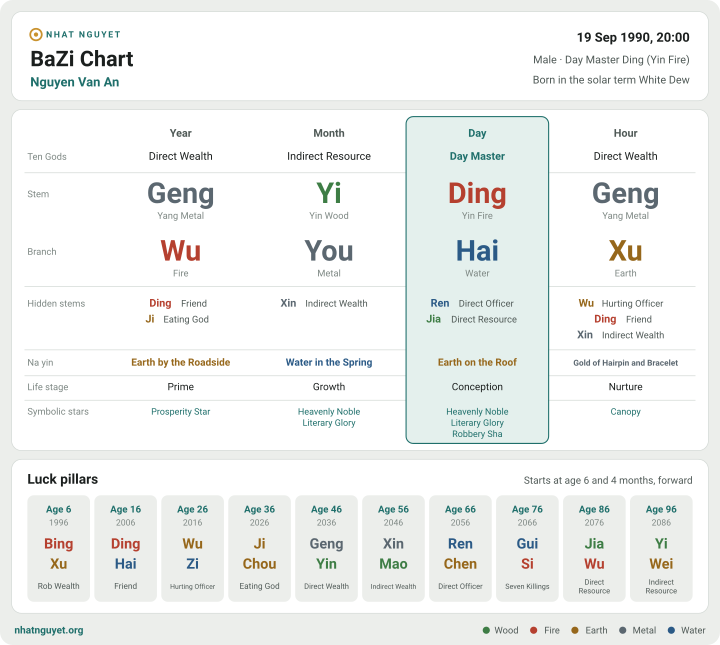
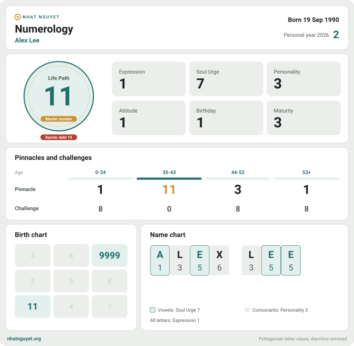

<h1 align="center">Nhat Nguyet</h1>

<p align="center">
  <b>Zi Wei Dou Shu, BaZi and numerology on a Vietnamese lunar calendar checked against NASA and IMCCE, with 3.6 million chart readings that cite the classics and 17,291 shared test vectors any port can pass.</b><br>
  JavaScript · Python · CLI · MCP server · web widgets · English, Tiếng Việt, 中文
</p>

<p align="center">
  <picture>
    <source media="(prefers-color-scheme: dark)" srcset="./assets/la-so-tu-vi-toi.svg">
    
  </picture>
  <picture>
    <source media="(prefers-color-scheme: dark)" srcset="./assets/la-so-bat-tu-toi.svg">
    
  </picture>
  <picture>
    <source media="(prefers-color-scheme: dark)" srcset="./assets/than-so-hoc-toi.svg">
    
  </picture>
</p>

<p align="center">
  <b>English</b> · <a href="./README.vi.md">Tiếng Việt</a> · <a href="./README.zh.md">中文</a> · <a href="./README.ja.md">日本語</a> · <a href="./README.ko.md">한국어</a> · <a href="./README.fr.md">Français</a> · <a href="./README.th.md">ไทย</a>
  <br>
  <a href="https://nhatnguyet.org/en/ma-nguon-mo/thu">Playground</a> ·
  <a href="https://nhatnguyet.org/en/ma-nguon-mo/tai-lieu">Docs</a> ·
  <a href="https://huggingface.co/nhatnguyet">Hugging Face</a> ·
  <a href="https://nhatnguyet.org/en/ma-nguon-mo">Project page</a>
</p>

<p align="center">
  <a href="https://www.npmjs.com/package/@nhatnguyet/tu-vi"></a>
  <a href="https://pypi.org/project/nhatnguyet/"></a>
  <a href="./ca-kiem"></a>
  <a href="https://github.com/Nhat-Nguyet/nhatnguyet/actions/workflows/kiem.yml"></a>
  <a href="./LICENSE"></a>
  <a href="./DATA-LICENSE"></a>
  <a href="https://doi.org/10.5281/zenodo.24358014"></a>
</p>

## Quick start

**JavaScript, TypeScript** (Node 18+, browsers)

```bash
npm i @nhatnguyet/tu-vi @nhatnguyet/am-lich
```

```js
import { writeFileSync } from "node:fs";
import { castZiWei } from "@nhatnguyet/tu-vi";
import { toLunar } from "@nhatnguyet/am-lich";

const chart = castZiWei({ name: "Nguyen Van An", date: "1990-09-19", time: "20:00", gender: "male" });
const life = chart.palaces[chart.lifePalace];
console.log(chart.bureau.name, "|", life.name, life.branch, "|", life.stars[0].name, life.stars[0].brightness);
writeFileSync("chart.svg", chart.toSvg());   // the chart image above

// Same day, two calendars: Tết in Vietnam, still the 12th month in China
const vn = toLunar("1985-01-21");
const cn = toLunar("1985-01-21", { country: "CN" });
console.log(vn.day, vn.month, vn.year, vn.yearName, "|", cn.day, cn.month, cn.year, cn.yearName);
```

```text
Earth Five | Life Palace Hợi | Moon Exalted
1 1 1985 Ất Sửu | 1 12 1984 Giáp Tý
```

**Python** (3.9+, standard library only): same results, same SVG byte for byte.

```bash
pip install nhatnguyet
```

```python
from nhatnguyet import cast_zi_wei, to_lunar, zi_wei_svg

chart = cast_zi_wei(name="Nguyen Van An", date="1990-09-19", time="20:00", gender="male")
life = chart["palaces"][chart["lifePalace"]]
print(chart["bureau"]["name"], "|", life["name"], life["branch"], "|", life["stars"][0]["name"], life["stars"][0]["brightness"])
open("chart.svg", "w", encoding="utf-8").write(zi_wei_svg(chart))

vn = to_lunar("1985-01-21")
cn = to_lunar("1985-01-21", country="CN")
print(vn["day"], vn["month"], vn["year"], vn["yearName"], "|", cn["day"], cn["month"], cn["year"], cn["yearName"])
```

**Command line**: no install with `npx`, or `nhatnguyet ...` after `pip install nhatnguyet`.

```bash
npx @nhatnguyet/cli ziwei 1990-09-19 20:00 male --year 2026
```

<details>
<summary>Output (the 12 palaces as a grid, then the year, ten-year periods, patterns)</summary>

```text
┌────────────────────┬────────────────────┬────────────────────┬────────────────────┐
│ Travel             │ Health             │ Wealth · Body      │ Children           │
│ Tân Tỵ             │ Nhâm Ngọ Triệt     │ Quý Mùi Triệt      │ Giáp Thân          │
│ Celestial Mechanism│ Purple Star Ex     │ Spinning Camel     │ Army Breaker We    │
│   Pr               │ Celestial Leader,  │ Nurture            │ Prosperity,        │
│ Celestial Talent   │ Celestial Fortune  │                    │ Celestial Horse    │
│ Extinction         │ Conception         │                    │ Growth             │
├────────────────────┼────────────────────┴────────────────────┼────────────────────┤
│ Friends/Subordinat…│                                         │ Spouse             │
│ Canh Thìn          │                                         │ Ất Dậu             │
│ Seven Killings We  │                                         │ Sword Ram,         │
│ Tomb               │                                         │ Earthly Robber,    │
│                    │          ZI WEI DOU SHU CHART           │ Dipper Lord        │
│                    │      Born 1990-09-19 20:00 (Tuất)       │ Bathing            │
├────────────────────┤       Lunar 1990-08-01 · Canh Ngọ       ├────────────────────┤
│ Career             │                Yang Male                │ Siblings           │
│ Kỷ Mão             │           Bureau: Earth Five            │ Bính Tuất Tuần     │
│ Sun Pr Lộc         │      Na yin: Earth by the Roadside      │ Purity Ex          │
│ Celestial Beam Pr  │          Life: Hợi · Body: Mùi          │ Celestial Treasury │
│ Right Assistant,   │                                         │   Pr               │
│ Peach Blossom,     │                                         │ Youth              │
│ Eight Seats,       │                                         │                    │
│ Celestial Nobili…  │                                         │                    │
│ Death              │                                         │                    │
├────────────────────┼────────────────────┬────────────────────┼────────────────────┤
│ Property           │ Fortune/Virtue     │ Parents            │ Life Palace        │
│ Mậu Dần            │ Kỷ Sửu             │ Mậu Tý             │ Đinh Hợi Tuần      │
│ Military Song      │ Celestial Blessing │ Greedy Wolf We     │ Moon Ex Kỵ         │
│   Pr Quyền         │   We Khoa          │ Literary Glory,    │ Left Assistant,    │
│ Celestial General  │ Giant Gate We      │ Celestial Weeping, │ Three Terraces,    │
│   Ex               │ Earthly Void,      │ Celestial Emptin…  │ Grace Light,       │
│ Celestial Excell…, │ Celestial Longev…  │ Peak               │ Celestial Offici…  │
│ Literary Melody    │ Decline            │                    │ Prime              │
│ Illness            │                    │                    │                    │
└────────────────────┴────────────────────┴────────────────────┴────────────────────┘
Brightness: Ex exalted, Pr prosperous, Fa favorable, Ne neutral, We weak. Ages are East
Asian ages (1 at birth).

Year 2026 (Bính Ngọ)
  age 37 · Year palace: Health · Minor limit: Friends/Subordinates ·
  Decade: Property (35-44) · Hóa Lộc: Celestial Blessing → Fortune/Virtue ·
  Hóa Quyền: Celestial Mechanism → Travel · Hóa Khoa: Literary Glory → Parents ·
  Hóa Kỵ: Purity → Siblings

Ten-year periods
    5-14  1994-2003  Life Palace (Hợi)  Moon
   15-24  2004-2013  Parents (Tý)  Greedy Wolf
   25-34  2014-2023  Fortune/Virtue (Sửu)  Celestial Blessing, Giant Gate
   35-44  2024-2033  Property (Dần)  Military Song, Celestial General
   45-54  2034-2043  Career (Mão)  Sun, Celestial Beam
   55-64  2044-2053  Friends/Subordinates (Thìn)  Seven Killings
   65-74  2054-2063  Travel (Tỵ)  Celestial Mechanism
   75-84  2064-2073  Health (Ngọ)  Purple Star
   85-94  2074-2083  Wealth (Mùi)  -
   95-104 2084-2093  Children (Thân)  Army Breaker
  105-114 2094-2103  Spouse (Dậu)  -
  115-124 2104-2113  Siblings (Tuất)  Purity, Celestial Treasury

Patterns
  Cơ Nguyệt Đồng Lương 機月同梁 · Life Palace
  Tả Hữu đồng hội 左右 · Life Palace
  Nhật xuất Phù Tang 日出扶桑 · Career
  Nguyệt lạc Hợi cung 月落亥宮 · Life Palace

Birth time 20:00 falls in the Tuất double hour (19:00-20:59). The lunar date follows the
Vietnamese calendar (UTC+7).
```

</details>

Other commands: `bazi`, `lunar`, `solar`, `terms`, `numerology`, `festivals`; `--lang vi|zh`, `--json`, `--svg chart.svg`. Full English API with every option: [docs/api-en.md](./docs/api-en.md).

## Contents

1. [What's inside](#whats-inside)
2. [Datasets](#datasets)
3. [How it compares](#how-it-compares)
4. [For AI](#for-ai)
5. [Widgets](#widgets)
6. [Scientific basis](#scientific-basis)
7. [Playground and docs](#playground-and-docs)
8. [Migrating from iztro](#migrating-from-iztro)
9. [License and attribution](#license-and-attribution)
10. [FAQ](#faq)
11. [Contributing](#contributing)

## What's inside

Every library reproduces, field by field, the engine that runs
[nhatnguyet.org](https://nhatnguyet.org) and the Nhat Nguyet app. No network
calls; the libraries have no third-party dependencies.

| Package | Python | What it does |
|---|---|---|
| [`@nhatnguyet/am-lich`](./js/packages/am-lich) | `nhatnguyet` | Lunar and Gregorian conversion for Vietnam, China, Korea, Japan and 7 more regions; stems and branches; 24 solar terms to the minute; 28 lunar mansions; na yin |
| [`@nhatnguyet/tu-vi`](./js/packages/tu-vi) | `nhatnguyet` | Zi Wei Dou Shu: 12 palaces, star brightness, Four Transformations, Tuần and Triệt, ten-year and yearly periods, transiting stars, patterns with the original classical line; SVG; text for LLMs; iztro-compatible layer |
| [`@nhatnguyet/bat-tu`](./js/packages/bat-tu) | `nhatnguyet` | BaZi: four pillars by solar term, hidden stems, Ten Gods, symbolic stars, luck pillars, minor luck; SVG |
| [`@nhatnguyet/than-so-hoc`](./js/packages/than-so-hoc) | `nhatnguyet` | Pythagorean numerology (life path, expression, soul urge, pinnacles, challenges, personal year), Vietnamese names with diacritics; SVG |
| [`@nhatnguyet/le-hoi`](./js/packages/le-hoi) | `nhatnguyet` | 200 Vietnamese festivals with their Gregorian dates in any year |
| [`@nhatnguyet/cli`](./js/packages/cli) | `nhatnguyet` command | Charts as terminal grids, JSON or SVG |
| [`@nhatnguyet/mcp`](./js/packages/mcp) | | MCP server with 7 tools for AI assistants |
| [`@nhatnguyet/widgets`](./js/packages/widgets) | | 5 web components (calendar, month grid, auspicious hours, Tết countdown, converter) |

[`ca-kiem/`](./ca-kiem) holds **17,291 test vectors** (input `vao`, expected
output `ra`) generated by the reference engine: 14,936 calendar cases, 777 Zi
Wei charts, 777 BaZi charts, 600 numerology profiles and 201 festival years.
TypeScript and Python both pass all of them on every push.

## Datasets

All on [Hugging Face](https://huggingface.co/nhatnguyet), CC BY 4.0, usable for
commercial products and AI training with credit.

| Dataset | Contents | Compressed size |
|---|---|---:|
| [`nhatnguyet/loi-luan-tu-vi`](https://huggingface.co/datasets/nhatnguyet/loi-luan-tu-vi) | 1,761,936 Zi Wei charts with readings: every day 1900 to 2100 × 12 hours × 2 genders | 9.20 GB |
| [`nhatnguyet/loi-luan-bat-tu`](https://huggingface.co/datasets/nhatnguyet/loi-luan-bat-tu) | 1,761,936 BaZi charts with readings, same range | 1.57 GB |
| [`nhatnguyet/loi-luan-than-so-hoc`](https://huggingface.co/datasets/nhatnguyet/loi-luan-than-so-hoc) | 73,414 numerology profiles, one per birth date | 0.08 GB |
| [`nhatnguyet/sach-co`](https://huggingface.co/datasets/nhatnguyet/sach-co) | 412 public domain classical texts (about 390 works), 70.1 million characters, full text | 151 MB text, 69 MB Parquet |
| [33 calendar and culture datasets](https://nhatnguyet.org/en/du-lieu) | lunisolar calendar 1900 to 2100, solar terms, 64 hexagrams, 78 Tarot cards, 200 festivals, 456 ritual prayers... CSV, JSON, Parquet, with a [DOI](https://doi.org/10.5281/zenodo.23009396) | |

The three reading datasets total **3,597,286 charts, 10.85 GB compressed**, in
three parts: structured charts with reading IDs (`la-so/`, 1.50 GB), full text
prebuilt per language (`ghep-san/<vi|en|zh>/`, 9.31 GB) and the text store
where each reading, classical quote and article is kept once (`kho/`, 0.04 GB).
Readings quote the classics with book and chapter. Files are one per birth
year. **Uncompressed they are very large** (the text repeats across charts: one
year of prebuilt Zi Wei text is about 2.6 GB per language), so stream them or
download a year at a time.

The classical texts: 337 in Classical Chinese, 44 in English, 30 in
Vietnamese, 1 in German; by topic, 201 on the I Ching and divination, 28
numerology, 26 Vietnamese history and culture, 26 the Three Arts, 22 feng shui,
20 BaZi and destiny, 20 Buddhism, 20 beliefs and rites, 19 calendar and date
selection, 14 physiognomy, 8 Zi Wei, 6 astrology and Tarot, 2 other. 28 are
OCR text and carry an `ocr` flag.

```python
from datasets import load_dataset

# one birth year of Zi Wei readings in English, streamed
ds = load_dataset("nhatnguyet/loi-luan-tu-vi", data_files="ghep-san/tu-vi/en/1990.jsonl.zst", split="train", streaming=True)
row = next(iter(ds))
print(row["k"])
print(row["van"].splitlines()[0])

books = load_dataset("nhatnguyet/sach-co", split="train")
print(len(books), sum(books["characters"]))
```

```text
1990-01-01-0-nam
# Tử Vi chart | Male | Born 01/01/1990, hour Tý
412 70092009
```

## How it compares

[iztro](https://github.com/SylarLong/iztro) and
[lunar-javascript](https://github.com/6tail/lunar-javascript) are careful,
widely used libraries, and both are correct for what they implement: the
Chinese calendar on Beijing time (UTC+8). Vietnam uses the same rules on Hanoi
time (UTC+7). Comparing every day from 1900 to 2100
([doi-chieu/](./doi-chieu/README.md), reproducible with `node chay.mjs`):

| | Result |
|---|---:|
| Days whose lunar date differs from lunar-javascript | 2,724 of 73,414 |
| Years whose Tết differs | 9 of 201 |
| Years whose leap month differs | 6 of 201 |
| Zi Wei charts (every day × 12 hours) whose Cục, Life palace or a major star differs from iztro | 38,752 of 880,968 (4.40%) |
| of which from the time zone (iztro uses Beijing time even with `vi-VN`) | 3.02% |
| of which from the leap-month rule (iztro `fixLeap`, an option) | 1.34% |
| Solar terms vs IMCCE, largest difference: Nhat Nguyet / lunar-javascript | 0.9 min / 0.28 min |

Example: born 21 January 1985, Tỵ hour. iztro gives the 1st day of the 12th
month of Giáp Tý, Kim Tứ Cục, Life palace in Thân. Nhat Nguyet gives Tết, the
1st day of Ất Sửu, Thủy Nhị Cục, Life palace in Dậu. Pass `country: "CN"` and
Nhat Nguyet gives the Chinese calendar too.

## For AI

Language models should not work out lunar dates or star positions in their
heads. Four ways to give them the numbers:

- **MCP server** with 7 tools (`lunar_convert`, `solar_terms`, `cast_zi_wei`,
  `cast_bazi`, `numerology`, `festivals`, `render_chart_svg`), runs locally:
  `claude mcp add nhatnguyet -- npx -y @nhatnguyet/mcp`. Setup for Claude
  Desktop, Cursor and VS Code: [js/packages/mcp](./js/packages/mcp/README.md).
- **Agent Skill** that tells an assistant to call the tools instead of
  guessing: [skills/](./skills/README.md).
- **`chartToText`** (`chart_to_text` in Python) turns a chart into compact
  Markdown for a prompt:

  ```js
  import { castZiWei, chartToText } from "@nhatnguyet/tu-vi";

  const chart = castZiWei({ date: "1990-09-19", time: "20:00", gender: "male" });
  console.log(chartToText(chart, { detail: "summary" }));
  ```

  ```text
  # Zi Wei Dou Shu chart

  Computed data only, no interpretation.

  - Gender: male
  - Birth date (Gregorian): 1990-09-19 20:00
  - Birth hour: Tuất (19:00-20:59)
  - Birth date (lunar): 1990-08-01
  - Year pillar: Canh Ngọ
  - Yin-yang: Yang Male
  - Bureau: Earth Five (5)
  ...
  ```

- **Datasets** for training and retrieval: [above](#datasets).

## Widgets

<p align="center"></p>

Hosted on nhatnguyet.org (14 widgets; pick options on
[nhatnguyet.org/widget](https://nhatnguyet.org/widget?lang=en)):

```html
<div data-widget="lich-hom-nay" data-lang="en" data-theme="auto"></div>
<script async src="https://nhatnguyet.org/embed/w.js"></script>
```

`data-country` (`VN` default, `CN`, `KR`, `JP`...) switches the calendar
widgets to another country's lunar calendar. Or run 5 of them in the page
itself, with no server:

```html
<script type="module" src="https://cdn.jsdelivr.net/npm/@nhatnguyet/widgets/dist/nn-widgets.js"></script>
<nn-lich-thang lang="en" theme="auto" country="VN"></nn-lich-thang>
```

All widgets and attributes: [widgets/](./widgets/README.md).

## Scientific basis

**The science is in the method, not in the predictions.** The calendar is
astronomy, checked against NASA and IMCCE over 1900 to 2100:

| Check | Result |
|---|---|
| New moons vs NASA (2,474) | 0.9 min late on average, 3.9 min at most |
| Lunar months rebuilt from NASA new moons and IMCCE solar terms | 2,459 of 2,461 match (the other two: new moon within a minute of midnight) |
| Solar terms vs IMCCE (4,824) | 0.27 min off on average, 0.9 min at most (rounded to the minute), every term on the right day |
| Vietnam (UTC+7) vs China (UTC+8), same rules | 2,814 days and 10 Tết dates differ |

Calendars by country: Vietnam UTC+7 (default); China, Taiwan, Hong Kong, Macau,
Singapore, Malaysia, Indonesia, the Philippines UTC+8; Korea, Japan UTC+9.
Every result is deterministic and can be rechecked with the test vectors. Zi
Wei Dou Shu, BaZi and numerology are the rules of traditional schools, not
validated science; do not use them for health, money or legal decisions.
Where schools disagree (the leap month, the Tý hour from 23:00), the docs say
which rule is used.

Further reading: [lunar calendar and solar terms](https://nhatnguyet.org/en/blog/co-so-khoa-hoc-am-lich-tiet-khi) ·
[Zi Wei chart](https://nhatnguyet.org/en/blog/co-so-khoa-hoc-la-so-tu-vi) ·
[BaZi](https://nhatnguyet.org/en/blog/co-so-khoa-hoc-bat-tu) ·
[numerology](https://nhatnguyet.org/en/blog/co-so-khoa-hoc-than-so-hoc) ·
[classical texts and readings](https://nhatnguyet.org/en/blog/co-so-khoa-hoc-sach-co-loi-luan) ·
[how Nhat Nguyet checks its work](https://nhatnguyet.org/en/blog/co-so-khoa-hoc-kiem-chung).

## Playground and docs

- **Playground**: [nhatnguyet.org/en/ma-nguon-mo/thu](https://nhatnguyet.org/en/ma-nguon-mo/thu), runs the packages in your browser.
- **API docs**: [nhatnguyet.org/en/ma-nguon-mo/tai-lieu](https://nhatnguyet.org/en/ma-nguon-mo/tai-lieu) and [docs/api-en.md](./docs/api-en.md).
- **Examples**: [examples/](./examples/README.md) (an HTML page with no build step, Node, Python).
- **Guides**: [build a Tử Vi chart with JavaScript](https://nhatnguyet.org/en/blog/lap-la-so-tu-vi-bang-javascript) · [lunar calendar and festivals for your app](https://nhatnguyet.org/en/blog/lich-am-le-hoi-cho-ung-dung) · [an AI assistant that cites the classics](https://nhatnguyet.org/en/blog/tro-ly-ai-trich-dan-sach-co) · [analyse chart data with Python](https://nhatnguyet.org/en/blog/phan-tich-du-lieu-la-so-bang-python).

## Migrating from iztro

Change one import; the result keeps iztro's `FunctionalAstrolabe` shape and its
six display languages, computed on the Vietnamese calendar:

```diff
- import { astro } from "iztro";
+ import { astro } from "@nhatnguyet/tu-vi/iztro";
```

Methods such as `astrolabe.palace()` are not provided (the layer is data
only). Details: [docs/chuyen-tu-iztro.md](./docs/chuyen-tu-iztro.md).

## License and attribution

| Part | License |
|---|---|
| Code | [MIT](./LICENSE) |
| Data, readings, test vectors | [CC BY 4.0](./DATA-LICENSE): commercial use and AI training allowed, credit required |
| Classical texts | Public domain originals; the digitization and cleaning are CC BY 4.0 |

Credit line: `Data: Nhat Nguyet (nhatnguyet.org)`, with a link where possible.
The Nhat Nguyet name and logo are not covered by these licenses.

```bibtex
@software{nhatnguyet_2026,
  author = {{Nhat Nguyet}},
  title  = {Nhat Nguyet: open source code and data for Zi Wei Dou Shu, BaZi and numerology},
  year   = {2026},
  url    = {https://nhatnguyet.org/en/ma-nguon-mo},
  doi    = {10.5281/zenodo.24358014}
}
```

## FAQ

<details>
<summary><b>Why is the Vietnamese lunar calendar different from the Chinese one?</b></summary>

Same rules, different clock. A month starts on the day of the new moon, and
the day is decided in local time. When a new moon falls between 16:00 and
17:00 UT it is before midnight in Hanoi and after midnight in Beijing, so the
month starts a day earlier in Vietnam. Tết 1985 is a whole month apart (21
January in Vietnam, 20 February in China) because the leap month falls in a
different year.
</details>

<details>
<summary><b>Which hour is the Tý hour, and what date does a birth at 23:30 use?</b></summary>

Tý runs 23:00 to 00:59. Zi Wei keeps the date you entered (some books move it
to the next day; enter the next date to follow them). BaZi turns the day pillar
at 23:00. Both are stated in the chart's `notes`.
</details>

<details>
<summary><b>Does the BaZi month pillar follow the lunar month or the solar terms?</b></summary>

The solar terms: the year turns at Lập Xuân (Start of Spring), the month at
each sectional term. Using the lunar month instead gives a different month
pillar on about a quarter of all days (24.3% from 1900 to 2100).
</details>

<details>
<summary><b>Can I use the data to train an AI model?</b></summary>

Yes, including commercially, under CC BY 4.0. Credit "Data: Nhat Nguyet
(nhatnguyet.org)".
</details>

<details>
<summary><b>How are Vietnamese names handled in numerology?</b></summary>

Diacritics are folded ("Đ" counts as "D"), then the Pythagorean letter table
is applied. Master numbers 11, 22 and 33 are kept.
</details>

## Contributing

Bug reports with a source (a book and chapter, or astronomical data) are the
most useful; see [CONTRIBUTING.md](./CONTRIBUTING.md).

**Port challenge**: write the engine in another language (Go, Rust, Dart,
Swift, C#...) and pass all 17,291 test vectors in [`ca-kiem/`](./ca-kiem).
Read `vao`, compare with `ra`; the rules are in
[CONTRIBUTING.md](./CONTRIBUTING.md#port-challenge).

Website: [nhatnguyet.org](https://nhatnguyet.org) · Email: lienhe@nhatnguyet.org

<p align="center"><sub>Data: Nhat Nguyet (nhatnguyet.org) · Code MIT · Data CC BY 4.0</sub></p>
