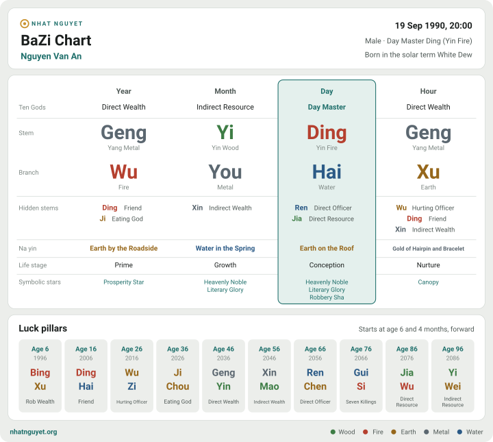
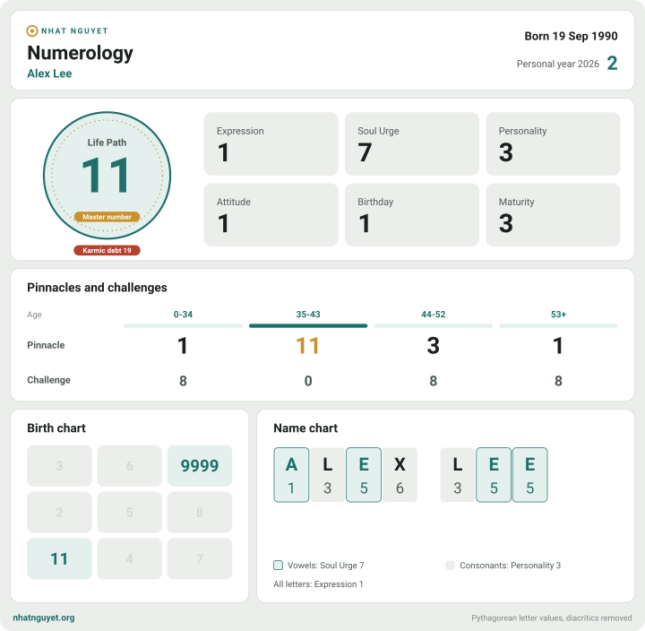
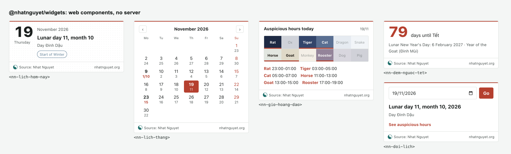

<h1 align="center">Nhat Nguyet</h1>

<p align="center">
  <b>ปฏิทินจันทรคติเวียดนามไม่ใช่ปฏิทินจีน ไลบรารียอดนิยมให้วันทางจันทรคติของเวียดนามผิดถึง 2,724 วันในช่วงปี 1900 ถึง 2100</b><br>
  จื่อเหวยโต่วซู่ ปาจื้อ ศาสตร์ตัวเลข เทศกาล และยามมงคล บนปฏิทินที่ถูกต้อง ใช้ได้ทั้ง JavaScript, Python และ MCP · ดวงเปิด 3.6 ล้านดวงพร้อมคำอ่านที่อ้างคัมภีร์โบราณ ระบุชื่อคัมภีร์และบท · ผลลัพธ์เป็น English, Tiếng Việt, 中文 · กรณีทดสอบร่วม 17,291 กรณี
</p>

<p align="center">
  <a href="./README.md">English</a> · <a href="./README.vi.md">Tiếng Việt</a> · <a href="./README.zh.md">中文</a> · <a href="./README.ja.md">日本語</a> · <a href="./README.ko.md">한국어</a> · <a href="./README.fr.md">Français</a> · <b>ไทย</b>
  <br>
  <a href="https://nhatnguyet.org/en/ma-nguon-mo/thu">ทดลองใช้</a> ·
  <a href="https://nhatnguyet.org/en/ma-nguon-mo/tai-lieu">เอกสาร</a> ·
  <a href="./docs/paper/paper.pdf">บทความวิชาการ</a> ·
  <a href="https://huggingface.co/nhatnguyet">Hugging Face</a> ·
  <a href="https://nhatnguyet.org/en/ma-nguon-mo">หน้าโครงการ</a>
</p>

<p align="center">
  <picture>
    <source media="(prefers-color-scheme: dark)" srcset="./assets/la-so-tu-vi-toi.svg">
    
  </picture>
</p>

<p align="center">
  <a href="https://www.npmjs.com/package/@nhatnguyet/ziwei"></a>
  <a href="https://pypi.org/project/nhatnguyet/"></a>
  <a href="./ca-kiem"></a>
  <a href="https://github.com/Nhat-Nguyet/nhatnguyet-lunar-ziwei-bazi-numerology/actions/workflows/kiem.yml"></a>
  <a href="./LICENSE"></a>
  <a href="./DATA-LICENSE"></a>
  <a href="https://doi.org/10.5281/zenodo.24358013"></a>
</p>

## เริ่มต้นอย่างรวดเร็ว

**JavaScript, TypeScript** (Node 18 ขึ้นไป, เบราว์เซอร์)

```bash
npm i @nhatnguyet/ziwei @nhatnguyet/lunar
```

```js
import { writeFileSync } from "node:fs";
import { castZiWei } from "@nhatnguyet/ziwei";
import { toLunar } from "@nhatnguyet/lunar";

const chart = castZiWei({ name: "Nguyen Van An", date: "1990-09-19", time: "20:00", gender: "male" });
const life = chart.palaces[chart.lifePalace];
console.log(chart.bureau.name, "|", life.name, life.branch, "|", life.stars[0].name, life.stars[0].brightness);
writeFileSync("chart.svg", chart.toSvg());   // the chart image above

// Same day, two calendars: Tết in Vietnam, still the 12th month in China
const vn = toLunar("1985-01-21");
const cn = toLunar("1985-01-21", { country: "CN" });
console.log(vn.day, vn.month, vn.year, vn.yearName, "|", cn.day, cn.month, cn.year, cn.yearName);
```

```text
Earth Five | Life Palace Hai | Moon Exalted
1 1 1985 Yi Chou | 1 12 1984 Jia Zi
```

**Python** (3.9 ขึ้นไป ใช้เพียงไลบรารีมาตรฐาน): ได้ผลลัพธ์เหมือนกัน และได้ SVG ที่ตรงกันทุกไบต์

```bash
pip install nhatnguyet
```

<!-- run: same-output -->
```python
from nhatnguyet import cast_zi_wei, to_lunar, zi_wei_svg

chart = cast_zi_wei(name="Nguyen Van An", date="1990-09-19", time="20:00", gender="male")
life = chart["palaces"][chart["lifePalace"]]
print(chart["bureau"]["name"], "|", life["name"], life["branch"], "|", life["stars"][0]["name"], life["stars"][0]["brightness"])
open("chart.svg", "w", encoding="utf-8").write(zi_wei_svg(chart))

vn = to_lunar("1985-01-21")
cn = to_lunar("1985-01-21", country="CN")
print(vn["day"], vn["month"], vn["year"], vn["yearName"], "|", cn["day"], cn["month"], cn["year"], cn["yearName"])
```

**บรรทัดคำสั่ง**: ใช้ได้โดยไม่ต้องติดตั้งผ่าน `npx` หรือใช้ `nhatnguyet ...` หลังจาก `pip install nhatnguyet`

<p align="center"></p>

```bash
npx @nhatnguyet/cli ziwei 1990-09-19 20:00 male --year 2026
```

<details>
<summary>ผลลัพธ์ (12 เรือนในรูปตาราง ตามด้วยดวงรายปี วัยจร 10 ปี และรูปแบบดวง)</summary>

```text
┌────────────────────┬────────────────────┬────────────────────┬────────────────────┐
│ Travel             │ Health             │ Wealth · Body      │ Children           │
│ Xin Si             │ Ren Wu Jie Kong    │ Gui Wei Jie Kong   │ Jia Shen           │
│ Celestial Mechanism│ Purple Star Ex     │ Spinning Top,      │ Army Breaker We    │
│   Pr               │ Celestial Leader,  │ Celestial Void     │ Prosperity,        │
│ Celestial Talent,  │ Celestial Fortune, │ Nurture            │ Celestial Horse,   │
│ Bell Star,         │ Celestial Messen…  │                    │ Celestial Charm,   │
│ Shattering Star    │ Conception         │                    │ Celestial Physic…, │
│ Extinction         │                    │                    │ Solitary Star,     │
│                    │                    │                    │ Flowing Haze       │
│                    │                    │                    │ Growth             │
├────────────────────┼────────────────────┴────────────────────┼────────────────────┤
│ Friends/Subordinat…│                                         │ Spouse             │
│ Geng Chen          │                                         │ Yi You             │
│ Seven Killings We  │                                         │ Sword Ram,         │
│ Phoenix Pavilion,  │                                         │ Earthly Robber,    │
│ Celestial Punish…, │                                         │ Dipper Lord,       │
│ State Seal,        │                                         │ Red Phoenix        │
│ Releasing Spirit,  │                                         │ Bathing            │
│ Terrace Aide,      │                                         │                    │
│ Celestial Injury,  │                                         │                    │
│ Celestial Net,     │          ZI WEI DOU SHU CHART           │                    │
│ Widow Star         │       Born 1990-09-19 20:00 (Xu)        │                    │
│ Tomb               │       Lunar 1990-08-01 · Geng Wu        │                    │
├────────────────────┤                Yang Male                ├────────────────────┤
│ Career             │           Bureau: Earth Five            │ Siblings           │
│ Ji Mao             │      Na yin: Earth by the Roadside      │ Bing Xu Xun Kong   │
│ Sun Pr Lu          │          Life: Hai · Body: Wei          │ Purity Ex          │
│ Celestial Beam Pr  │                                         │ Celestial Treasury │
│ Right Assistant,   │                                         │   Pr               │
│ Peach Blossom,     │                                         │ Dragon Pool,       │
│ Eight Seats,       │                                         │ Earthly Snare,     │
│ Celestial Nobili…, │                                         │ Canopy             │
│ Celestial Virtue,  │                                         │ Youth              │
│ Celestial Joy,     │                                         │                    │
│ Celestial Release  │                                         │                    │
│ Death              │                                         │                    │
├────────────────────┼────────────────────┬────────────────────┼────────────────────┤
│ Property           │ Fortune/Virtue     │ Parents            │ Life Palace        │
│ Wu Yin             │ Ji Chou            │ Wu Zi              │ Ding Hai Xun Kong  │
│ Military Song      │ Celestial Blessing │ Greedy Wolf We     │ Moon Ex Ji         │
│   Pr Quan          │   We Ke            │ Literary Glory,    │ Left Assistant,    │
│ Celestial Minister │ Giant Gate We      │ Celestial Weeping, │ Three Terraces,    │
│   Ex               │ Earthly Void,      │ Celestial Emptin…, │ Grace Light,       │
│ Celestial Halberd, │ Celestial Longev…, │ Patent of Honour   │ Celestial Offici…, │
│ Literary Melody,   │ Court Tally        │ Peak               │ Fire Star,         │
│ Earthly Release,   │ Decline            │                    │ Monthly Virtue,    │
│ Celestial Kitchen  │                    │                    │ Robbery Sha,       │
│ Illness            │                    │                    │ Annual Literary …  │
│                    │                    │                    │ Prime              │
└────────────────────┴────────────────────┴────────────────────┴────────────────────┘
Brightness: Ex exalted, Pr prosperous, Fa favorable, Ne neutral, We weak. Ages are East
Asian ages (1 at birth).

Year 2026 (Bing Wu)
  age 37 · Year palace: Health · Minor limit: Friends/Subordinates ·
  Decade: Property (35-44) · Hua Lu: Celestial Blessing → Fortune/Virtue ·
  Hua Quan: Celestial Mechanism → Travel · Hua Ke: Literary Glory → Parents ·
  Hua Ji: Purity → Siblings

Ten-year periods
    5-14  1994-2003  Life Palace (Hai)  Moon
   15-24  2004-2013  Parents (Zi)  Greedy Wolf
   25-34  2014-2023  Fortune/Virtue (Chou)  Celestial Blessing, Giant Gate
   35-44  2024-2033  Property (Yin)  Military Song, Celestial Minister
   45-54  2034-2043  Career (Mao)  Sun, Celestial Beam
   55-64  2044-2053  Friends/Subordinates (Chen)  Seven Killings
   65-74  2054-2063  Travel (Si)  Celestial Mechanism
   75-84  2064-2073  Health (Wu)  Purple Star
   85-94  2074-2083  Wealth (Wei)  -
   95-104 2084-2093  Children (Shen)  Army Breaker
  105-114 2094-2103  Spouse (You)  -
  115-124 2104-2113  Siblings (Xu)  Purity, Celestial Treasury

Patterns
  Mechanism, Moon, Blessing and Beam 機月同梁 · Life Palace
  Left and Right Assistants Meeting 左右同會 · Life Palace
  Sun Rising from Fusang 日出扶桑 · Career
  Moon Setting in the Hai Palace 月落亥宮 · Life Palace

Birth time 20:00 falls in the Xu double hour (19:00-20:59). The lunar date follows the
Vietnamese calendar (UTC+7).
```

</details>

คำสั่งอื่น: `bazi`, `lunar`, `solar`, `terms`, `numerology`, `festivals` (`--ics` สำหรับไฟล์ปฏิทิน), `hours` และตัวเลือก `--lang vi|zh`, `--json`, `--svg chart.svg` รวมถึงตัวเลือกตามสำนักด้านล่าง เอกสาร API ฉบับภาษาอังกฤษพร้อมตัวเลือกทั้งหมด: [docs/api-en.md](./docs/api-en.md)

## สารบัญ

1. [ทำไมจึงเชื่อถือได้](#ทำไมจึงเชื่อถือได้)
2. [การติดตั้ง](#การติดตั้ง)
3. [ความสามารถ](#ความสามารถ)
4. [ชุดข้อมูล](#ชุดข้อมูล)
5. [สำหรับ AI](#สำหรับ-ai)
6. [วิดเจ็ต](#วิดเจ็ต)
7. [ตัวอย่างและเอกสาร](#ตัวอย่างและเอกสาร)
8. [ย้ายมาจาก iztro](#ย้ายมาจาก-iztro)
9. [คำถามที่พบบ่อย](#คำถามที่พบบ่อย)
10. [การมีส่วนร่วม](#การมีส่วนร่วม)
11. [การอ้างอิงและสัญญาอนุญาต](#การอ้างอิงและสัญญาอนุญาต)

## ทำไมจึงเชื่อถือได้

**วิทยาศาสตร์อยู่ที่วิธีการ ไม่ได้อยู่ที่คำทำนาย** ปฏิทินเป็นเรื่องของดาราศาสตร์
และตรวจสอบเทียบกับ NASA และ IMCCE ตลอดช่วงปี 1900 ถึง 2100:

| การตรวจสอบ | ผลลัพธ์ |
|---|---|
| จันทร์ดับเทียบกับ NASA (2,474) | ช้ากว่าเฉลี่ย 0.9 นาที มากที่สุด 3.9 นาที |
| เดือนจันทรคติที่สร้างขึ้นใหม่จากจันทร์ดับของ NASA และฤดูกาลย่อยของ IMCCE | ตรงกัน 2,459 จาก 2,461 เดือน (อีกสองเดือนคือจันทร์ดับห่างจากเที่ยงคืนไม่ถึงหนึ่งนาที) |
| ฤดูกาลย่อยเทียบกับ IMCCE (4,824) | ต่างกันเฉลี่ย 0.27 นาที มากที่สุด 0.9 นาที (ปัดเป็นนาที) และทุกฤดูกาลย่อยตรงวัน |
| เวียดนาม (UTC+7) เทียบกับจีน (UTC+8) ด้วยกฎเดียวกัน | ต่างกัน 2,814 วัน และวัน Tết ต่างกัน 10 ครั้ง |

- **บทความวิชาการ**: [Computing the Vietnamese lunisolar calendar](./docs/paper/paper.pdf)
  (PDF) อธิบายวิธีการ งบความคลาดเคลื่อน การตรวจสอบเทียบกับ NASA, IMCCE
  และ JPL DE440 และคำอธิบายของทุกวันที่ปฏิทินเวียดนามกับปฏิทินจีนต่างกัน
  ทุกตัวเลขในบทความคำนวณซ้ำได้ด้วย `docs/paper/reproduce.sh`
- **กรณีทดสอบร่วม**: [`ca-kiem/`](./ca-kiem) เก็บ **กรณีทดสอบหลัก 17,291 กรณี**
  (อินพุต `vao` ผลลัพธ์ที่คาดหวัง `ra`) ที่สร้างจากเอนจินอ้างอิงซึ่งขับเคลื่อน
  [nhatnguyet.org](https://nhatnguyet.org) ได้แก่ กรณีปฏิทิน 14,936 กรณี ดวงจื่อเหวย
  777 ดวง ดวงปาจื้อ 777 ดวง โปรไฟล์ศาสตร์ตัวเลข 600 รายการ และเทศกาล 201 ปี
  รวมกับอีก 432 กรณีสำหรับตัวเลือกตามสำนัก และยามมงคล 1,096 วัน (รวม 18,819 กรณี) ทั้ง TypeScript และ Python ผ่านครบทุกกรณี
  ในทุกครั้งที่ push
- **ประวัติวัน Tết**: [`history/`](./history/README.md) แสดงวัน Tết ของทุกปีตั้งแต่ 1900
  ถึง 2100 ที่ UTC+7 และ UTC+8 พร้อมปฏิทินที่เวียดนามใช้จริง และแหล่งอ้างอิงของแต่ละปีที่มีบันทึก
- **ขอบเขตที่ตรงไปตรงมา**: จื่อเหวยโต่วซู่ ปาจื้อ และศาสตร์ตัวเลข เป็นกฎของสำนักดั้งเดิม
  ไม่ใช่วิทยาศาสตร์ที่ผ่านการพิสูจน์ อย่าใช้ประกอบการตัดสินใจเรื่องสุขภาพ การเงิน
  หรือกฎหมาย เมื่อสำนักต่าง ๆ เห็นไม่ตรงกัน ไลบรารีจะบอกว่าใช้กฎใดและให้คุณสลับได้
  ([ตัวเลือกตามสำนัก](#ตัวเลือกตามสำนัก))

### เปรียบเทียบกับไลบรารีอื่น

[iztro](https://github.com/SylarLong/iztro) และ
[lunar-javascript](https://github.com/6tail/lunar-javascript) เป็นไลบรารีที่พัฒนาอย่างพิถีพิถัน
และมีผู้ใช้อย่างแพร่หลาย ทั้งสองถูกต้องสำหรับสิ่งที่ตั้งใจทำ คือปฏิทินจีนตามเวลาปักกิ่ง (UTC+8)
ส่วนเวียดนามใช้กฎเดียวกันแต่ตามเวลาฮานอย (UTC+7) เมื่อเปรียบเทียบทุกวันตั้งแต่ปี 1900 ถึง 2100
([doi-chieu/](./doi-chieu/README.md) ทำซ้ำได้ด้วย `node chay.mjs`):

| | ผลลัพธ์ |
|---|---:|
| วันที่วันทางจันทรคติต่างจาก lunar-javascript | 2,724 จาก 73,414 |
| ปีที่วัน Tết ต่างจาก lunar-javascript | 9 จาก 201 |
| ปีที่เดือนอธิกมาสต่างจาก lunar-javascript | 6 จาก 201 |
| วันที่ยังต่างจาก lunar-javascript แม้ตั้ง `country: "CN"` | 150 (5 เดือน) |
| ดวงจื่อเหวย (ทุกวัน × 12 ชั่วยาม) ที่ Cục เรือนชะตา หรือดาวหลักดวงใดดวงหนึ่งต่างจาก iztro | 38,752 จาก 880,968 (4.40%) |
| ในจำนวนนี้ เกิดจากเขตเวลา (iztro ใช้เวลาปักกิ่งแม้จะตั้ง `vi-VN`) | 26,602 (3.02%) |
| ในจำนวนนี้ เกิดจากกฎเดือนอธิกมาส (`fixLeap` ของ iztro ซึ่งเป็นตัวเลือก) | 11,818 (1.34%) |
| ในจำนวนนี้ ไม่ได้เกิดจากทั้งสองสาเหตุ | 332 (0.04%) |
| ฤดูกาลย่อยเทียบกับ IMCCE ค่าต่างมากที่สุด: Nhat Nguyet / lunar-javascript | 0.9 นาที / 0.28 นาที |

**ตัวเลขสองชุดวัดคนละเรื่อง** 2,724 วันและ Tết 9 ปี คือการเทียบ Nhat Nguyet
(เวียดนาม UTC+7) กับ lunar-javascript ส่วน 2,814 วันและ Tết 10 ปีในตารางด้านบน
คือการเทียบเอนจินของ Nhat Nguyet กับตัวมันเองที่ UTC+7 และ UTC+8 ตัวเลขสองชุดไม่เท่ากัน
เพราะ `country: "CN"` ไม่ได้ตรงกับ lunar-javascript ทุกวัน ยังต่างกัน 150 วัน
คือปีละหนึ่งเดือนในปี 1914, 1916, 1920, 2057 และ 2097 ปี 1914, 1916 และ 1920
เป็นช่วงที่ lunar-javascript ตั้งใจปรับวันที่ก่อนปี 1960 ให้ตรงกับปฏิทินจีนที่พิมพ์ในอดีต
ส่วนปี 2057 และ 2097 จันทร์ดับตรงกับเที่ยงคืนเวลาปักกิ่งพอดี (16:00 UT) ใกล้จนตัดสินไม่ได้

**ดวง 332 ดวงที่ไม่ได้เกิดจากเขตเวลาหรือกฎเดือนอธิกมาส** อยู่ในเดือนเดียวกันทั้งหมด
คือ 30 วันตั้งแต่ 28 กันยายน 2057 จันทร์ดับของเดือนนั้นอยู่ที่ 16:00 UT
Nhat Nguyet คำนวณว่าเกิดก่อนเที่ยงคืนปักกิ่งเล็กน้อย จึงเริ่มเดือนในวันที่ 28
ทั้งสองเขตเวลา ส่วน lunar-javascript (และ iztro) คำนวณว่าเกิดหลังเที่ยงคืน
จึงเริ่มวันที่ 29 เป็นกรณีเฉียดเที่ยงคืนแบบเดียวกับข้างต้น
เปลี่ยนเขตเวลาหรือกฎเดือนอธิกมาสก็ไม่ทำให้ต่างไป

ตัวอย่าง: เกิดวันที่ 21 มกราคม 1985 ยาม Tỵ iztro ให้ผลเป็นวันที่ 1 เดือน 12
ของปี Giáp Tý, Kim Tứ Cục, เรือนชะตาอยู่ที่ Thân ส่วน Nhat Nguyet ให้ผลเป็นวัน Tết
คือวันที่ 1 ของปี Ất Sửu, Thủy Nhị Cục, เรือนชะตาอยู่ที่ Dậu หากส่ง `country: "CN"`
Nhat Nguyet ก็ให้ผลตามปฏิทินจีนได้เช่นกัน

## การติดตั้ง

เวอร์ชัน 0.3.0 แพ็กเกจ JavaScript เป็น ESM พร้อมไทป์ของ TypeScript และไม่มี
dependency ส่วนแพ็กเกจ Python ใช้เพียงไลบรารีมาตรฐาน

```bash
npm i @nhatnguyet/lunar @nhatnguyet/ziwei @nhatnguyet/bazi @nhatnguyet/numerology @nhatnguyet/festivals
pip install nhatnguyet
```

| แพ็กเกจ | เผยแพร่ในชื่ออื่นด้วย | ทำอะไรได้ |
|---|---|---|
| [`@nhatnguyet/lunar`](./js/packages/am-lich) | `@nhatnguyet/am-lich` | แปลงระหว่างปฏิทินจันทรคติกับปฏิทินเกรกอเรียนสำหรับเวียดนาม จีน เกาหลี ญี่ปุ่น และอีก 7 ภูมิภาค ก้านฟ้ากิ่งดิน 24 ฤดูกาลย่อยละเอียดถึงนาที 28 กลุ่มดาวฤกษ์ na yin และยามมงคล |
| [`@nhatnguyet/ziwei`](./js/packages/tu-vi) | `@nhatnguyet/tu-vi` | จื่อเหวยโต่วซู่: 12 เรือน ความสว่างของดาว สี่การแปรเปลี่ยน Tuần และ Triệt วัยจร 10 ปีและดวงรายปี ดาวจร รูปแบบดวงพร้อมข้อความต้นฉบับจากตำรา ตัวเลือกตามสำนัก SVG ข้อความสำหรับ LLM และชั้นที่เข้ากันได้กับ iztro |
| [`@nhatnguyet/bazi`](./js/packages/bat-tu) | `@nhatnguyet/bat-tu` | ปาจื้อ: สี่เสาตามฤดูกาลย่อย ก้านแฝง สิบเทพ ดาวสัญลักษณ์ เสาวัยจร วัยจรย่อย และ SVG |
| [`@nhatnguyet/numerology`](./js/packages/than-so-hoc) | `@nhatnguyet/than-so-hoc` | ศาสตร์ตัวเลขแบบพีทาโกรัส (เลขเส้นทางชีวิต เลขการแสดงออก เลขแรงปรารถนาของจิตวิญญาณ จุดสูงสุด ความท้าทาย เลขปีส่วนตัว) รองรับชื่อเวียดนามที่มีวรรณยุกต์ และ SVG |
| [`@nhatnguyet/festivals`](./js/packages/le-hoi) | `@nhatnguyet/le-hoi` | เทศกาลเวียดนาม 206 งาน พร้อมวันที่ของปีใดก็ได้ จังหวัด กลุ่มชาติพันธุ์ และสถานที่จัดงาน ส่งออกเป็น iCalendar ได้ |
| [`@nhatnguyet/cli`](./js/packages/cli) | | แสดงดวงเป็นตารางในเทอร์มินัล หรือเป็น JSON, SVG หรือ iCalendar คำสั่งเดียวกับ `nhatnguyet` ใน Python |
| [`@nhatnguyet/mcp`](./js/packages/mcp) | | เซิร์ฟเวอร์ MCP สำหรับผู้ช่วย AI |
| [`@nhatnguyet/widgets`](./js/packages/widgets) | | เว็บคอมโพเนนต์ 5 ตัว |
| [`nhatnguyet`](./python) (PyPI) | | ทุกอย่างข้างต้นในแพ็กเกจ Python เดียว ได้ผลตรงกันทีละฟิลด์ |

แพ็กเกจที่ใช้ชื่อภาษาเวียดนามคือโค้ดชุดเดียวกันภายใต้ชื่อเดิม
โค้ดที่ import ชื่อเหล่านั้นอยู่แล้วยังทำงานได้ตามเดิม

## ความสามารถ

ทุกไลบรารีให้ผลตรงกันทีละฟิลด์กับเอนจินที่ขับเคลื่อน
[nhatnguyet.org](https://nhatnguyet.org) และแอป Nhat Nguyet ไม่มีการเรียกเครือข่าย
ผลลัพธ์เป็นภาษาอังกฤษ (`lang: "en"` ค่าเริ่มต้น) ภาษาเวียดนาม (`"vi"`) หรือภาษาจีน
(`"zh"`) ในภาษาอังกฤษ ก้านฟ้ากิ่งดินเป็นพินอินโดยค่าเริ่มต้น
(`terms: "han"` หรือ `"vi"` สำหรับอักษรจีนหรือคำจีน-เวียดนาม)

<table>
  <tr>
    <td align="center" width="33%"><a href="./assets/la-so-tu-vi.svg"><picture><source media="(prefers-color-scheme: dark)" srcset="./assets/la-so-tu-vi-toi.svg"></picture></a><br><sub>จื่อเหวยโต่วซู่ · <code>castZiWei().toSvg()</code></sub></td>
    <td align="center" width="33%"><a href="./assets/la-so-bat-tu.svg"><picture><source media="(prefers-color-scheme: dark)" srcset="./assets/la-so-bat-tu-toi.svg"></picture></a><br><sub>ปาจื้อ · <code>castBaZi().toSvg()</code></sub></td>
    <td align="center" width="33%"><a href="./assets/than-so-hoc.svg"><picture><source media="(prefers-color-scheme: dark)" srcset="./assets/than-so-hoc-toi.svg"></picture></a><br><sub>ศาสตร์ตัวเลข · <code>numerology().toSvg()</code></sub></td>
  </tr>
</table>

<p align="center"><sub>ทุกภาพเป็น SVG ที่ไลบรารีวาด คลิกเพื่อเปิดขนาดเต็ม</sub></p>

### ปฏิทินจันทรคติและยามมงคล

`toLunar`, `toSolar`, `solarTerms` และ `auspiciousHours` ใน
`@nhatnguyet/lunar` (`to_lunar`, `to_solar`, `solar_terms`,
`auspicious_hours` ใน Python) ใช้ปฏิทินของเวียดนาม (UTC+7) เว้นแต่จะส่ง
`country`: จีน ไต้หวัน ฮ่องกง มาเก๊า สิงคโปร์ มาเลเซีย อินโดนีเซีย
และฟิลิปปินส์ (UTC+8) เกาหลีและญี่ปุ่น (UTC+9)

`auspiciousHours` ให้สิบสองชั่วยามของวันหนึ่งพร้อมแฟล็กยามมงคล (hoàng đạo)
หรือยามอัปมงคล (hắc đạo) และเทพประจำยาม ตามที่ปฏิทินโหราของเวียดนามพิมพ์ไว้
(บรรทัดคำสั่ง `nhatnguyet hours` เครื่องมือ MCP `auspicious_hours`):

```js
import { auspiciousHours } from "@nhatnguyet/lunar";

const day = auspiciousHours("2027-02-06");   // Tết 2027
console.log(day.day, "|", day.hours.filter((h) => h.auspicious).map((h) => `${h.branch} ${h.range} ${h.spirit}`).join(", "));
```

```text
Bing Chen | Yin 03:00-04:59 Si Ming, Chen 07:00-08:59 Qing Long, Si 09:00-10:59 Ming Tang, Shen 15:00-16:59 Jin Kui, You 17:00-18:59 Bao Guang, Hai 21:00-22:59 Yu Tang
```

<!-- run: same-output -->
```python
from nhatnguyet import auspicious_hours

day = auspicious_hours("2027-02-06")   # Tết 2027
print(day["day"], "|", ", ".join(f"{h['branch']} {h['range']} {h['spirit']}" for h in day["hours"] if h["auspicious"]))
```

### จื่อเหวยโต่วซู่

`castZiWei` สร้างดวงครบชุด ได้แก่ เรือนชะตาและเรือนกาย Cục ดาวหลัก 14 ดวง
และดาวรอง 55 ดวงพร้อมความสว่าง สี่การแปรเปลี่ยน Tuần และ Triệt วัยจร 10 ปี
ปีที่ดูพร้อมดาวจร และรูปแบบดวงจากตำรา Zi Wei Dou Shu Quan Shu พร้อมข้อความต้นฉบับ
`chart.toSvg()` วาดดวง ส่วน `chartToText` แปลงดวงเป็น Markdown แบบกระชับสำหรับ
โมเดลภาษา ชั้นที่เข้ากันได้กับ iztro มีเมธอดค้นหาและดวงจร:
`palace()`, `star()`, `surroundedPalaces()`, `horoscope()`, `fliesTo()`
([ย้ายมาจาก iztro](#ย้ายมาจาก-iztro))

### ตัวเลือกตามสำนัก

เมื่อตำราเห็นไม่ตรงกัน ไลบรารีเลือกค่าเริ่มต้น ระบุชื่อตำราที่ยึด และให้คุณสลับไปใช้กฎ
ของแหล่งอ้างอิงอื่นที่ระบุชื่อไว้ ([docs/schools.md](./docs/schools.md)) ค่าเริ่มต้นไม่เปลี่ยน
และทุกตัวเลือกมีกรณีทดสอบของตัวเอง

| ตัวเลือก | ค่า (ค่าเริ่มต้นอยู่หน้า) | สิ่งที่เปลี่ยน |
|---|---|---|
| `fireBell` | `vietnamese`, `quanshu`, `swap-for-female`, `swap-for-yin-male-yang-female` | ดาว Fire Star และ Bell Star |
| `leapMonth` | `whole`, `split-at-15`, `next-month` | เดือนที่ใช้เมื่อเกิดในเดือนอธิกมาส |
| `transformations` | `vietnamese`, `quanshu`, `zhongzhou` | สี่การแปรเปลี่ยนของก้าน Geng |
| `heavenlyKitchen` | `vietnamese`, `chinese` | ดาว Celestial Kitchen ในปี Gui |
| `injuryMessenger` | `standard`, `zhongzhou` | ดาว Celestial Injury และ Messenger |
| `ziHour` (ปาจื้อ) | `next-day-from-23`, `split-at-midnight` | เสาวันของผู้ที่เกิดระหว่าง 23:00 ถึง 24:00 |

```js
import { castZiWei } from "@nhatnguyet/ziwei";

const opts = { date: "1990-09-19", time: "20:00", gender: "male" };
const where = (chart, star) => chart.palaces.find((p) => p.stars.some((s) => s.name === star)).branch;
const viet = castZiWei(opts);
const quanshu = castZiWei({ ...opts, schools: { fireBell: "quanshu" } });
console.log("Bell Star:", where(viet, "Bell Star"), "|", where(quanshu, "Bell Star"));
console.log(quanshu.notes.at(-1));
```

```text
Bell Star: Si | Chou
School options (not the default): Fire and Bell stars: both forward (Quan Shu).
```

<!-- run: same-output -->
```python
from nhatnguyet import cast_zi_wei

opts = dict(date="1990-09-19", time="20:00", gender="male")
where = lambda chart, star: next(p["branch"] for p in chart["palaces"] if any(s["name"] == star for s in p["stars"]))
viet = cast_zi_wei(**opts)
quanshu = cast_zi_wei(**opts, schools={"fire_bell": "quanshu"})
print("Bell Star:", where(viet, "Bell Star"), "|", where(quanshu, "Bell Star"))
print(quanshu["notes"][-1])
```

บนบรรทัดคำสั่ง: `--fire-bell quanshu`, `--leap-month split-at-15`,
`--zi-hour split-at-midnight`... เมื่อเทียบกับ iztro 2.6.5 บน 610 ดวง
`{ fireBell: "quanshu", transformations: "quanshu", heavenlyKitchen: "chinese" }`
ทำให้ความต่างของตำแหน่ง Fire และ Bell (484 จุด) สี่การแปรเปลี่ยนของปี Geng (126)
และ Celestial Kitchen ของปี Gui (59) เหลือ 0

### ปาจื้อและศาสตร์ตัวเลข

`castBaZi` เปลี่ยนปีที่ Lập Xuân (เริ่มฤดูใบไม้ผลิ) และเปลี่ยนเดือนที่ฤดูกาลย่อยต้นเดือน
แต่ละช่วง ละเอียดถึงนาที ให้ก้านแฝง สิบเทพ สิบสองระยะ ดาวสัญลักษณ์ เสาวัยจร
และวัยจรย่อย ส่วน `numerology` ใช้วิธีแบบพีทาโกรัส ตัดวรรณยุกต์ภาษาเวียดนามออก
("Đ" นับเป็น "D") และคงเลขมาสเตอร์ 11, 22 และ 33 ไว้

### เทศกาล

`festivals(year)` ใน `@nhatnguyet/festivals` ให้เทศกาล 164 งานที่มีวันที่คงที่
ตามปฏิทินจันทรคติหรือเกรกอเรียน สำหรับปีใดก็ได้ตั้งแต่ 1900 ถึง 2100 จากทั้งหมด 206 งาน
ในชุดข้อมูล (อีก 42 งานผู้จัดกำหนดวันเองทุกปี) แต่ละงานมีจังหวัดตามแผนที่ 34 จังหวัดปี 2025
กลุ่มชาติพันธุ์เจ้าของเทศกาลเมื่อคำอธิบายระบุไว้ และสถานที่จัดงาน โดยมีพิกัดเฉพาะเมื่อ
แหล่งอ้างอิงให้ไว้ `group`, `scope` และ `level` เป็นรหัสภาษาอังกฤษในทุกภาษา
`festivalsIcs(year)` เขียนไฟล์ iCalendar (RFC 5545) ที่มีเหตุการณ์ทั้งวันหนึ่งรายการต่อเทศกาล

```js
import { writeFileSync } from "node:fs";
import { festivals, festivalsIcs } from "@nhatnguyet/festivals";

const f = festivals(2027).find((x) => x.id === "khai-hoi-chua-bai-dinh");
const venue = f.venues[0];
console.log(f.date, f.name, "|", f.provinces[0].name, "|", venue.name, venue.coordinates.lat, venue.coordinates.lon);
writeFileSync("vietnam-festivals-2027.ics", festivalsIcs(2027));
```

```text
2027-02-11 Bái Đính Pagoda Festival Opening | Ninh Bình | Bái Đính Pagoda 20.276944 105.862778
```

<!-- run: same-output -->
```python
from nhatnguyet import festivals
from nhatnguyet.en import festivals_ics

f = next(x for x in festivals(2027) if x["id"] == "khai-hoi-chua-bai-dinh")
venue = f["venues"][0]
print(f["date"], f["name"], "|", f["provinces"][0]["name"], "|", venue["name"], venue["coordinates"]["lat"], venue["coordinates"]["lon"])
open("vietnam-festivals-2027.ics", "w", encoding="utf-8", newline="").write(festivals_ics(2027))
```

ไฟล์เดียวกันจากบรรทัดคำสั่ง: `nhatnguyet festivals 2027 --ics > vn.ics`

## ชุดข้อมูล

CC BY 4.0 ใช้ในผลิตภัณฑ์เชิงพาณิชย์และใช้ฝึก AI ได้ โดยต้องระบุแหล่งที่มา

| ชุดข้อมูล | เนื้อหา | ขนาด |
|---|---|---:|
| [`nhatnguyet/ziwei-readings`](https://huggingface.co/datasets/nhatnguyet/ziwei-readings) | ดวงจื่อเหวย 1,761,936 ดวงพร้อมคำทำนาย: ทุกวันตั้งแต่ปี 1900 ถึง 2100 × 12 ชั่วยาม × 2 เพศ | 10.37 GB |
| [`nhatnguyet/bazi-readings`](https://huggingface.co/datasets/nhatnguyet/bazi-readings) | ดวงปาจื้อ 1,761,936 ดวงพร้อมคำทำนาย ในช่วงเดียวกัน | 1.56 GB |
| [`nhatnguyet/numerology-readings`](https://huggingface.co/datasets/nhatnguyet/numerology-readings) | โปรไฟล์ศาสตร์ตัวเลข 73,414 รายการ หนึ่งรายการต่อหนึ่งวันเกิด | 0.08 GB |
| [`nhatnguyet/ziwei-knowledge`](https://huggingface.co/datasets/nhatnguyet/ziwei-knowledge) | หน่วยความรู้ 2,787 หน่วย (ดาวหนึ่งดวงในเรือนหนึ่ง รูปแบบดวงหนึ่ง...) พร้อมข้อความของเว็บไซต์สามภาษา และข้อความจากตำราโบราณ 885 ตอน | |
| [`nhatnguyet/bazi-knowledge`](https://huggingface.co/datasets/nhatnguyet/bazi-knowledge) | 973 หน่วย (ธาตุประจำวันตามเดือน เสาวันและชั่วยาม สิบเทพ...) ข้อความจากตำราโบราณ 1,589 ตอน | |
| [`nhatnguyet/numerology-knowledge`](https://huggingface.co/datasets/nhatnguyet/numerology-knowledge) | 143 หน่วย (เลขหลัก เลขวัฏจักร หัวข้อชีวิต) 195 ตอน | |
| [`nhatnguyet/sach-co`](https://huggingface.co/datasets/nhatnguyet/sach-co) | ตำราโบราณที่เป็นสาธารณสมบัติ 373 ฉบับ (ราว 350 ผลงาน) 72.7 ล้านตัวอักษร ฉบับเต็ม | ข้อความ 147 MB, Parquet 70 MB |
| [`nhatnguyet/classical-parallel`](https://huggingface.co/datasets/nhatnguyet/classical-parallel) | ส่วนที่จัดเรียงคู่กัน 1,328 ส่วนของอี้จิง: ภาษาจีนคลาสสิกคู่กับคำแปลภาษาอังกฤษ (952) และภาษาฝรั่งเศส (376) ที่เป็นสาธารณสมบัติ | |
| [ศัพทานุกรม](./du-lieu/terminology/README.md) | 428 ศัพท์ในภาษาเวียดนาม จีนตัวเต็มและตัวย่อ พินอิน และภาษาอังกฤษ ครบทุกชื่อที่ไลบรารีให้ออกมา | |
| [ชุดประเมิน AI](./ai-eval/README.md) | 1,520 คำถามที่คำนวณคำตอบได้ ในภาษาอังกฤษ เวียดนาม และจีน (วันทางจันทรคติ, Tết, เสา, ดวง) 626 ข้อ (41%) เป็นกรณียาก | |
| [Tết 1900 ถึง 2100](./history/README.md) | วัน Tết ที่ UTC+7 และ UTC+8 ตลอด 201 ปี พร้อมปฏิทินที่ใช้จริงและแหล่งอ้างอิง | |
| [ชุดข้อมูลปฏิทินและวัฒนธรรม 33 ชุด](https://nhatnguyet.org/en/du-lieu) | ปฏิทินจันทรคติสุริยคติปี 1900 ถึง 2100, ฤดูกาลย่อย, 64 เฮกซะแกรม, ไพ่ทาโรต์ 78 ใบ, เทศกาล 206 งาน, บทสวดบูชา 456 บท... ในรูปแบบ CSV, JSON, Parquet พร้อม [DOI](https://doi.org/10.5281/zenodo.23009396) | |

ชุดข้อมูลคำทำนายทั้งสามชุดรวมกันได้ **3,597,286 ดวง 12.02 GB หลังบีบอัด**
แบ่งเป็นสามส่วน ได้แก่ ดวงแบบมีโครงสร้างพร้อม ID ของคำทำนาย (`charts/`, 1.55 GB)
ข้อความเต็มที่ประกอบสำเร็จแยกตามภาษา (`assembled/<system>/<en|vi|zh>/`, 10.42 GB)
และคลังข้อความที่เก็บคำทำนาย ข้อความจากตำราโบราณ และบทความแต่ละรายการไว้เพียงครั้งเดียว
(`store/`, 0.04 GB) คำทำนายอ้างอิงตำราโบราณโดยระบุชื่อเล่มและบท แต่ละไฟล์คือหนึ่งปีเกิด
**เมื่อคลายการบีบอัดแล้วจะมีขนาดใหญ่มาก** (ข้อความซ้ำกันข้ามดวง
ข้อความจื่อเหวยแบบประกอบสำเร็จของปีเดียวมีขนาดราว 2.7 GB ต่อภาษา)
จึงควรอ่านแบบสตรีมหรือดาวน์โหลดทีละปี

ชุดข้อมูลความรู้คือฉบับกระชับ หนึ่งแถวต่อหนึ่งหน่วย ใช้ ID ข้อความเดียวกับชุดคำทำนาย
พร้อมข้อความจากตำราที่เป็นสาธารณสมบัติซึ่งเอนจินคำทำนายค้นหาสำหรับหน่วยนั้น และ ID ของกฎ
ตำราโบราณแบ่งตามภาษา ได้แก่ ภาษาจีนคลาสสิก 306 ฉบับ ภาษาอังกฤษ 36 ฉบับ
ภาษาฝรั่งเศส 20 ฉบับ และภาษาเวียดนาม 11 ฉบับ แบ่งตามหัวข้อ ได้แก่ อี้จิงและการพยากรณ์ 192
ความเชื่อและพิธีกรรม 24 ประวัติศาสตร์และวัฒนธรรมเวียดนาม 22 เลขศาสตร์ 21 สามศาสตร์ 20
ปฏิทินและการเลือกวัน 19 ปาจื้อและโชคชะตา 17 ฮวงจุ้ย 16 พุทธศาสนา 14 โหงวเฮ้ง 13
โหราศาสตร์และไพ่ทาโรต์ 7 จื่อเวย 6 และอื่น ๆ 2 ในจำนวนนี้ 38 ฉบับเป็นข้อความจาก OCR
และมีแฟล็ก `ocr` ทุกฉบับมีฟิลด์ `pd_basis` ที่บอกเหตุผลว่าเป็นสาธารณสมบัติ
ตามนโยบายของเจ้าของ `sach-co` ระบุแต่ละฉบับด้วยรหัสกลาง (`sc-0416`) แทนชื่อคัมภีร์และผู้แต่ง
ส่วนชุดข้อมูลความรู้และคลังคำอ่านระบุชื่อคัมภีร์และผู้แต่งของทุกข้อความที่ยกมา

```python
from datasets import load_dataset

units = load_dataset("nhatnguyet/ziwei-knowledge", "major-star-in-palace", split="train")
row = units[0]
print(len(units), row["unit_id"])
print(row["classical"][0]["book_title_original"], "|", row["classical"][0]["classical_text"][:20])

books = load_dataset("nhatnguyet/sach-co", split="train")
print(len(books), sum(books["characters"]))
```

```text
2016 major-star-in-palace/zi-wei.life.zi
紫微斗数全书 | 子宫喜丁己庚生人贵格，壬癸生人不耐久。
373 72650969
```

## สำหรับ AI

โมเดลภาษาไม่ควรคิดวันทางจันทรคติหรือตำแหน่งดาวเอาเองในหัว
มีสี่วิธีส่งตัวเลขที่ถูกต้องให้โมเดล:

- **เซิร์ฟเวอร์ MCP** ทำงานบนเครื่องของคุณ มีเครื่องมือ `lunar_convert`, `solar_terms`,
  `auspicious_hours`, `cast_ziwei`, `cast_bazi`, `numerology`, `festivals`,
  `render_chart_svg` (รองรับตัวเลือกตามสำนัก):
  `claude mcp add nhatnguyet -- npx -y @nhatnguyet/mcp` วิธีตั้งค่าสำหรับ Claude
  Desktop, Cursor และ VS Code: [js/packages/mcp](./js/packages/mcp/README.md)
- **Agent Skill** ที่บอกผู้ช่วยให้เรียกใช้เครื่องมือแทนการเดา: [skills/](./skills/README.md)
- **`chartToText`** (`chart_to_text` ใน Python) แปลงดวงเป็น Markdown แบบกระชับ
  สำหรับใส่ในพรอมต์:

  ```js
  import { castZiWei, chartToText } from "@nhatnguyet/ziwei";

  const chart = castZiWei({ date: "1990-09-19", time: "20:00", gender: "male" });
  console.log(chartToText(chart, { detail: "summary" }));
  ```

  ```text
  # Zi Wei Dou Shu chart

  Computed data only, no interpretation.

  - Gender: male
  - Birth date (Gregorian): 1990-09-19 20:00
  - Birth hour: Xu (19:00-20:59)
  - Birth date (lunar): 1990-08-01
  - Year pillar: Geng Wu
  - Yin-yang: Yang Male
  - Bureau: Earth Five (5)
  ...
  ```

- **ข้อมูล**: [ชุดประเมิน AI](./ai-eval/README.md) วัดว่าโมเดลตอบข้อเท็จจริงเหล่านี้ถูก
  บ่อยเพียงใดเมื่อมีและไม่มีเครื่องมือ (`ai-eval/score.py`)
  [ศัพทานุกรม](./du-lieu/terminology/README.md) จับคู่ทุกศัพท์ระหว่างภาษาเวียดนาม จีน
  และอังกฤษ ส่วน[ชุดข้อมูล](#ชุดข้อมูล)ใช้สำหรับการฝึกและการค้นคืนข้อมูล

## วิดเจ็ต

<p align="center"></p>

[`@nhatnguyet/widgets`](./js/packages/widgets) คือเว็บคอมโพเนนต์ 5 ตัว (ปฏิทินวันนี้
ปฏิทินรายเดือน ยามมงคล นับถอยหลังถึง Tết และตัวแปลงวันที่) ที่ทำงานในเบราว์เซอร์ของผู้อ่าน
โค้ดเปิดอยู่ใน repo นี้ ไม่ต้องมีเซิร์ฟเวอร์ ไม่เรียกเครือข่าย มีธีมสว่างและมืด
และแสดงผลเป็นภาษาอังกฤษ เวียดนาม และจีน

```html
<script type="module" src="https://cdn.jsdelivr.net/npm/@nhatnguyet/widgets/dist/nn-widgets.js"></script>
<nn-lich-thang lang="en" theme="auto" country="VN"></nn-lich-thang>
```

`country` (ค่าเริ่มต้นคือ `VN` หรือ `CN`, `KR`, `JP`...) เปลี่ยนไปใช้ปฏิทินจันทรคติของประเทศอื่น
แอตทริบิวต์และภาพตัวอย่าง: [widgets/](./widgets/README.md)

nhatnguyet.org ยังมีวิดเจ็ตฝังด้วย iframe อีก 14 ตัว (อภิธานศัพท์ วันมงคล ผลสลาก...)
ซึ่งเป็นบริการของเว็บไซต์ ไม่ใช่โค้ดเปิดใน repo นี้:
[nhatnguyet.org/widget](https://nhatnguyet.org/en/widget)

## ตัวอย่างและเอกสาร

- **ทดลองใช้**: [nhatnguyet.org/en/ma-nguon-mo/thu](https://nhatnguyet.org/en/ma-nguon-mo/thu) รันแพ็กเกจในเบราว์เซอร์ของคุณ
- **เอกสาร API**: [nhatnguyet.org/en/ma-nguon-mo/tai-lieu](https://nhatnguyet.org/en/ma-nguon-mo/tai-lieu) และ [docs/api-en.md](./docs/api-en.md)
- **คู่มือ**: [ผูกดวง Tử Vi ด้วย JavaScript](https://nhatnguyet.org/en/blog/lap-la-so-tu-vi-bang-javascript) · [ปฏิทินจันทรคติและเทศกาลสำหรับแอปของคุณ](https://nhatnguyet.org/en/blog/lich-am-le-hoi-cho-ung-dung) · [ผู้ช่วย AI ที่อ้างอิงตำราโบราณ](https://nhatnguyet.org/en/blog/tro-ly-ai-trich-dan-sach-co) · [วิเคราะห์ข้อมูลดวงด้วย Python](https://nhatnguyet.org/en/blog/phan-tich-du-lieu-la-so-bang-python)
- **พื้นฐาน**: [ปฏิทินจันทรคติและฤดูกาลย่อย](https://nhatnguyet.org/en/blog/co-so-khoa-hoc-am-lich-tiet-khi) ·
  [ดวงจื่อเหวย](https://nhatnguyet.org/en/blog/co-so-khoa-hoc-la-so-tu-vi) ·
  [ปาจื้อ](https://nhatnguyet.org/en/blog/co-so-khoa-hoc-bat-tu) ·
  [ศาสตร์ตัวเลข](https://nhatnguyet.org/en/blog/co-so-khoa-hoc-than-so-hoc) ·
  [ตำราโบราณและคำทำนาย](https://nhatnguyet.org/en/blog/co-so-khoa-hoc-sach-co-loi-luan) ·
  [Nhat Nguyet ตรวจสอบงานของตัวเองอย่างไร](https://nhatnguyet.org/en/blog/co-so-khoa-hoc-kiem-chung)

[`examples/`](./examples/README.md) มีตัวอย่างลองเร็ว (หน้า HTML ที่ไม่ต้อง build, Node,
Python) และเทมเพลตสี่ชุดให้คัดลอกไปใช้:

| เทมเพลต | คืออะไร |
|---|---|
| [`nextjs-lunar-calendar`](./examples/nextjs-lunar-calendar) | หน้า Next.js (static export): ตารางรายเดือนพร้อมวันทางจันทรคติและฤดูกาลย่อย นับถอยหลังถึง Tết และดวงจื่อเหวยจากแบบฟอร์ม |
| [`telegram-bot`](./examples/telegram-bot) | บอต grammY: `/today`, `/tet`, `/ziwei` ตอบเป็นภาษาอังกฤษ เวียดนาม หรือจีน |
| [`google-sheets`](./examples/google-sheets) | `=LUNARDATE()`, `=SEXAGENARY()`, `=SOLARTERM()`, `=SOLARDATE()` ในไฟล์ `Code.gs` ไฟล์เดียว |
| [`jupyter`](./examples/jupyter) | โน้ตบุ๊ก: Tết เดือนจันทรคติ และเดือนอธิกมาสในเวียดนามและจีน ปี 1900 ถึง 2100 พร้อมแผนภูมิ |

## ย้ายมาจาก iztro

`@nhatnguyet/ziwei/iztro` **เข้ากันได้** กับ iztro: `astro.bySolar` และ
`astro.byLunar` รับพารามิเตอร์เดียวกันและคืน JSON โครงสร้างเดียวกับ
`FunctionalAstrolabe` ของ iztro พร้อมภาษาแสดงผลทั้งหกภาษาและเมธอดของมัน
(`palace()`, `star()`, `surroundedPalaces()`, `horoscope()`, `fliesTo()`,
`use()`...) โดยคำนวณบนปฏิทินเวียดนาม (`{ country: "CN" }` สำหรับเวลาปักกิ่ง)

```diff
- import { astro } from "iztro";
+ import { astro } from "@nhatnguyet/ziwei/iztro";
```

เมื่อวัดเทียบกับ iztro บน 2,006 ดวงจร เรือนวัยจร 10 ปี เรือนตามอายุ และเรือนรายปี
รวมทั้งตำแหน่งดาวรายปี ตรงกันทั้งหมด ความต่างที่เหลือทุกจุด (สี่การแปรเปลี่ยนของปี Geng
กฎเดือนอธิกมาส และสองเดือนที่จันทร์ดับตรงกับเที่ยงคืนปักกิ่ง) ได้รับการนับและอธิบายไว้
บางตำแหน่งตั้งใจยึดตามตำราเหล่านั้น ได้แก่ ความสว่างของดาวหลัก 5 ระดับ (iztro ใช้ 7 ระดับ)
Tiangui และ Kui กับ Yue ในปี Geng ที่ยังไม่ได้วาง: ดาวคุณศัพท์ห้าดวงที่พบเฉพาะในตำราจีน
วง Jiang Xing และดาวจรของวัยจร 10 ปีและรายเดือน ส่งตัวเลือกตามสำนักข้างต้นเพื่อให้ตรงกับ
iztro ในเรื่อง Fire และ Bell สี่การแปรเปลี่ยนของปี Geng และ Celestial Kitchen รายการทั้งหมด:
[docs/chuyen-tu-iztro.md](./docs/chuyen-tu-iztro.md)

## คำถามที่พบบ่อย

<details>
<summary><b>ทำไมปฏิทินจันทรคติเวียดนามจึงต่างจากปฏิทินจีน</b></summary>

กฎเดียวกัน แต่นาฬิกาต่างกัน เดือนใหม่เริ่มในวันที่เกิดจันทร์ดับ และวันนั้นตัดสินตามเวลาท้องถิ่น
เมื่อจันทร์ดับเกิดระหว่าง 16:00 ถึง 17:00 UT ที่ฮานอยยังไม่ถึงเที่ยงคืน แต่ที่ปักกิ่งเลยเที่ยงคืนไปแล้ว
เดือนจึงเริ่มที่เวียดนามเร็วกว่าหนึ่งวัน Tết ปี 1985 ห่างกันถึงหนึ่งเดือนเต็ม (21 มกราคมที่เวียดนาม
และ 20 กุมภาพันธ์ที่จีน) เพราะเดือนอธิกมาสตกอยู่คนละปี
</details>

<details>
<summary><b>ยาม Tý คือช่วงไหน และคนที่เกิดเวลา 23:30 ใช้วันที่ใด</b></summary>

ยาม Tý คือ 23:00 ถึง 00:59 จื่อเหวยใช้วันที่ตามที่คุณป้อน (ตำราบางเล่มเลื่อนไปเป็นวันถัดไป
หากต้องการทำตามตำราเหล่านั้นให้ป้อนวันถัดไป) ส่วนปาจื้อเปลี่ยนเสาวันตอน 23:00
หรือตอนเที่ยงคืนเมื่อตั้ง `schools: { ziHour: "split-at-midnight" }`
ทั้งสองกฎระบุไว้ใน `notes` ของดวง
</details>

<details>
<summary><b>เสาเดือนของปาจื้อยึดตามเดือนจันทรคติหรือฤดูกาลย่อย</b></summary>

ยึดตามฤดูกาลย่อย ปีเปลี่ยนที่ Lập Xuân (เริ่มฤดูใบไม้ผลิ) และเดือนเปลี่ยนที่ฤดูกาลย่อยต้นเดือนแต่ละช่วง
หากใช้เดือนจันทรคติแทน เสาเดือนจะต่างออกไปในราวหนึ่งในสี่ของทุกวัน (24.3% ในช่วงปี 1900 ถึง 2100)
</details>

<details>
<summary><b>นำข้อมูลไปฝึกโมเดล AI ได้ไหม</b></summary>

ได้ รวมถึงการใช้เชิงพาณิชย์ ภายใต้ CC BY 4.0 โดยระบุแหล่งที่มาว่า "Data: Nhat Nguyet
(nhatnguyet.org)"
</details>

<details>
<summary><b>ศาสตร์ตัวเลขจัดการชื่อภาษาเวียดนามอย่างไร</b></summary>

ตัดวรรณยุกต์และเครื่องหมายกำกับเสียงออกก่อน ("Đ" นับเป็น "D") แล้วจึงใช้ตารางตัวอักษรแบบพีทาโกรัส
เลขมาสเตอร์ 11, 22 และ 33 คงไว้ตามเดิม
</details>

## การมีส่วนร่วม

รายงานบั๊กที่มีแหล่งอ้างอิง (ชื่อตำราและบท หรือข้อมูลดาราศาสตร์) มีประโยชน์ที่สุด
ดู [CONTRIBUTING.md](./CONTRIBUTING.md)

**ความท้าทายในการพอร์ต**: เขียนเอนจินด้วยภาษาอื่น (Go, Rust, Dart, Swift, C#...)
และผ่านกรณีทดสอบทั้ง 17,291 กรณีใน [`ca-kiem/`](./ca-kiem) อ่าน `vao` แล้วเทียบกับ `ra`
กติกาอยู่ใน [CONTRIBUTING.md](./CONTRIBUTING.md#port-challenge)

## การอ้างอิงและสัญญาอนุญาต

| ส่วน | สัญญาอนุญาต |
|---|---|
| โค้ด | [MIT](./LICENSE) |
| ข้อมูล คำทำนาย กรณีทดสอบ | [CC BY 4.0](./DATA-LICENSE): ใช้เชิงพาณิชย์และใช้ฝึก AI ได้ โดยต้องระบุแหล่งที่มา |
| ตำราโบราณ | ต้นฉบับเป็นสาธารณสมบัติ ส่วนการแปลงเป็นดิจิทัลและการทำความสะอาดข้อความอยู่ภายใต้ CC BY 4.0 |

ข้อความระบุแหล่งที่มา: `Data: Nhat Nguyet (nhatnguyet.org)` พร้อมลิงก์เมื่อทำได้
ชื่อและโลโก้ Nhat Nguyet ไม่อยู่ภายใต้สัญญาอนุญาตเหล่านี้ หากต้องการอ้างอิงซอฟต์แวร์
(วิธีการคำนวณปฏิทินอยู่ใน[บทความวิชาการ](./docs/paper/paper.pdf)):

```bibtex
@software{nhatnguyet_2026,
  author = {{Nhat Nguyet}},
  title  = {Nhat Nguyet: open source code and data for Zi Wei Dou Shu, BaZi and numerology},
  year   = {2026},
  url    = {https://nhatnguyet.org/en/ma-nguon-mo},
  doi    = {10.5281/zenodo.24358013}
}
```

เว็บไซต์: [nhatnguyet.org](https://nhatnguyet.org) · อีเมล: lienhe@nhatnguyet.org

<p align="center"><sub>ข้อมูล: Nhat Nguyet (nhatnguyet.org) · โค้ด MIT · ข้อมูล CC BY 4.0</sub></p>
