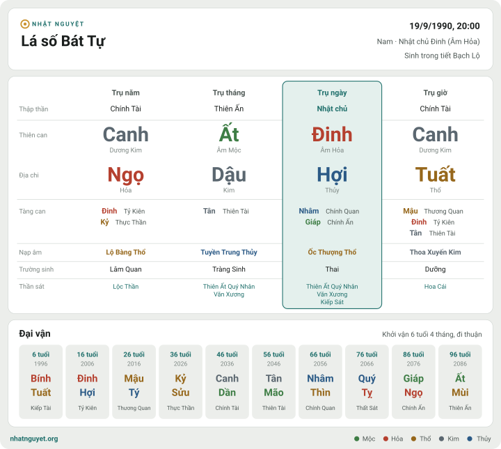

<h1 align="center">Nhật Nguyệt</h1>

<p align="center">
  <b>Tử Vi, Bát Tự, Thần số học trên âm lịch Việt Nam đối chiếu NASA và IMCCE, kèm 3,6 triệu lá số có lời luận trích sách cổ và 17.291 ca kiểm dùng chung để bản viết lại ở ngôn ngữ nào cũng tự kiểm được.</b><br>
  JavaScript · Python · dòng lệnh · máy chủ MCP · widget · Tiếng Việt, English, 中文
</p>

<p align="center">
  <picture>
    <source media="(prefers-color-scheme: dark)" srcset="./assets/la-so-tu-vi-vi-toi.svg">
    
  </picture>
  <picture>
    <source media="(prefers-color-scheme: dark)" srcset="./assets/la-so-bat-tu-vi-toi.svg">
    
  </picture>
  <picture>
    <source media="(prefers-color-scheme: dark)" srcset="./assets/than-so-hoc-vi-toi.svg">
    
  </picture>
</p>

<p align="center">
  <a href="./README.md">English</a> · <b>Tiếng Việt</b> · <a href="./README.zh.md">中文</a> · <a href="./README.ja.md">日本語</a> · <a href="./README.ko.md">한국어</a> · <a href="./README.fr.md">Français</a> · <a href="./README.th.md">ไทย</a>
  <br>
  <a href="https://nhatnguyet.org/ma-nguon-mo/thu">Thử trực tiếp</a> ·
  <a href="https://nhatnguyet.org/ma-nguon-mo/tai-lieu">Tài liệu</a> ·
  <a href="https://huggingface.co/nhatnguyet">Hugging Face</a> ·
  <a href="https://nhatnguyet.org/ma-nguon-mo">Trang giới thiệu</a>
</p>

<p align="center">
  <a href="https://www.npmjs.com/package/@nhatnguyet/tu-vi"></a>
  <a href="https://pypi.org/project/nhatnguyet/"></a>
  <a href="./ca-kiem"></a>
  <a href="https://github.com/Nhat-Nguyet/nhatnguyet/actions/workflows/kiem.yml"></a>
  <a href="./LICENSE"></a>
  <a href="./DATA-LICENSE"></a>
  <a href="https://doi.org/10.5281/zenodo.24358014"></a>
</p>

## Bắt đầu nhanh

**JavaScript, TypeScript** (Node 18 trở lên, trình duyệt)

```bash
npm i @nhatnguyet/tu-vi @nhatnguyet/am-lich
```

```js
import { writeFileSync } from "node:fs";
import { castZiWei } from "@nhatnguyet/tu-vi";
import { toLunar } from "@nhatnguyet/am-lich";

const chart = castZiWei({ name: "Nguyen Van An", date: "1990-09-19", time: "20:00", gender: "male" });
const life = chart.palaces[chart.lifePalace];
console.log(chart.bureau.name, "|", life.name, life.branch, "|", life.stars[0].name, life.stars[0].brightness);
writeFileSync("chart.svg", chart.toSvg());   // the chart image above

// Same day, two calendars: Tết in Vietnam, still the 12th month in China
const vn = toLunar("1985-01-21");
const cn = toLunar("1985-01-21", { country: "CN" });
console.log(vn.day, vn.month, vn.year, vn.yearName, "|", cn.day, cn.month, cn.year, cn.yearName);
```

```text
Earth Five | Life Palace Hợi | Moon Exalted
1 1 1985 Ất Sửu | 1 12 1984 Giáp Tý
```

**Python** (3.9 trở lên, chỉ thư viện chuẩn): cùng kết quả, cùng tệp SVG tới từng byte.

```bash
pip install nhatnguyet
```

```python
from nhatnguyet import cast_zi_wei, to_lunar, zi_wei_svg

chart = cast_zi_wei(name="Nguyen Van An", date="1990-09-19", time="20:00", gender="male")
life = chart["palaces"][chart["lifePalace"]]
print(chart["bureau"]["name"], "|", life["name"], life["branch"], "|", life["stars"][0]["name"], life["stars"][0]["brightness"])
open("chart.svg", "w", encoding="utf-8").write(zi_wei_svg(chart))

vn = to_lunar("1985-01-21")
cn = to_lunar("1985-01-21", country="CN")
print(vn["day"], vn["month"], vn["year"], vn["yearName"], "|", cn["day"], cn["month"], cn["year"], cn["yearName"])
```

**Dòng lệnh**: chạy luôn bằng `npx`, hoặc gõ `nhatnguyet ...` sau khi `pip install nhatnguyet`.

```bash
npx @nhatnguyet/cli ziwei 1990-09-19 20:00 male --year 2026
```

<details>
<summary>Kết quả (12 cung xếp thành lưới, rồi năm xem, đại vận, cách cục)</summary>

```text
┌────────────────────┬────────────────────┬────────────────────┬────────────────────┐
│ Travel             │ Health             │ Wealth · Body      │ Children           │
│ Tân Tỵ             │ Nhâm Ngọ Triệt     │ Quý Mùi Triệt      │ Giáp Thân          │
│ Celestial Mechanism│ Purple Star Ex     │ Spinning Camel     │ Army Breaker We    │
│   Pr               │ Celestial Leader,  │ Nurture            │ Prosperity,        │
│ Celestial Talent   │ Celestial Fortune  │                    │ Celestial Horse    │
│ Extinction         │ Conception         │                    │ Growth             │
├────────────────────┼────────────────────┴────────────────────┼────────────────────┤
│ Friends/Subordinat…│                                         │ Spouse             │
│ Canh Thìn          │                                         │ Ất Dậu             │
│ Seven Killings We  │                                         │ Sword Ram,         │
│ Tomb               │                                         │ Earthly Robber,    │
│                    │          ZI WEI DOU SHU CHART           │ Dipper Lord        │
│                    │      Born 1990-09-19 20:00 (Tuất)       │ Bathing            │
├────────────────────┤       Lunar 1990-08-01 · Canh Ngọ       ├────────────────────┤
│ Career             │                Yang Male                │ Siblings           │
│ Kỷ Mão             │           Bureau: Earth Five            │ Bính Tuất Tuần     │
│ Sun Pr Lộc         │      Na yin: Earth by the Roadside      │ Purity Ex          │
│ Celestial Beam Pr  │          Life: Hợi · Body: Mùi          │ Celestial Treasury │
│ Right Assistant,   │                                         │   Pr               │
│ Peach Blossom,     │                                         │ Youth              │
│ Eight Seats,       │                                         │                    │
│ Celestial Nobili…  │                                         │                    │
│ Death              │                                         │                    │
├────────────────────┼────────────────────┬────────────────────┼────────────────────┤
│ Property           │ Fortune/Virtue     │ Parents            │ Life Palace        │
│ Mậu Dần            │ Kỷ Sửu             │ Mậu Tý             │ Đinh Hợi Tuần      │
│ Military Song      │ Celestial Blessing │ Greedy Wolf We     │ Moon Ex Kỵ         │
│   Pr Quyền         │   We Khoa          │ Literary Glory,    │ Left Assistant,    │
│ Celestial General  │ Giant Gate We      │ Celestial Weeping, │ Three Terraces,    │
│   Ex               │ Earthly Void,      │ Celestial Emptin…  │ Grace Light,       │
│ Celestial Excell…, │ Celestial Longev…  │ Peak               │ Celestial Offici…  │
│ Literary Melody    │ Decline            │                    │ Prime              │
│ Illness            │                    │                    │                    │
└────────────────────┴────────────────────┴────────────────────┴────────────────────┘
Brightness: Ex exalted, Pr prosperous, Fa favorable, Ne neutral, We weak. Ages are East
Asian ages (1 at birth).

Year 2026 (Bính Ngọ)
  age 37 · Year palace: Health · Minor limit: Friends/Subordinates ·
  Decade: Property (35-44) · Hóa Lộc: Celestial Blessing → Fortune/Virtue ·
  Hóa Quyền: Celestial Mechanism → Travel · Hóa Khoa: Literary Glory → Parents ·
  Hóa Kỵ: Purity → Siblings

Ten-year periods
    5-14  1994-2003  Life Palace (Hợi)  Moon
   15-24  2004-2013  Parents (Tý)  Greedy Wolf
   25-34  2014-2023  Fortune/Virtue (Sửu)  Celestial Blessing, Giant Gate
   35-44  2024-2033  Property (Dần)  Military Song, Celestial General
   45-54  2034-2043  Career (Mão)  Sun, Celestial Beam
   55-64  2044-2053  Friends/Subordinates (Thìn)  Seven Killings
   65-74  2054-2063  Travel (Tỵ)  Celestial Mechanism
   75-84  2064-2073  Health (Ngọ)  Purple Star
   85-94  2074-2083  Wealth (Mùi)  -
   95-104 2084-2093  Children (Thân)  Army Breaker
  105-114 2094-2103  Spouse (Dậu)  -
  115-124 2104-2113  Siblings (Tuất)  Purity, Celestial Treasury

Patterns
  Cơ Nguyệt Đồng Lương 機月同梁 · Life Palace
  Tả Hữu đồng hội 左右 · Life Palace
  Nhật xuất Phù Tang 日出扶桑 · Career
  Nguyệt lạc Hợi cung 月落亥宮 · Life Palace

Birth time 20:00 falls in the Tuất double hour (19:00-20:59). The lunar date follows the
Vietnamese calendar (UTC+7).
```

</details>

Lệnh khác: `bazi`, `lunar`, `solar`, `terms`, `numerology`, `festivals`; `--lang vi|zh` cho tên tiếng Việt, tiếng Trung, `--json`, `--svg chart.svg`. API tiếng Anh đầy đủ mọi tuỳ chọn: [docs/api-en.md](./docs/api-en.md).

## Mục lục

1. [Có gì trong repo](#có-gì-trong-repo)
2. [Bộ dữ liệu](#bộ-dữ-liệu)
3. [So với thư viện khác](#so-với-thư-viện-khác)
4. [Cho AI](#cho-ai)
5. [Widget](#widget)
6. [Cơ sở khoa học](#cơ-sở-khoa-học)
7. [Trang thử và tài liệu](#trang-thử-và-tài-liệu)
8. [Chuyển từ iztro](#chuyển-từ-iztro)
9. [Giấy phép và ghi nguồn](#giấy-phép-và-ghi-nguồn)
10. [Hỏi đáp](#hỏi-đáp)
11. [Đóng góp](#đóng-góp)

## Có gì trong repo

Mọi thư viện ra đúng từng trường như lõi tính chạy
[nhatnguyet.org](https://nhatnguyet.org) và app Nhật Nguyệt. Không gọi mạng;
các thư viện không phụ thuộc gói ngoài nào.

| Gói | Python | Làm gì |
|---|---|---|
| [`@nhatnguyet/am-lich`](./js/packages/am-lich) | `nhatnguyet` | Đổi âm dương lịch cho Việt Nam, Trung Quốc, Hàn Quốc, Nhật Bản và 7 vùng khác; can chi; 24 tiết khí tới phút; Nhị Thập Bát Tú; nạp âm |
| [`@nhatnguyet/tu-vi`](./js/packages/tu-vi) | `nhatnguyet` | Tử Vi: 12 cung, miếu vượng hãm, Tứ Hóa, Tuần Triệt, đại vận, hạn năm, sao lưu, cách cục kèm câu gốc chữ Hán; vẽ SVG; bản chữ cho mô hình ngôn ngữ; lớp tương thích iztro |
| [`@nhatnguyet/bat-tu`](./js/packages/bat-tu) | `nhatnguyet` | Bát Tự: bốn trụ theo tiết khí, tàng can, thập thần, thần sát, đại vận, tiểu vận; vẽ SVG |
| [`@nhatnguyet/than-so-hoc`](./js/packages/than-so-hoc) | `nhatnguyet` | Thần số học Pythagoras (đường đời, sứ mệnh, linh hồn, đỉnh cao, thách thức, năm cá nhân), tên tiếng Việt có dấu; vẽ SVG |
| [`@nhatnguyet/le-hoi`](./js/packages/le-hoi) | `nhatnguyet` | 200 lễ hội Việt Nam kèm ngày dương lịch của năm bất kỳ |
| [`@nhatnguyet/cli`](./js/packages/cli) | lệnh `nhatnguyet` | In lá số thành lưới trên cửa sổ dòng lệnh, xuất JSON hay SVG |
| [`@nhatnguyet/mcp`](./js/packages/mcp) | | Máy chủ MCP 7 công cụ cho trợ lý AI |
| [`@nhatnguyet/widgets`](./js/packages/widgets) | | 5 thành phần web (lịch hôm nay, lịch tháng, giờ hoàng đạo, đếm ngược Tết, đổi lịch) |

[`ca-kiem/`](./ca-kiem) chứa **17.291 ca kiểm** (đầu vào `vao`, đáp án `ra`)
sinh từ lõi tính gốc: 14.936 ca lịch, 777 lá Tử Vi, 777 lá Bát Tự, 600 hồ sơ
thần số học, 201 năm lễ hội. Bản TypeScript và Python qua trọn bộ ở mỗi lần đẩy
mã.

## Bộ dữ liệu

Tất cả ở [Hugging Face](https://huggingface.co/nhatnguyet), giấy phép CC BY 4.0,
dùng được cho sản phẩm thương mại và huấn luyện AI, chỉ cần ghi nguồn.

| Bộ | Nội dung | Cỡ nén |
|---|---|---:|
| [`nhatnguyet/loi-luan-tu-vi`](https://huggingface.co/datasets/nhatnguyet/loi-luan-tu-vi) | 1.761.936 lá Tử Vi có lời luận: mọi ngày từ 1900 tới 2100 × 12 giờ × 2 giới | 9,20 GB |
| [`nhatnguyet/loi-luan-bat-tu`](https://huggingface.co/datasets/nhatnguyet/loi-luan-bat-tu) | 1.761.936 lá Bát Tự có lời luận, cùng khoảng ngày | 1,57 GB |
| [`nhatnguyet/loi-luan-than-so-hoc`](https://huggingface.co/datasets/nhatnguyet/loi-luan-than-so-hoc) | 73.414 hồ sơ thần số học, mỗi ngày sinh một hồ sơ | 0,08 GB |
| [`nhatnguyet/sach-co`](https://huggingface.co/datasets/nhatnguyet/sach-co) | 412 văn bản cổ thuộc phạm vi công cộng (khoảng 390 tác phẩm), 70,1 triệu ký tự, toàn văn | 151 MB chữ, 69 MB Parquet |
| [33 bộ lịch pháp và văn hoá](https://nhatnguyet.org/du-lieu) | âm dương lịch 1900 tới 2100, tiết khí, 64 quẻ, 78 lá Tarot, 200 lễ hội, 456 bài văn cúng... dạng CSV, JSON, Parquet, có [DOI](https://doi.org/10.5281/zenodo.23009396) | |

Ba bộ lời luận cộng lại **3.597.286 lá, 10,85 GB nén**, chia ba phần: lá số có
cấu trúc kèm mã lời luận (`la-so/`, 1,50 GB), toàn văn ghép sẵn theo từng ngôn
ngữ (`ghep-san/<vi|en|zh>/`, 9,31 GB) và kho chữ nơi mỗi lời luận, câu sách, bài
viết chỉ lưu một lần (`kho/`, 0,04 GB). Lời luận trích sách cổ kèm tên sách và
chương. Mỗi năm sinh một tệp. **Giải nén ra rất lớn** (chữ lặp giữa các lá: một
năm Tử Vi ghép sẵn chừng 2,6 GB mỗi ngôn ngữ), nên đọc theo dòng
(`streaming=True`) hoặc tải từng năm.

Văn bản cổ: 337 bản Hán văn, 44 tiếng Anh, 30 tiếng Việt, 1 tiếng Đức; theo đề
tài: 201 Kinh Dịch và bốc phệ, 28 thần số học, 26 sử và văn hoá Việt, 26 Tam
thức, 22 phong thủy, 20 Bát Tự và mệnh lý, 20 Phật giáo, 20 tín ngưỡng và lễ
tục, 19 lịch pháp và chọn ngày, 14 nhân tướng, 8 Tử Vi, 6 chiêm tinh và Tarot,
2 khác. 28 văn bản là chữ nhận dạng quang học, có cờ `ocr`.

```python
from datasets import load_dataset

# one birth year of Zi Wei readings in English, streamed
ds = load_dataset("nhatnguyet/loi-luan-tu-vi", data_files="ghep-san/tu-vi/en/1990.jsonl.zst", split="train", streaming=True)
row = next(iter(ds))
print(row["k"])
print(row["van"].splitlines()[0])

books = load_dataset("nhatnguyet/sach-co", split="train")
print(len(books), sum(books["characters"]))
```

```text
1990-01-01-0-nam
# Tử Vi chart | Male | Born 01/01/1990, hour Tý
412 70092009
```

## So với thư viện khác

[iztro](https://github.com/SylarLong/iztro) và
[lunar-javascript](https://github.com/6tail/lunar-javascript) là hai thư viện
cẩn thận, dùng rộng rãi, và đúng với thứ chúng tính: lịch Trung Quốc theo giờ
Bắc Kinh (UTC+8). Việt Nam dùng cùng quy tắc nhưng theo giờ Hà Nội (UTC+7). Đối
chiếu từng ngày từ 1900 tới 2100 ([doi-chieu/](./doi-chieu/README.md), chạy lại
được bằng `node chay.mjs`):

| | Kết quả |
|---|---:|
| Ngày có ngày âm khác lunar-javascript | 2.724 trên 73.414 |
| Năm có ngày Tết khác | 9 trên 201 |
| Năm có tháng nhuận khác | 6 trên 201 |
| Lá Tử Vi (mọi ngày × 12 giờ) khác iztro ở cục, cung Mệnh hay một chính tinh | 38.752 trên 880.968 (4,40%) |
| trong đó do múi giờ (iztro tính theo giờ Bắc Kinh kể cả khi chọn `vi-VN`) | 3,02% |
| trong đó do quy tắc tháng nhuận (`fixLeap` của iztro, là một tuỳ chọn) | 1,34% |
| Tiết khí so với IMCCE, lệch nhiều nhất: Nhật Nguyệt / lunar-javascript | 0,9 phút / 0,28 phút |

Ví dụ: sinh ngày 21/01/1985, giờ Tỵ. iztro ra mùng 1 tháng Chạp năm Giáp Tý,
Kim Tứ Cục, Mệnh ở Thân. Nhật Nguyệt ra mùng 1 Tết Ất Sửu, Thủy Nhị Cục, Mệnh ở
Dậu. Truyền `country: "CN"` thì Nhật Nguyệt cũng cho lịch Trung Quốc.

## Cho AI

Mô hình ngôn ngữ không nên tự nhẩm ngày âm hay vị trí sao. Bốn cách đưa con số
thật cho chúng:

- **Máy chủ MCP** 7 công cụ (`lunar_convert`, `solar_terms`, `cast_zi_wei`,
  `cast_bazi`, `numerology`, `festivals`, `render_chart_svg`), chạy trên máy:
  `claude mcp add nhatnguyet -- npx -y @nhatnguyet/mcp`. Cài cho Claude
  Desktop, Cursor, VS Code: [js/packages/mcp](./js/packages/mcp/README.md).
- **Agent Skill** dặn trợ lý gọi công cụ thay vì đoán:
  [skills/](./skills/README.md).
- **`chartToText`** (`chart_to_text` ở Python) chuyển lá số thành Markdown gọn
  để đưa vào lời nhắc (`lang: "vi"` cho bản tiếng Việt):

  ```js
  import { castZiWei, chartToText } from "@nhatnguyet/tu-vi";

  const chart = castZiWei({ date: "1990-09-19", time: "20:00", gender: "male" });
  console.log(chartToText(chart, { detail: "summary" }));
  ```

  ```text
  # Zi Wei Dou Shu chart

  Computed data only, no interpretation.

  - Gender: male
  - Birth date (Gregorian): 1990-09-19 20:00
  - Birth hour: Tuất (19:00-20:59)
  - Birth date (lunar): 1990-08-01
  - Year pillar: Canh Ngọ
  - Yin-yang: Yang Male
  - Bureau: Earth Five (5)
  ...
  ```

- **Bộ dữ liệu** để huấn luyện và truy xuất: [ở trên](#bộ-dữ-liệu).

## Widget

<p align="center"></p>

Nhúng từ nhatnguyet.org (14 widget; chọn tuỳ chọn và chép mã ở
[nhatnguyet.org/widget](https://nhatnguyet.org/widget)):

```html
<div data-widget="lich-hom-nay" data-lang="en" data-theme="auto"></div>
<script async src="https://nhatnguyet.org/embed/w.js"></script>
```

`data-country` (`VN` mặc định, `CN`, `KR`, `JP`...) đổi các widget lịch sang âm
lịch của nước khác; `data-lang="vi"` cho chữ tiếng Việt. Hoặc chạy 5 widget
ngay trong trang, không cần máy chủ:

```html
<script type="module" src="https://cdn.jsdelivr.net/npm/@nhatnguyet/widgets/dist/nn-widgets.js"></script>
<nn-lich-thang lang="en" theme="auto" country="VN"></nn-lich-thang>
```

Mọi widget và thuộc tính: [widgets/](./widgets/README.md).

## Cơ sở khoa học

**Phần khoa học nằm ở phương pháp, không ở lời đoán.** Lịch là phép tính thiên
văn, đối chiếu với NASA và IMCCE trên khoảng 1900 tới 2100:

| Phép kiểm | Kết quả |
|---|---|
| Điểm sóc so với NASA (2.474 lần) | muộn trung bình 0,9 phút, nhiều nhất 3,9 phút |
| Tháng âm dựng lại từ điểm sóc NASA và tiết khí IMCCE | khớp 2.459 trên 2.461 tháng (hai tháng còn lại có điểm sóc trong vòng một phút quanh nửa đêm) |
| Tiết khí so với IMCCE (4.824 mốc) | lệch trung bình 0,27 phút, nhiều nhất 0,9 phút (làm tròn tới phút), mọi mốc đúng ngày |
| Việt Nam (UTC+7) so với Trung Quốc (UTC+8), cùng quy tắc | khác 2.814 ngày và 10 ngày Tết |

Lịch theo nước: Việt Nam UTC+7 (mặc định); Trung Quốc, Đài Loan, Hồng Kông, Ma
Cao, Singapore, Malaysia, Indonesia, Philippines UTC+8; Hàn Quốc, Nhật Bản
UTC+9. Mọi kết quả là tất định và kiểm lại được bằng ca kiểm. Tử Vi, Bát Tự,
Thần số học là quy tắc của các trường phái truyền thống, chưa được khoa học
kiểm chứng; đừng dùng để quyết chuyện sức khoẻ, tiền bạc, pháp lý. Chỗ các phái
không thống nhất (tháng nhuận, giờ Tý từ 23h), tài liệu nói rõ đang theo cách
nào.

Đọc thêm: [âm lịch và tiết khí](https://nhatnguyet.org/blog/co-so-khoa-hoc-am-lich-tiet-khi) ·
[lá số Tử Vi](https://nhatnguyet.org/blog/co-so-khoa-hoc-la-so-tu-vi) ·
[Bát Tự](https://nhatnguyet.org/blog/co-so-khoa-hoc-bat-tu) ·
[thần số học](https://nhatnguyet.org/blog/co-so-khoa-hoc-than-so-hoc) ·
[sách cổ và lời luận](https://nhatnguyet.org/blog/co-so-khoa-hoc-sach-co-loi-luan) ·
[Nhật Nguyệt kiểm chứng thế nào](https://nhatnguyet.org/blog/co-so-khoa-hoc-kiem-chung).

## Trang thử và tài liệu

- **Thử trực tiếp**: [nhatnguyet.org/ma-nguon-mo/thu](https://nhatnguyet.org/ma-nguon-mo/thu), chạy các gói ngay trong trình duyệt.
- **Tài liệu API**: [nhatnguyet.org/ma-nguon-mo/tai-lieu](https://nhatnguyet.org/ma-nguon-mo/tai-lieu) và [docs/api-en.md](./docs/api-en.md).
- **Ví dụ**: [examples/](./examples/README.md) (trang HTML không cần dựng, Node, Python).
- **Hướng dẫn**: [lập lá số Tử Vi bằng JavaScript](https://nhatnguyet.org/blog/lap-la-so-tu-vi-bang-javascript) · [âm lịch và lễ hội cho ứng dụng](https://nhatnguyet.org/blog/lich-am-le-hoi-cho-ung-dung) · [trợ lý AI trích dẫn sách cổ](https://nhatnguyet.org/blog/tro-ly-ai-trich-dan-sach-co) · [phân tích dữ liệu lá số bằng Python](https://nhatnguyet.org/blog/phan-tich-du-lieu-la-so-bang-python).

## Chuyển từ iztro

Đổi một dòng import; kết quả giữ khuôn `FunctionalAstrolabe` và sáu ngôn ngữ
hiển thị của iztro, nhưng tính trên âm lịch Việt Nam:

```diff
- import { astro } from "iztro";
+ import { astro } from "@nhatnguyet/tu-vi/iztro";
```

Các phương thức như `astrolabe.palace()` không có (lớp này chỉ trả dữ liệu).
Chi tiết: [docs/chuyen-tu-iztro.md](./docs/chuyen-tu-iztro.md).

## Giấy phép và ghi nguồn

| Phần | Giấy phép |
|---|---|
| Mã nguồn | [MIT](./LICENSE) |
| Dữ liệu, lời luận, ca kiểm | [CC BY 4.0](./DATA-LICENSE): được dùng thương mại và huấn luyện AI, phải ghi nguồn |
| Văn bản cổ | Nguyên bản thuộc phạm vi công cộng; phần số hoá và làm sạch theo CC BY 4.0 |

Dòng ghi nguồn: `Dữ liệu: Nhật Nguyệt (nhatnguyet.org)`, kèm liên kết khi có
thể. Tên và biểu trưng Nhật Nguyệt không nằm trong các giấy phép này.

```bibtex
@software{nhatnguyet_2026,
  author = {{Nhat Nguyet}},
  title  = {Nhat Nguyet: open source code and data for Zi Wei Dou Shu, BaZi and numerology},
  year   = {2026},
  url    = {https://nhatnguyet.org/en/ma-nguon-mo},
  doi    = {10.5281/zenodo.24358014}
}
```

## Hỏi đáp

<details>
<summary><b>Vì sao âm lịch Việt Nam khác âm lịch Trung Quốc?</b></summary>

Cùng quy tắc, khác đồng hồ. Tháng âm bắt đầu ở ngày có điểm sóc, và ngày được
xét theo giờ địa phương. Điểm sóc rơi vào 16h tới 17h UT thì ở Hà Nội còn trước
nửa đêm, ở Bắc Kinh đã qua nửa đêm, nên tháng ở Việt Nam bắt đầu sớm một ngày.
Tết 1985 lệch hẳn một tháng (21/01 ở Việt Nam, 20/02 ở Trung Quốc) vì tháng
nhuận rơi vào hai năm khác nhau.
</details>

<details>
<summary><b>Giờ Tý là giờ nào, sinh lúc 23h30 thì lấy ngày nào?</b></summary>

Giờ Tý từ 23h tới 0h59. Tử Vi giữ đúng ngày đã nhập (có sách tính sang ngày
hôm sau; muốn theo sách ấy thì nhập ngày hôm sau). Bát Tự đổi trụ ngày từ 23h.
Cả hai đều ghi rõ trong `notes` của lá số.
</details>

<details>
<summary><b>Trụ tháng Bát Tự theo tháng âm hay theo tiết khí?</b></summary>

Theo tiết khí: năm đổi ở Lập Xuân, tháng đổi ở mỗi tiết. Lấy tháng âm làm trụ
tháng thì sai khoảng một phần tư số ngày (24,3% từ 1900 tới 2100).
</details>

<details>
<summary><b>Có được dùng dữ liệu để huấn luyện mô hình AI không?</b></summary>

Được, kể cả cho mục đích thương mại, theo CC BY 4.0. Chỉ cần ghi "Dữ liệu: Nhật
Nguyệt (nhatnguyet.org)".
</details>

<details>
<summary><b>Thần số học xử lý tên tiếng Việt có dấu thế nào?</b></summary>

Bỏ dấu ("Đ" tính là "D") rồi áp bảng chữ sang số của Pythagoras. Giữ nguyên
các số bậc thầy 11, 22, 33.
</details>

## Đóng góp

Báo lỗi kèm nguồn (sách và chương, hay số liệu thiên văn) là có ích nhất; xem
[CONTRIBUTING.md](./CONTRIBUTING.md).

**Thử thách chuyển ngữ**: viết lại lõi tính bằng ngôn ngữ khác (Go, Rust, Dart,
Swift, C#...) và qua trọn 17.291 ca kiểm trong [`ca-kiem/`](./ca-kiem). Đọc
`vao`, so với `ra`; luật chơi ở
[CONTRIBUTING.md](./CONTRIBUTING.md#port-challenge).

Trang web: [nhatnguyet.org](https://nhatnguyet.org) · Thư: lienhe@nhatnguyet.org

<p align="center"><sub>Dữ liệu: Nhật Nguyệt (nhatnguyet.org) · Mã MIT · Dữ liệu CC BY 4.0</sub></p>
