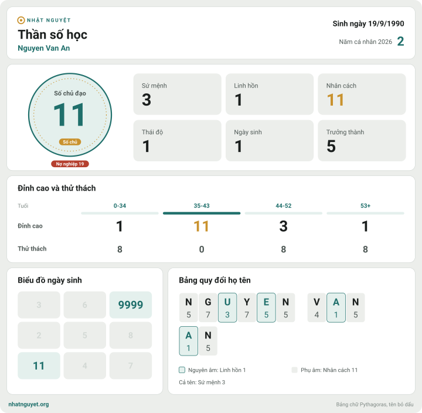

<h1 align="center">Nhật Nguyệt</h1>

<p align="center">
  <b>Âm dương lịch, Tử Vi, Bát Tự, thần số học, Kinh Dịch và phong thuỷ cho JavaScript và Python: chính xác theo thiên văn, tính theo từng nước, và cùng một đáp án ở mọi ngôn ngữ.</b><br>
  Điểm sóc và tiết khí đối chiếu với NASA và IMCCE từ 1900 tới 2100 · âm lịch của Trung Quốc, Hàn Quốc, Nhật Bản, Việt Nam và 7 nước, vùng khác · máy chủ MCP cho trợ lý AI · 3,6 triệu lá số mở có lời luận trích sách cổ, ghi rõ sách và chương · kết quả bằng Tiếng Việt, English và 中文 · 17.291 ca kiểm dùng chung (tổng cộng 28.586)
</p>

<p align="center">
  <a href="./README.md">English</a> · <b>Tiếng Việt</b> · <a href="./README.zh.md">中文</a> · <a href="./README.ja.md">日本語</a> · <a href="./README.ko.md">한국어</a> · <a href="./README.fr.md">Français</a> · <a href="./README.th.md">ไทย</a>
  <br>
  <a href="https://nhatnguyet.org/ma-nguon-mo/thu">Thử trực tiếp</a> ·
  <a href="https://nhatnguyet.org/ma-nguon-mo/tai-lieu">Tài liệu</a> ·
  <a href="./docs/paper/paper.pdf">Bài báo</a> ·
  <a href="https://huggingface.co/nhatnguyet">Hugging Face</a> ·
  <a href="https://nhatnguyet.org/ma-nguon-mo">Trang giới thiệu</a>
</p>

<p align="center">
  <picture>
    <source media="(prefers-color-scheme: dark)" srcset="./assets/la-so-tu-vi-vi-toi.svg">
    
  </picture>
</p>

<p align="center">
  <a href="https://www.npmjs.com/package/@nhatnguyet/ziwei"></a>
  <a href="https://pypi.org/project/nhatnguyet/"></a>
  <a href="./ca-kiem"></a>
  <a href="https://github.com/Nhat-Nguyet/nhatnguyet-lunar-ziwei-bazi-numerology/actions/workflows/kiem.yml"></a>
  <a href="./LICENSE"></a>
  <a href="./DATA-LICENSE"></a>
  <a href="https://doi.org/10.5281/zenodo.24358013"></a>
</p>

## Bắt đầu nhanh

**JavaScript, TypeScript** (Node 18 trở lên, trình duyệt)

```bash
npm i @nhatnguyet/ziwei @nhatnguyet/lunar
```

```js
import { writeFileSync } from "node:fs";
import { castZiWei } from "@nhatnguyet/ziwei";
import { toLunar } from "@nhatnguyet/lunar";

const chart = castZiWei({ date: "1990-09-19", time: "20:00", gender: "male" });
const life = chart.palaces[chart.lifePalace];
console.log(chart.bureau.name, "|", life.name, life.branch, "|", life.stars[0].name, life.stars[0].brightness);
writeFileSync("chart.svg", chart.toSvg());   // the chart image above

// The same day can be a different lunar date in Beijing, Seoul and Hanoi time
for (const date of ["2027-02-06", "2030-02-02"]) {
  const lunar = ["CN", "KR", "VN"].map((country) => {
    const d = toLunar(date, { country });
    return `${country} ${d.year}-${d.month}-${d.day}`;
  });
  console.log(date, "|", lunar.join(" | "));
}
```

```text
Earth Five | Life Palace Hai | Moon Exalted
2027-02-06 | CN 2027-1-1 | KR 2026-12-30 | VN 2027-1-1
2030-02-02 | CN 2029-12-30 | KR 2029-12-30 | VN 2030-1-1
```

`country` mặc định là `"VN"` (Việt Nam, UTC+7), lịch mà dự án bắt đầu từ đó:
âm lịch Việt Nam lệch lịch Trung Quốc ở hàng nghìn ngày, và thư viện làm theo
lịch Trung Quốc không tính phần ấy. `castZiWei` cũng nhận tuỳ chọn này. Mười
nước, vùng còn lại liệt kê ở [Âm lịch](#âm-lịch-và-giờ-hoàng-đạo).

**Python** (3.9 trở lên, chỉ thư viện chuẩn): cùng kết quả, cùng tệp SVG tới từng byte.

```bash
pip install nhatnguyet
```

<!-- run: same-output -->
```python
from nhatnguyet import cast_zi_wei, to_lunar, zi_wei_svg

chart = cast_zi_wei(date="1990-09-19", time="20:00", gender="male")
life = chart["palaces"][chart["lifePalace"]]
print(chart["bureau"]["name"], "|", life["name"], life["branch"], "|", life["stars"][0]["name"], life["stars"][0]["brightness"])
open("chart.svg", "w", encoding="utf-8").write(zi_wei_svg(chart))

for date in ["2027-02-06", "2030-02-02"]:
    lunar = [f"{c} {d['year']}-{d['month']}-{d['day']}" for c in ("CN", "KR", "VN") for d in [to_lunar(date, country=c)]]
    print(date, "|", " | ".join(lunar))
```

**Dòng lệnh**: chạy luôn bằng `npx`, hoặc gõ `nhatnguyet ...` sau khi `pip install nhatnguyet`.

<p align="center"></p>

```bash
npx @nhatnguyet/cli ziwei 1990-09-19 20:00 male --year 2026
```

<details>
<summary>Kết quả (12 cung xếp thành lưới, rồi năm xem, đại vận, cách cục)</summary>

```text
┌────────────────────┬────────────────────┬────────────────────┬────────────────────┐
│ Travel             │ Health             │ Wealth · Body      │ Children           │
│ Xin Si             │ Ren Wu Jie Kong    │ Gui Wei Jie Kong   │ Jia Shen           │
│ Celestial Mechanism│ Purple Star Ex     │ Spinning Top,      │ Army Breaker We    │
│   Pr               │ Celestial Leader,  │ Celestial Void     │ Prosperity,        │
│ Celestial Talent,  │ Celestial Fortune, │ Nurture            │ Celestial Horse,   │
│ Bell Star,         │ Celestial Messen…  │                    │ Celestial Charm,   │
│ Shattering Star    │ Conception         │                    │ Celestial Physic…, │
│ Extinction         │                    │                    │ Solitary Star,     │
│                    │                    │                    │ Flowing Haze       │
│                    │                    │                    │ Growth             │
├────────────────────┼────────────────────┴────────────────────┼────────────────────┤
│ Friends/Subordinat…│                                         │ Spouse             │
│ Geng Chen          │                                         │ Yi You             │
│ Seven Killings We  │                                         │ Sword Ram,         │
│ Phoenix Pavilion,  │                                         │ Earthly Robber,    │
│ Celestial Punish…, │                                         │ Dipper Lord,       │
│ State Seal,        │                                         │ Red Phoenix        │
│ Releasing Spirit,  │                                         │ Bathing            │
│ Terrace Aide,      │                                         │                    │
│ Celestial Injury,  │                                         │                    │
│ Celestial Net,     │          ZI WEI DOU SHU CHART           │                    │
│ Widow Star         │       Born 1990-09-19 20:00 (Xu)        │                    │
│ Tomb               │       Lunar 1990-08-01 · Geng Wu        │                    │
├────────────────────┤                Yang Male                ├────────────────────┤
│ Career             │           Bureau: Earth Five            │ Siblings           │
│ Ji Mao             │      Na yin: Earth by the Roadside      │ Bing Xu Xun Kong   │
│ Sun Pr Lu          │          Life: Hai · Body: Wei          │ Purity Ex          │
│ Celestial Beam Pr  │                                         │ Celestial Treasury │
│ Right Assistant,   │                                         │   Pr               │
│ Peach Blossom,     │                                         │ Dragon Pool,       │
│ Eight Seats,       │                                         │ Earthly Snare,     │
│ Celestial Nobili…, │                                         │ Canopy             │
│ Celestial Virtue,  │                                         │ Youth              │
│ Celestial Joy,     │                                         │                    │
│ Celestial Release  │                                         │                    │
│ Death              │                                         │                    │
├────────────────────┼────────────────────┬────────────────────┼────────────────────┤
│ Property           │ Fortune/Virtue     │ Parents            │ Life Palace        │
│ Wu Yin             │ Ji Chou            │ Wu Zi              │ Ding Hai Xun Kong  │
│ Military Song      │ Celestial Blessing │ Greedy Wolf We     │ Moon Ex Ji         │
│   Pr Quan          │   We Ke            │ Literary Glory,    │ Left Assistant,    │
│ Celestial Minister │ Giant Gate We      │ Celestial Weeping, │ Three Terraces,    │
│   Ex               │ Earthly Void,      │ Celestial Emptin…, │ Grace Light,       │
│ Celestial Halberd, │ Celestial Longev…, │ Patent of Honour   │ Celestial Offici…, │
│ Literary Melody,   │ Court Tally        │ Peak               │ Fire Star,         │
│ Earthly Release,   │ Decline            │                    │ Monthly Virtue,    │
│ Celestial Kitchen  │                    │                    │ Robbery Sha,       │
│ Illness            │                    │                    │ Annual Literary …  │
│                    │                    │                    │ Prime              │
└────────────────────┴────────────────────┴────────────────────┴────────────────────┘
Brightness: Ex exalted, Pr prosperous, Fa favorable, Ne neutral, We weak. Ages are East
Asian ages (1 at birth).

Year 2026 (Bing Wu)
  age 37 · Year palace: Health · Minor limit: Friends/Subordinates ·
  Decade: Property (35-44) · Hua Lu: Celestial Blessing → Fortune/Virtue ·
  Hua Quan: Celestial Mechanism → Travel · Hua Ke: Literary Glory → Parents ·
  Hua Ji: Purity → Siblings

Ten-year periods
    5-14  1994-2003  Life Palace (Hai)  Moon
   15-24  2004-2013  Parents (Zi)  Greedy Wolf
   25-34  2014-2023  Fortune/Virtue (Chou)  Celestial Blessing, Giant Gate
   35-44  2024-2033  Property (Yin)  Military Song, Celestial Minister
   45-54  2034-2043  Career (Mao)  Sun, Celestial Beam
   55-64  2044-2053  Friends/Subordinates (Chen)  Seven Killings
   65-74  2054-2063  Travel (Si)  Celestial Mechanism
   75-84  2064-2073  Health (Wu)  Purple Star
   85-94  2074-2083  Wealth (Wei)  -
   95-104 2084-2093  Children (Shen)  Army Breaker
  105-114 2094-2103  Spouse (You)  -
  115-124 2104-2113  Siblings (Xu)  Purity, Celestial Treasury

Patterns
  Mechanism, Moon, Blessing and Beam 機月同梁 · Life Palace
  Left and Right Assistants Meeting 左右同會 · Life Palace
  Sun Rising from Fusang 日出扶桑 · Career
  Moon Setting in the Hai Palace 月落亥宮 · Life Palace

Birth time 20:00 falls in the Xu double hour (19:00-20:59). The lunar date follows the
Vietnamese calendar (UTC+7).
```

</details>

Lệnh khác: `bazi`, `lunar`, `solar`, `terms`, `numerology`, `festivals` (`--ics` để xuất tệp lịch), `hours`, `hexagram`, `cast` (lục hào), `daily-hexagram`, `kua`, `flying-stars`, `luban`; `--lang vi|zh`, `--json`, `--svg chart.svg`, và các tuỳ chọn trường phái bên dưới. API tiếng Anh đầy đủ mọi tuỳ chọn: [docs/api-en.md](./docs/api-en.md).

## Mục lục

1. [Vì sao đáng tin](#vì-sao-đáng-tin)
2. [Cài đặt](#cài-đặt)
3. [Tính năng](#tính-năng)
4. [Bộ dữ liệu](#bộ-dữ-liệu)
5. [Cho AI](#cho-ai)
6. [Widget](#widget)
7. [Ví dụ và tài liệu](#ví-dụ-và-tài-liệu)
8. [Chuyển từ iztro](#chuyển-từ-iztro)
9. [Hỏi đáp](#hỏi-đáp)
10. [Đóng góp](#đóng-góp)
11. [Trích dẫn và giấy phép](#trích-dẫn-và-giấy-phép)

## Vì sao đáng tin

**Lịch là phép tính thiên văn, tính cho đúng nước được hỏi.** Âm dương lịch Á
Đông chung quy tắc nhưng không chung đồng hồ: tháng âm bắt đầu ở ngày có điểm
sóc theo giờ địa phương, nên Bắc Kinh, Seoul và Hà Nội có thể bắt đầu một
tháng, hay một năm, vào những ngày khác nhau. Thư viện tính mỗi nước theo múi
giờ của nước ấy và đối chiếu phần thiên văn với NASA và IMCCE trên khoảng 1900
tới 2100:

| Phép kiểm | Kết quả |
|---|---|
| Điểm sóc so với NASA (2.474 lần) | muộn trung bình 0,9 phút, nhiều nhất 3,9 phút |
| Tháng âm dựng lại từ điểm sóc NASA và tiết khí IMCCE | khớp 2.459 trên 2.461 tháng (hai tháng còn lại có điểm sóc trong vòng một phút quanh nửa đêm) |
| Tiết khí so với IMCCE (4.824 mốc) | lệch trung bình 0,27 phút, nhiều nhất 0,9 phút (làm tròn tới phút), mọi mốc đúng ngày |
| Hà Nội (UTC+7) so với Bắc Kinh (UTC+8), cùng quy tắc | khác 2.814 ngày và 10 ngày Tết |
| Seoul (UTC+9) so với Bắc Kinh (UTC+8), cùng quy tắc | khác 2.818 ngày và 11 ngày Tết âm lịch |

- **Bài báo kỹ thuật**: [Tính âm dương lịch Việt Nam](./docs/paper/paper.pdf)
  (PDF) trình bày phương pháp, ngân sách sai số, phần đối chiếu với NASA,
  IMCCE và JPL DE440, và lời giải thích cho từng ngày âm lịch Việt Nam và
  Trung Quốc khác nhau. Mọi con số trong bài được `docs/paper/reproduce.sh`
  tính lại.
- **Ca kiểm dùng chung**: [`ca-kiem/`](./ca-kiem) chứa **17.291 ca lõi**
  (đầu vào `vao`, đáp án `ra`) sinh từ lõi tính gốc chạy
  [nhatnguyet.org](https://nhatnguyet.org): 14.936 ca lịch, 777 lá Tử Vi,
  777 lá Bát Tự, 600 hồ sơ thần số học và 201 năm lễ hội, cộng 432 ca cho các
  tuỳ chọn trường phái, 1.096 ngày giờ hoàng đạo, 6.684 ca Kinh Dịch và 3.083 ca
  phong thuỷ (tổng 28.586 ca). Bản TypeScript và Python qua trọn bộ ở mỗi lần đẩy mã.
- **Lịch sử ngày Tết**: [`history/`](./history/README.md) kê ngày Tết của mọi
  năm 1900 tới 2100 theo UTC+7 và UTC+8, kèm lịch Việt Nam thực sự dùng và
  nguồn cho từng năm có tư liệu.
- **Nói rõ phạm vi**: phần khoa học nằm ở phương pháp, không ở lời đoán. Tử Vi, Bát Tự, thần số học, Kinh Dịch và phong thuỷ là
  quy tắc của các trường phái truyền thống, chưa được khoa học kiểm chứng; đừng dùng để quyết chuyện
  sức khoẻ, tiền bạc, pháp lý. Chỗ các phái không thống nhất, thư viện nói rõ
  đang theo quy tắc nào và cho đổi ([tuỳ chọn trường phái](#tuỳ-chọn-trường-phái)).

### So với thư viện khác

[iztro](https://github.com/SylarLong/iztro) và
[lunar-javascript](https://github.com/6tail/lunar-javascript) là hai thư viện
cẩn thận, dùng rộng rãi, và đúng với thứ chúng tính: lịch Trung Quốc theo giờ
Bắc Kinh (UTC+8). Dùng cho nước khác, chúng cho ngày của Bắc Kinh. Việt Nam là ví dụ rõ nhất: cùng quy tắc, theo giờ Hà Nội (UTC+7). Đối
chiếu từng ngày từ 1900 tới 2100 ([doi-chieu/](./doi-chieu/README.md), chạy lại
được bằng `node chay.mjs`):

| | Kết quả |
|---|---:|
| Ngày có ngày âm khác lunar-javascript | 2.724 trên 73.414 |
| Năm có ngày Tết khác lunar-javascript | 9 trên 201 |
| Năm có tháng nhuận khác lunar-javascript | 6 trên 201 |
| Ngày vẫn khác lunar-javascript khi đặt `country: "CN"` | 150 (5 tháng) |
| Lá Tử Vi (mọi ngày × 12 giờ) khác iztro ở cục, cung Mệnh hay một chính tinh | 38.752 trên 880.968 (4,40%) |
| trong đó do múi giờ (iztro tính theo giờ Bắc Kinh kể cả khi chọn `vi-VN`) | 26.602 (3,02%) |
| trong đó do quy tắc tháng nhuận (`fixLeap` của iztro, là một tuỳ chọn) | 11.818 (1,34%) |
| trong đó không do hai lý do trên | 332 (0,04%) |
| Tiết khí so với IMCCE, lệch nhiều nhất: Nhật Nguyệt / lunar-javascript | 0,9 phút / 0,28 phút |

**Hai con số đo hai việc khác nhau.** 2.724 ngày và 9 năm Tết là Nhật Nguyệt
(Việt Nam, UTC+7) so với lunar-javascript. 2.814 ngày và 10 năm Tết ở bảng
trên là lõi tính Nhật Nguyệt so với chính nó, ở UTC+7 và ở UTC+8. Hai con số
không bằng nhau vì `country: "CN"` không trùng hẳn lunar-javascript: còn 150
ngày khác, mỗi năm một tháng ở 1914, 1916, 1920, 2057 và 2097. Năm 1914, 1916,
1920 là chỗ lunar-javascript cố ý chỉnh ngày trước 1960 cho khớp lịch in cũ của
Trung Quốc; năm 2057 và 2097 điểm sóc rơi đúng nửa đêm Bắc Kinh (16:00 UT), sát
tới mức không phân định được.

**332 lá không do múi giờ cũng không do tháng nhuận** đều nằm trong một tháng:
30 ngày từ 28/09/2057. Điểm sóc tháng ấy lúc 16:00 UT; Nhật Nguyệt đặt nó ngay
trước nửa đêm Bắc Kinh nên bắt đầu tháng vào ngày 28 ở cả hai múi giờ, còn
lunar-javascript (và vì thế iztro) đặt ngay sau nên bắt đầu vào ngày 29. Đó là
cùng ca sát nửa đêm nói trên, đổi múi giờ hay quy tắc nhuận đều không đổi được.

Ví dụ: sinh ngày 21/01/1985, giờ Tỵ. iztro ra mùng 1 tháng Chạp năm Giáp Tý,
Kim Tứ Cục, Mệnh ở Thân. Nhật Nguyệt ra mùng 1 Tết Ất Sửu, Thủy Nhị Cục, Mệnh ở
Dậu. Truyền `country: "CN"` thì Nhật Nguyệt cũng cho lịch Trung Quốc.

## Cài đặt

Phiên bản 0.4.0. Các gói JavaScript là ESM, có kiểu TypeScript và không phụ
thuộc gói ngoài nào (riêng máy chủ MCP cần SDK của nó và zod); gói Python chỉ dùng thư viện chuẩn.

```bash
npm i @nhatnguyet/lunar @nhatnguyet/ziwei @nhatnguyet/bazi @nhatnguyet/numerology @nhatnguyet/festivals @nhatnguyet/iching @nhatnguyet/fengshui
pip install nhatnguyet
```

| Gói | Cũng phát hành dưới tên | Làm gì |
|---|---|---|
| [`@nhatnguyet/lunar`](./js/packages/am-lich) | `@nhatnguyet/am-lich` | Đổi âm dương lịch cho Trung Quốc, Hàn Quốc, Nhật Bản, Việt Nam và 7 nước, vùng khác; can chi; 24 tiết khí tới phút; Nhị Thập Bát Tú; nạp âm; giờ hoàng đạo |
| [`@nhatnguyet/ziwei`](./js/packages/tu-vi) | `@nhatnguyet/tu-vi` | Tử Vi: 12 cung, miếu vượng hãm, Tứ Hóa, Tuần Triệt, đại vận, hạn năm, sao lưu, cách cục kèm câu gốc chữ Hán, tuỳ chọn trường phái; vẽ SVG; bản chữ cho mô hình ngôn ngữ; lớp tương thích iztro |
| [`@nhatnguyet/bazi`](./js/packages/bat-tu) | `@nhatnguyet/bat-tu` | Bát Tự: bốn trụ theo tiết khí, tàng can, thập thần, thần sát, đại vận, tiểu vận; vẽ SVG |
| [`@nhatnguyet/numerology`](./js/packages/than-so-hoc) | `@nhatnguyet/than-so-hoc` | Thần số học Pythagoras (đường đời, sứ mệnh, linh hồn, đỉnh cao, thách thức, năm cá nhân), tên tiếng Việt có dấu; vẽ SVG |
| [`@nhatnguyet/festivals`](./js/packages/le-hoi) | `@nhatnguyet/le-hoi` | 206 lễ hội Việt Nam kèm ngày của năm bất kỳ, tỉnh, dân tộc, nơi tổ chức; xuất iCalendar |
| [`@nhatnguyet/iching`](./js/packages/iching) | | Kinh Dịch: 64 quẻ kèm tên tiếng Anh, bính âm, chữ Hán và tiếng Việt, bát cung, quẻ hỗ và quẻ biến, gieo ba đồng xu và Mai Hoa, lục hào nạp giáp, quẻ trị ngày theo quái khí, nguyên văn Chu Dịch với bản dịch của Legge năm 1882; SVG |
| [`@nhatnguyet/fengshui`](./js/packages/fengshui) | | Quy tắc phong thuỷ của các trường phái truyền thống: cung phi Bát Trạch (số Kua) và quái nhà, 24 sơn, phi tinh Huyền Không, sao năm, thước Lỗ Ban; SVG la bàn và bàn phi tinh |
| [`@nhatnguyet/cli`](./js/packages/cli) | | In lá số thành lưới trên cửa sổ dòng lệnh, JSON, SVG hay iCalendar; cùng các lệnh như `nhatnguyet` ở Python |
| [`@nhatnguyet/mcp`](./js/packages/mcp) | | Máy chủ MCP cho trợ lý AI |
| [`@nhatnguyet/widgets`](./js/packages/widgets) | | 5 thành phần web |
| [`nhatnguyet`](./python) (PyPI) | | Mọi thứ ở trên trong một gói Python, kết quả khớp từng trường |

Các gói tên tiếng Việt là cùng mã dưới tên gốc; lệnh import cũ vẫn chạy.

## Tính năng

Mọi thư viện ra đúng từng trường như lõi tính chạy
[nhatnguyet.org](https://nhatnguyet.org) và app Nhật Nguyệt. Không gọi mạng.
Kết quả bằng tiếng Anh (`lang: "en"`, mặc định), tiếng Việt (`"vi"`) hay tiếng
Trung (`"zh"`); ở tiếng Anh, can chi mặc định viết bằng bính âm (`terms: "han"`
hay `"vi"` để ra chữ Hán hay âm Hán Việt).

<table>
  <tr>
    <td align="center" width="33%"><a href="./assets/la-so-tu-vi-vi.svg"><picture><source media="(prefers-color-scheme: dark)" srcset="./assets/la-so-tu-vi-vi-toi.svg"></picture></a><br><sub>Tử Vi · <code>castZiWei().toSvg()</code></sub></td>
    <td align="center" width="33%"><a href="./assets/la-so-bat-tu-vi.svg"><picture><source media="(prefers-color-scheme: dark)" srcset="./assets/la-so-bat-tu-vi-toi.svg"></picture></a><br><sub>Bát Tự · <code>castBaZi().toSvg()</code></sub></td>
    <td align="center" width="33%"><a href="./assets/than-so-hoc-vi.svg"><picture><source media="(prefers-color-scheme: dark)" srcset="./assets/than-so-hoc-vi-toi.svg"></picture></a><br><sub>Thần số học · <code>numerology().toSvg()</code></sub></td>
  </tr>
</table>

<p align="center"><sub>Mỗi hình là một SVG do thư viện vẽ; bấm vào hình để xem cỡ lớn.</sub></p>

### Âm lịch và giờ hoàng đạo

`toLunar`, `toSolar`, `solarTerms` và `auspiciousHours` trong
`@nhatnguyet/lunar` (`to_lunar`, `to_solar`, `solar_terms`,
`auspicious_hours` ở Python). `country` chọn lịch: Trung Quốc
(`CN`), Đài Loan (`TW`), Hồng Kông (`HK`), Ma Cao (`MO`), Singapore (`SG`),
Malaysia (`MY`), Indonesia (`ID`), Philippines (`PH`) theo UTC+8; Hàn Quốc
(`KR`), Nhật Bản (`JP`) theo UTC+9; Việt Nam (`VN`, mặc định) theo UTC+7; hoặc
`timeZone` tính bằng giờ. Dòng lệnh (`--country`), máy chủ MCP và widget nhận
cùng các mã ấy.

`auspiciousHours` cho mười hai canh giờ của một ngày, kèm cờ hoàng đạo hay hắc
đạo và vị thần cai quản giờ ấy, như lịch in Trung Quốc và Việt Nam vẫn ghi (dòng lệnh
`nhatnguyet hours`, công cụ MCP `auspicious_hours`):

```js
import { auspiciousHours } from "@nhatnguyet/lunar";

const day = auspiciousHours("2027-02-06");   // Tết 2027
console.log(day.day, "|", day.hours.filter((h) => h.auspicious).map((h) => `${h.branch} ${h.range} ${h.spirit}`).join(", "));
```

```text
Bing Chen | Yin 03:00-04:59 Si Ming, Chen 07:00-08:59 Qing Long, Si 09:00-10:59 Ming Tang, Shen 15:00-16:59 Jin Kui, You 17:00-18:59 Bao Guang, Hai 21:00-22:59 Yu Tang
```

<!-- run: same-output -->
```python
from nhatnguyet import auspicious_hours

day = auspicious_hours("2027-02-06")   # Tết 2027
print(day["day"], "|", ", ".join(f"{h['branch']} {h['range']} {h['spirit']}" for h in day["hours"] if h["auspicious"]))
```

### Tử Vi

`castZiWei` lập lá số đầy đủ: cung Mệnh, cung Thân, cục, 14 chính tinh và 55
phụ tinh kèm độ sáng, Tứ Hóa, Tuần Triệt, đại vận, một năm xem kèm sao lưu, và
các cách cục của Tử Vi Đẩu Số Toàn Thư kèm câu gốc chữ Hán. `chart.toSvg()` vẽ
lá số; `chartToText` chuyển nó thành Markdown gọn cho mô hình ngôn ngữ. Lớp
tương thích iztro có các hàm tra và vận hạn: `palace()`, `star()`,
`surroundedPalaces()`, `horoscope()`, `fliesTo()`
([Chuyển từ iztro](#chuyển-từ-iztro)).

### Tuỳ chọn trường phái

Chỗ các sách không thống nhất, thư viện chọn một mặc định, nêu tên sách nó theo
và cho đổi sang quy tắc của một nguồn có tên khác
([docs/schools.md](./docs/schools.md)). Mặc định không bao giờ đổi, và mỗi tuỳ
chọn có ca kiểm riêng.

| Tuỳ chọn | Giá trị (mặc định đứng đầu) | Đổi gì |
|---|---|---|
| `fireBell` | `vietnamese`, `quanshu`, `swap-for-female`, `swap-for-yin-male-yang-female` | Hỏa Tinh và Linh Tinh |
| `leapMonth` | `whole`, `split-at-15`, `next-month` | tháng dùng cho người sinh trong tháng nhuận |
| `transformations` | `vietnamese`, `quanshu`, `zhongzhou` | Tứ Hóa của can Canh |
| `heavenlyKitchen` | `vietnamese`, `chinese` | Thiên Trù năm Quý |
| `injuryMessenger` | `standard`, `zhongzhou` | Thiên Thương và Thiên Sứ |
| `ziHour` (Bát Tự) | `next-day-from-23`, `split-at-midnight` | trụ ngày của người sinh từ 23h tới 24h |

```js
import { castZiWei } from "@nhatnguyet/ziwei";

const opts = { date: "1990-09-19", time: "20:00", gender: "male" };
const where = (chart, star) => chart.palaces.find((p) => p.stars.some((s) => s.name === star)).branch;
const viet = castZiWei(opts);
const quanshu = castZiWei({ ...opts, schools: { fireBell: "quanshu" } });
console.log("Bell Star:", where(viet, "Bell Star"), "|", where(quanshu, "Bell Star"));
console.log(quanshu.notes.at(-1));
```

```text
Bell Star: Si | Chou
School options (not the default): Fire and Bell stars: both forward (Quan Shu).
```

<!-- run: same-output -->
```python
from nhatnguyet import cast_zi_wei

opts = dict(date="1990-09-19", time="20:00", gender="male")
where = lambda chart, star: next(p["branch"] for p in chart["palaces"] if any(s["name"] == star for s in p["stars"]))
viet = cast_zi_wei(**opts)
quanshu = cast_zi_wei(**opts, schools={"fire_bell": "quanshu"})
print("Bell Star:", where(viet, "Bell Star"), "|", where(quanshu, "Bell Star"))
print(quanshu["notes"][-1])
```

Trên dòng lệnh: `--fire-bell quanshu`, `--leap-month split-at-15`,
`--zi-hour split-at-midnight`... So với iztro 2.6.5 trên 610 lá số,
`{ fireBell: "quanshu", transformations: "quanshu", heavenlyKitchen: "chinese" }`
đưa vị trí Hỏa Linh (484 chỗ khác), Tứ Hóa năm Canh (126) và Thiên Trù năm Quý
(59) về 0.

### Bát Tự và thần số học

`castBaZi` lấy năm từ Lập Xuân và tháng từ mỗi tiết, tới phút; cho tàng can,
thập thần, mười hai trường sinh, thần sát, đại vận và tiểu vận. `numerology`
theo phương pháp Pythagoras và bỏ dấu tiếng Việt ("Đ" tính là "D"), giữ các số
bậc thầy 11, 22 và 33.

### Lễ hội

`@nhatnguyet/festivals` là bộ dữ liệu lễ hội Việt Nam. `festivals(year)` cho 164 lễ hội có ngày âm lịch
hay dương lịch cố định ở năm bất kỳ từ 1900 tới 2100, trong số 206 lễ của bộ dữ
liệu (42 lễ còn lại do ban tổ chức đặt ngày mỗi năm). Mỗi lễ có tỉnh theo bản đồ
34 tỉnh năm 2025, dân tộc có lễ ấy khi phần mô tả nói rõ, và nơi tổ chức, kèm
toạ độ chỉ khi có nguồn ghi. `group`, `scope` và `level` là mã tiếng Anh ở mọi
ngôn ngữ. `festivalsIcs(year)` ghi tệp iCalendar (RFC 5545), mỗi lễ một sự kiện
cả ngày.

```js
import { writeFileSync } from "node:fs";
import { festivals, festivalsIcs } from "@nhatnguyet/festivals";

const f = festivals(2027).find((x) => x.id === "khai-hoi-chua-bai-dinh");
const venue = f.venues[0];
console.log(f.date, f.name, "|", f.provinces[0].name, "|", venue.name, venue.coordinates.lat, venue.coordinates.lon);
writeFileSync("vietnam-festivals-2027.ics", festivalsIcs(2027));
```

```text
2027-02-11 Bái Đính Pagoda Festival Opening | Ninh Bình | Bái Đính Pagoda 20.276944 105.862778
```

<!-- run: same-output -->
```python
from nhatnguyet import festivals
from nhatnguyet.en import festivals_ics

f = next(x for x in festivals(2027) if x["id"] == "khai-hoi-chua-bai-dinh")
venue = f["venues"][0]
print(f["date"], f["name"], "|", f["provinces"][0]["name"], "|", venue["name"], venue["coordinates"]["lat"], venue["coordinates"]["lon"])
open("vietnam-festivals-2027.ics", "w", encoding="utf-8", newline="").write(festivals_ics(2027))
```

Cùng tệp ấy từ dòng lệnh: `nhatnguyet festivals 2027 --ics > vn.ics`.

### Kinh Dịch

`hexagram`, `castCoins`, `castFromNumbers` (Mai Hoa), `najia` và
`dailyHexagram` trong `@nhatnguyet/iching` (`nhatnguyet.iching` ở Python). Quẻ
nhập bằng số thứ tự Văn Vương, sáu hào hay tên tiếng Anh, bính âm, chữ Hán,
tiếng Việt. Lục hào cho mỗi hào can chi, lục thân, lục thú, hào Thế, Ứng, không
vong và vượng suy theo tháng; quẻ trị ngày theo phép quái khí của Mạnh Hỉ đời
Hán; `text(n)` là nguyên văn Chu Dịch (phạm vi công cộng) kèm bản dịch tiếng
Anh năm 1882 của James Legge. Phương pháp và nguồn:
[docs/iching.md](./docs/iching.md).

```js
import { castCoins, najia, dailyHexagram } from "@nhatnguyet/iching";

// a cast recorded by hand: line values bottom first (6 and 9 are moving lines)
const cast = castCoins({ lines: [9, 8, 7, 6, 7, 8] });
const chart = najia(cast, { date: "2026-11-19" });
console.log(cast.primary.name, "->", cast.changed.name, "| moving", cast.moving.join(", "));
for (const l of [...chart.lines].reverse()) {
  const mark = l.world ? " (world)" : l.response ? " (response)" : "";
  console.log(`${l.position} ${l.stem} ${l.branch} ${l.element} ${l.relation} / ${l.spirit}${mark}`);
}
console.log("Daily hexagram:", dailyHexagram("2026-11-19").hexagram.name);
```

```text
After Completion -> Influence | moving 1, 4
6 Wu Zi Water Sibling / Azure Dragon (response)
5 Wu Xu Earth Officer/Ghost / Dark Warrior
4 Wu Shen Metal Parent / White Tiger
3 Ji Hai Water Sibling / Soaring Snake (world)
2 Ji Chou Earth Officer/Ghost / Hooked Chen
1 Ji Mao Wood Offspring / Vermilion Bird
Daily hexagram: Biting Through
```

<!-- run: same-output -->
```python
from nhatnguyet.iching import cast_coins, najia, daily_hexagram

cast = cast_coins(lines=[9, 8, 7, 6, 7, 8])
chart = najia(cast, date="2026-11-19")
print(cast["primary"]["name"], "->", cast["changed"]["name"], "| moving", ", ".join(map(str, cast["moving"])))
for l in reversed(chart["lines"]):
    mark = " (world)" if l["world"] else " (response)" if l["response"] else ""
    print(f"{l['position']} {l['stem']} {l['branch']} {l['element']} {l['relation']} / {l['spirit']}{mark}")
print("Daily hexagram:", daily_hexagram("2026-11-19")["hexagram"]["name"])
```

### Phong thuỷ

`lifeGua`, `houseGua`, `flyingStarChart`, `annualStars` và `lubanRuler`
trong `@nhatnguyet/fengshui` (`nhatnguyet.fengshui` ở Python): cung phi Bát
Trạch, đổi năm ở Tết theo giờ Việt Nam, bàn phi tinh Huyền Không phái Thẩm cho
vận 1 tới 9, sao năm, 24 sơn và ba loại thước Lỗ Ban, kèm SVG la bàn và bàn phi
tinh. Đây là quy tắc một trường phái nêu ra, không phải tác dụng đã được kiểm
chứng; chỗ sách vở không thống nhất: [docs/fengshui.md](./docs/fengshui.md).

```js
import { lifeGua, flyingStarChart, lubanRuler } from "@nhatnguyet/fengshui";

const g = lifeGua("1990-09-19", "female");
console.log("Kua", g.number, g.trigram.name, g.groupName, "|", g.directions.filter((d) => d.favorable).map((d) => `${d.directionName} ${d.starName}`).join(", "));
const c = flyingStarChart({ period: 9, facing: "wu" });
const stars = c.grid.map((row) => row.map((n) => `${c.palaces[n - 1].mountain}${c.palaces[n - 1].facing}`).join(" "));
console.log(c.patternName, "| mountain and facing stars, south on top:", stars.join(" / "));
const r = lubanRuler(80);
console.log(r.rulerName, r.sector.name, r.auspicious ? "good" : "bad", "| nearest good:", r.nearestAuspicious.map((x) => x.lengthCm).join(", "), "cm");
```

```text
Kua 8 Gen West group | Southwest Sheng Qi, Northwest Tian Yi, West Yan Nian, Northeast Fu Wei
Double Stars at Sitting | mountain and facing stars, south on top: 63 18 81 / 72 54 36 / 27 99 45
42.9cm Luban rule Hai bad | nearest good: 69.7, 80.5 cm
```

<!-- run: same-output -->
```python
from nhatnguyet.fengshui import life_gua, flying_star_chart, luban_ruler

g = life_gua("1990-09-19", "female")
print("Kua", g["number"], g["trigram"]["name"], g["groupName"], "|", ", ".join(f"{d['directionName']} {d['starName']}" for d in g["directions"] if d["favorable"]))
c = flying_star_chart(period=9, facing="wu")
stars = [" ".join(f"{c['palaces'][n - 1]['mountain']}{c['palaces'][n - 1]['facing']}" for n in row) for row in c["grid"]]
print(c["patternName"], "| mountain and facing stars, south on top:", " / ".join(stars))
r = luban_ruler(80)
print(r["rulerName"], r["sector"]["name"], "good" if r["auspicious"] else "bad", "| nearest good:", ", ".join(str(x["lengthCm"]) for x in r["nearestAuspicious"]), "cm")
```

## Bộ dữ liệu

CC BY 4.0, dùng được cho sản phẩm thương mại và huấn luyện AI, chỉ cần ghi nguồn.

| Bộ | Nội dung | Cỡ |
|---|---|---:|
| [`nhatnguyet/ziwei-readings`](https://huggingface.co/datasets/nhatnguyet/ziwei-readings) | 1.761.936 lá Tử Vi có lời luận: mọi ngày từ 1900 tới 2100 × 12 giờ × 2 giới | 10,37 GB |
| [`nhatnguyet/bazi-readings`](https://huggingface.co/datasets/nhatnguyet/bazi-readings) | 1.761.936 lá Bát Tự có lời luận, cùng khoảng ngày | 1,56 GB |
| [`nhatnguyet/numerology-readings`](https://huggingface.co/datasets/nhatnguyet/numerology-readings) | 73.414 hồ sơ thần số học, mỗi ngày sinh một hồ sơ | 0,08 GB |
| [`nhatnguyet/ziwei-knowledge`](https://huggingface.co/datasets/nhatnguyet/ziwei-knowledge) | 2.787 đơn vị tri thức (một sao ở một cung, một cách cục...) kèm lời của site bằng ba thứ tiếng và 885 đoạn sách cổ | |
| [`nhatnguyet/bazi-knowledge`](https://huggingface.co/datasets/nhatnguyet/bazi-knowledge) | 973 đơn vị (nhật chủ theo tháng, trụ ngày và giờ, thập thần...), 1.589 đoạn sách cổ | |
| [`nhatnguyet/numerology-knowledge`](https://huggingface.co/datasets/nhatnguyet/numerology-knowledge) | 143 đơn vị (các số chính, số theo chu kỳ, chủ đề đời sống), 195 đoạn sách | |
| [`nhatnguyet/sach-co`](https://huggingface.co/datasets/nhatnguyet/sach-co) | 373 văn bản cổ thuộc phạm vi công cộng (khoảng 350 tác phẩm), 72,7 triệu ký tự, toàn văn | 147 MB chữ, 70 MB Parquet |
| [`nhatnguyet/classical-parallel`](https://huggingface.co/datasets/nhatnguyet/classical-parallel) | 1.328 đoạn Kinh Dịch đặt song song: Hán văn cổ cùng bản dịch tiếng Anh (952) và tiếng Pháp (376) thuộc phạm vi công cộng | |
| [Thuật ngữ](./du-lieu/terminology/README.md) | 672 thuật ngữ bằng tiếng Việt, chữ Hán phồn thể và giản thể, bính âm và tiếng Anh, đủ mọi tên các thư viện in ra | |
| [Bộ đánh giá AI](./ai-eval/README.md) | 1.520 câu hỏi có đáp án tính sẵn bằng tiếng Anh, Việt, Trung (ngày âm, Tết, trụ, lá số), 626 câu (41%) là ca khó | |
| [Tết 1900 tới 2100](./history/README.md) | Tết theo UTC+7 và UTC+8 của 201 năm, kèm lịch thực sự dùng và nguồn | |
| [33 bộ lịch pháp và văn hoá](https://nhatnguyet.org/du-lieu) | âm dương lịch 1900 tới 2100, tiết khí, 64 quẻ, 78 lá Tarot, 206 lễ hội, 456 bài văn cúng... dạng CSV, JSON, Parquet, có [DOI](https://doi.org/10.5281/zenodo.23009396) | |

Ba bộ lời luận cộng lại **3.597.286 lá, 12,02 GB nén**, chia ba phần: lá số có
cấu trúc kèm mã lời luận (`charts/`, 1,55 GB), toàn văn ghép sẵn theo từng ngôn
ngữ (`assembled/<system>/<en|vi|zh>/`, 10,42 GB) và kho chữ nơi mỗi lời luận, câu sách,
bài viết chỉ lưu một lần (`store/`, 0,04 GB). Lời luận trích sách cổ kèm tên
sách và chương. Mỗi năm sinh một tệp. **Giải nén ra rất lớn** (chữ lặp giữa các
lá: một năm Tử Vi ghép sẵn chừng 2,7 GB mỗi ngôn ngữ), nên đọc theo dòng hoặc
tải từng năm.

Bộ tri thức là bản gọn: mỗi đơn vị một dòng, cùng mã chữ với bộ lời luận, các
đoạn sách phạm vi công cộng mà bộ máy luận giải tra cho đơn vị ấy, và mã quy
tắc. Văn bản cổ: 306 bản Hán văn, 36 tiếng Anh, 20 tiếng Pháp, 11 tiếng Việt;
theo đề tài, 192 Kinh Dịch và bốc phệ, 24 tín ngưỡng và lễ tục, 22 sử và văn
hoá Việt, 21 thần số học, 20 Tam thức, 19 lịch pháp và chọn ngày, 17 Bát Tự và
mệnh lý, 16 phong thủy, 14 Phật giáo, 13 nhân tướng, 7 chiêm tinh và Tarot, 6
Tử Vi, 2 khác. 38 văn bản là chữ nhận dạng quang học, có cờ `ocr`. Mỗi văn bản
có trường `pd_basis` nói vì sao thuộc phạm vi công cộng. Theo lựa chọn của chủ
dự án, `sach-co` gọi mỗi văn bản bằng một mã trung tính (`sc-0416`) thay cho
tên sách và tác giả; các bộ tri thức và kho lời luận thì ghi tên sách và tác
giả cho mọi đoạn chúng trích.

```python
from datasets import load_dataset

units = load_dataset("nhatnguyet/ziwei-knowledge", "major-star-in-palace", split="train")
row = units[0]
print(len(units), row["unit_id"])
print(row["classical"][0]["book_title_original"], "|", row["classical"][0]["classical_text"][:20])

books = load_dataset("nhatnguyet/sach-co", split="train")
print(len(books), sum(books["characters"]))
```

```text
2016 major-star-in-palace/zi-wei.life.zi
紫微斗数全书 | 子宫喜丁己庚生人贵格，壬癸生人不耐久。
373 72650969
```

## Cho AI

Mô hình ngôn ngữ không nên tự nhẩm ngày âm hay vị trí sao. Bốn cách đưa con số
thật cho chúng:

- **Máy chủ MCP**, chạy trên máy, các công cụ `lunar_convert`, `solar_terms`,
  `auspicious_hours`, `cast_ziwei`, `cast_bazi`, `numerology`, `festivals`,
  `render_chart_svg` (có cả tuỳ chọn trường phái), `hexagram`, `six_lines_chart`,
  `daily_hexagram`, `life_gua`, `flying_star_chart`, `luban_ruler`:
  `claude mcp add nhatnguyet -- npx -y @nhatnguyet/mcp`. Cài cho Claude
  Desktop, Cursor, VS Code: [js/packages/mcp](./js/packages/mcp/README.md).
- **Agent Skill** dặn trợ lý gọi công cụ thay vì đoán:
  [skills/](./skills/README.md).
- **`chartToText`** (`chart_to_text` ở Python) chuyển lá số thành Markdown gọn
  để đưa vào lời nhắc:

  ```js
  import { castZiWei, chartToText } from "@nhatnguyet/ziwei";

  const chart = castZiWei({ date: "1990-09-19", time: "20:00", gender: "male" });
  console.log(chartToText(chart, { detail: "summary" }));
  ```

  ```text
  # Zi Wei Dou Shu chart

  Computed data only, no interpretation.

  - Gender: male
  - Birth date (Gregorian): 1990-09-19 20:00
  - Birth hour: Xu (19:00-20:59)
  - Birth date (lunar): 1990-08-01
  - Year pillar: Geng Wu
  - Yin-yang: Yang Male
  - Bureau: Earth Five (5)
  ...
  ```

- **Dữ liệu**: [bộ đánh giá AI](./ai-eval/README.md) đo mô hình trả lời đúng
  các dữ kiện này thường tới đâu khi có và khi không có công cụ
  (`ai-eval/score.py`); [bộ thuật ngữ](./du-lieu/terminology/README.md) đối
  chiếu mọi thuật ngữ giữa tiếng Việt, Trung và Anh; các
  [bộ dữ liệu](#bộ-dữ-liệu) dùng cho huấn luyện và truy xuất.

## Widget

<p align="center"></p>

[`@nhatnguyet/widgets`](./js/packages/widgets) là 5 thành phần web (lịch hôm
nay, lịch tháng, giờ hoàng đạo, đếm ngược Tết, đổi lịch) chạy ngay trong trình
duyệt của người đọc: mã mở nằm trong repo này, không cần máy chủ, không gọi
mạng, có giao diện sáng và tối, chữ tiếng Anh, Việt, Trung.

```html
<script type="module" src="https://cdn.jsdelivr.net/npm/@nhatnguyet/widgets/dist/nn-widgets.js"></script>
<nn-lich-thang lang="en" theme="auto" country="VN"></nn-lich-thang>
```

`country` (`VN` mặc định, `CN`, `KR`, `JP`...) đổi sang âm lịch của nước khác.
Thuộc tính và ảnh từng widget: [widgets/](./widgets/README.md).

nhatnguyet.org còn có 14 widget nhúng bằng iframe (thuật ngữ, ngày tốt, kết quả
xổ số...); đó là dịch vụ của trang web, không phải mã mở trong repo này:
[nhatnguyet.org/widget](https://nhatnguyet.org/widget).

## Ví dụ và tài liệu

- **Thử trực tiếp**: [nhatnguyet.org/ma-nguon-mo/thu](https://nhatnguyet.org/ma-nguon-mo/thu), chạy các gói ngay trong trình duyệt.
- **Tài liệu API**: [nhatnguyet.org/ma-nguon-mo/tai-lieu](https://nhatnguyet.org/ma-nguon-mo/tai-lieu) và [docs/api-en.md](./docs/api-en.md).
- **Hướng dẫn**: [lập lá số Tử Vi bằng JavaScript](https://nhatnguyet.org/blog/lap-la-so-tu-vi-bang-javascript) · [âm lịch và lễ hội cho ứng dụng](https://nhatnguyet.org/blog/lich-am-le-hoi-cho-ung-dung) · [trợ lý AI trích dẫn sách cổ](https://nhatnguyet.org/blog/tro-ly-ai-trich-dan-sach-co) · [phân tích dữ liệu lá số bằng Python](https://nhatnguyet.org/blog/phan-tich-du-lieu-la-so-bang-python).
- **Kiến thức nền**: [âm lịch và tiết khí](https://nhatnguyet.org/blog/co-so-khoa-hoc-am-lich-tiet-khi) ·
  [lá số Tử Vi](https://nhatnguyet.org/blog/co-so-khoa-hoc-la-so-tu-vi) ·
  [Bát Tự](https://nhatnguyet.org/blog/co-so-khoa-hoc-bat-tu) ·
  [thần số học](https://nhatnguyet.org/blog/co-so-khoa-hoc-than-so-hoc) ·
  [sách cổ và lời luận](https://nhatnguyet.org/blog/co-so-khoa-hoc-sach-co-loi-luan) ·
  [Nhật Nguyệt kiểm chứng thế nào](https://nhatnguyet.org/blog/co-so-khoa-hoc-kiem-chung).

[`examples/`](./examples/README.md) có các ví dụ chạy thử nhanh (trang HTML
không cần dựng, Node, Python) và bốn mẫu để chép về dùng:

| Mẫu | Là gì |
|---|---|
| [`nextjs-lunar-calendar`](./examples/nextjs-lunar-calendar) | trang Next.js (xuất tĩnh): lưới tháng có ngày âm và tiết khí, đếm ngược Tết, lá số Tử Vi từ biểu mẫu |
| [`telegram-bot`](./examples/telegram-bot) | bot grammY: `/today`, `/tet`, `/ziwei`, trả lời bằng tiếng Anh, Việt hay Trung |
| [`google-sheets`](./examples/google-sheets) | `=LUNARDATE()`, `=SEXAGENARY()`, `=SOLARTERM()`, `=SOLARDATE()` trong một tệp `Code.gs` |
| [`jupyter`](./examples/jupyter) | notebook: Tết, tháng âm và tháng nhuận ở Việt Nam và Trung Quốc, 1900 tới 2100, kèm biểu đồ |

## Chuyển từ iztro

`@nhatnguyet/ziwei/iztro` **tương thích** với iztro: `astro.bySolar` và
`astro.byLunar` nhận cùng tham số và trả cùng khuôn JSON với
`FunctionalAstrolabe` của iztro, kèm sáu ngôn ngữ hiển thị và các phương thức
của nó (`palace()`, `star()`, `surroundedPalaces()`, `horoscope()`,
`fliesTo()`, `use()`...), tính trên âm lịch của nước được truyền
(`{ country: "CN" }` thì theo giờ Bắc Kinh như iztro; mặc định là Việt Nam).

```diff
- import { astro } from "iztro";
+ import { astro } from "@nhatnguyet/ziwei/iztro";
```

Đo với iztro trên 2.006 lá vận hạn, cung đại vận, cung tuổi, cung năm và vị trí
sao lưu năm đều khớp; mọi chỗ còn khác (Tứ Hóa năm Canh, quy tắc tháng nhuận,
hai tháng có điểm sóc đúng nửa đêm Bắc Kinh) đều được đếm và giải thích. Vài vị
trí cố ý theo sách Việt: độ sáng chính tinh năm mức (iztro bảy mức), Thiên Quý,
Khôi Việt năm Canh. Chưa an: năm tạp tinh chỉ có trong sách Trung Quốc, vòng
Tướng Tinh, và các sao lưu theo đại vận và theo tháng. Truyền các tuỳ chọn
trường phái ở trên để theo iztro ở Hỏa Linh, Tứ Hóa năm Canh và Thiên Trù. Danh
sách đầy đủ: [docs/chuyen-tu-iztro.md](./docs/chuyen-tu-iztro.md).

## Hỏi đáp

<details>
<summary><b>Vì sao cùng một ngày lại có ngày âm khác nhau ở Trung Quốc, Hàn Quốc và Việt Nam?</b></summary>

Cùng quy tắc, khác đồng hồ. Tháng âm bắt đầu ở ngày có điểm sóc, và ngày được
xét theo giờ địa phương. Điểm sóc rơi vào 16h tới 17h UT thì ở Hà Nội còn trước
nửa đêm, ở Bắc Kinh đã qua nửa đêm, nên tháng ở Việt Nam bắt đầu sớm một ngày;
rơi vào 15h tới 16h UT thì ở Seoul và Tokyo đã qua nửa đêm, nên tháng ở đó bắt
đầu muộn một ngày.
Tết 1985 lệch hẳn một tháng (21/01 ở Việt Nam, 20/02 ở Trung Quốc) vì tháng
nhuận rơi vào hai năm khác nhau.
</details>

<details>
<summary><b>Giờ Tý là giờ nào, sinh lúc 23h30 thì lấy ngày nào?</b></summary>

Giờ Tý từ 23h tới 0h59. Tử Vi giữ đúng ngày đã nhập (có sách tính sang ngày
hôm sau; muốn theo sách ấy thì nhập ngày hôm sau). Bát Tự đổi trụ ngày từ 23h,
hoặc từ nửa đêm với `schools: { ziHour: "split-at-midnight" }`. Cả hai đều ghi
rõ trong `notes` của lá số.
</details>

<details>
<summary><b>Trụ tháng Bát Tự theo tháng âm hay theo tiết khí?</b></summary>

Theo tiết khí: năm đổi ở Lập Xuân, tháng đổi ở mỗi tiết. Lấy tháng âm thay vào
thì trụ tháng khác đi ở khoảng một phần tư số ngày (24,3% từ 1900 tới 2100).
</details>

<details>
<summary><b>Có được dùng dữ liệu để huấn luyện mô hình AI không?</b></summary>

Được, kể cả cho mục đích thương mại, theo CC BY 4.0. Chỉ cần ghi "Dữ liệu: Nhật
Nguyệt (nhatnguyet.org)".
</details>

<details>
<summary><b>Thần số học xử lý tên tiếng Việt có dấu thế nào?</b></summary>

Bỏ dấu ("Đ" tính là "D") rồi áp bảng chữ sang số của Pythagoras. Giữ nguyên
các số bậc thầy 11, 22, 33.
</details>

## Đóng góp

Báo lỗi kèm nguồn (sách và chương, hay số liệu thiên văn) là có ích nhất; xem
[CONTRIBUTING.md](./CONTRIBUTING.md).

**Thử thách chuyển ngữ**: viết lại lõi tính bằng ngôn ngữ khác (Go, Rust, Dart,
Swift, C#...) và qua trọn 17.291 ca kiểm trong [`ca-kiem/`](./ca-kiem). Đọc
`vao`, so với `ra`; luật chơi ở
[CONTRIBUTING.md](./CONTRIBUTING.md#port-challenge).

## Trích dẫn và giấy phép

| Phần | Giấy phép |
|---|---|
| Mã nguồn | [MIT](./LICENSE) |
| Dữ liệu, lời luận, ca kiểm | [CC BY 4.0](./DATA-LICENSE): được dùng thương mại và huấn luyện AI, phải ghi nguồn |
| Văn bản cổ | Nguyên bản thuộc phạm vi công cộng; phần số hoá và làm sạch theo CC BY 4.0 |

Dòng ghi nguồn: `Dữ liệu: Nhật Nguyệt (nhatnguyet.org)`, kèm liên kết khi có
thể. Tên và biểu trưng Nhật Nguyệt không nằm trong các giấy phép này. Để trích
dẫn phần mềm (phương pháp tính lịch nằm ở [bài báo kỹ thuật](./docs/paper/paper.pdf)):

```bibtex
@software{nhatnguyet_2026,
  author = {{Nhat Nguyet}},
  title  = {Nhat Nguyet: open source code and data for Zi Wei Dou Shu, BaZi and numerology},
  year   = {2026},
  url    = {https://nhatnguyet.org/en/ma-nguon-mo},
  doi    = {10.5281/zenodo.24358013}
}
```

Trang web: [nhatnguyet.org](https://nhatnguyet.org) · Thư: lienhe@nhatnguyet.org

<p align="center"><sub>Dữ liệu: Nhật Nguyệt (nhatnguyet.org) · Mã MIT · Dữ liệu CC BY 4.0</sub></p>
