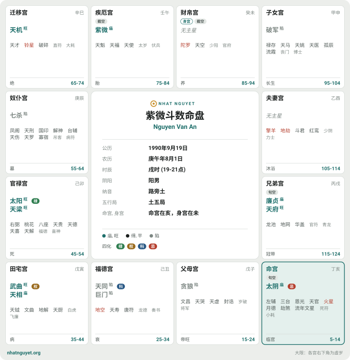
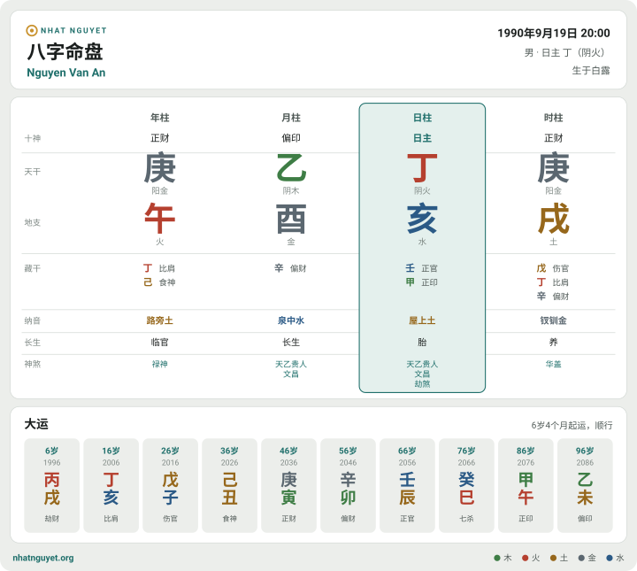
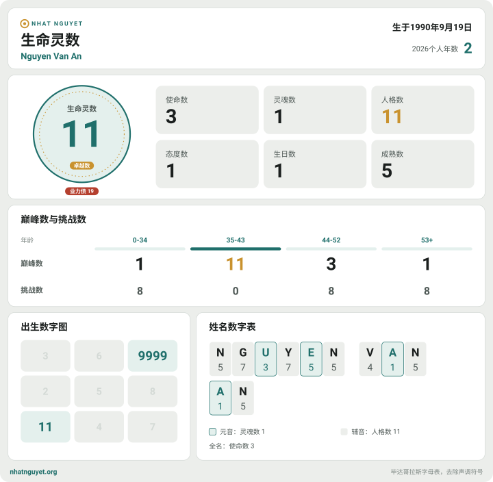

<h1 align="center">Nhat Nguyet</h1>

<p align="center">
  <b>紫微斗数、八字与数字命理，建立在与 NASA、IMCCE 核对过的越南农历之上；附 360 万份引用古籍的命盘论断，以及 17,291 组共享测试用例，任何语言的移植版本都能自行验证。</b><br>
  JavaScript · Python · 命令行 · MCP 服务器 · 网页小组件 · 中文、English、Tiếng Việt
</p>

<p align="center">
  <picture>
    <source media="(prefers-color-scheme: dark)" srcset="./assets/la-so-tu-vi-zh-toi.svg">
    
  </picture>
  <picture>
    <source media="(prefers-color-scheme: dark)" srcset="./assets/la-so-bat-tu-zh-toi.svg">
    
  </picture>
  <picture>
    <source media="(prefers-color-scheme: dark)" srcset="./assets/than-so-hoc-zh-toi.svg">
    
  </picture>
</p>

<p align="center">
  <a href="./README.md">English</a> · <a href="./README.vi.md">Tiếng Việt</a> · <b>中文</b> · <a href="./README.ja.md">日本語</a> · <a href="./README.ko.md">한국어</a> · <a href="./README.fr.md">Français</a> · <a href="./README.th.md">ไทย</a>
  <br>
  <a href="https://nhatnguyet.org/zh/ma-nguon-mo/thu">在线试用</a> ·
  <a href="https://nhatnguyet.org/zh/ma-nguon-mo/tai-lieu">文档</a> ·
  <a href="https://huggingface.co/nhatnguyet">Hugging Face</a> ·
  <a href="https://nhatnguyet.org/zh/ma-nguon-mo">项目介绍</a>
</p>

<p align="center">
  <a href="https://www.npmjs.com/package/@nhatnguyet/tu-vi"></a>
  <a href="https://pypi.org/project/nhatnguyet/"></a>
  <a href="./ca-kiem"></a>
  <a href="https://github.com/Nhat-Nguyet/nhatnguyet/actions/workflows/kiem.yml"></a>
  <a href="./LICENSE"></a>
  <a href="./DATA-LICENSE"></a>
  <a href="https://doi.org/10.5281/zenodo.24358014"></a>
</p>

## 快速开始

**JavaScript、TypeScript**（Node 18 及以上、浏览器）

```bash
npm i @nhatnguyet/tu-vi @nhatnguyet/am-lich
```

```js
import { writeFileSync } from "node:fs";
import { castZiWei } from "@nhatnguyet/tu-vi";
import { toLunar } from "@nhatnguyet/am-lich";

const chart = castZiWei({ name: "Nguyen Van An", date: "1990-09-19", time: "20:00", gender: "male" });
const life = chart.palaces[chart.lifePalace];
console.log(chart.bureau.name, "|", life.name, life.branch, "|", life.stars[0].name, life.stars[0].brightness);
writeFileSync("chart.svg", chart.toSvg());   // the chart image above

// Same day, two calendars: Tết in Vietnam, still the 12th month in China
const vn = toLunar("1985-01-21");
const cn = toLunar("1985-01-21", { country: "CN" });
console.log(vn.day, vn.month, vn.year, vn.yearName, "|", cn.day, cn.month, cn.year, cn.yearName);
```

```text
Earth Five | Life Palace Hợi | Moon Exalted
1 1 1985 Ất Sửu | 1 12 1984 Giáp Tý
```

**Python**（3.9 及以上，仅用标准库）：结果相同，生成的 SVG 逐字节相同。

```bash
pip install nhatnguyet
```

```python
from nhatnguyet import cast_zi_wei, to_lunar, zi_wei_svg

chart = cast_zi_wei(name="Nguyen Van An", date="1990-09-19", time="20:00", gender="male")
life = chart["palaces"][chart["lifePalace"]]
print(chart["bureau"]["name"], "|", life["name"], life["branch"], "|", life["stars"][0]["name"], life["stars"][0]["brightness"])
open("chart.svg", "w", encoding="utf-8").write(zi_wei_svg(chart))

vn = to_lunar("1985-01-21")
cn = to_lunar("1985-01-21", country="CN")
print(vn["day"], vn["month"], vn["year"], vn["yearName"], "|", cn["day"], cn["month"], cn["year"], cn["yearName"])
```

**命令行**：用 `npx` 免安装运行；`pip install nhatnguyet` 后也可直接用 `nhatnguyet ...`。

```bash
npx @nhatnguyet/cli ziwei 1990-09-19 20:00 male --year 2026
```

<details>
<summary>输出（十二宫排成方格，随后是流年、大限、格局）</summary>

```text
┌────────────────────┬────────────────────┬────────────────────┬────────────────────┐
│ Travel             │ Health             │ Wealth · Body      │ Children           │
│ Tân Tỵ             │ Nhâm Ngọ Triệt     │ Quý Mùi Triệt      │ Giáp Thân          │
│ Celestial Mechanism│ Purple Star Ex     │ Spinning Camel     │ Army Breaker We    │
│   Pr               │ Celestial Leader,  │ Nurture            │ Prosperity,        │
│ Celestial Talent   │ Celestial Fortune  │                    │ Celestial Horse    │
│ Extinction         │ Conception         │                    │ Growth             │
├────────────────────┼────────────────────┴────────────────────┼────────────────────┤
│ Friends/Subordinat…│                                         │ Spouse             │
│ Canh Thìn          │                                         │ Ất Dậu             │
│ Seven Killings We  │                                         │ Sword Ram,         │
│ Tomb               │                                         │ Earthly Robber,    │
│                    │          ZI WEI DOU SHU CHART           │ Dipper Lord        │
│                    │      Born 1990-09-19 20:00 (Tuất)       │ Bathing            │
├────────────────────┤       Lunar 1990-08-01 · Canh Ngọ       ├────────────────────┤
│ Career             │                Yang Male                │ Siblings           │
│ Kỷ Mão             │           Bureau: Earth Five            │ Bính Tuất Tuần     │
│ Sun Pr Lộc         │      Na yin: Earth by the Roadside      │ Purity Ex          │
│ Celestial Beam Pr  │          Life: Hợi · Body: Mùi          │ Celestial Treasury │
│ Right Assistant,   │                                         │   Pr               │
│ Peach Blossom,     │                                         │ Youth              │
│ Eight Seats,       │                                         │                    │
│ Celestial Nobili…  │                                         │                    │
│ Death              │                                         │                    │
├────────────────────┼────────────────────┬────────────────────┼────────────────────┤
│ Property           │ Fortune/Virtue     │ Parents            │ Life Palace        │
│ Mậu Dần            │ Kỷ Sửu             │ Mậu Tý             │ Đinh Hợi Tuần      │
│ Military Song      │ Celestial Blessing │ Greedy Wolf We     │ Moon Ex Kỵ         │
│   Pr Quyền         │   We Khoa          │ Literary Glory,    │ Left Assistant,    │
│ Celestial General  │ Giant Gate We      │ Celestial Weeping, │ Three Terraces,    │
│   Ex               │ Earthly Void,      │ Celestial Emptin…  │ Grace Light,       │
│ Celestial Excell…, │ Celestial Longev…  │ Peak               │ Celestial Offici…  │
│ Literary Melody    │ Decline            │                    │ Prime              │
│ Illness            │                    │                    │                    │
└────────────────────┴────────────────────┴────────────────────┴────────────────────┘
Brightness: Ex exalted, Pr prosperous, Fa favorable, Ne neutral, We weak. Ages are East
Asian ages (1 at birth).

Year 2026 (Bính Ngọ)
  age 37 · Year palace: Health · Minor limit: Friends/Subordinates ·
  Decade: Property (35-44) · Hóa Lộc: Celestial Blessing → Fortune/Virtue ·
  Hóa Quyền: Celestial Mechanism → Travel · Hóa Khoa: Literary Glory → Parents ·
  Hóa Kỵ: Purity → Siblings

Ten-year periods
    5-14  1994-2003  Life Palace (Hợi)  Moon
   15-24  2004-2013  Parents (Tý)  Greedy Wolf
   25-34  2014-2023  Fortune/Virtue (Sửu)  Celestial Blessing, Giant Gate
   35-44  2024-2033  Property (Dần)  Military Song, Celestial General
   45-54  2034-2043  Career (Mão)  Sun, Celestial Beam
   55-64  2044-2053  Friends/Subordinates (Thìn)  Seven Killings
   65-74  2054-2063  Travel (Tỵ)  Celestial Mechanism
   75-84  2064-2073  Health (Ngọ)  Purple Star
   85-94  2074-2083  Wealth (Mùi)  -
   95-104 2084-2093  Children (Thân)  Army Breaker
  105-114 2094-2103  Spouse (Dậu)  -
  115-124 2104-2113  Siblings (Tuất)  Purity, Celestial Treasury

Patterns
  Cơ Nguyệt Đồng Lương 機月同梁 · Life Palace
  Tả Hữu đồng hội 左右 · Life Palace
  Nhật xuất Phù Tang 日出扶桑 · Career
  Nguyệt lạc Hợi cung 月落亥宮 · Life Palace

Birth time 20:00 falls in the Tuất double hour (19:00-20:59). The lunar date follows the
Vietnamese calendar (UTC+7).
```

</details>

其他命令：`bazi`、`lunar`、`solar`、`terms`、`numerology`、`festivals`；`--lang zh` 输出中文，`--json`，`--svg chart.svg`。英文 API 及全部参数见 [docs/api-en.md](./docs/api-en.md)。

## 目录

1. [仓库内容](#仓库内容)
2. [数据集](#数据集)
3. [与其他库对比](#与其他库对比)
4. [面向 AI](#面向-ai)
5. [网页小组件](#网页小组件)
6. [科学依据](#科学依据)
7. [在线试用与文档](#在线试用与文档)
8. [从 iztro 迁移](#从-iztro-迁移)
9. [许可与署名](#许可与署名)
10. [常见问题](#常见问题)
11. [参与贡献](#参与贡献)

## 仓库内容

每个库都与驱动 [nhatnguyet.org](https://nhatnguyet.org) 和 Nhat Nguyet 应用的计算引擎逐字段一致。不联网；各库不依赖任何第三方包。

| 包 | Python | 功能 |
|---|---|---|
| [`@nhatnguyet/am-lich`](./js/packages/am-lich) | `nhatnguyet` | 越南、中国、韩国、日本及另外 7 个地区的公农历互换；干支；二十四节气精确到分钟；二十八宿；纳音 |
| [`@nhatnguyet/tu-vi`](./js/packages/tu-vi) | `nhatnguyet` | 紫微斗数：十二宫、星曜庙旺、四化、旬空截空、大限、流年、流曜、附古籍原句的格局；SVG 绘图；供大语言模型使用的文本；iztro 兼容层 |
| [`@nhatnguyet/bat-tu`](./js/packages/bat-tu) | `nhatnguyet` | 八字：按节气排四柱、藏干、十神、神煞、大运、小运；SVG 绘图 |
| [`@nhatnguyet/than-so-hoc`](./js/packages/than-so-hoc) | `nhatnguyet` | 毕达哥拉斯数字命理（生命灵数、天赋数、灵魂数、巅峰数、挑战数、个人年），支持带声调的越南语姓名；SVG 绘图 |
| [`@nhatnguyet/le-hoi`](./js/packages/le-hoi) | `nhatnguyet` | 200 个越南节庆及其任意年份的公历日期 |
| [`@nhatnguyet/cli`](./js/packages/cli) | `nhatnguyet` 命令 | 在终端以方格显示命盘，或输出 JSON、SVG |
| [`@nhatnguyet/mcp`](./js/packages/mcp) | | 为 AI 助手提供 7 个工具的 MCP 服务器 |
| [`@nhatnguyet/widgets`](./js/packages/widgets) | | 5 个网页组件（今日农历、月历、黄道吉时、春节倒计时、日期换算） |

[`ca-kiem/`](./ca-kiem) 收录 **17,291 组测试用例**（输入 `vao`，期望输出 `ra`），由参考引擎生成：历法 14,936 组、紫微命盘 777 个、八字命盘 777 个、数字命理档案 600 份、节庆年份 201 个。TypeScript 与 Python 版本每次推送都全部通过。

## 数据集

全部发布在 [Hugging Face](https://huggingface.co/nhatnguyet)，CC BY 4.0 许可，注明出处即可用于商业产品和 AI 训练。

| 数据集 | 内容 | 压缩后大小 |
|---|---|---:|
| [`nhatnguyet/loi-luan-tu-vi`](https://huggingface.co/datasets/nhatnguyet/loi-luan-tu-vi) | 1,761,936 个附论断的紫微命盘：1900 至 2100 年每一天 × 12 时辰 × 2 种性别 | 9.20 GB |
| [`nhatnguyet/loi-luan-bat-tu`](https://huggingface.co/datasets/nhatnguyet/loi-luan-bat-tu) | 1,761,936 个附论断的八字命盘，范围相同 | 1.57 GB |
| [`nhatnguyet/loi-luan-than-so-hoc`](https://huggingface.co/datasets/nhatnguyet/loi-luan-than-so-hoc) | 73,414 份数字命理档案，每个出生日期一份 | 0.08 GB |
| [`nhatnguyet/sach-co`](https://huggingface.co/datasets/nhatnguyet/sach-co) | 412 篇公有领域古籍全文（约 390 部作品），7,010 万字符 | 纯文本 151 MB，Parquet 69 MB |
| [33 个历法与文化数据集](https://nhatnguyet.org/zh/du-lieu) | 1900 至 2100 年阴阳历、节气、六十四卦、78 张塔罗牌、200 个节庆、456 篇祭文……CSV、JSON、Parquet 格式，附 [DOI](https://doi.org/10.5281/zenodo.23009396) | |

三个论断数据集合计 **3,597,286 个命盘，压缩后 10.85 GB**，分为三部分：附论断编号的结构化命盘（`la-so/`，1.50 GB）、按语言预先拼好的全文（`ghep-san/<vi|en|zh>/`，9.31 GB），以及每条论断、古籍引文、文章只存一次的文本库（`kho/`，0.04 GB）。论断引用古籍时注明书名与章节。每个出生年份一个文件。**解压后体积非常大**（命盘之间文字重复：紫微一年的预拼全文每种语言约 2.6 GB），请用流式读取（`streaming=True`）或按年下载。

古籍：文言 337 篇、英文 44 篇、越南文 30 篇、德文 1 篇；按主题：易经与卜筮 201、数字命理 28、越南历史与文化 26、三式 26、风水 22、八字与命理 20、佛教 20、信仰与礼俗 20、历法与择日 19、相术 14、紫微 8、占星与塔罗 6、其他 2。其中 28 篇为光学字符识别文本，带 `ocr` 标记。

```python
from datasets import load_dataset

# one birth year of Zi Wei readings in English, streamed
ds = load_dataset("nhatnguyet/loi-luan-tu-vi", data_files="ghep-san/tu-vi/en/1990.jsonl.zst", split="train", streaming=True)
row = next(iter(ds))
print(row["k"])
print(row["van"].splitlines()[0])

books = load_dataset("nhatnguyet/sach-co", split="train")
print(len(books), sum(books["characters"]))
```

```text
1990-01-01-0-nam
# Tử Vi chart | Male | Born 01/01/1990, hour Tý
412 70092009
```

## 与其他库对比

[iztro](https://github.com/SylarLong/iztro) 和 [lunar-javascript](https://github.com/6tail/lunar-javascript) 都是严谨、广泛使用的库，对于它们所实现的内容也都正确：按北京时间（UTC+8）计算的中国农历。越南采用相同规则，但按河内时间（UTC+7）计算。逐日对比 1900 至 2100 年（[doi-chieu/](./doi-chieu/README.md)，可用 `node chay.mjs` 复现）：

| | 结果 |
|---|---:|
| 农历日期与 lunar-javascript 不同的天数 | 73,414 天中 2,724 天 |
| 春节日期不同的年份 | 201 年中 9 年 |
| 闰月不同的年份 | 201 年中 6 年 |
| 局数、命宫或任一主星与 iztro 不同的紫微命盘（每天 × 12 时辰） | 880,968 个中 38,752 个（4.40%） |
| 其中因时区（iztro 即使选 `vi-VN` 也用北京时间） | 3.02% |
| 其中因闰月规则（iztro 的 `fixLeap`，可选项） | 1.34% |
| 节气与 IMCCE 的最大偏差：Nhat Nguyet / lunar-javascript | 0.9 分钟 / 0.28 分钟 |

例：1985 年 1 月 21 日巳时出生。iztro 得出甲子年腊月初一、金四局、命宫在申；Nhat Nguyet 得出乙丑年正月初一（越南春节）、水二局、命宫在酉。传入 `country: "CN"`，Nhat Nguyet 也给出中国农历的结果。

## 面向 AI

大语言模型不应心算农历日期或星曜位置。以下四种方式可以把真实数据交给它们：

- **MCP 服务器**，7 个工具（`lunar_convert`、`solar_terms`、`cast_zi_wei`、`cast_bazi`、`numerology`、`festivals`、`render_chart_svg`），本地运行：`claude mcp add nhatnguyet -- npx -y @nhatnguyet/mcp`。Claude Desktop、Cursor、VS Code 的配置见 [js/packages/mcp](./js/packages/mcp/README.md)。
- **Agent Skill**，让助手调用工具而不是猜测：[skills/](./skills/README.md)。
- **`chartToText`**（Python 中为 `chart_to_text`）把命盘转成简洁的 Markdown，便于放进提示词（`lang: "zh"` 输出中文）：

  ```js
  import { castZiWei, chartToText } from "@nhatnguyet/tu-vi";

  const chart = castZiWei({ date: "1990-09-19", time: "20:00", gender: "male" });
  console.log(chartToText(chart, { detail: "summary" }));
  ```

  ```text
  # Zi Wei Dou Shu chart

  Computed data only, no interpretation.

  - Gender: male
  - Birth date (Gregorian): 1990-09-19 20:00
  - Birth hour: Tuất (19:00-20:59)
  - Birth date (lunar): 1990-08-01
  - Year pillar: Canh Ngọ
  - Yin-yang: Yang Male
  - Bureau: Earth Five (5)
  ...
  ```

- **数据集**，用于训练与检索：[见上文](#数据集)。

## 网页小组件

<p align="center"></p>

由 nhatnguyet.org 托管（14 个小组件；在 [nhatnguyet.org/widget](https://nhatnguyet.org/widget?lang=zh) 选择选项并复制代码）：

```html
<div data-widget="lich-hom-nay" data-lang="en" data-theme="auto"></div>
<script async src="https://nhatnguyet.org/embed/w.js"></script>
```

`data-country`（默认 `VN`，可选 `CN`、`KR`、`JP` 等）把日历类小组件切换为其他国家的农历；`data-lang="zh"` 显示中文。也可以不经服务器，直接在页面中运行其中 5 个：

```html
<script type="module" src="https://cdn.jsdelivr.net/npm/@nhatnguyet/widgets/dist/nn-widgets.js"></script>
<nn-lich-thang lang="en" theme="auto" country="VN"></nn-lich-thang>
```

全部小组件与属性：[widgets/](./widgets/README.md)。

## 科学依据

**科学性在于方法，而不在于预测。** 历法是天文计算，在 1900 至 2100 年范围内与 NASA 和 IMCCE 核对：

| 检验 | 结果 |
|---|---|
| 朔与 NASA 对比（2,474 次） | 平均晚 0.9 分钟，最多 3.9 分钟 |
| 用 NASA 朔与 IMCCE 节气重建的农历月 | 2,461 个月中 2,459 个一致（其余两个的朔在午夜前后一分钟内） |
| 节气与 IMCCE 对比（4,824 个） | 平均偏差 0.27 分钟，最多 0.9 分钟（取整到分钟），日期全部正确 |
| 越南（UTC+7）与中国（UTC+8），规则相同 | 2,814 天、10 个春节日期不同 |

按国家的历法：越南 UTC+7（默认）；中国大陆、台湾、香港、澳门、新加坡、马来西亚、印度尼西亚、菲律宾 UTC+8；韩国、日本 UTC+9。所有结果都是确定性的，可用测试用例复核。紫微斗数、八字与数字命理是传统流派的规则，未经科学验证；请勿用于健康、财务或法律决定。各派有分歧之处（闰月、23 点起的子时），文档会写明所用规则。

延伸阅读：[农历与节气](https://nhatnguyet.org/zh/blog/co-so-khoa-hoc-am-lich-tiet-khi) · [紫微命盘](https://nhatnguyet.org/zh/blog/co-so-khoa-hoc-la-so-tu-vi) · [八字](https://nhatnguyet.org/zh/blog/co-so-khoa-hoc-bat-tu) · [数字命理](https://nhatnguyet.org/zh/blog/co-so-khoa-hoc-than-so-hoc) · [古籍与论断](https://nhatnguyet.org/zh/blog/co-so-khoa-hoc-sach-co-loi-luan) · [Nhat Nguyet 如何核验](https://nhatnguyet.org/zh/blog/co-so-khoa-hoc-kiem-chung)。

## 在线试用与文档

- **在线试用**：[nhatnguyet.org/zh/ma-nguon-mo/thu](https://nhatnguyet.org/zh/ma-nguon-mo/thu)，在浏览器中直接运行各个包。
- **API 文档**：[nhatnguyet.org/zh/ma-nguon-mo/tai-lieu](https://nhatnguyet.org/zh/ma-nguon-mo/tai-lieu) 与 [docs/api-en.md](./docs/api-en.md)。
- **示例**：[examples/](./examples/README.md)（免构建的 HTML 页面、Node、Python）。
- **教程**：[用 JavaScript 排紫微命盘](https://nhatnguyet.org/zh/blog/lap-la-so-tu-vi-bang-javascript) · [为应用加入农历与节庆](https://nhatnguyet.org/zh/blog/lich-am-le-hoi-cho-ung-dung) · [能引用古籍的 AI 助手](https://nhatnguyet.org/zh/blog/tro-ly-ai-trich-dan-sach-co) · [用 Python 分析命盘数据](https://nhatnguyet.org/zh/blog/phan-tich-du-lieu-la-so-bang-python)。

## 从 iztro 迁移

只需改一行 import；结果保持 iztro 的 `FunctionalAstrolabe` 结构和六种显示语言，但按越南农历计算：

```diff
- import { astro } from "iztro";
+ import { astro } from "@nhatnguyet/tu-vi/iztro";
```

不提供 `astrolabe.palace()` 之类的方法（该兼容层只返回数据）。详见 [docs/chuyen-tu-iztro.md](./docs/chuyen-tu-iztro.md)。

## 许可与署名

| 部分 | 许可 |
|---|---|
| 代码 | [MIT](./LICENSE) |
| 数据、论断、测试用例 | [CC BY 4.0](./DATA-LICENSE)：允许商业使用与 AI 训练，须注明出处 |
| 古籍 | 原文属公有领域；数字化与清理部分采用 CC BY 4.0 |

署名格式：`数据：Nhat Nguyet (nhatnguyet.org)`，尽可能附上链接。Nhat Nguyet 的名称与标志不在上述许可范围内。

```bibtex
@software{nhatnguyet_2026,
  author = {{Nhat Nguyet}},
  title  = {Nhat Nguyet: open source code and data for Zi Wei Dou Shu, BaZi and numerology},
  year   = {2026},
  url    = {https://nhatnguyet.org/en/ma-nguon-mo},
  doi    = {10.5281/zenodo.24358014}
}
```

## 常见问题

<details>
<summary><b>为什么越南农历与中国农历不同？</b></summary>

规则相同，钟表不同。农历月从朔所在的那一天开始，而"哪一天"按当地时间判断。朔落在世界时 16 点到 17 点之间时，河内尚未过午夜，北京已过午夜，于是越南的月份早一天开始。1985 年春节相差整整一个月（越南 1 月 21 日，中国 2 月 20 日），因为闰月落在不同的年份。
</details>

<details>
<summary><b>子时是几点？23:30 出生用哪一天？</b></summary>

子时为 23:00 至 00:59。紫微保留输入的日期（有些书改算到次日；想按那些书，就输入次日日期）。八字的日柱在 23:00 换日。两者都会写在命盘的 `notes` 中。
</details>

<details>
<summary><b>八字月柱按农历月还是按节气？</b></summary>

按节气：年在立春交替，月在每个节交替。若用农历月作月柱，约四分之一的日子会排错（1900 至 2100 年为 24.3%）。
</details>

<details>
<summary><b>可以用这些数据训练 AI 模型吗？</b></summary>

可以，包括商业用途，按 CC BY 4.0。只需注明"数据：Nhat Nguyet (nhatnguyet.org)"。
</details>

<details>
<summary><b>数字命理如何处理带声调的越南语姓名？</b></summary>

先去掉声调符号（"Đ" 按 "D" 计），再用毕达哥拉斯字母数字表计算。保留卓越数 11、22、33。
</details>

## 参与贡献

最有用的是附带出处（书名与章节，或天文数据）的错误报告；见 [CONTRIBUTING.md](./CONTRIBUTING.md)。

**移植挑战**：用另一种语言（Go、Rust、Dart、Swift、C#……）重写引擎，并通过 [`ca-kiem/`](./ca-kiem) 中全部 17,291 组测试用例。读取 `vao`，与 `ra` 比对；规则见 [CONTRIBUTING.md](./CONTRIBUTING.md#port-challenge)。

网站：[nhatnguyet.org](https://nhatnguyet.org) · 邮箱：lienhe@nhatnguyet.org

<p align="center"><sub>数据：Nhat Nguyet (nhatnguyet.org) · 代码 MIT · 数据 CC BY 4.0</sub></p>
