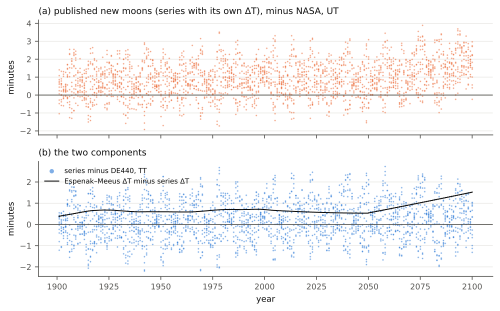

::: keywords
**Keywords:** Vietnamese calendar; lunisolar calendar; solar terms; new moon;
VSOP87; ΔT; precession; time zones; software verification; test vectors.
:::

# Introduction

Vietnam keeps a lunisolar calendar (âm lịch) alongside the Gregorian civil
calendar. The lunar calendar fixes the date of Tết (the lunar new year), of
traditional festivals and of family anniversaries, and Vietnamese law assigns
it this role [@decision121, Art. 2 and 3]. Its rules are those of the Chinese
calendar after the reform of 1645: months begin on the day of the astronomical
new moon, and the solar terms determine month numbers and leap months
[@aslaksen2010]. The Vietnamese and Chinese calendars differ in one parameter,
the meridian on which "the day of the new moon" is decided. Decision 121-CP of
8 August 1967 sets it to the official time of Vietnam, UTC+7, from 1 January
1968 [@decision121]; its Article 1 was amended in 2002 without changing the
time zone [@decision134]. The decision was issued in the North; after 1975 the
same rule applies nationwide, and the State Calendar Board's statements on the
1984 and 2007 calendars follow it [@vnexpress2006]. The Chinese calendar has
been computed for UTC+8 since 1929 [@aslaksen2010].

One hour is enough to change a date. A new moon between 16:00 and 17:00 UT
falls before midnight in Hanoi and after midnight in Beijing, so the month
starts a day earlier in Vietnam; occasionally a major solar term crosses a
month boundary, the leap month moves and Tết shifts by a whole month, as in
1985. In 2006 a member of the State Calendar Board, quoted by the press,
attributed wrong dates in popular almanacs to tables translated from the
Chinese calendar [@vnexpress2006].

Three gaps motivate this report. First, the Vietnamese calendar algorithm of
Hồ Ngọc Đức is published as a web page with source code
[@hongocduc_en; @hongocduc_vi], but we found no quantitative verification of
it against independent ephemerides. Second, open-source libraries in this
domain such as lunar-javascript and iztro compute the Chinese calendar
[@lunarjavascript; @iztro], and the days on which their dates differ from the
Vietnamese ones have not, to our knowledge, been enumerated with causes.
Third, the history of the Vietnamese calendar is documented
[@lan2019; @aslaksen2010], but not as a dataset that can be checked against
computed dates.

This report is written by the Nhat Nguyet project, which develops the
software it evaluates (see Competing interests). Its contributions are:

1. a formal statement of the Vietnamese calendar rules with explicit
   notation, and of where the implementation departs from them (Section 3);
2. a description of the algorithms, including the fact that the two
   astronomical modules use two different ΔT models (Section 4);
3. a validation against IMCCE (in UT and in TT), USNO, NASA and JPL DE440,
   with the error separated into series truncation, precession model, ΔT and
   residual (Sections 5 and 6);
4. an attribution of every day on which the engine differs from the UTC+8
   calendar and from lunar-javascript (Section 7);
5. reproducible artefacts: raw reference data with checksums, derivation and
   analysis scripts, and shared test vectors (Data and code availability).

The libraries that implement the calendar also contain rule systems of
traditional divination (for example BaZi month pillars, which are defined by
solar terms). This report evaluates only the astronomical and calendrical
computations and makes no claim about those rule systems.

# Background and related work

## The lunisolar calendar after 1645

The reform carried out by Jesuit astronomers at the Qing court and adopted in
1645 (the Shíxiàn calendar) replaced the mean Sun with the true Sun (dìngqì)
in the computation of the solar terms [@aslaksen2010]. Aslaksen describes the
post-1645 calendar as "modular": its rules are stated in terms of the true Sun
and true Moon, and the method used to compute their positions is a separate
problem [@aslaksen2010, p. 13]. This is why a modern implementation can keep
the rules and replace the astronomy. The Chinese calendar was computed for the
Beijing meridian (116°25′ E) before 1929 and for 120° E afterwards
[@aslaksen2010, sec. 4.2]. @reingold2018 give complete algorithms for the
Chinese calendar; their published code also defines a Vietnamese location,
Hanoi with UTC+8 before 1968 and UTC+7 from 1968 [@calendarcode2].

## The Vietnamese calendar

Lê Thành Lân reconstructed historical Vietnamese calendars from surviving
almanacs and concludes, with earlier work by Hoàng Xuân Hãn, that "since AD
1080 Vietnam has always had its own calendar" [@lan2019]. The Hiệp Kỷ
calendar of the Nguyễn dynasty observatory, used from 1813 to 1945, "was
modelled on the Thoi Hien [Thời Hiến, 時憲] method, so the Vietnamese and
Chinese calendars were quite similar" [@lan2019]. Lê Thành Lân also shows that
French colonial concordances "wrongly assumed that Vietnam used the Chinese
calendar", and he leaves the calendar of 1904 to 1945 aside because of
"unresolved issues" [@lan2019]. Aslaksen writes that "traditionally, the
Vietnamese used the Chinese calendar based on the longitude of Beijing
(116°25′ East)" [@aslaksen2010, p. 28]; he gives no period, and the statement
does not hold for the court calendars studied by Lê Thành Lân. We found no
source that documents the almanac meridian specifically for 1945 to 1967.
Decision 121-CP itself states that the lunar calendar then in use had "many
different bases and methods of computation" and did not match the official
time (Article 2) [@decision121].

Decision 121-CP, dated 8 August 1967 and effective 1 January 1968, states
that the country lies entirely in the seventh time zone (central meridian
105° E) and that its official time is the time of that zone (Article 1), that
the lunar calendar used for Tết, historical anniversaries and traditional
festivals "is the lunar calendar computed in the official time of our
country" (Article 3), and assigns its computation to the Meteorological
Service (Article 4) [@decision121]. The first Tết under the new rule fell on
a new moon at 16:29 UT on 29 January 1968. According to Aslaksen it was
celebrated on 29 January in the North; in the South "the new Moon occurred 46
minutes (11.5°) later at 0h 15m on January 30, so Tet was celebrated on
January 30" [@aslaksen2010, p. 28]. The 46 minutes are the difference between
the meridian of UTC+7 (105° E) and the Beijing meridian (116°25′ E); Hanoi
itself (105°51′ E) lies 42.3 minutes of time west of Beijing. The South
reckoned that new moon at the Beijing meridian (UTC+7h45m40s), not at UTC+8.

Two quantities must be kept apart. The *civil clock time* of a region is
documented by the tz database [@ianatz]: in the South it was UTC+8 from 1960
until 13 June 1975. The *almanac meridian* is the meridian at which calendar
events are dated. The two need not coincide, and in 1968 they did not in the
South (clock UTC+8, almanac Beijing meridian).

## Algorithms and ephemerides

The new-moon series used by the Vietnamese algorithm has the 1900-epoch form
of Meeus's *Astronomical Formulae for Calculators* [@meeus1985]; the
algorithm, its source code and the Vietnamese adaptation to UTC+7 are
published by Hồ Ngọc Đức [@hongocduc_en; @hongocduc_vi], who states that his
rules are adapted from the *Explanatory Supplement to the Astronomical
Almanac* [@seidelmann1992]. *Astronomical Algorithms* [@meeus1998] gives the
methods used here for the Sun: VSOP87 [@bretagnon1988; @vsop87files], the
IAU 1980 theory of nutation [@seidelmann1982], the FK5 correction and annual
aberration. ΔT = TT − UT is taken from the polynomial expressions of Espenak
and Meeus [@espenak2006; @espenakdeltat], fitted to historical values of
Morrison and Stephenson [@morrison2004]; @stephenson2016 and @morrison2021
revise the historical record and give a long-term parabola, which Skyfield
[@skyfield] joins to the observed values to form a current prediction. The
references used here rest on INPOP19 [@fienga2019; @fienga2009]
and JPL DE440 [@park2021]. Precession of the equinox enters through the
IAU 1976 [@lieske1977] and IAU 2006 (P03) [@capitaine2003] models.

## Existing implementations

lunar-javascript [@lunarjavascript] and lunar-typescript [@lunartypescript]
by the same author compute the Chinese calendar for UTC+8. Before Julian day
2436935 (early 1960) lunar-javascript computes new moons with a low-precision
series adjusted by a correction table (function `calcShuo` in its source); we
read this as an attempt to reproduce historical Chinese almanacs
(Section 7.2). iztro [@iztro], a Zi Wei Dou Shu library, takes its calendar
from lunar-typescript. The Calendrical Calculations code provides an
independent Vietnamese variant [@reingold2018; @calendarcode2]; we have not
compared with it in this version (Section 9). Hồ Ngọc Đức distributed his
algorithm as JavaScript programs [@hongocduc_js], which we compare with the
engine day by day (Section 6.7). These libraries are correct for
the calendars they target; the question examined here is only how their dates
relate to the Vietnamese calendar.

# Calendar rules

Table 1 lists the notation. Instants are Julian dates on the UT scale unless
stated otherwise.

| Symbol | Meaning |
|---|---|
| $t$ | an instant, Julian date (UT) |
| $JDE$ | Julian Ephemeris Date, Terrestrial Time (TT) |
| $\Delta T$ | $\mathrm{TT} - \mathrm{UT}$, seconds |
| $z$ | calendar meridian as a time offset in hours ($z = 7$ Vietnam, $z = 8$ China, $z = 7.7611$ Beijing meridian) |
| $D_z(t)$ | civil day number (Julian day number) containing $t$ at offset $z$ |
| $\lambda_\odot(t)$ | apparent geocentric ecliptic longitude of the Sun, of date |
| $n_k$ | instant of the $k$-th new moon (conjunction in longitude) |
| $s_j$ | instant at which $\lambda_\odot = 15° j$; major terms have $j$ even |
| $m_k$ | first civil day of the month that begins with new moon $k$ |
| $p, q$ | indices $k$ of the new moons that start two consecutive months 11 |
| $\sigma(d)$ | sector $\lfloor \lambda_{\mathrm{g}} / 30° \rfloor$ of a low-precision solar longitude at 00:00 of day $d$ |

: Table 1. Notation.

**Definition 1 (civil day).**
$$D_z(t) = \left\lfloor t + \tfrac{1}{2} + \tfrac{z}{24} \right\rfloor \qquad\qquad (1)$$

**Definition 2 (month).** Month $k$ begins on $m_k = D_z(n_k)$ and contains
the civil days $m_k \le d < m_{k+1}$; it has 29 or 30 days.

**Definition 3 (containment).** An event at instant $s$ belongs to month
$k$ if $m_k \le D_z(s) < m_{k+1}$. A month contains a major term if some
$s_j$ with even $j$ belongs to it.

**Definition 4 (month 11).** The month that contains the December solstice
($\lambda_\odot = 270°$) is month 11.

**Definition 5 (leap month).** Let months 11 of two consecutive years begin
with new moons $p$ and $q$. If $q - p = 12$ the months $p+1, \dots, q-1$ are
numbered 12, 1, 2, ..., 10. If $q - p = 13$, the first month after $p$ that
contains no major term is the leap month; it carries the number of the month
before it, and the others are numbered in sequence.

**Definition 6 (new year).** Tết is the first civil day of month 1.

Every rule depends on time only through $D_z$, so the calendar is
insensitive to errors in $n_k$ or $s_j$ except when an event lies close to a
civil midnight. **Deviation of the implementation.** The calendar module
(Section 4.5) does not evaluate Definitions 3 and 4 with the instants $s_j$:
it compares the sector $\sigma$ of a low-precision geometric longitude at
00:00 of the first days of consecutive months. This is equivalent to
Definition 3 except when a major term lies within the error of that longitude
of a month-boundary midnight; Section 6.6 measures that error, counts such
cases and checks every month start directly. This report uses
$z = 7$ for all years, which is a computing convention and not a
reconstruction of the calendars then in use (Section 8.3).

# Methods

## Overview

The engine has two astronomical modules with different accuracy targets and,
importantly, **different ΔT models**. The *calendar module* determines month
boundaries and leap months with the published algorithm of Hồ Ngọc Đức
(Sections 4.4 and 4.5); it converts its new moons from TT to UT with a
quadratic ΔT polynomial embedded in that algorithm (eq. 10). The *solar-term
module* computes the instants $s_j$, published to the minute and used by BaZi
month pillars, with Espenak–Meeus ΔT (Sections 4.2 and 4.3). The calendar
module is kept identical to the published algorithm by design, so that its
month boundaries coincide with that published reference; this is a decision
of the project, not a
claim that it is the most accurate choice, and Section 6.8 quantifies what an
Espenak–Meeus-harmonised ΔT would change. The engine is written in Go; TypeScript and
Python ports reproduce it (Section 4.7).

## Apparent solar longitude

The solar-term module follows Meeus [-@meeus1998, chapters 22, 25 and 32].
With $\tau = (JDE - 2451545)/365250$, the heliocentric longitude $L$ and
radius $R$ of the Earth are evaluated from VSOP87D [@bretagnon1988], which
refers to the ecliptic and equinox of date:

$$L = \sum_{\alpha} \tau^\alpha \sum_i A_{\alpha,i} \cos(B_{\alpha,i} + C_{\alpha,i}\,\tau), \qquad R \text{ likewise} \qquad\qquad (2)$$

The apparent geocentric longitude is

$$\lambda_\odot = L + 180° - 0.09033\text{″} + \Delta\psi - \frac{20.4898\text{″}}{R} \qquad\qquad (3)$$

where −0.09033″ is the conversion to the FK5 system [@meeus1998, eq. 25.9]
(its latitude-dependent part is omitted because the Sun's latitude stays
below 1.2″), $\Delta\psi$ is the nutation in longitude from the
{{series_terms/nutation_iau1980}}-term IAU 1980 theory
[@seidelmann1982; @meeus1998, Table 22.A], and the last term is the annual
aberration [@meeus1998, eq. 25.10].

**Truncation.** A term of order $\tau^\alpha$ is kept when
$A \cdot 0.1^\alpha \ge 10^{-7}$ rad for $L$ and $\ge 10^{-5}$ au for $R$
($|\tau| \le 0.1$ over 1900 to 2100). This keeps {{series_terms/vsop87d_L}}
terms for $L$ (orders 0, 1, 2: {{series_terms/vsop87d_L_by_power|list}}) and
{{series_terms/vsop87d_R}} for $R$, against {{vsop/terms_full_L}} and
{{vsop/terms_full_R}} in the complete VSOP87D Earth file [@vsop87files].
Evaluated every two days from 1900 to 2100 ({{vsop/samples}} epochs), the
truncation changes $\lambda_\odot$ (including the effect of $R$ on the
aberration term) by {{vsop/apparent_longitude_error_arcsec/rms}}″ RMS and
{{vsop/apparent_longitude_error_arcsec/max_abs}}″ at most. At the mean solar
motion of {{constants/mean_motion_arcsec_per_day}}″ per day this is
{{vsop/equivalent_time_error_seconds/rms}} s RMS and
{{vsop/equivalent_time_error_seconds/max_abs}} s at most in a solar-term
instant. This is a non-negligible but sub-minute component of the error
budget (Table 2); we accept it because the published instants are rounded to
the minute and the tables must stay small enough for a browser library.

**Time scales.** Equation (3) is evaluated in TT. For an instant given in UT
the engine adds ΔT from the piecewise polynomials of Espenak and Meeus
[@espenakdeltat], evaluated at the decimal year $y$ of the instant. With
$t = y - 2000$ and $u = (y - 1820)/100$, the pieces used after 2005 are

$$\Delta T = 62.92 + 0.32217\,t + 0.005589\,t^2 \quad (2005 \le y < 2050) \qquad\qquad (4)$$
$$\Delta T = -20 + 32\,u^2 - 0.5628\,(2150 - y) \quad (2050 \le y < 2150) \qquad\qquad (5)$$

Both are extrapolations published in 2006 (Table 3, Figure 3).

## Solar-term instants and rounding

The instant $s_j$ solves $\lambda_\odot(s_j) = 15° j$. The engine uses a
Newton iteration with a fixed derivative equal to the mean solar motion
$\bar v = 360°/365.2422$ per day,

$$t_{i+1} = t_i - \frac{\lambda_\odot(t_i) - 15° j}{\bar v} \qquad\qquad (6)$$

with the difference reduced to $[-180°, 180°)$. Over 1900 to 2100 the daily
motion $v$ of $\lambda_\odot$ computed by the engine lies between
{{solar_motion/min_deg_per_day}}° and {{solar_motion/max_deg_per_day}}°, so
$|1 - v/\bar v| \le$ {{solar_motion/max_contraction}} and the error contracts
by a factor of at least {{solar_motion/min_factor}} per step. The iteration
stops when the step is below $10^{-3}$ min (0.06 s); the remaining error is
then bounded by {{solar_motion/residual_bound_s}} s, and on the 4,824 terms of
1900 to 2100 the iteration took at most {{solar_terms/newton_max_steps}}
steps. The instant is converted to UTC+7 and rounded to the nearest minute,
except that an instant in the last half minute of a civil day is written as
23:59 of that day, so that rounding never moves a term to another day.

| Source | Size, 1900 to 2100 | How obtained |
|---|---:|---|
| VSOP87D truncation, eq. (2) | {{vsop/at_solar_terms/rms_dt_s}} s RMS, {{vsop/at_solar_terms/max_abs_dt_s}} s max at the {{vsop/at_solar_terms/instants}} IMCCE instants ({{vsop/equivalent_time_error_seconds/max_abs}} s max over all epochs, Section 4.2) | full series at each IMCCE instant |
| Precession rate (IAU 1976 in VSOP87D vs P03), Section 6.2 | {{solar_terms/precession_equivalent_s_per_century}} s per century | rate measured in VSOP87D, Section 6.2 |
| ΔT, engine minus IMCCE | {{solar_terms/delta_t_engine_minus_imcce_s/mean}} s mean, {{solar_terms/delta_t_engine_minus_imcce_s/max_abs}} s max | Miriade TT−UTC |
| Residual after the three above | {{solar_terms/tt_corrected_seconds/rmse}} s RMS, {{solar_terms/tt_corrected_seconds/max_abs}} s max | Section 6.2 |
| Root finding, eq. (6) | bounded by {{solar_motion/residual_bound_s}} s | contraction factor |
| Rounding to the minute | up to 30 s | by construction |

: Table 2. Error budget of a solar-term instant, engine minus IMCCE.

## New moons and the two ΔT models

The calendar module computes the $k$-th new moon after that of January 1900
with the series of Meeus [-@meeus1985], as published by Hồ Ngọc Đức
[@hongocduc_vi]. We verified the coefficients of equations (7) to (10)
against Hồ Ngọc Đức's published source code and against an independent
implementation that cites the third edition of Meeus's book (GNU Emacs,
`lisp/calendar/lunar.el`), not against the printed book. With
$T = k/1236.85$ and angles in degrees,

$$JDE_k = 2415020.75933 + 29.53058868\,k + 0.0001178\,T^2 - 0.000000155\,T^3 + 0.00033\sin(166.56 + 132.87\,T - 0.009173\,T^2) \qquad\qquad (7)$$

$$\begin{aligned}
M &= 359.2242 + 29.10535608\,k - 0.0000333\,T^2 - 0.00000347\,T^3\\
M' &= 306.0253 + 385.81691806\,k + 0.0107306\,T^2 + 0.00001236\,T^3\\
F &= 21.2964 + 390.67050646\,k - 0.0016528\,T^2 - 0.00000239\,T^3
\end{aligned} \qquad\qquad (8)$$

$$\begin{aligned}
C = {} & (0.1734 - 0.000393\,T)\sin M + 0.0021\sin 2M - 0.4068\sin M' + 0.0161\sin 2M' - 0.0004\sin 3M'\\
& + 0.0104\sin 2F - 0.0051\sin(M + M') - 0.0074\sin(M - M') + 0.0004\sin(2F + M) - 0.0004\sin(2F - M)\\
& - 0.0006\sin(2F + M') + 0.0010\sin(2F - M') + 0.0005\sin(2M' + M)
\end{aligned} \qquad\qquad (9)$$

$$n_k = JDE_k + C - \delta_k, \qquad \delta_k = -0.000278 + 0.000265\,T + 0.000262\,T^2 \text{ days} \qquad\qquad (10)$$

for $T \ge -11$. The quantity $JDE_k + C$ is the series' new moon in TT, and
$\delta_k$ is the ΔT of the published algorithm. From 1900 to 2025 it is much
smaller than the Espenak–Meeus ΔT that the solar-term module uses and than the
observed ΔT ({{delta_t/series_dk_minus_observed_2025|abs}} s smaller in 2025;
Table 3). After 2025 every column of Table 3 is a prediction. The
Espenak–Meeus polynomials of 2006 and IMCCE's extrapolation rise steeply,
whereas a current prediction rises slowly: Skyfield {{delta_t/skyfield_version}}
[@skyfield] uses the IERS observed values (and the IERS short-term prediction)
up to January 2027, which it reproduces to
{{delta_t/skyfield_minus_observed_max_abs_1973_2025}} s in 1973–2025, and then a
cubic spline from the present value and slope to the long-term parabola of
@stephenson2016. Espenak–Meeus exceeds this prediction by
{{delta_t/espenak_meeus_minus_skyfield/2050}} s in 2050 and
{{delta_t/espenak_meeus_minus_skyfield/2100}} s in 2100, and from
{{delta_t/series_dk_closer_to_skyfield_than_em_from|d}} on $\delta_k$ is closer
to it than Espenak–Meeus is (Figure 3). The comparison of $\delta_k$ with
Espenak–Meeus is therefore decisive only up to 2025. We use the Skyfield values
as a second ΔT model, not as a better forecast. The first day of the month is
$m_k = D_z(n_k)$.

| Year | $\delta_k$, eq. (10) (s) | Espenak–Meeus (s) | IMCCE Miriade TT−UTC (s) | Skyfield (s) | observed (IERS) (s) |
|---|---:|---:|---:|---:|---:|
| 1900 | {{delta_t/table/1900/series_dk}} | {{delta_t/table/1900/espenak_meeus}} | {{delta_t/table/1900/miriade}} | {{delta_t/table/1900/skyfield}} | |
| 1950 | {{delta_t/table/1950/series_dk}} | {{delta_t/table/1950/espenak_meeus}} | {{delta_t/table/1950/miriade}} | {{delta_t/table/1950/skyfield}} | |
| 2000 | {{delta_t/table/2000/series_dk}} | {{delta_t/table/2000/espenak_meeus}} | {{delta_t/table/2000/miriade}} | {{delta_t/table/2000/skyfield}} | {{delta_t/table/2000/observed}} |
| 2025 | {{delta_t/table/2025/series_dk}} | {{delta_t/table/2025/espenak_meeus}} | {{delta_t/table/2025/miriade}} | {{delta_t/table/2025/skyfield}} | {{delta_t/table/2025/observed}} |
| 2050 | {{delta_t/table/2050/series_dk}} | {{delta_t/table/2050/espenak_meeus}} | {{delta_t/table/2050/miriade}} | {{delta_t/table/2050/skyfield}} | |
| 2072 | {{delta_t/table/2072/series_dk}} | {{delta_t/table/2072/espenak_meeus}} | {{delta_t/table/2072/miriade}} | {{delta_t/table/2072/skyfield}} | |
| 2100 | {{delta_t/table/2100/series_dk}} | {{delta_t/table/2100/espenak_meeus}} | {{delta_t/table/2100/miriade}} | {{delta_t/table/2100/skyfield}} | |

: Table 3. ΔT used by the calendar module ($\delta_k$, mid-year lunation), by the solar-term module (Espenak–Meeus, mid-year), reported by IMCCE Miriade (1 January), predicted by Skyfield {{delta_t/skyfield_version}} (mid-year; observed values up to 2026) and observed (1 January, ΔT = 32.184 s + (TAI − UTC) − (UT1 − UTC) from IERS EOP 20 C04 and Bulletin C [@iersbulc]).

## Month construction

The calendar module decides containment of major terms with the sector test
$\sigma(d)$ (Table 1), where $\lambda_{\mathrm{g}}$ is a low-precision
geometric solar longitude (mean longitude plus a three-term equation of the
centre [@meeus1998, ch. 25]) evaluated at 00:00 local time, without nutation,
aberration or ΔT. A month whose first day and the next month's first day
have the same sector contains no major term. Aberration (−20.4898″) and
nutation (principal term 17.1996″ [@seidelmann1982]) are omitted, and the
low-precision longitude has errors of its own (no planetary or lunar
perturbations). We measured $\lambda_{\mathrm{g}}$ minus the engine's apparent
longitude every day from 1900 to 2100: it lies between
{{sector_test/band/min_arcsec}}″ and {{sector_test/band/max_arcsec}}″ (mean
{{sector_test/band/mean_arcsec}}″), so the sector boundary is crossed between
{{sector_test/band/max_minutes}} min early and
{{sector_test/band/min_minutes|abs}} min late in time at the mean solar motion
(the band of Section 6.6). Algorithm 1 summarises the procedure
(Hồ Ngọc Đức's algorithm with one correction, noted below); $A$ and $B$ are
the first days of the months 11 that bracket day $d$, and $\ell$ is the
position of the leap month.

```
Algorithm 1. Gregorian day d to lunar date at offset z.
  k  <- floor((d - 2415021.076998695) / 29.530588853)      # estimate
  m  <- D_z(n_{k+1});  while m > d: k <- k - 1;  m <- D_z(n_{k+1})
  A  <- month11(year(d)) or month11(year(d) - 1);  B <- the next month 11
        # month11(y): the new-moon day before 31 Dec of y, one month earlier
        # if sigma(that day) >= 9 (the solstice has passed)
  r  <- floor((m - A) / 29)                                # months since A
  month <- r + 11 (mod 12, in 1..12); leap <- false
  if B - A > 365:                                          # 13 months
      l <- first i >= 1 with sigma(start of month i) = sigma(start of month i+1)
      if r >= l: month <- r + 10 (mod 12); leap <- (r = l)
  day <- d - m + 1
```

The `while` loop replaces a single backward step of the published algorithm.
The estimate of $k$ uses the mean synodic month and can exceed the correct
index by two; with a single step two days, 7 May 2054 and 9 April 2062, were
assigned day 0 of a month. An invariant test over the released calendar data
found them.

## Time zone handling

The offset $z$ enters only through equation (1) and the sector test. The
engine uses $z = 7$ for every year; the libraries accept $z = 8$ (China) and
$z = 9$ (Korea, historical Japan). This report also evaluates $z = 8$ and the
Beijing meridian (an offset of {{constants/beijing_lmt_hours}} h) as counterfactuals,
with exact containment (Section 6.6).

## Implementations

The reference engine is written in Go; the libraries port it to TypeScript
and Python [@nhatnguyet]. All three evaluate equation (2) with the same Horner
scheme and term order. The shared test vectors (Section 5.6) compare dates and
published minutes, which are discrete. A separate check
(`cross_language_check.py`) compares the unrounded values of the TypeScript
and Python ports: the apparent longitude in TT and in UT at the
{{crosslang/apparent_longitude_tt/values}} IMCCE instants and the new-moon
series for {{crosslang/new_moon_series/values}} lunations are bit-identical
({{crosslang/apparent_longitude_tt/bit_identical}},
{{crosslang/apparent_longitude_ut/bit_identical}} and
{{crosslang/new_moon_series/bit_identical}} values). The Go engine is checked
against the ports only through the test vectors.

# Data and validation design

## Reference datasets

Table 4 lists the references. All raw downloads are kept in the repository
(`docs/paper/data/raw/`, with SHA-256 checksums), except the DE440 kernel,
whose checksum is recorded.

| | IMCCE Miriade | USNO | NASA GSFC | JPL DE440 |
|---|---|---|---|---|
| Quantity | apparent geocentric ecliptic longitude of the Sun of date, every 2 days | equinoxes and solstices | new moons | new moons, computed by us |
| Theory | INPOP19, as reported by the service [@fienga2019] | not documented by the API | algorithms of Meeus (1998) [@nasaphases] | DE440 [@park2021] read with jplephem [@jplephem] |
| Time scale | UTC and TT (two queries) | UT, to the minute | UT, to the minute | TT (TDB) |
| Count, range | {{imcce/utc/samples}} samples, {{imcce/utc/instants}} derived terms, 1900–2100 | {{data_files/usno-equinox-solstice-1900-2100.tsv/rows}}, 1900–2100 | {{data_files/nasa-new-moons-1901-2100.tsv/rows}}, 1901–2100 | {{de440/new_moons}}, 1901–2100 |
| Accessed | 19 Nov 2026 (TT), 27 Sep 2026 and 19 Nov 2026 (UTC) | 27 Sep 2026 | 27 Sep 2026, pages re-read 19 Nov 2026 | kernel de440s.bsp, 19 Nov 2026 |

: Table 4. Reference datasets.

**IMCCE.** The Miriade `ephemcc` service [@miriade; @berthier2009] was queried
for the Sun, geocentre, apparent coordinates of date (`-teph=2`), ecliptic
(`-rplane=2`), every two days from 1 November 1899, in UTC and in TT, with the
TT−UTC column (`--ttmutc`); the exact query is in `fetch_reference_data.py`.
The service's JSON output names the planetary theory "INPOP19" and the frame
"apparent (true equator; equinoxe of the date)", ecliptic; we archived one
response (`data/raw/miriade-sun-tt-sample.json`, whose first row is a row of
the TT download), since the CSV output carries neither. The same response
also reports `"coosys": {"equinox": "J2000"}`, which contradicts the frame
field; we rely on the frame field, which matches the requested `-teph=2`. We
take "INPOP19" to be the public release INPOP19a [@fienga2019]; this is an
inference. The documentation does not say
how "UTC" is realised before 1960, when UTC did not exist. The returned TT−UTC
equals ΔT before 1972 (for example {{delta_t/table/1900/miriade}} s on
1 January 1900), so we read Miriade's "UTC" before 1972 as UT. For each
multiple of 15°, `derive_imcce_terms.py` interpolates the four surrounding
samples with a cubic Lagrange polynomial and locates the crossing by
bisection. The derived UTC instants reproduce the instants published earlier
with the libraries to the second in
{{imcce/agreement_with_published_utc_instants/equal_to_the_second}} of
{{imcce/agreement_with_published_utc_instants/published}} cases. Repeating the
derivation with every other sample (four-day step) changes an instant by at
most {{imcce/utc/four_day_step_max_change_s}} s; since the interpolation error
scales as the fourth power of the step, the error at the two-day step is about
{{imcce/utc/estimated_two_day_interpolation_error_s}} s.

**USNO.** The Astronomical Applications API [@usnoapi] does not state which
ephemeris it uses for equinoxes and solstices, and we could not find it in
the USNO documentation. USNO serves only as a check on the IMCCE derivation.

**NASA.** The catalogue is computed with the algorithms of Meeus (1998) and
lists ΔT per year to the minute [@nasaphases]; its ΔT agrees with the rounded
Espenak–Meeus value in all {{new_moons/nasa_delta_t_years}} years
({{new_moons/nasa_delta_t_rounded_minutes_differ_from_em}} differences).
Comparison with DE440 (Section 6.3) shows that its times are rounded, not
truncated, to the minute: NASA minus DE440 has a mean of
{{new_moons/nasa_minus_de440_ut_minutes/mean}} min.

**JPL DE440.** `de440_new_moons.py` solves the conjunction in apparent
geocentric ecliptic longitude of date near each NASA new moon: barycentric
positions from DE440, light time iterated, annual aberration to first order,
rotation to the mean ecliptic and equinox of date with IAU 1976 precession
[@lieske1977] (nutation in longitude affects both bodies equally). For a
conjunction in longitude the precession model cancels to first order: solving
the same {{de440/new_moons}} conjunctions with Skyfield (`skyfield_check.py`;
IAU 2006/2000A, relativistic aberration and light deflection) gives the same TT
instants to {{skyfield/script_minus_skyfield_tt_s/max_abs}} s at most
({{skyfield/script_minus_skyfield_tt_s/rms}} s RMS). The result is in TT and
independent of ΔT and of Meeus's algorithms. To compare it with UT values we
use two ΔT models, Espenak–Meeus and the Skyfield prediction. Before 2026 both
follow observation: Skyfield reproduces the observed ΔT, and Espenak–Meeus
stays within {{delta_t/espenak_meeus_minus_observed/max_abs}} s of it from
1973 to 2025.

## Choice of references and independence

The references are ephemerides, not calendar tables: almanacs and calendar
websites are usually produced by the engine's algorithm or by the Chinese
variant of the rules, and comparing an algorithm with its own output tests
nothing. For the same reason no Chinese calendar table is used as a
reference. Independence is partial and we state where it is not:

- NASA uses the algorithms of Meeus (1998) and Espenak–Meeus ΔT
  [@nasaphases; @espenakdeltat]; the engine's new-moon series is by Meeus and
  its solar-term module uses the same ΔT. The reconstruction of Section 5.4
  therefore shares ΔT with the solar-term module and an author lineage with
  the lunar series. DE440 removes both dependencies for the lunar side, in TT.
- IMCCE uses INPOP19 and its own ΔT; it is the only reference fully
  independent of Meeus. Its ΔT for the future is an extrapolation (Table 3).
- USNO's ephemeris is undocumented; it is a consistency check only.

## Metrics

For each reference event the error is $e = t_{\mathrm{engine}} -
t_{\mathrm{reference}}$; negative values mean the engine is early. We report
the number of events $n$, the mean, the mean absolute error (MAE), the root
mean square error (RMSE), the median of $|e|$, the 95th and 99th percentiles
of $|e|$ (nearest rank) and the extremes. The 4,824 solar terms and 2,474 new
moons of 1900 to 2100 are complete populations, not samples, so their means
are fixed numbers. Because the errors drift over decades, we describe them as
a linear trend (value at 2000, slope per century, residual RMS) plus period
means; a block-bootstrap sensitivity analysis is given in Appendix A only to
show that intervals depend strongly on the block length. *Civil-day
agreement* is the fraction of events whose engine and reference instants fall
on the same civil day at UTC+7. The references' own uncertainties are their
resolution (one minute for NASA and USNO, uniform rounding with a standard
deviation of {{constants/uniform_rounding_sd_s}} s), the interpolation error of
the IMCCE derivation, and, for future dates, ΔT.

## Independent reconstruction of the calendar

The calendar is rebuilt from Definitions 1 to 6 using only the NASA new moons
and the IMCCE major terms (Algorithm 2) and compared month by month with the
engine at $z = 7$ and $z = 8$.

```
Algorithm 2. Calendar from reference events, offset z.
  for each NASA new moon k:  m_k <- D_z(n_k)
  for each IMCCE December solstice S:  month 11 starts with the k for which
                                       m_k <= D_z(S) < m_{k+1}
  for consecutive months 11 starting with new moons p, q:
      if q - p = 13: leap <- first j in (p, q) with no IMCCE major term s
                             such that m_j <= D_z(s) < m_{j+1}
      number months p+1 .. q-1 from 12 upwards, skipping the leap month
  flag a month as near-midnight if its new moon is within 5 min of
  midnight, or a major term within 30 min of midnight lies within one day
  of a month boundary
```

The thresholds bound the calendar module's errors: at most
{{new_moons/published_vs_nasa_minutes/max_abs}} min for new moons
(Section 6.3) and a sector-test band of {{sector_test/band/max_minutes}} min
after to {{sector_test/band/min_minutes|abs}} min before midnight
(Section 4.5).

## Comparison with other implementations

`doi-chieu/chay.mjs` evaluates the engine and lunar-javascript for every day
from 1 January 1900 to 31 December 2100. A differing day is attributed to the
meridian when it disappears with the engine evaluated at $z = 8$; the
remaining days are examined one by one (Section 7.2). The comparison was rerun
for this version with engine {{lunar_javascript/engine_version_used}}.

## Test vectors

The reference engine writes input and output pairs to `ca-kiem/`
({{test_vectors/total}} in total, {{test_vectors/am-lich}} calendar cases,
engine {{test_vectors/calendar_vector_engine_versions|list}}). The TypeScript
port (`npm test`) and the Python port (`python -m unittest discover -s
tests`) must reproduce all of them on every change (continuous integration
of the repository); `ca-kiem/check.py` compares the output of any other
implementation.

# Results

## Solar terms in UT

Table 5 summarises the solar-term errors in UT, the scale of the published
instants. Before rounding, all
{{solar_terms/ut_unrounded_seconds/n}} instants lie within
{{solar_terms/ut_unrounded_seconds/max_abs}} s of IMCCE. The error is a trend
plus scatter: {{solar_terms/ut_trend/at_2000}} s at 2000, changing by
{{solar_terms/ut_trend/per_century}} s per century, with a residual RMS of
{{solar_terms/ut_trend/residual_rms}} s about the line. After rounding, no
published minute differs from IMCCE by more than one minute
({{solar_terms/published_over_1_min}} cases), and
{{solar_terms/civil_day_differs_utc7}} instants fall on a different civil day
at UTC+7. This 100% civil-day agreement is conditional on the reference: the
closest IMCCE instant to Hanoi midnight,
{{solar_terms/closest_to_hanoi_midnight/imcce_utc}} UT, lies
{{solar_terms/closest_to_hanoi_midnight/seconds_to_midnight}} s before midnight,
and the engine is {{solar_terms/closest_to_hanoi_midnight/engine_minus_imcce_s}} s
later, that is {{solar_terms/closest_to_hanoi_midnight/engine_seconds_before_midnight}} s
before midnight. This margin is smaller than the
{{imcce/utc/estimated_two_day_interpolation_error_s}} s interpolation error of
the reference, so IMCCE as derived here does not decide this case, and the
100% figure is conditional on it.

| Statistic | IMCCE, before rounding (s) | IMCCE, published (min) | USNO, before rounding (min) | USNO, published (min) |
|---|---:|---:|---:|---:|
| $n$ | {{solar_terms/ut_unrounded_seconds/n}} | {{solar_terms/ut_published_minutes/n}} | {{solar_terms/usno_unrounded_minutes/n}} | {{solar_terms/usno_published_minutes/n}} |
| mean | {{solar_terms/ut_unrounded_seconds/mean}} | {{solar_terms/ut_published_minutes/mean}} | {{solar_terms/usno_unrounded_minutes/mean}} | {{solar_terms/usno_published_minutes/mean}} |
| MAE | {{solar_terms/ut_unrounded_seconds/mae}} | {{solar_terms/ut_published_minutes/mae}} | {{solar_terms/usno_unrounded_minutes/mae}} | {{solar_terms/usno_published_minutes/mae}} |
| RMSE | {{solar_terms/ut_unrounded_seconds/rmse}} | {{solar_terms/ut_published_minutes/rmse}} | {{solar_terms/usno_unrounded_minutes/rmse}} | {{solar_terms/usno_published_minutes/rmse}} |
| median $|e|$ | {{solar_terms/ut_unrounded_seconds/median_abs}} | {{solar_terms/ut_published_minutes/median_abs}} | {{solar_terms/usno_unrounded_minutes/median_abs}} | {{solar_terms/usno_published_minutes/median_abs}} |
| P95 / P99 $|e|$ | {{solar_terms/ut_unrounded_seconds/p95_abs}} / {{solar_terms/ut_unrounded_seconds/p99_abs}} | {{solar_terms/ut_published_minutes/p95_abs}} / {{solar_terms/ut_published_minutes/p99_abs}} | {{solar_terms/usno_unrounded_minutes/p95_abs}} / {{solar_terms/usno_unrounded_minutes/p99_abs}} | {{solar_terms/usno_published_minutes/p95_abs}} / {{solar_terms/usno_published_minutes/p99_abs}} |
| min / max | {{solar_terms/ut_unrounded_seconds/min}} / {{solar_terms/ut_unrounded_seconds/max}} | {{solar_terms/ut_published_minutes/min}} / {{solar_terms/ut_published_minutes/max}} | {{solar_terms/usno_unrounded_minutes/min}} / {{solar_terms/usno_unrounded_minutes/max}} | {{solar_terms/usno_published_minutes/min}} / {{solar_terms/usno_published_minutes/max}} |

: Table 5. Solar-term instants minus reference in UT, 1900 to 2100. "Before rounding" is the solution of equation (6); "published" is the minute the engine outputs. USNO times are rounded to the minute.

Against USNO the published minutes differ by at most
{{solar_terms/usno_published_minutes/max_abs}} min; the
{{solar_terms/usno_published_2_min/count}} differences of 2 min fall in
{{solar_terms/usno_published_2_min/first_year|d}} to
{{solar_terms/usno_published_2_min/last_year|d}}. IMCCE and USNO themselves
differ by at most {{solar_terms/imcce_minus_usno_max_abs_before_2080}} min
before 2080 and {{solar_terms/imcce_minus_usno_max_abs_from_2080}} min from
2080, where their ΔT extrapolations diverge.


## Decomposition in TT: truncation, precession and ΔT

Comparing the engine with the IMCCE instants derived from the TT query
removes ΔT from the comparison. Table 6 shows the successive steps. The
decomposition is exact to {{solar_terms/decomposition_max_abs_residual_s}} s:
the UT error equals the TT error minus the difference between the engine's
ΔT and the TT−UTC reported by IMCCE.

| Step | mean (s) | RMS (s) | max $|e|$ (s) | trend (s per century) | residual RMS about the trend (s) |
|---|---:|---:|---:|---:|---:|
| UT, as published (before rounding) | {{solar_terms/ut_unrounded_seconds/mean}} | {{solar_terms/ut_unrounded_seconds/rmse}} | {{solar_terms/ut_unrounded_seconds/max_abs}} | {{solar_terms/ut_trend/per_century}} | {{solar_terms/ut_trend/residual_rms}} |
| TT | {{solar_terms/tt_seconds/mean}} | {{solar_terms/tt_seconds/rmse}} | {{solar_terms/tt_seconds/max_abs}} | {{solar_terms/tt_trend/per_century}} | {{solar_terms/tt_trend/residual_rms}} |
| TT, truncation removed | {{solar_terms/tt_truncation_removed_seconds/mean}} | {{solar_terms/tt_truncation_removed_seconds/rmse}} | {{solar_terms/tt_truncation_removed_seconds/max_abs}} | {{solar_terms/tt_truncation_removed_trend/per_century}} | {{solar_terms/tt_truncation_removed_trend/residual_rms}} |
| TT, truncation and precession-rate difference removed | {{solar_terms/tt_corrected_seconds/mean}} | {{solar_terms/tt_corrected_seconds/rmse}} | {{solar_terms/tt_corrected_seconds/max_abs}} | {{solar_terms/tt_corrected_trend/per_century}} | {{solar_terms/tt_corrected_trend/residual_rms}} |

: Table 6. Solar-term error, engine minus IMCCE, in successive decompositions. Trends are least-squares lines against time. Their formal (white-noise) standard errors are below 0.1 s per century; they ignore the autocorrelation of the errors and understate the uncertainty.

**ΔT.** The engine's ΔT minus IMCCE's TT−UTC is
{{solar_terms/delta_t_engine_minus_imcce_by_period/1900-1949/mean}} s on average in
1900–1949, {{solar_terms/delta_t_engine_minus_imcce_by_period/1950-1999/mean}} s in
1950–1999, {{solar_terms/delta_t_engine_minus_imcce_by_period/2000-2049/mean}} s in
2000–2049 and {{solar_terms/delta_t_engine_minus_imcce_by_period/2050-2100/mean}} s
in 2050–2100. For 1973 to 2025, IMCCE's TT−UTC agrees with the observed ΔT to
{{delta_t/miriade_minus_observed/max_abs}} s, while the Espenak–Meeus
polynomial exceeds it by {{delta_t/espenak_meeus_minus_observed/at_2025}} s in
2025 (Figure 3). A larger ΔT places the same TT instant earlier in UT, which
explains the negative UT errors after 2005.

**Truncation.** Subtracting the measured truncation effect at each instant
(`vsop_budget.py`) reduces the residual RMS about the trend from
{{solar_terms/tt_trend/residual_rms}} s to
{{solar_terms/tt_truncation_removed_trend/residual_rms}} s, but leaves the
trend of {{solar_terms/tt_truncation_removed_trend/per_century}} s per century.

**Precession.** VSOP87D refers to the mean ecliptic and equinox of date,
which its documentation describes as "deduced from the [J2000 frame] by
precessional moving between J2000 and the epoch of the date", without naming
the precession quantities [@vsop87files]. We measured them: the Earth's
longitude in VSOP87D minus that in VSOP87B (J2000), fitted with a cubic over
1900 to 2100 (`vsop_budget.py`), grows by
{{vsop/precession_in_vsop87d/rate_arcsec_per_century}}″ per century plus
{{vsop/precession_in_vsop87d/quadratic_arcsec_per_century2}}″ per century²
(residual {{vsop/precession_in_vsop87d/residual_rms_arcsec}}″ RMS), which is the
general precession in longitude of the IAU 1976 system, 5029.0966″ and
1.11113″ [@lieske1977]. For Miriade's "true equator and equinox of date" we
assume the IAU 2006 (P03) precession, 5028.796195″ per century
[@capitaine2003]; neither the service documentation nor its JSON header names
the model, and the test below is what supports the assumption. The difference
of {{solar_terms/precession_rate_difference_arcsec_per_century}}″ per century
is {{solar_terms/precession_equivalent_s_per_century}} s per century in the
time of a solar term. Removing it (the quadratic terms differ by less than
0.006″ over the period and are ignored) leaves a trend of
{{solar_terms/tt_corrected_trend/per_century}} s per century and a residual of
{{solar_terms/tt_corrected_seconds/rmse}} s RMS
({{solar_terms/tt_corrected_seconds/max_abs}} s at most). We take this as
strong support for the explanation; the remaining mean of
{{solar_terms/tt_corrected_seconds/mean}} s and the small trend may reflect
differences in nutation, frame or the INPOP and VSOP87 solutions, which we
have not separated further. A fit of the 18.6-year nodal term to the corrected
residual gives an amplitude of {{solar_terms/node_term_amplitude_s}} s, small
compared with the residual; we did not attribute it further.


## New moons

Table 7 decomposes the error of the calendar module's new moons. Against
NASA in UT the published new moons are late by
{{new_moons/published_vs_nasa_minutes/mean}} min on average. In TT, the series
itself differs from DE440 by {{new_moons/series_tt_vs_de440_minutes/mean}} min
on average ({{new_moons/series_tt_vs_de440_minutes/mae}} min MAE,
{{new_moons/series_tt_vs_de440_minutes/max_abs}} min at most). The rest of the
bias is the difference between the Espenak–Meeus ΔT used by NASA and the
series' own $\delta_k$: {{new_moons/espenak_meeus_minus_dk_seconds/mean}} s on
average, {{new_moons/espenak_meeus_minus_dk_by_period/2050-2100/mean}} s in
2050–2100 and up to {{new_moons/espenak_meeus_minus_dk_seconds/max_abs}} s
(Figure 4). With the series kept but $\delta_k$
replaced by Espenak–Meeus ΔT ("Espenak–Meeus-harmonised"), the mean error
against NASA drops to {{new_moons/harmonised_vs_nasa_minutes/mean}} min and the
MAE to {{new_moons/harmonised_vs_nasa_minutes/mae}} min. The bias is therefore
mainly a ΔT inconsistency; the scatter, {{new_moons/series_tt_vs_de440_minutes/mae}} min
MAE and {{new_moons/series_tt_vs_de440_minutes/rmse}} min RMS in TT, is the
13-term series, and it is the scatter that decides the months near midnight
(Section 6.5).

| Comparison | mean (min) | MAE (min) | RMSE (min) | max $|e|$ (min) | 2050–2100 mean (min) |
|---|---:|---:|---:|---:|---:|
| published (series, $\delta_k$) minus NASA, UT | {{new_moons/published_vs_nasa_minutes/mean}} | {{new_moons/published_vs_nasa_minutes/mae}} | {{new_moons/published_vs_nasa_minutes/rmse}} | {{new_moons/published_vs_nasa_minutes/max_abs}} | {{new_moons/published_vs_nasa_by_period/2050-2100/mean}} |
| series minus DE440, TT | {{new_moons/series_tt_vs_de440_minutes/mean}} | {{new_moons/series_tt_vs_de440_minutes/mae}} | {{new_moons/series_tt_vs_de440_minutes/rmse}} | {{new_moons/series_tt_vs_de440_minutes/max_abs}} | {{new_moons/series_tt_vs_de440_by_period/2050-2100/mean}} |
| Espenak–Meeus-harmonised (series, Espenak–Meeus ΔT) minus NASA, UT | {{new_moons/harmonised_vs_nasa_minutes/mean}} | {{new_moons/harmonised_vs_nasa_minutes/mae}} | {{new_moons/harmonised_vs_nasa_minutes/rmse}} | {{new_moons/harmonised_vs_nasa_minutes/max_abs}} | {{new_moons/harmonised_vs_nasa_by_period/2050-2100/mean}} |
| NASA minus DE440 (with Espenak–Meeus ΔT), UT | {{new_moons/nasa_minus_de440_ut_minutes/mean}} | {{new_moons/nasa_minus_de440_ut_minutes/mae}} | {{new_moons/nasa_minus_de440_ut_minutes/rmse}} | {{new_moons/nasa_minus_de440_ut_minutes/max_abs}} | |

: Table 7. New moons, {{new_moons/n}} events from 1901 to 2100.

NASA agrees with DE440 to within {{new_moons/nasa_minus_de440_ut_minutes/max_abs}} min.
Rounding to the minute accounts for at most 0.5 min; the rest, up to
{{new_moons/nasa_minus_de440_beyond_rounding_s|.0f}} s, is the error of NASA's
Meeus (1998) algorithm. The month starts on the
civil day of the NASA new moon in {{new_moons/published_first_day_on_nasa_day}}
of {{new_moons/n}} cases for the published engine and
{{new_moons/harmonised_first_day_on_nasa_day}} for the harmonised variant.



## The calendar rebuilt from the references

Table 8 compares the engine with the calendar rebuilt by Algorithm 2. At
UTC+7, {{rebuilt_calendar/utc7/match}} of {{rebuilt_calendar/utc7/months}}
months agree in first day, number and leap flag, including all
{{rebuilt_calendar/utc7/leap_months_matched}} leap months; the
{{rebuilt_calendar/utc7/near_midnight}} months that differ are flagged as
near-midnight and {{rebuilt_calendar/utc7/other}} unflagged months differ. At
UTC+8 the counts are {{rebuilt_calendar/utc8/match}} and
{{rebuilt_calendar/utc8/near_midnight}}. An error in the handling of the
offset would appear in one zone and not in the other.

| Offset | months rebuilt | equal | of which leap | differ, flagged | differ, not flagged |
|---|---:|---:|---:|---:|---:|
| UTC+7 | {{rebuilt_calendar/utc7/months}} | {{rebuilt_calendar/utc7/match}} | {{rebuilt_calendar/utc7/leap_months_matched}} | {{rebuilt_calendar/utc7/near_midnight}} | {{rebuilt_calendar/utc7/other}} |
| UTC+8 | {{rebuilt_calendar/utc8/months}} | {{rebuilt_calendar/utc8/match}} | {{rebuilt_calendar/utc8/leap_months_matched}} | {{rebuilt_calendar/utc8/near_midnight}} | {{rebuilt_calendar/utc8/other}} |

: Table 8. Engine against the calendar rebuilt from NASA and IMCCE, months beginning {{rebuilt_calendar/utc7/first}} to {{rebuilt_calendar/utc7/last}}.

## Edge cases near midnight

Table 9 lists every month whose first day differs between the engine, the
Espenak–Meeus-harmonised variant, NASA and DE440 (converted to UT with either
ΔT model), and May 2054 (Section 6.7). Before 2026 both ΔT models follow
observation, so DE440 decides; after 2025 the DE440 day is itself a
prediction.

| NASA new moon (UT) | DE440, Hanoi, Espenak–Meeus ΔT | DE440, Hanoi, Skyfield ΔT | engine day | series minus DE440, TT (s) | ΔT minus $\delta_k$, E–M / Skyfield (s) | assessment |
|---|---|---|---|---:|---:|---|
| {{de440_two_delta_t/edge_months/0/nasa_ut}} | {{de440_two_delta_t/edge_months/0/de440_hanoi_espenak_meeus}} | {{de440_two_delta_t/edge_months/0/de440_hanoi_skyfield}} | {{de440_two_delta_t/edge_months/0/engine_hanoi_day}} | {{de440_two_delta_t/edge_months/0/series_minus_de440_tt_s|+.1f}} | {{de440_two_delta_t/edge_months/0/espenak_meeus_minus_dk_s|+.1f}} / {{de440_two_delta_t/edge_months/0/skyfield_minus_dk_s|+.1f}} | {{de440_two_delta_t/edge_months/0/verdict}} |
| {{de440_two_delta_t/edge_months/1/nasa_ut}} | {{de440_two_delta_t/edge_months/1/de440_hanoi_espenak_meeus}} | {{de440_two_delta_t/edge_months/1/de440_hanoi_skyfield}} | {{de440_two_delta_t/edge_months/1/engine_hanoi_day}} | {{de440_two_delta_t/edge_months/1/series_minus_de440_tt_s|+.1f}} | {{de440_two_delta_t/edge_months/1/espenak_meeus_minus_dk_s|+.1f}} / {{de440_two_delta_t/edge_months/1/skyfield_minus_dk_s|+.1f}} | {{de440_two_delta_t/edge_months/1/verdict}} |
| {{de440_two_delta_t/edge_months/2/nasa_ut}} | {{de440_two_delta_t/edge_months/2/de440_hanoi_espenak_meeus}} | {{de440_two_delta_t/edge_months/2/de440_hanoi_skyfield}} | {{de440_two_delta_t/edge_months/2/engine_hanoi_day}} | {{de440_two_delta_t/edge_months/2/series_minus_de440_tt_s|+.1f}} | {{de440_two_delta_t/edge_months/2/espenak_meeus_minus_dk_s|+.1f}} / {{de440_two_delta_t/edge_months/2/skyfield_minus_dk_s|+.1f}} | {{de440_two_delta_t/edge_months/2/verdict}} |
| {{de440_two_delta_t/edge_months/3/nasa_ut}} | {{de440_two_delta_t/edge_months/3/de440_hanoi_espenak_meeus}} | {{de440_two_delta_t/edge_months/3/de440_hanoi_skyfield}} | {{de440_two_delta_t/edge_months/3/engine_hanoi_day}} | {{de440_two_delta_t/edge_months/3/series_minus_de440_tt_s|+.1f}} | {{de440_two_delta_t/edge_months/3/espenak_meeus_minus_dk_s|+.1f}} / {{de440_two_delta_t/edge_months/3/skyfield_minus_dk_s|+.1f}} | {{de440_two_delta_t/edge_months/3/verdict}} |
| {{de440_two_delta_t/edge_months/4/nasa_ut}} | {{de440_two_delta_t/edge_months/4/de440_hanoi_espenak_meeus}} | {{de440_two_delta_t/edge_months/4/de440_hanoi_skyfield}} | {{de440_two_delta_t/edge_months/4/engine_hanoi_day}} | {{de440_two_delta_t/edge_months/4/series_minus_de440_tt_s|+.1f}} | {{de440_two_delta_t/edge_months/4/espenak_meeus_minus_dk_s|+.1f}} / {{de440_two_delta_t/edge_months/4/skyfield_minus_dk_s|+.1f}} | {{de440_two_delta_t/edge_months/4/verdict}} |
| {{de440_two_delta_t/edge_months/5/nasa_ut}} | {{de440_two_delta_t/edge_months/5/de440_hanoi_espenak_meeus}} | {{de440_two_delta_t/edge_months/5/de440_hanoi_skyfield}} | {{de440_two_delta_t/edge_months/5/engine_hanoi_day}} | {{de440_two_delta_t/edge_months/5/series_minus_de440_tt_s|+.1f}} | {{de440_two_delta_t/edge_months/5/espenak_meeus_minus_dk_s|+.1f}} / {{de440_two_delta_t/edge_months/5/skyfield_minus_dk_s|+.1f}} | {{de440_two_delta_t/edge_months/5/verdict}} |

: Table 9. Months near Hanoi midnight, 1901 to 2100. "Engine day" is the first day of the month in the published engine. The last two numeric columns are the components of the engine's error in UT: the series in TT, and the ΔT model minus the series' $\delta_k$.

**June 1944 is an engine error.** In 1944 ΔT is known from observation to
about a second (Espenak–Meeus {{de440_two_delta_t/edge_months/0/espenak_meeus_dt_s}} s, Skyfield
{{de440_two_delta_t/edge_months/0/skyfield_dt_s}} s). DE440 puts the new moon
{{de440_two_delta_t/edge_months/0/de440_s_before_midnight_skyfield|.0f}} s before Hanoi midnight on
20 June, and the engine {{de440_two_delta_t/edge_months/0/engine_minus_de440_skyfield_min}} min later,
on 21 June. The cause is mainly the series
({{de440_two_delta_t/edge_months/0/series_minus_de440_tt_s|+.1f}} s in TT), with the ΔT difference
adding {{de440_two_delta_t/edge_months/0/espenak_meeus_minus_dk_s}} s; the Espenak–Meeus-harmonised
variant is also wrong. NASA's rounded 17:00 UT falls on midnight, which is why
the reconstruction of Section 6.4 does not detect it. This is the only month of
1901 to 2025 ({{de440_two_delta_t/observed_era_events}} new moons) in which the
published engine disagrees with DE440. It is a statement under this report's
UTC+7 convention: the calendar in use in 1944 was not computed that way
(Section 8.3).

**Future months depend on the ΔT prediction.** In December 2072 the engine
starts the month on 10 December, and DE440 is on 9 December under both ΔT
models, but under the Skyfield prediction only
{{de440_two_delta_t/edge_months/3/de440_s_before_midnight_skyfield|.0f}} s before midnight. With
Espenak–Meeus the engine's lateness is mostly ΔT
({{de440_two_delta_t/edge_months/3/espenak_meeus_minus_dk_s|+.1f}} s), with Skyfield it is mostly the
series ({{de440_two_delta_t/edge_months/3/series_minus_de440_tt_s|+.1f}} s). In November 2077 and
October 2085 the DE440 day itself changes with the ΔT model: Espenak–Meeus
gives 15 November and 18 October, Skyfield 16 November and 19 October. The
engine agrees with DE440 in 2077 under Skyfield and in 2085 under
Espenak–Meeus. A ΔT prediction half a century ahead is uncertain by far more
than these margins, so we classify all three months as depending on the ΔT
model; none is an established error, and none moves a Tết.

## The month test

The sector test of Section 4.5 can misplace a major term only if the term lies
less than {{sector_test/band/max_minutes}} min after or
{{sector_test/band/min_minutes|abs}} min before a civil midnight (the measured
band). Over 1900 to 2100,
{{sector_test/major_terms_near_month_boundary}} IMCCE major terms lie in that
band at UTC+7 and within one day of a month start
({{sector_test/days|list}}). A direct check settles all of them: at the first
day of each of the {{sector_test/direct_check/utc7/months}} months of 1900 to
2100, the sector $\sigma$ was compared with the sector implied by the IMCCE
major terms (the last major term dated before that day). Month 11 and the leap
month depend on the major terms only through these sectors. At UTC+7 the
sectors differ at {{sector_test/direct_check/utc7/sector_differs}} month
starts, and at UTC+8 at {{sector_test/direct_check/utc8/sector_differs}}; this
is a stronger statement than the leap-month agreement of Table 8, but it
remains a property of this period. At the Beijing meridian the test fails at
{{sector_test/direct_check/beijing/sector_differs}} month starts
({{sector_test/direct_check/beijing/first_days|list}}). The last is the
December 1984 solstice (16:22:49 UT), which falls 8.5 min after local midnight
on 22 December, the day of the new moon; by Definition 4 month 11 then begins
on 22 December and Tết 1985 is {{beijing/tet_1985_exact}}, but
$\lambda_{\mathrm{g}}$ has already passed 270° at that midnight and the engine
gives {{beijing/tet_1985_engine_sector_test}}. All results in this report at
offsets other than UTC+7 (Sections 7 and 8.3, the history dataset) are
therefore computed with exact containment: the engine's new moons, and the
major terms of the solar-term module assigned to civil days by Definition 3.
At UTC+7 and UTC+8 this gives the engine's date on every day of 1900 to 2100.

## Hồ Ngọc Đức's program

The calendar module is meant to reproduce the published algorithm
(Section 4.1). We ran Hồ Ngọc Đức's JavaScript [@hongocduc_js] unmodified in
an empty Node.js context (`hnd_compare.py`; the files are fetched from archived
copies at run time and checked by SHA-256, not redistributed, because their
licence allows only personal, non-commercial use). Its `convertSolar2Lunar`
with time zone 7 (amlich-aa98.js, 2006) gives the engine's lunar date on
{{hnd/aa98_agree}} of {{hnd/days}} days from 1900 to 2100. The two exceptions
are {{hnd/aa98_differences/0/date}} and {{hnd/aa98_differences/1/date}}, where
the published code returns day 0 of the next month: its estimate of the
lunation is two ahead and it steps back once, where the engine's `while` loop
steps back twice (Section 4.5).

His earlier table-driven program (amlich-hnd.js, version 0.8) encodes a
different calendar before 1968. It differs from the engine at UTC+7 on
{{hnd/hnd_table_differ_utc7_days}} days, {{hnd/hnd_table_differ_utc7_before_1968_days}}
of them before 1968, and agrees on every day of 1900 to 2100 with the rule of
the Chinese calendar computed by exact containment (Beijing meridian before
1929, UTC+8 from 1929 to 1967, UTC+7 from 1968), except in four months:
{{hnd/hnd_table_differ_from_rule/0/first}} (Tết 1925 one day later than at any
of the three meridians; the new moon was at 14:45 UT), and
{{hnd/hnd_table_differ_from_rule/1/first}},
{{hnd/hnd_table_differ_from_rule/2/first}} and
{{hnd/hnd_table_differ_from_rule/3/first}}, the near-midnight months of
Table 9, where the table starts the month a day earlier than the engine. We do
not know how the table was computed; it is not the algorithm under test.

## What an Espenak–Meeus-harmonised ΔT would change

As a finding, not a recommendation: if the calendar module used Espenak–Meeus
ΔT instead of $\delta_k$, with everything else unchanged,
{{counterfactual_em_delta_t/month_starts_moved}} month starts between 1900 and
2100 would move by one day
({{counterfactual_em_delta_t/moved_month_starts|list}} in the published
engine), {{counterfactual_em_delta_t/days_differ}} days would change their
lunar date, and no Tết and no leap month would change
({{counterfactual_em_delta_t/tet_years_differ|len}} and
{{counterfactual_em_delta_t/leap_years_differ|len}} cases). The project keeps
the published algorithm (Section 4.1). Against DE440 with observed ΔT
(1901 to 2025) the harmonised variant fixes no month and adds one
(July 1967, Table 9, where DE440 is
{{de440_two_delta_t/edge_months/1/de440_s_before_midnight_skyfield|abs|.0f}} s
after Hanoi midnight); after 2025 it is not an accuracy improvement, because it
follows Espenak–Meeus, which already exceeds the observed ΔT in 2025.

# Comparison with other implementations

## The same rules at UTC+7 and UTC+8

Evaluated at UTC+8, the engine gives a different lunar date than at UTC+7 on
{{utc7_vs_utc8/days_differ}} of {{utc7_vs_utc8/days_total}} days
({{utc7_vs_utc8/percent}}%), in {{utc7_vs_utc8/runs}} runs of consecutive days.
Tết differs in {{utc7_vs_utc8/tet_years_differ|len}} years
({{utc7_vs_utc8/tet_years_differ|list}}) and the leap month in
{{utc7_vs_utc8/leap_years_differ|len}} lunar years
({{utc7_vs_utc8/leap_years_differ|list}}). Of the {{new_moons/n}} NASA new
moons, {{new_moons/nasa_16_to_17_ut}} fall between 16:00 and 17:00 UT. The
largest effect occurs in 1984 and 1985. The December 1984 solstice, at
16:22:49 UT on 21 December (IMCCE), falls on 21 December at UTC+7 but on
22 December at UTC+8, the day of the next new moon; month 11 therefore starts
on 23 November 1984 at UTC+7 and on 22 December 1984 at UTC+8. By the rules,
1984 has a leap tenth month at UTC+8, the leap month moves to the second month
of 1985 at UTC+7, and Tết 1985 falls on 21 January at UTC+7 and 20 February
at UTC+8. The State Calendar Board confirms the 1984 leap-month difference
[@vnexpress2006]. Table 10 gives the counts by period.

| Period | days | days differing | % | years with different Tết |
|---|---:|---:|---:|---|
| 1900–1945 | {{utc7_vs_utc8/by_period/1900-1945/days}} | {{utc7_vs_utc8/by_period/1900-1945/days_differ}} | {{utc7_vs_utc8/by_period/1900-1945/percent}} | {{utc7_vs_utc8/by_period/1900-1945/tet_years_differ|list}} |
| 1946–1967 | {{utc7_vs_utc8/by_period/1946-1967/days}} | {{utc7_vs_utc8/by_period/1946-1967/days_differ}} | {{utc7_vs_utc8/by_period/1946-1967/percent}} | {{utc7_vs_utc8/by_period/1946-1967/tet_years_differ|list}} |
| 1968–1975 | {{utc7_vs_utc8/by_period/1968-1975/days}} | {{utc7_vs_utc8/by_period/1968-1975/days_differ}} | {{utc7_vs_utc8/by_period/1968-1975/percent}} | {{utc7_vs_utc8/by_period/1968-1975/tet_years_differ|list}} |
| 1976–2025 | {{utc7_vs_utc8/by_period/1976-2025/days}} | {{utc7_vs_utc8/by_period/1976-2025/days_differ}} | {{utc7_vs_utc8/by_period/1976-2025/percent}} | {{utc7_vs_utc8/by_period/1976-2025/tet_years_differ|list}} |
| 2026–2100 | {{utc7_vs_utc8/by_period/2026-2100/days}} | {{utc7_vs_utc8/by_period/2026-2100/days_differ}} | {{utc7_vs_utc8/by_period/2026-2100/percent}} | {{utc7_vs_utc8/by_period/2026-2100/tet_years_differ|list}} |

: Table 10. Days on which the engine at UTC+7 and at UTC+8 gives different lunar dates. The periods follow the history of Section 8.3.

## lunar-javascript

Table 11 compares the engine at UTC+7 with lunar-javascript
{{lunar_javascript/versions/lunar-javascript}}. lunar-typescript
{{lunar_javascript/versions/lunar-typescript (used by iztro)}}, the calendar of
iztro {{lunar_javascript/versions/iztro}}, gives the same dates as
lunar-javascript on all days.

| Measure | Days or years |
|---|---:|
| days with a different lunar date | {{lunar_javascript/vn_vs_ljs/ngay}} of {{lunar_javascript/days}} |
| runs of consecutive differing days | {{lunar_javascript/vn_vs_ljs/soDot}} |
| days whose day number, month or leap flag, year differs | {{lunar_javascript/vn_vs_ljs/khacSoNgay}}, {{lunar_javascript/vn_vs_ljs/khacThang}}, {{lunar_javascript/vn_vs_ljs/khacNam}} |
| differing days explained by the meridian | {{lunar_javascript/vn_days_explained_by_time_zone}} |
| differing days not explained by the meridian | {{lunar_javascript/vn_days_not_explained_by_time_zone}} ({{lunar_javascript/vn_days_not_explained_years|list}}) |
| years with a different Tết | {{lunar_javascript/tet_years_differ|len}} |
| years with a different leap month | {{lunar_javascript/leap_years_differ|len}} |
| engine at UTC+8, days still different | {{lunar_javascript/cn_vs_ljs/ngay}} in {{lunar_javascript/cn_vs_ljs/soDot}} months |

: Table 11. Engine (UTC+7) against lunar-javascript, every day from 1900 to 2100.

**Root causes.** Of the {{lunar_javascript/vn_vs_ljs/ngay}} differing days,
{{lunar_javascript/vn_days_explained_by_time_zone}} disappear when the engine
runs at UTC+8. The {{lunar_javascript/cn_vs_ljs/ngay}} days on which the
engine at UTC+8 still differs form months in
{{lunar_javascript/cn_residual_years|list}}. The rule evaluated at the Beijing
meridian (exact containment, Section 6.6) reproduces lunar-javascript on all
days of the 1914
({{lunar_javascript/cn_residual_by_year/1914/equal_at_beijing_lmt}}), 1916
({{lunar_javascript/cn_residual_by_year/1916/equal_at_beijing_lmt}}) and 1920
({{lunar_javascript/cn_residual_by_year/1920/equal_at_beijing_lmt}}) months, which
is consistent with the correction table of lunar-javascript before 1960
encoding dates computed for the Beijing meridian; we did not analyse the table
itself. At UTC+7 these three months already agree with lunar-javascript. In
2057 and 2097 the NASA new moon is within five minutes of 16:00 UT, Beijing
midnight; the 2097 month also agrees at the Beijing meridian, which we regard
as incidental. Only the 2057 month
({{lunar_javascript/cn_residual_by_year/2057/days}} days) differs at UTC+7 for a
reason other than the meridian. Figure 5 shows the differing days by year.

For solar terms, lunar-javascript keeps seconds and agrees with IMCCE within
{{lunar_javascript/ljs_solar_terms_vs_imcce/lonNhatPhut}} min; the engine's
published minutes agree within
{{solar_terms/ut_published_minutes/max_abs}} min. Both place all terms on the
reference civil day of their own zone. The comparison also covers Zi Wei Dou
Shu charts built by iztro, which are outside the scope of this report; the
numbers are in `doi-chieu/README.md`.


# Discussion

## What the accuracy means for users

For calendar dates the relevant measure is civil-day agreement. Solar terms
of 1900 to 2100 fall on the reference day in all cases, with the margin in
the worst case smaller than the differences between ephemerides. Months fall
into two classes: those whose new moon lies more than a few minutes from
Hanoi midnight, which every model and reference in this report dates
identically, and a small, enumerable set within a few minutes of midnight,
whose date depends on ΔT and on model details. The published solar-term
minutes are within one minute of IMCCE; a user who needs seconds should use
an ephemeris directly.

## Sensitivity to ΔT and future dates

A change of ΔT by $\delta$ shifts every computed UT instant by $\delta$, so
dates change only for events within $|\delta|$ of midnight. We do not choose
between ΔT predictions; we use the spread between the two models of this
report as a measure of the present uncertainty. Espenak–Meeus exceeds the
observed ΔT by {{delta_t/espenak_meeus_minus_observed/at_2025}} s in 2025 and
the Skyfield prediction by {{delta_t/espenak_meeus_minus_skyfield/2050}} s in
2050, {{delta_t/espenak_meeus_minus_skyfield/2072}} s in 2072 and
{{delta_t/espenak_meeus_minus_skyfield/2100}} s in 2100; IMCCE's extrapolation
lies near Espenak–Meeus (Table 3), and IMCCE and USNO differ by up to
{{solar_terms/imcce_minus_usno_max_abs_from_2080}} min after 2080. The spread
is therefore about one minute around 2070 and two minutes by 2100, which is
what the windows of Table 12 measure. For 2026 to 2100, a ΔT
uncertainty of one minute would make
{{midnight/new_moons/future/within_1_min}} month starts and
{{midnight/major_terms/future/within_1_min}} major terms sensitive; with five
minutes the counts are {{midnight/new_moons/future/within_5_min}} and
{{midnight/major_terms/future/within_5_min}}. A major term near midnight
matters only if it is also within a day of a month boundary, so the second
count is an upper bound. The new moon that starts month 1 closest to Hanoi
midnight in 2026 to 2100 is that of
{{midnight/tet_closest_future/year|d}}, at
{{midnight/tet_closest_future/minutes}} min, so the computed Tết dates of that
period would change only for a ΔT error of roughly half an hour.

| Window around Hanoi midnight | new moons, 1901–2025 | new moons, 2026–2100 | major terms, 1900–2025 | major terms, 2026–2100 |
|---|---:|---:|---:|---:|
| < 0.5 min | {{midnight/new_moons/past/within_0.5_min}} | {{midnight/new_moons/future/within_0.5_min}} | {{midnight/major_terms/past/within_0.5_min}} | {{midnight/major_terms/future/within_0.5_min}} |
| < 1 min | {{midnight/new_moons/past/within_1_min}} | {{midnight/new_moons/future/within_1_min}} | {{midnight/major_terms/past/within_1_min}} | {{midnight/major_terms/future/within_1_min}} |
| < 2 min | {{midnight/new_moons/past/within_2_min}} | {{midnight/new_moons/future/within_2_min}} | {{midnight/major_terms/past/within_2_min}} | {{midnight/major_terms/future/within_2_min}} |
| < 5 min | {{midnight/new_moons/past/within_5_min}} | {{midnight/new_moons/future/within_5_min}} | {{midnight/major_terms/past/within_5_min}} | {{midnight/major_terms/future/within_5_min}} |
| < 10 min | {{midnight/new_moons/past/within_10_min}} | {{midnight/new_moons/future/within_10_min}} | {{midnight/major_terms/past/within_10_min}} | {{midnight/major_terms/future/within_10_min}} |
| events | {{midnight/new_moons/past/events}} | {{midnight/new_moons/future/events}} | {{midnight/major_terms/past/events}} | {{midnight/major_terms/future/events}} |

: Table 12. Reference events close to Hanoi midnight (UTC+7), by window. New moons from NASA, major terms from IMCCE.

## Historical calendars, 1900 to 1975

The engine applies UTC+7 to all years, but the calendar in use before 1968 was
not computed that way. The history dataset released with the libraries
(`history/tet-1900-2100.csv`) records, per year, the almanac meridian in
force where a source documents it or by inference, Tết computed at UTC+7,
UTC+8 and the Beijing meridian (the last two by exact containment; the
version released with v0.3.0 had Tết 1985 on 21 January at the Beijing
meridian, an artefact of the sector test, now corrected to
{{beijing/tet_1985_exact}}), and the Tết observed where a source states it.
Table 13 summarises it.

| Period | Civil clock time [@ianatz] | Almanac meridian | Evidence for the Tết observed |
|---|---|---|---|
| 1900–1945 | various | Nguyễn court calendar (Hiệp Kỷ), modelled on the Qing method [@lan2019] | none in our sources |
| 1946–1967 | North UTC+7; South UTC+7 or UTC+8 | Beijing meridian, inferred from Aslaksen's "traditionally" [@aslaksen2010] | none that is contemporary |
| 1968–1975 | North UTC+7; South UTC+8 | North UTC+7 [@decision121]; South Beijing meridian, documented for 1968 [@aslaksen2010] | 1968: 29 January North, 30 January South [@aslaksen2010] |
| 1976– | UTC+7 | UTC+7 [@decision121] | 2007: 17 February [@vnexpress2006] |

: Table 13. Civil clock time and almanac meridian in Vietnam.

Between 1946 and 1975 the Beijing meridian and UTC+8, both evaluated with
exact containment (Section 6.6), give different lunar dates on
{{beijing/beijing_vs_utc8_1946_1975/days_differ}} days in
{{beijing/beijing_vs_utc8_1946_1975/runs}} runs (starting
{{beijing/beijing_vs_utc8_1946_1975/run_starts|list}}) and the same Tết in
every year, so for Tết the distinction does not matter in that period, but for
some month starts it does. In 1968 the Beijing meridian gives
{{beijing/tet_1968/beijing}} for the South, as Aslaksen reports. The history
dataset records only two attested Tết dates that discriminate between rules,
1968 and 2007, and both agree with the rule in force. The 1985 Tết is
computed, not attested: the State Calendar Board statement concerns the 1984
leap month [@vnexpress2006], and Hồ Ngọc Đức's derivation uses the algorithm
under test [@hongocduc_en]. A 1965 date reported by a 2025 retrospective
newspaper article is kept in the dataset as a secondary report only. The
official reference work of the State Calendar Board for the twentieth century
has not been compared year by year (Section 9).

# Limitations and threats to validity

**Shared lineage of references.** NASA uses Meeus (1998) and Espenak–Meeus
ΔT, like parts of the engine (Section 5.2). DE440 and IMCCE remove this
dependency in TT; in UT all comparisons depend on a ΔT model.

**Resolution of the references.** NASA and USNO give minutes; NASA times are
rounded (Section 5.1). A month whose new moon lies within 30 s of midnight
cannot be decided against NASA, and after 2025 DE440 in UT inherits the ΔT
prediction (Table 9).

**ΔT.** All future instants depend on predicted ΔT. The two modules of the
engine use two ΔT models (Table 3); the calendar module's $\delta_k$ is
{{delta_t/series_dk_minus_observed_2025|abs}} s below the observed value in
2025, but closer than Espenak–Meeus to the Skyfield prediction from
{{delta_t/series_dk_closer_to_skyfield_than_em_from|d}}. Which prediction is
right is not known; the Skyfield values are one current extrapolation, used
here to show the spread. We keep $\delta_k$ deliberately (Section 4.1) and
quantify the consequence in Section 6.8.

**Precession hypothesis.** The removal of the precession-rate difference
(Section 6.2) is a first-order test with the linear rates only; it does not
model the full difference between the two precession theories or the
ecliptic definitions.

**Sector test and range.** The sector test agrees with exact containment at
every month start of 1900 to 2100 at UTC+7 and UTC+8, but fails three times at
the Beijing meridian in the same period (Section 6.6); its correctness at UTC+7
is a property of this period, not of the method. The new-moon series puts one
month of 1901 to 2025 on a different day from DE440 (June 1944, Section 6.5).
Neither the VSOP87D truncation nor the series has been validated outside 1900
to 2100.

**Statistics.** The error populations are complete for 1900 to 2100; the
intervals in Appendix A depend on the block length and are not forecasts.

**Comparisons not made.** We did not compare with the Vietnamese variant of
Calendrical Calculations [@calendarcode2] or year by year with the State
Calendar Board's official calendar for the twentieth century. These are the
most relevant external checks for future work. Hồ Ngọc Đức's program was
compared only in its archived JavaScript form (Section 6.7).

**Historical claims.** The almanac meridian for 1946–1967, and for the South
in 1969–1975, is inferred, not documented.

**Software.** The ports agree with each other bit for bit on the values
checked (Section 4.7) and with the Go engine on the test vectors; the
vectors sample the input space and do not cover it.

# Conclusions

The Vietnamese lunisolar calendar can be computed from the rules of the
post-1645 Chinese calendar with the meridian fixed by Decision 121-CP. For
the solar terms, separating ΔT, series truncation and precession model
explains the differences from IMCCE down to
{{solar_terms/tt_corrected_seconds/rmse}} s RMS; the remaining published error
is dominated by rounding to the minute. For the new moons, the calendar
module's bias against NASA is mainly the difference between its embedded ΔT
and Espenak–Meeus ΔT, and its scatter is the 13-term series. The calendar
rebuilt from the references agrees in {{rebuilt_calendar/utc7/match}} of
{{rebuilt_calendar/utc7/months}} months; the two exceptions (2072 and 2085)
and a third month against DE440 (2077) depend on the ΔT prediction. Against
DE440 with observed ΔT one month of 1901 to 2025 is wrong (June 1944, by
{{de440_two_delta_t/edge_months/0/engine_minus_de440_skyfield_min}} min, mainly
the series). The month test agrees with exact containment at every month
start at UTC+7, and the engine gives the date of Hồ Ngọc Đức's published
program on all but two days, where that program has a defect that the engine
corrects.
Harmonising the ΔT of the calendar module with Espenak–Meeus would move
{{counterfactual_em_delta_t/month_starts_moved}} month starts and no Tết in
1900 to 2100. The meridian alone changes the lunar
date on {{utc7_vs_utc8/percent}}% of days and Tết in
{{utc7_vs_utc8/tet_years_differ|len}} of 201 years, and explains
{{lunar_javascript/vn_days_explained_by_time_zone}} of the
{{lunar_javascript/vn_vs_ljs/ngay}} days on which lunar-javascript differs
from the Vietnamese calendar.

# Data and code availability {-}

Code, data and this report are in the repository
<https://github.com/Nhat-Nguyet/nhatnguyet-lunar-ziwei-bazi-numerology> at the
release tag v0.3.0 (software DOI 10.5281/zenodo.24358013 [@nhatnguyet]). The
numbers were computed with calendar engine {{versions/engine}} (Python package
{{versions/python_package}}) from a clean checkout. `docs/paper/` contains the
paper source (`paper.src.md`, numbers inserted by `fill.py`), the scripts
(`fetch_reference_data.py`, `derive_imcce_terms.py`, `vsop_budget.py`,
`de440_new_moons.py`, `delta_t_forecast.py`, `skyfield_check.py`,
`hnd_compare.py`, `cross_language_check.py`, `analysis.py`, `reproduce.sh`,
`build.sh`), the raw downloads in `data/raw/` with `SHA256SUMS` (including
the archived Miriade JSON response), the derived reference files in `data/`,
and every computed value in `results*.json`. The library comparison is in `doi-chieu/`, the history
dataset in `history/`, the test vectors in `ca-kiem/`. Table 14 gives the
checksums of the derived reference files.

| File | Rows | SHA-256 |
|---|---:|---|
| `imcce-terms-utc.tsv` | {{data_files/imcce-terms-utc.tsv/rows}} | `{{data_files/imcce-terms-utc.tsv/sha256}}` |
| `imcce-terms-tt.tsv` | {{data_files/imcce-terms-tt.tsv/rows}} | `{{data_files/imcce-terms-tt.tsv/sha256}}` |
| `nasa-new-moons-1901-2100.tsv` | {{data_files/nasa-new-moons-1901-2100.tsv/rows}} | `{{data_files/nasa-new-moons-1901-2100.tsv/sha256}}` |
| `usno-equinox-solstice-1900-2100.tsv` | {{data_files/usno-equinox-solstice-1900-2100.tsv/rows}} | `{{data_files/usno-equinox-solstice-1900-2100.tsv/sha256}}` |
| `de440-new-moons-1901-2100.tsv` | {{data_files/de440-new-moons-1901-2100.tsv/rows}} | `{{data_files/de440-new-moons-1901-2100.tsv/sha256}}` |
| `vsop-truncation-at-terms.tsv` | {{data_files/vsop-truncation-at-terms.tsv/rows}} | `{{data_files/vsop-truncation-at-terms.tsv/sha256}}` |
| `delta-t-skyfield.tsv` | {{data_files/delta-t-skyfield.tsv/rows}} | `{{data_files/delta-t-skyfield.tsv/sha256}}` |
| de440s.bsp (JPL, not redistributed) | | `{{de440/kernel_sha256}}` |
| VSOP87D.ear (IMCCE, not redistributed) | | `{{vsop/sha256}}` |
| VSOP87B.ear (IMCCE, not redistributed) | | `{{vsop/precession_in_vsop87d/sha256_b}}` |
| amlich-aa98.js (Hồ Ngọc Đức, archived copy, not redistributed) | | `{{hnd/sources/amlich-aa98.js/sha256}}` |
| amlich-js.zip (Hồ Ngọc Đức, archived copy, not redistributed) | | `{{hnd/sources/amlich-js.zip/sha256}}` |

: Table 14. Checksums of the derived reference files and external inputs.

```
git clone https://github.com/Nhat-Nguyet/nhatnguyet-lunar-ziwei-bazi-numerology
cd nhatnguyet-lunar-ziwei-bazi-numerology && git checkout v0.3.0
docs/paper/reproduce.sh      # every results*.json and figure
cd docs/paper && ./build.sh  # paper.md and paper.pdf
```

Code is released under the MIT licence; data, test vectors and this report
under CC BY 4.0.

# Acknowledgements {-}

We thank the providers of the reference data: the Institut de mécanique
céleste et de calcul des éphémérides (IMCCE, Paris Observatory) for the
Miriade service and the VSOP87 files; the Astronomical Applications
Department of the U.S. Naval Observatory for its public API; Fred Espenak and
NASA Goddard Space Flight Center for the phase catalogue ("Moon Phase
Predictions by Fred Espenak, NASA/GSFC"); the Jet Propulsion Laboratory for
the DE440 ephemeris; the IERS for Earth orientation data; and the author of
Skyfield and jplephem. We also
acknowledge Hồ Ngọc Đức for publishing his algorithm and source code, the
authors of lunar-javascript and iztro, whose public code made the comparison
possible, and an anonymous referee whose reports on versions 2 and 3 led to
the decomposition of Section 6.2, the analysis of Section 6.3 and Sections 6.5
to 6.7.

# Competing interests {-}

This report is written by the Nhat Nguyet project, which develops the
calendar engine and libraries evaluated here. The website nhatnguyet.org,
operated by the same project, uses this engine and offers paid services built
on it (subscriptions and personalised readings). The comparison with other
libraries (Section 7) attributes each difference to a cause and does not rank
implementations.

# Appendix A. Sensitivity of bootstrap intervals {-}

For illustration only, a block bootstrap of the mean UT error of the
{{solar_terms/ut_unrounded_seconds/n}} solar terms
({{solar_terms/ut_block_sensitivity/resamples}} resamples, seed
{{solar_terms/ut_block_sensitivity/seed|d}}) gives these 95% percentile
intervals, in seconds, for blocks of 1, 10, 25 and 50 years:
{{solar_terms/ut_block_sensitivity/mean_interval_by_block_years/1/0}} to
{{solar_terms/ut_block_sensitivity/mean_interval_by_block_years/1/1}};
{{solar_terms/ut_block_sensitivity/mean_interval_by_block_years/10/0}} to
{{solar_terms/ut_block_sensitivity/mean_interval_by_block_years/10/1}};
{{solar_terms/ut_block_sensitivity/mean_interval_by_block_years/25/0}} to
{{solar_terms/ut_block_sensitivity/mean_interval_by_block_years/25/1}};
{{solar_terms/ut_block_sensitivity/mean_interval_by_block_years/50/0}} to
{{solar_terms/ut_block_sensitivity/mean_interval_by_block_years/50/1}}. The
width grows with the block length because the error drifts over decades; the
4,824 instants are the population of 1900 to 2100, so none of these intervals
is a confidence interval for that population's mean.

# References {-}

::: {#refs}
:::
