# Nhat Nguyet widgets

Two ways to put the Vietnamese lunar calendar on a web page, both free and
both credited "Source: Nhat Nguyet".

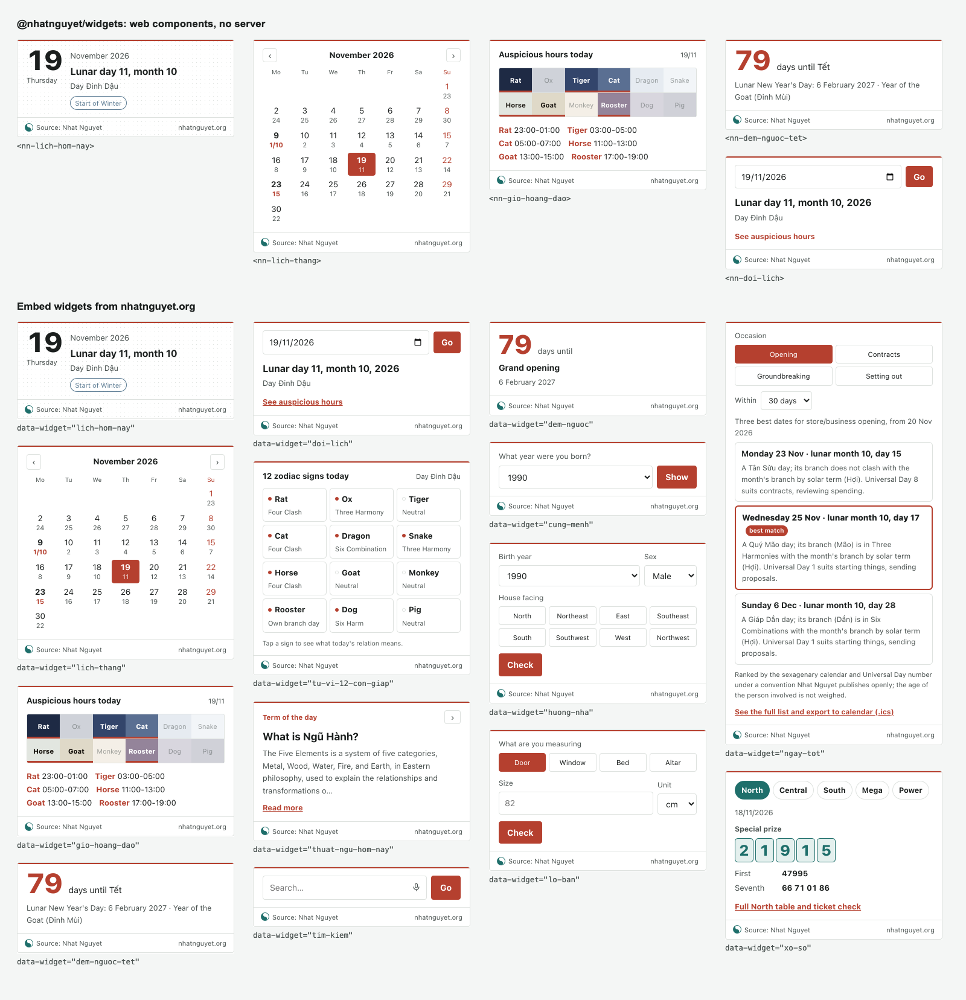

| | Runs where | Needs | Best for |
|---|---|---|---|
| **5 web components** ([`@nhatnguyet/widgets`](../js/packages/widgets)) | In the reader's browser, no server | One `<script type="module">` | Calendar basics anywhere, offline apps, sites that cannot load iframes |
| **14 embed widgets** (nhatnguyet.org) | An iframe served by nhatnguyet.org | One `<div>` and one `<script>` | Everything, including content that needs the site's data (glossary, good dates, lottery results) |

## 1. Web components that run locally

Five Custom Elements built on [`@nhatnguyet/am-lich`](../js/packages/am-lich),
the TypeScript port of the engine behind nhatnguyet.org, so the lunar dates
match the embed widgets. No framework, no network calls, styles kept inside
the Shadow DOM.

```html
<script type="module" src="https://cdn.jsdelivr.net/npm/@nhatnguyet/widgets/dist/nn-widgets.js"></script>

<nn-lich-hom-nay lang="en" theme="auto"></nn-lich-hom-nay>
<nn-lich-thang lang="en" theme="auto"></nn-lich-thang>
<nn-gio-hoang-dao lang="en" theme="auto"></nn-gio-hoang-dao>
<nn-dem-nguoc-tet lang="en" theme="auto"></nn-dem-nguoc-tet>
<nn-doi-lich lang="en" theme="auto"></nn-doi-lich>
```

| Element | Shows | Preview |
|---|---|---|
| `<nn-lich-hom-nay>` | Today's date, weekday, lunar date, day stem-branch, solar term | 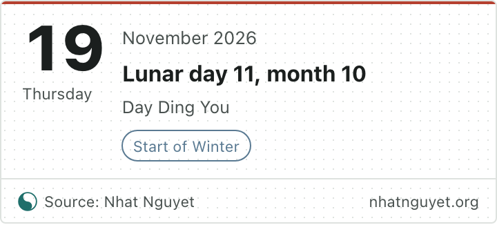 |
| `<nn-lich-thang>` | Month grid with lunar days, month navigation, day details | 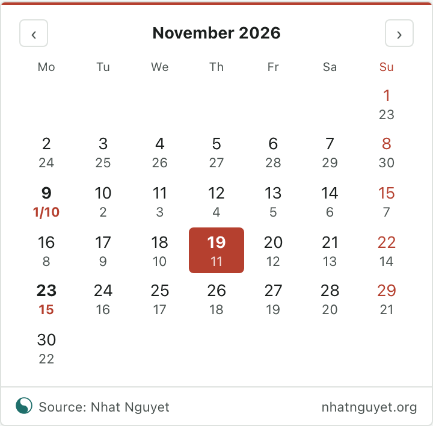 |
| `<nn-gio-hoang-dao>` | The 12 two-hour periods, auspicious ones highlighted | 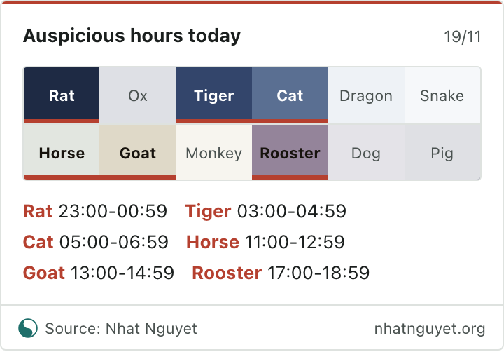 |
| `<nn-dem-nguoc-tet>` | Days until the Lunar New Year (Tết) | 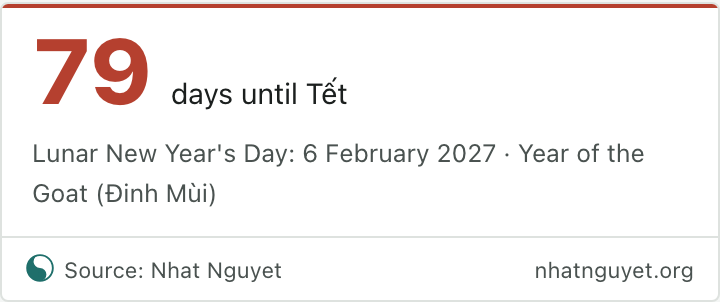 |
| `<nn-doi-lich>` | Solar to lunar date converter with that day's auspicious hours | 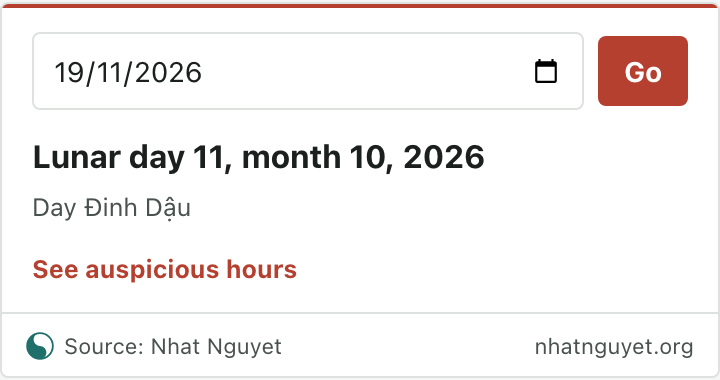 |

Attributes: `lang` (`vi`, `en`, `zh`; default: the page's `lang`, else the
browser language, else `en`), `terms` (with `lang="en"`:
`pinyin` default, `han` or `vi`, how stem-branch names are written, as the
libraries' `terms` option), `theme` (`light`, `dark`,
`auto`; default `light`), `accent` (6-digit hex), `country` (`VN` default; `CN`,
`KR`, `JP` and others switch the lunar calendar's time zone), `date`
(`YYYY-MM-DD`, pins the day), `month` (`YYYY-MM`, for `<nn-lich-thang>`). Full
documentation: [js/packages/widgets/README.md](../js/packages/widgets/README.md).
A test page with every size and theme: [js/packages/widgets/examples/index.html](../js/packages/widgets/examples/index.html).

## 2. Embed widgets served by nhatnguyet.org

Paste two lines where the widget should appear. The loader builds a sandboxed
iframe that resizes itself and sets no cookies; the natal element widget only
remembers the chosen birth year inside its own iframe. Pick options and copy the code on [nhatnguyet.org/widget](https://nhatnguyet.org/widget?lang=en).

```html
<div data-widget="lich-hom-nay" data-theme="auto" data-lang="en"></div>
<script async src="https://nhatnguyet.org/embed/w.js"></script>
```

| Widget | Preview (360 px) | Embed code | Attributes |
|---|---|---|---|
| **Today's lunar date**<br>`lich-hom-nay`<br>Solar date, lunar date, sexagenary day and solar term. It turns over daily on its own. |  | <code>&lt;div data-widget="lich-hom-nay"&gt;&lt;/div&gt;<br>&lt;script async src="https://nhatnguyet.org/embed/w.js"&gt;&lt;/script&gt;</code> | `data-theme`, `data-accent`, `data-lang`, `data-tho`, `data-size`, `data-country` |
| **Perpetual lunar calendar**<br>`lich-thang`<br>A full month grid with solar and lunar dates, marking the new and full moon. |  | <code>&lt;div data-widget="lich-thang"&gt;&lt;/div&gt;<br>&lt;script async src="https://nhatnguyet.org/embed/w.js"&gt;&lt;/script&gt;</code> | `data-theme`, `data-accent`, `data-lang`, `data-tho`, `data-size`, `data-country` |
| **Auspicious hours today**<br>`gio-hoang-dao`<br>The day's twelve two-hour periods in one strip, with the auspicious ones marked. | 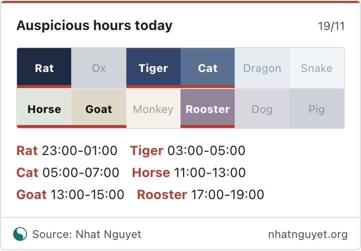 | <code>&lt;div data-widget="gio-hoang-dao"&gt;&lt;/div&gt;<br>&lt;script async src="https://nhatnguyet.org/embed/w.js"&gt;&lt;/script&gt;</code> | `data-theme`, `data-accent`, `data-lang`, `data-size`, `data-country` |
| **Countdown to Tết**<br>`dem-nguoc-tet`<br>Days left until the first of Tết, switching its message at New Year's Eve and on the day. | 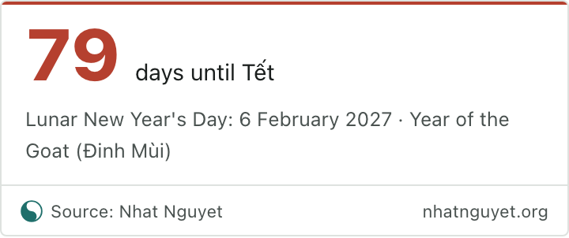 | <code>&lt;div data-widget="dem-nguoc-tet"&gt;&lt;/div&gt;<br>&lt;script async src="https://nhatnguyet.org/embed/w.js"&gt;&lt;/script&gt;</code> | `data-theme`, `data-accent`, `data-lang`, `data-size`, `data-country` |
| **Lunar date converter**<br>`doi-lich`<br>Pick a date, get the lunar date and sexagenary name, then the auspicious hours for it. | 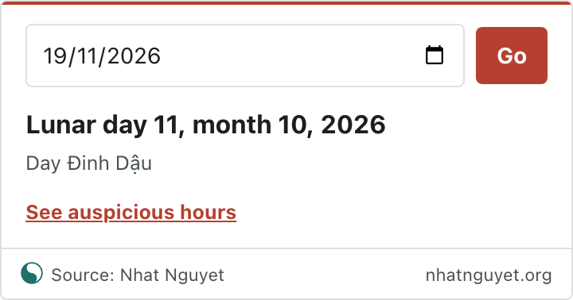 | <code>&lt;div data-widget="doi-lich"&gt;&lt;/div&gt;<br>&lt;script async src="https://nhatnguyet.org/embed/w.js"&gt;&lt;/script&gt;</code> | `data-theme`, `data-accent`, `data-lang`, `data-country` |
| **12 zodiac animals today**<br>`tu-vi-12-con-giap`<br>A grid of the twelve animals, each showing its computed relation to today's branch. | 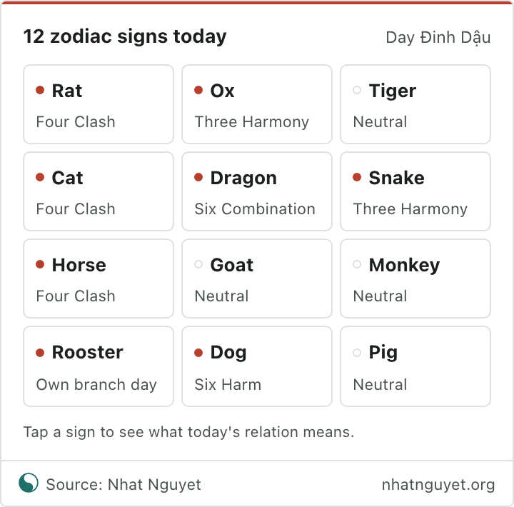 | <code>&lt;div data-widget="tu-vi-12-con-giap"&gt;&lt;/div&gt;<br>&lt;script async src="https://nhatnguyet.org/embed/w.js"&gt;&lt;/script&gt;</code> | `data-theme`, `data-accent`, `data-lang`, `data-layout`, `data-size`, `data-country` |
| **Term of the day**<br>`thuat-ngu-hom-nay`<br>One entry from the spiritual glossary with a short definition, rotating every ten minutes. | 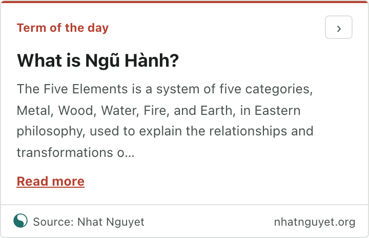 | <code>&lt;div data-widget="thuat-ngu-hom-nay"&gt;&lt;/div&gt;<br>&lt;script async src="https://nhatnguyet.org/embed/w.js"&gt;&lt;/script&gt;</code> | `data-theme`, `data-accent`, `data-lang` |
| **Search box**<br>`tim-kiem`<br>A search box that opens results on Nhat Nguyet in a new tab. | 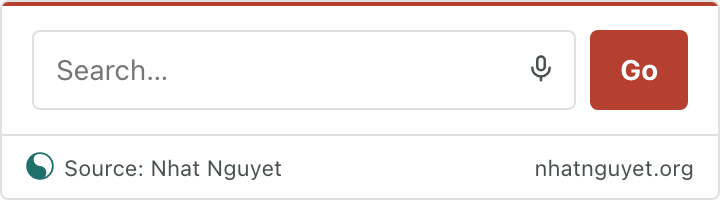 | <code>&lt;div data-widget="tim-kiem"&gt;&lt;/div&gt;<br>&lt;script async src="https://nhatnguyet.org/embed/w.js"&gt;&lt;/script&gt;</code> | `data-theme`, `data-accent`, `data-lang` |
| **Event countdown**<br>`dem-nguoc`<br>A countdown to any date you set: an opening, a launch, a founding anniversary. | 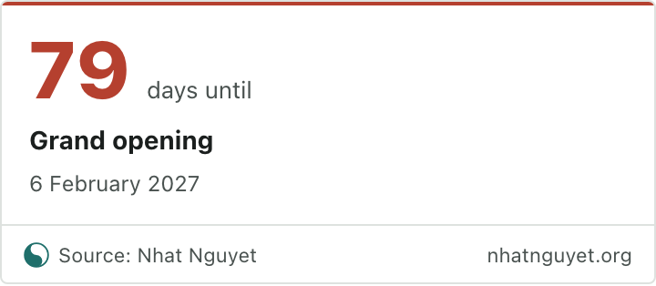 | <code>&lt;div data-widget="dem-nguoc" data-ngay-den="2027-02-06" data-ten-su-kien="Grand opening"&gt;&lt;/div&gt;<br>&lt;script async src="https://nhatnguyet.org/embed/w.js"&gt;&lt;/script&gt;</code> | `data-theme`, `data-accent`, `data-lang`, `data-size`, `data-ngay-den`, `data-ten-su-kien` |
| **Your natal element**<br>`cung-menh`<br>Pick a birth year for the Na Yin element, with its classical color and direction. | 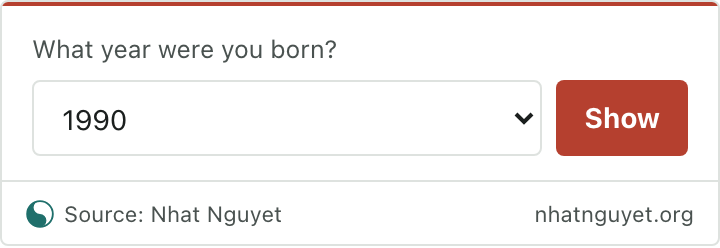 | <code>&lt;div data-widget="cung-menh"&gt;&lt;/div&gt;<br>&lt;script async src="https://nhatnguyet.org/embed/w.js"&gt;&lt;/script&gt;</code> | `data-theme`, `data-accent`, `data-lang`, `data-size` |
| **House direction check**<br>`huong-nha`<br>Property browsers check on the spot whether a house faces a direction that suits them. | 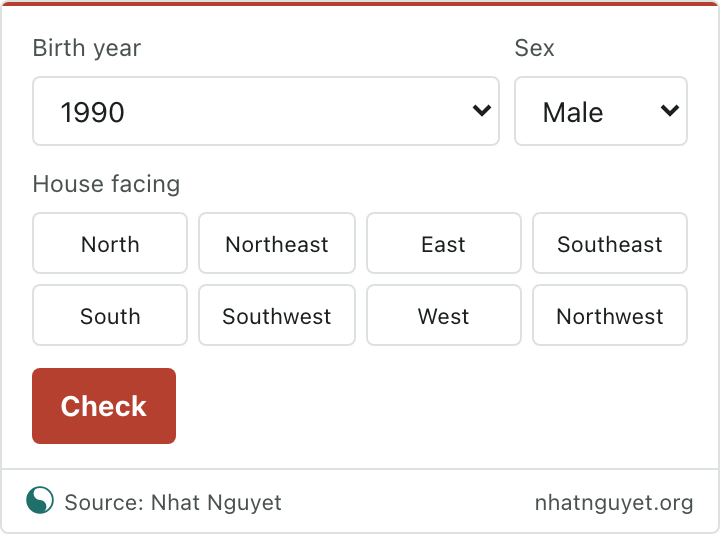 | <code>&lt;div data-widget="huong-nha"&gt;&lt;/div&gt;<br>&lt;script async src="https://nhatnguyet.org/embed/w.js"&gt;&lt;/script&gt;</code> | `data-theme`, `data-accent`, `data-lang`, `data-size`, `data-huong` |
| **Lo Ban rule mini**<br>`lo-ban`<br>Visitors check whether a door, bed or altar dimension falls in a favorable band. | 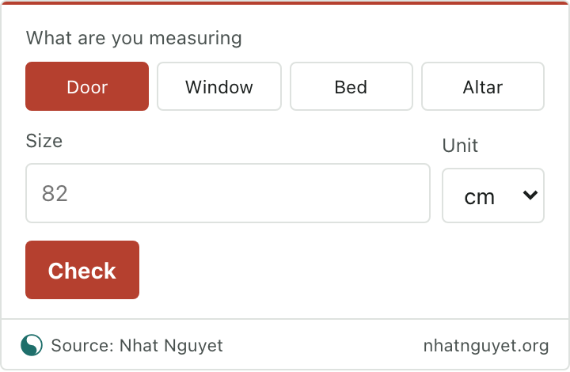 | <code>&lt;div data-widget="lo-ban"&gt;&lt;/div&gt;<br>&lt;script async src="https://nhatnguyet.org/embed/w.js"&gt;&lt;/script&gt;</code> | `data-theme`, `data-accent`, `data-lang`, `data-size` |
| **Good dates for business**<br>`ngay-tot`<br>The three best upcoming dates for an opening, a contract, groundbreaking or setting out. | 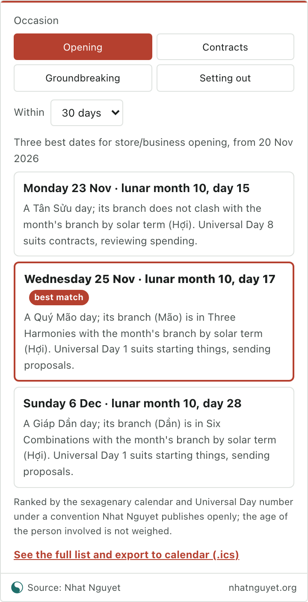 | <code>&lt;div data-widget="ngay-tot"&gt;&lt;/div&gt;<br>&lt;script async src="https://nhatnguyet.org/embed/w.js"&gt;&lt;/script&gt;</code> | `data-theme`, `data-accent`, `data-lang`, `data-size`, `data-loai-viec` |
| **Lottery results**<br>`xo-so`<br>The latest results for Vietnam's three regional lotteries and Vietlott, updated after each draw. | 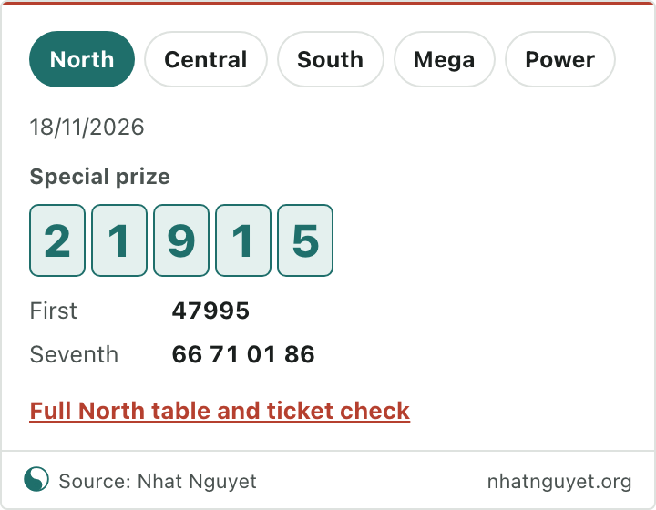 | <code>&lt;div data-widget="xo-so"&gt;&lt;/div&gt;<br>&lt;script async src="https://nhatnguyet.org/embed/w.js"&gt;&lt;/script&gt;</code> | `data-theme`, `data-accent`, `data-lang`, `data-size`, `data-kieu`, `data-loai` |

### Attributes

| Attribute | Values | Meaning |
|---|---|---|
| `data-widget` | required | The widget id, taken from that widget's embed snippet |
| `data-theme` | `light`, `dark` or `auto` | Defaults to light. `auto` follows the light or dark setting of the reader's device |
| `data-accent` | `#b5402f` | Accent color as a 6-digit hex value, to match your own branding |
| `data-lang` | `vi`, `en` or `zh` | Defaults to vi |
| `data-size` | `compact`, `standard` or `wide` | Level of detail for the width you have: compact drops secondary detail, wide lays out horizontally. Defaults to standard |
| `data-layout` | `grid` or `list` | Applies to the 12 zodiac animals widget only |
| `data-tho` | `1` or omitted | Show a Vietnamese proverb matched to the lunar month below the content (Vietnamese only) |
| `data-ngay-den` | `2027-03-15` | Target date for the event countdown, in year-month-day form. Required for that widget |
| `data-ten-su-kien` | `Branch 2 opening` | The name shown beside the count, up to 60 characters. Required for the event countdown |
| `data-huong` | `dong-nam`, `tay-bac`... | Pin the house facing for the direction widget, so the visitor only picks a birth year |
| `data-loai-viec` | `khai_truong`, `ky_hop_dong`, `dong_tho` or `xuat_hanh` | Pin the occasion for the good-dates widget, saving the visitor a tap |
| `data-loai` | `mien-bac`, `mien-trung`, `mien-nam`, `mega-6-45` or `power-6-55` | The tab the lottery results widget opens on; defaults to `mien-bac` |
| `data-kieu` | `tab`, `xoay`, `tong-hop` or `bang` | Display style of the lottery widget: by draw, rotating, all draws or full table |
| `data-country` | `VN` (default), `CN`, `TW`, `HK`, `MO`, `SG`, `MY`, `ID`, `PH`, `KR` or `JP` | Whose lunar calendar to use, for the six date widgets (today, month, hours, Lunar New Year, converter, 12 animals). Vietnam reckons the day at UTC+7, China and Chinese communities at UTC+8, Korea and Japan at UTC+9, so in some years the lunar date and New Year differ (1985: 21 January in Vietnam, 20 February in China). Outside Vietnam the fourth animal is the Rabbit, not the Cat, the New Year countdown names that country's festival (Spring Festival, Seollal, Kyū Shōgatsu) and a small line names the calendar in use |

Every widget reflows from 280 px to 1280 px: the 12 hour cells fold into two
rows below 600 px, the zodiac grid drops to two columns below 360 px, and
button rows wrap instead of scrolling. Terms of use:
[nhatnguyet.org/widget/dieu-khoan](https://nhatnguyet.org/widget/dieu-khoan?lang=en).

## Credit line

Both kinds show "Nguồn: Nhật Nguyệt" (vi), "Source: Nhat Nguyet" (en) or
"数据：Nhat Nguyet" (zh) with a link to nhatnguyet.org. Please keep it.
